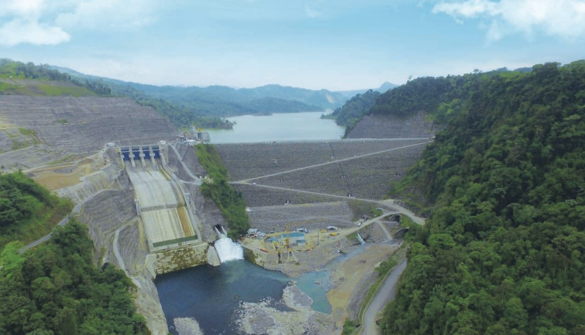
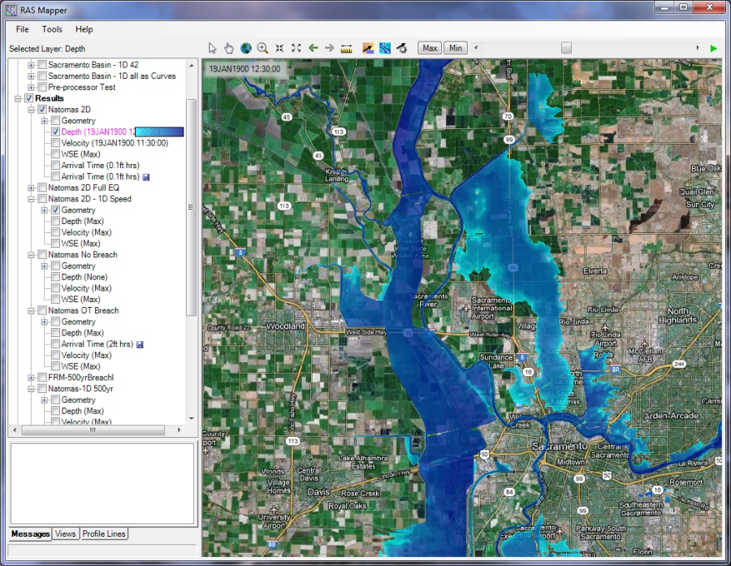

::: {.quote-block}
"El agua es la fuerza motriz de toda la naturaleza."\
— Atribuida a *Leonardo da Vinci*
:::

## ¿Qué es la hidrología? {#sec-hidrologia-definicion}

La **hidrología** es la ciencia que estudia el agua de la Tierra: dónde está, cómo circula, cómo se distribuye y cómo interactúa con el ambiente y con las actividades humanas. En términos más operativos, la hidrología convierte los fenómenos del agua en cantidades que se pueden medir y analizar con métodos físicos, empíricos o estadísticos.

En ingeniería interesa sobre todo la **hidrología aplicada**, que usa ese conocimiento para diseñar obras, gestionar el recurso hídrico, prever eventos extremos y ordenar el territorio. Con el tiempo pasó de reglas empíricas a métodos que combinan física, estadística, modelación numérica y análisis de datos. Ese cambio mejoró la capacidad de predecir caudales de crecida, caudales ambientales, recarga de acuíferos y otras variables de diseño.

En la práctica, casi todo estudio hidrológico responde a una de tres preguntas sobre un sitio: cuánta agua hay en promedio, cuánta puede llegar en una crecida y cuánta puede faltar en una sequía. La primera sirve para planificar abastecimientos, riego y generación eléctrica. La segunda, para dimensionar puentes, alcantarillas, drenajes y diques. La tercera, para dimensionar embalses y prever restricciones de uso.

Es una disciplina compartida. En un mismo estudio pueden trabajar profesionales de ingeniería, geografía, geología, meteorología, ciencias ambientales y ciencias sociales.

Entre los temas que estudia están:

- la variación de la precipitación en el tiempo y en el espacio;
- el comportamiento de las cuencas hidrográficas;
- la generación de escorrentía superficial;
- la infiltración y la recarga de acuíferos;
- el transporte de sedimentos;
- la relación del agua con el clima y la atmósfera.

## La hidrología en la ingeniería civil {#sec-hidrologia-ingenieria}

Casi toda obra que tiene que ver con agua necesita un estudio hidrológico. Entre ellas:

- sistemas pluviales y drenajes urbanos;
- puentes y alcantarillas;
- presas, embalses y canales;
- obras fluviales de control de inundaciones;
- evaluación y mitigación de amenazas hidrometeorológicas;
- análisis de los efectos del cambio climático sobre el agua.

Del estudio hidrológico salen los datos que esas obras necesitan para diseñarse: caudales de diseño, tiempos de concentración, hidrogramas, niveles de inundación y volúmenes disponibles.

```{r}
#| label: fig-DRAT
#| fig-cap: "Proyecto hidroeléctrico Reventazón. Fuente: @ICE_CostaRica."
#| fig-alt: "Presa del proyecto hidroeléctrico Reventazón en Costa Rica"
#| echo: false
#| out-width: 85%


```

## Relación con el ciclo hidrológico {#sec-hidrologia-ciclo}

El **ciclo hidrológico** es el movimiento continuo del agua en la Tierra y es la base de cualquier análisis hidrológico. Sus procesos principales son:

- evaporación y transpiración;
- condensación y formación de nubes;
- precipitación;
- infiltración y percolación;
- escorrentía superficial;
- flujo subterráneo;
- retorno al océano.

Entender cómo se encadenan esos procesos es lo que permite modelar la respuesta de una cuenca ante una tormenta, un cambio en el uso del suelo o una variación del clima. El ciclo se estudia en detalle a partir de la @sec-ciclo-fundamentos.

## Desarrollo histórico de la hidrología {#sec-hidrologia-historia}

La línea de tiempo reúne algunos hitos que marcaron el paso de la especulación a la hidrología cuantitativa. Cada fecha corresponde a la publicación original del método o de la ecuación, que se retoma en el capítulo donde se usa.

::: {.timeline}

::: {.timeline-item}
<div class="timeline-era">≤ Siglo XV</div>
<div class="timeline-title">Especulación y primeras descripciones del ciclo hidrológico</div>

- Filósofos persas, chinos, indios y griegos se preguntan por el origen del agua de los ríos.
- Aparecen las primeras ideas sobre la relación entre lluvia, escorrentía y cuerpos de agua.
- En el Renacimiento, científicos europeos hacen **las primeras descripciones coherentes del ciclo hidrológico** a partir de observaciones.
:::

::: {.timeline-item}
<div class="timeline-era">Siglos XVII–XVIII</div>
<div class="timeline-title">Inicio de la medición y la experimentación</div>

- Se desarrollan las primeras mediciones sistemáticas de **caudales** (por ejemplo, en el río Sena, Francia).
- Comienza la medición continua de **precipitación** en Inglaterra y de evaporación en el Mediterráneo.
- Se formaliza la **hidráulica experimental**, con aportes de Bernoulli, Chézy y otros.
:::

::: {.timeline-item}
<div class="timeline-era">Siglo XIX</div>
<div class="timeline-title">Desarrollo de principios en hidrología e hidráulica</div>

- **Ley de Dalton (1802):** descripción de la evaporación.
- **Ecuación de Hagen–Poiseuille (1840):** flujo laminar en capilares.
- **Ecuación Darcy–Weisbach (1845):** flujo en tuberías.
- **Método racional (Mulvaney, 1850):** cálculo de caudales de escorrentía a partir de la precipitación.
- **Ecuación de Darcy (1856):** flujo en medios porosos saturados.
- Primeros pronósticos del tiempo publicados, de Robert FitzRoy en Inglaterra (1861).
- Construcción del alcantarillado de Londres (Bazalgette, 1875) como hito de la ingeniería sanitaria.
- **Ecuación de Manning (1891):** descripción del flujo en canales abiertos.
:::

::: {.timeline-item}
<div class="timeline-era">Siglo XX</div>
<div class="timeline-title">Consolidación de la hidrología cuantitativa</div>

- **Ecuación de Green y Ampt (1911):** modelo de infiltración en suelos.
- **Curvas de frecuencia (Hazen, 1914):** análisis probabilístico de crecientes máximas.
- **Ecuación de Richards (1931):** flujo en medio poroso parcialmente saturado.
- **Hidrograma unitario (Sherman, 1932):** conversión de precipitación en escorrentía.
- **Ecuación de Theis (1935):** flujo en acuíferos confinados.
- **Leyes de Horton (1945):** descripción morfológica y funcional de cuencas.
- **Gumbel (1958):** fundamentos de la teoría de valores extremos aplicados a hidrología.
:::

::: {.timeline-item}
<div class="timeline-era">Siglos XX → XXI</div>
<div class="timeline-title">Evolución hacia modelos numéricos y sistemas integrados</div>

Con la llegada de las computadoras, desde la década de 1960, los modelos conceptuales se complementan y, en muchos casos, se reemplazan por modelos numéricos:

- **Stanford Watershed Model** (1966), uno de los primeros modelos de simulación continua de cuencas.
- Modelos de base física como los de la **familia SHE** (*Système Hydrologique Européen*).
- Acoplamiento de modelos hidrológicos y atmosféricos.

Surgen además:

- La **operación en tiempo real** de embalses, drenajes urbanos y sistemas de alerta de inundaciones.
- Una hidrología **interdisciplinaria y global**, apoyada en la computación, la teledetección, los sensores automáticos y la estadística.
:::

:::

## Hidrología y estadística {#sec-hidrologia-estadistica}

La lluvia y el caudal de un año no se repiten al siguiente. Por esa variabilidad, la estadística es una herramienta de trabajo diaria en hidrología. Se usa para:

- ajustar distribuciones de probabilidad a eventos extremos;
- analizar series de tiempo de precipitación y caudal;
- regionalizar, es decir, trasladar información de cuencas con datos a cuencas sin datos;
- construir modelos de regresión para estimar variables hidrológicas;
- agrupar estaciones o cuencas con comportamientos parecidos.

Con R, ajustar varias distribuciones a una serie de máximos anuales y compararlas con pruebas de bondad de ajuste toma unos segundos. A mano, ese mismo análisis tomaba días y por eso casi nunca se hacía completo. Este libro usa R en los ejemplos por esa razón.

## Un caso aplicado: las inundaciones {#sec-hidrologia-inundaciones}

Las inundaciones son el fenómeno hidrológico con más consecuencias para la planificación y la gestión del riesgo. Para reducir pérdidas hay que saber qué las causa, qué tan grandes pueden ser y con qué frecuencia ocurren. Esas preguntas se responden con los métodos de este libro: análisis de frecuencia de lluvias y caudales, modelos de lluvia-escorrentía y modelos hidráulicos como el de la @fig-inundacion.

```{r}
#| label: fig-inundacion
#| fig-cap: "Modelación de una inundación con HEC-RAS. Fuente: @USACE_HECRAS."
#| fig-alt: "Mapa de manchas de inundación generado con el programa HEC-RAS"
#| echo: false
#| out-width: 60%


```

## Hidrología en Costa Rica {#sec-hidrologia-costa-rica}

En Costa Rica, la medición, la investigación y la gestión del agua están repartidas entre instituciones públicas, universidades, empresas privadas y organismos internacionales.

<div class="cr-hidro-grid">

<div class="cr-card cr-public">
<h3>ICE</h3>
<p>
Responsable de la mayor parte de la generación eléctrica del país. Mantiene una red de medición de <strong>precipitación y caudal</strong> y hace estudios y modelos hidrológicos para diseñar y operar sus plantas hidroeléctricas, como Reventazón, Arenal, Cachí y Pirrís.
</p>
</div>

<div class="cr-card cr-public">
<h3>SENARA</h3>
<p>
Estudia y protege las aguas subterráneas. Usa la hidrología y la hidrogeología para diseñar y operar sistemas de <strong>riego, drenaje y aprovechamiento de aguas subterráneas</strong>.
</p>
</div>

<div class="cr-card cr-public">
<h3>AyA</h3>
<p>
Responsable del <strong>abastecimiento de agua potable</strong> y del <strong>tratamiento de aguas residuales</strong>. Hace mediciones hidrológicas para sus captaciones y opera sistemas como el abastecimiento de la Gran Área Metropolitana y la planta de tratamiento Los Tajos.
</p>
</div>

<div class="cr-card cr-public">
<h3>MINAE</h3>
<p>
Ministerio a cargo de los <strong>recursos hídricos, costeros y marinos</strong>. Define políticas, otorga las concesiones de agua y coordina la conservación.
</p>
</div>

<div class="cr-card cr-public">
<h3>IMN</h3>
<p>
Órgano adscrito al MINAE que coordina las <strong>actividades meteorológicas</strong> del país. Estudia el tiempo y el clima, hace pronósticos y emite avisos ante fenómenos atmosféricos extremos.
</p>
</div>

<div class="cr-card cr-public">
<h3>CNE</h3>
<p>
Atiende las <strong>emergencias</strong>, entre ellas las hidrometeorológicas como inundaciones, deslizamientos y tormentas, y coordina el Sistema Nacional de Gestión del Riesgo.
</p>
</div>

<div class="cr-card cr-academic">
<h3>Universidades públicas y centros de investigación</h3>
<p>
<strong>UCR:</strong> Ingeniería Civil, Ingeniería en Biosistemas, Geología, Geografía, Meteorología (Física), CIMAR, IMARES, CIGEFI, CIEDES, OACG.  
<strong>ITCR:</strong> Ingeniería Agrícola, Ingeniería Ambiental.  
<strong>UNA:</strong> Ingeniería Hidrológica, Escuela de Geografía, Laboratorio de Hidrología Ambiental.  
<strong>Otros centros:</strong> EARTH, IICA, CATIE, entre otros.
</p>
</div>

<div class="cr-card cr-private">
<h3>Sector privado y consultoría</h3>
<p>
<strong>Empresas consultoras</strong> hacen estudios hidrológicos para infraestructura, ordenamiento territorial y gestión del riesgo.  
<strong>Generadores hidroeléctricos privados</strong> diseñan y operan plantas de generación.  
El <strong>sector agrícola</strong>, como las bananeras y piñeras, usa información hidrológica para riego, drenaje y manejo de inundaciones.
</p>
</div>

</div>

<p class="cr-international-note">
Otras instituciones también usan o generan información hidrológica, como el Ministerio de Salud, la SETENA y las municipalidades. En el plano internacional, organismos de las Naciones Unidas como la <strong>UNESCO</strong>, la <strong>OMM</strong> y <strong>ONU-Agua</strong> coordinan programas, publican guías técnicas y promueven la investigación en recursos hídricos.
</p>

