::: quote-block
"Nunca sabremos el valor del agua hasta que el pozo esté seco."\
— *Thomas Fuller, Gnomologia (1732)*
:::

## El agua en la Tierra {#sec-disponibilidad-hidrosfera}

El agua regula el clima, participa en los ciclos biogeoquímicos, transporta sedimentos, nutrientes y energía, y condiciona dónde y cómo se desarrollan los ecosistemas y las actividades humanas.

Toda el agua de la atmósfera, el suelo, los océanos y la corteza terrestre forma la **hidrosfera** (@fig-hidrosfera). De ese volumen, **solo cerca del 2.5 % es agua dulce**, y apenas una fracción muy pequeña de ella se puede aprovechar directamente.

```{r}
#| label: fig-hidrosfera
#| fig-cap: "Principales reservorios de agua de la hidrosfera. Fuente: @usgsHydrosphere."
#| fig-alt: "Esquema con la proporción de agua salada, agua dulce y sus reservorios principales"
#| echo: false

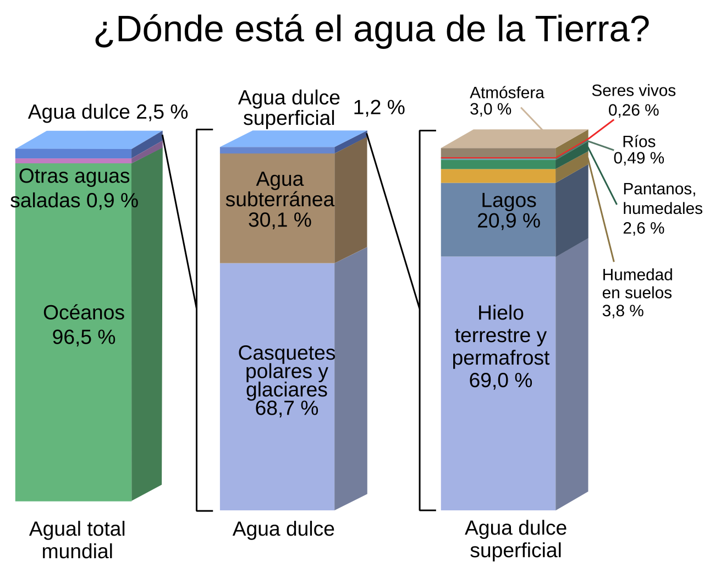
```

## Distribución global del agua {#sec-disponibilidad-distribucion}

Los océanos guardan cerca del 96.5 % del agua del planeta (@tbl-distribucion-agua). Del agua dulce, casi todo está en glaciares, casquetes polares y acuíferos. Los ríos, lagos y humedales tienen menos del **0.5 % del agua dulce**, y sin embargo son la fuente de la mayor parte del agua que se usa.

<!-- VERIFICAR: los tiempos de residencia del cuadro (20 000 años para el agua subterránea, 17 días para los ríos) no coinciden con los que se dan más adelante en el texto (1400 a 10 000 años, 16 días). Confirmar en la fuente y unificar. -->

```{r}
#| label: tbl-distribucion-agua
#| tbl-cap: "Volumen, porcentaje y tiempo de residencia de los principales reservorios de agua en la Tierra."
#| echo: false
#| message: false
#| warning: false

library(dplyr)
library(kableExtra)
library(tibble)

tabla_agua <- tribble(
  ~`Fuente de agua`, ~`Volumen`, ~`Porcentaje del total`, ~`Porcentaje del agua dulce`, ~`Tiempo de residencia (años)`,
  "Agua en los continentes (total)", "47 971 710",   3.5,    NA,    "Todas las aguas superficiales: 4.0<br>0.05 (17 días)",
  "Lagos (dulces)",             "91 000",            0.007,  0.26,  "Todas las aguas superficiales: 4.0<br>0.05 (17 días)",
  "Lagos (salobres)",           "85 400",            0.006,  NA,    "Todas las aguas superficiales: 4.0<br>0.05 (17 días)",
  "Ríos",                       "2 120",             0.0002, 0.006, "Todas las aguas superficiales: 4.0<br>0.05 (17 días)",
  "Pantanos",                   "11 470",            0.0008, 0.03,  "Todas las aguas superficiales: 4.0<br>0.05 (17 días)",
  "Humedad del suelo",          "16 500",            0.0012, 0.05,  "Todas las aguas subterráneas: 20 000",
  "Agua subterránea dulce*",    "10 530 000*",       0.76,   30.1,  "Todas las aguas subterráneas: 20 000",
  "Agua subterránea salobre",   "12 870 000",        0.93,   NA,    "Todas las aguas subterráneas: 20 000",
  "Agua biológica",             "1 120",             0.0001, 0.003, "",
  "Hielo polar y glaciares",    "24 364 100",        1.76,   69.6,  "",
  "Atmósfera",                  "12 900",            0.001,  0.04,  "0.02 (8 días)",
  "Océanos",                    "1 338 000 000",     96.5,   NA,    "2 650",
  "Total",                      "1 385 984 610",     100.0,  100.0, ""
)

tabla_agua %>%
  kbl(
    booktabs = TRUE,
    format = "html",
    align = c("l", "c", "c", "c", "c"),
    escape = FALSE,
    na = "",
    col.names = c(
      "Fuente de agua",
      "Volumen (km<sup>3</sup>)",
      "Porcentaje del total",
      "Porcentaje del agua dulce",
      "Tiempo de residencia (años)"
    )
  ) %>%
  kable_classic(html_font = "Latin Modern Roman") %>%
  kable_styling(
    full_width = FALSE,
    bootstrap_options = c("hover", "condensed", "striped")
  ) %>%
  row_spec(0, bold = TRUE) %>%
  row_spec(c(1, 6, 11, 12, 13), bold = TRUE) %>%
  row_spec(c(2, 3, 7, 8), italic = TRUE) %>%
  row_spec(5, extra_css = "border-bottom: 2px solid black;") %>%
  row_spec(8, extra_css = "border-bottom: 2px solid black;") %>%
  collapse_rows(
    columns = 5,
    valign = "middle"
  )


```

Fuente: @maidment1993handbook.

::: {.callout-note title="Ejemplo: cuánta agua dulce está en ríos y lagos"}
Con los volúmenes del @tbl-distribucion-agua, calcule qué porcentaje del agua dulce está en lagos de agua dulce, ríos y pantanos, y qué lámina de agua formaría el volumen de los ríos si se repartiera sobre todos los continentes, que suman unos 149 millones de km².

**Pseudocódigo**

1. Escribir el volumen de cada reservorio de agua dulce.
2. Sumar el total de agua dulce.
3. Calcular el porcentaje del agua superficial (lagos dulces, ríos y pantanos).
4. Dividir el volumen de los ríos entre el área de los continentes y pasar a milímetros.

```{r}
#| label: ej-disponibilidad-agua-dulce
#| code-fold: false

library(tidyverse)

# 1) Volumen de los reservorios de agua dulce (km³)
agua_dulce <- tibble(
  reservorio = c("Lagos dulces", "Ríos", "Pantanos", "Humedad del suelo",
                 "Agua subterránea dulce", "Agua biológica",
                 "Hielo polar y glaciares", "Atmósfera"),
  volumen_km3 = c(91000, 2120, 11470, 16500, 10530000, 1120, 24364100, 12900)
)

# 2) Total de agua dulce
total_dulce <- sum(agua_dulce$volumen_km3)

# 3) Porcentaje en lagos, ríos y pantanos
superficial <- agua_dulce %>%
  filter(reservorio %in% c("Lagos dulces", "Ríos", "Pantanos")) %>%
  summarise(volumen_km3 = sum(volumen_km3)) %>%
  pull(volumen_km3)
porcentaje_superficial <- 100 * superficial / total_dulce

# 4) Lámina de los ríos sobre los continentes (km³ / km² = km; × 1e6 = mm)
lamina_rios_mm <- 2120 / 149e6 * 1e6

round(c(total_dulce_km3 = total_dulce,
        porcentaje_superficial = porcentaje_superficial,
        lamina_rios_mm = lamina_rios_mm), 2)
```

**Interpretación.** De unos 35 millones de km³ de agua dulce, apenas el 0.3 % está en lagos, ríos y pantanos, que son las fuentes de donde se toma la mayor parte del agua que se usa. El agua de todos los ríos del mundo, repartida sobre los continentes, formaría una lámina de solo 14 mm. Los ríos pueden abastecer tanto porque su agua se renueva continuamente con la lluvia, no porque guarden mucha.
:::

## Disponibilidad efectiva del recurso hídrico {#sec-disponibilidad-efectiva}

Que haya agua no significa que se pueda usar. La disponibilidad depende también de dónde está, de su calidad, de cómo varía en el tiempo y de la capacidad técnica, institucional y económica de cada región para captarla, almacenarla y distribuirla.

En hidrología, la **disponibilidad** es la parte del recurso que se puede aprovechar de forma sostenible. Para estimarla se considera:

-   la oferta natural (precipitación, escorrentía, almacenamiento superficial y subterráneo),
-   la demanda (doméstica, agrícola, industrial y ambiental),
-   las limitaciones hidrogeológicas (permeabilidad, gradientes, recarga),
-   y las restricciones ecológicas, como los caudales ambientales necesarios para mantener los ecosistemas acuáticos.

Por eso, aunque a escala planetaria hay agua suficiente, millones de personas sufren estrés hídrico cada año.

## Variabilidad espacial del recurso hídrico {#sec-disponibilidad-espacial}

El agua dulce accesible cambia mucho de una región a otra. Las diferencias las controlan la circulación atmosférica de gran escala, las cordilleras, las corrientes oceánicas y la estacionalidad de la lluvia. A escala mundial se distinguen tres tipos de regiones:

-   Regiones húmedas y tropicales, con alta precipitación anual y recarga abundante (por ejemplo, cuencas amazónica, congoleña y del sudeste asiático).
-   Regiones semiáridas, donde la precipitación es estacional o limitada (por ejemplo, cuencas del Mediterráneo, sur de África y parte de Centroamérica).
-   Regiones áridas, donde la evaporación supera ampliamente la precipitación (por ejemplo, norte de África, Medio Oriente y Australia central).

A escala de país y de cuenca, la disponibilidad varía por cuatro razones principales:

- **Clima regional.** En Centroamérica, la Zona de Convergencia Intertropical y los vientos alisios generan contrastes entre el Caribe, húmedo todo el año, y el Pacífico Norte, con una estación seca marcada.
- **Relieve.** Las cordilleras producen lluvia orográfica en barlovento y condiciones más secas en sotavento, como ocurre entre las vertientes Caribe y Pacífica de Costa Rica.
- **Cercanía a grandes cuerpos de agua.** Las zonas cercanas al océano, a grandes lagos o a embalses tienen más humedad disponible que las zonas continentales alejadas.
- **Geología.** Los acuíferos en formaciones volcánicas o aluviales permeables almacenan mucha agua. Las rocas poco permeables limitan la infiltración y el almacenamiento subterráneo.

Por eso dos cuencas vecinas pueden comportarse muy distinto.

## Recurso, disponibilidad y accesibilidad {#sec-disponibilidad-conceptos}

Tres términos se usan a menudo como sinónimos, pero no lo son:

-   **Recurso hídrico:** todo el volumen de agua de un sistema natural o artificial, se pueda usar o no (océanos, glaciares, acuíferos, lagos, ríos, embalses).
-   **Disponibilidad hídrica:** la parte del recurso que se puede usar en un lugar y un periodo dados, considerando su renovación natural y las restricciones físicas del sistema.
-   **Accesibilidad:** las condiciones de infraestructura, tecnología, costo y marco legal e institucional que permiten o impiden usar el agua disponible.


Con esta distinción se entiende por qué regiones con mucha agua pueden tener problemas de abastecimiento, mientras otras con poca logran cubrir su demanda gracias a una buena gestión.

El Pacífico Norte de Costa Rica es un ejemplo. En la estación lluviosa los ríos llevan mucha agua, pero en la seca pasan meses casi sin lluvia (@fig-marimba). Como la lluvia se concentra en pocos meses y hay poca capacidad de almacenamiento y regulación, el agua de la estación lluviosa no se puede guardar para la seca. El resultado es escasez recurrente, aunque el volumen anual de agua no sea bajo.

```{r}
#| label: fig-marimba
#| fig-cap: "Estacionalidad del río Abangares, Guanacaste. Fuente: @CIEDES_UCR."
#| fig-alt: "Fotografía del cauce del río Abangares en estación seca y lluviosa"
#| echo: false

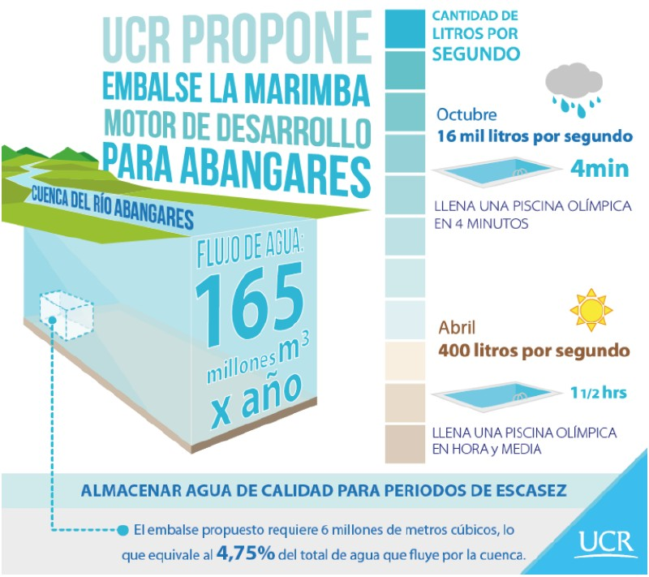

```

## Escalas de análisis {#sec-disponibilidad-escalas}

La respuesta a cuánta agua hay depende de la escala a la que se pregunte:

-   **Escala global:** muestra la distribución general del agua y los grandes contrastes del planeta (@fig-sequia).
-   **Escala regional o nacional:** combina el clima, la fisiografía y la gestión.
-   **Escala de cuenca:** es la escala de trabajo de la ingeniería civil, porque en ella ocurren los procesos que importan para el diseño y la planificación.
-   **Escala temporal:** la disponibilidad se puede evaluar por año, estación, mes o día, según el objetivo del estudio.


```{r}
#| label: fig-sequia
#| fig-cap: "Sequía normalizada en América Latina y el Caribe. Fuente: @UNESCO_AtlasSequia2018."
#| fig-alt: "Mapa del índice de sequía normalizado en América Latina y el Caribe"
#| echo: false

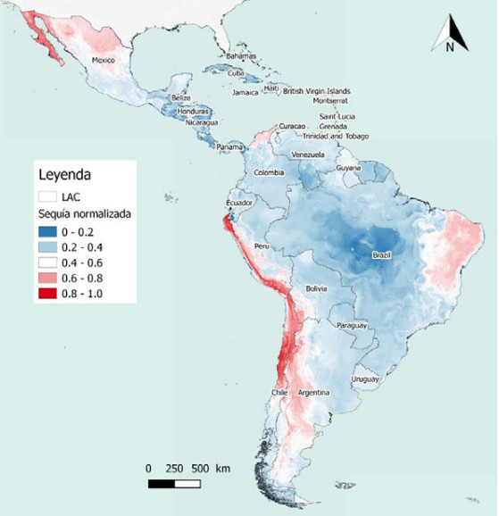

```

### Escalas temporales {#sec-disponibilidad-escalas-tiempo}

La precipitación y el caudal se registran en intervalos que van de minutos a años. Qué procesos del ciclo hidrológico importan depende de la escala temporal del análisis, y eso se nota sobre todo al elegir qué simular.

El **tiempo de residencia**, el tiempo medio que el agua pasa en un compartimento, cambia mucho entre componentes:

-   **Agua subterránea:** de unos 1400 a más de 10 000 años.
-   **Humedad del suelo:** del orden de 1 año.
-   **Ríos:** cerca de 16 días.
-   **Atmósfera:** unos 8 días.

En un modelo, el **intervalo de cálculo** $\Delta t$ debe ser lo bastante corto para captar la variación que importa, sin multiplicar sin necesidad los datos que hay que reunir ni el tiempo de cálculo. Para la operación de un embalse grande de abastecimiento basta un paso semanal o mensual. Para el caudal de diseño de un puente hacen falta pasos de minutos u horas.

### Escalas espaciales {#sec-disponibilidad-escalas-espacio}

Las escalas espaciales van de la ladera a la cuenca, la región, el continente y el planeta. Los sistemas de información geográfica (SIG) son la forma habitual de almacenar y analizar la información espacial en todas ellas (@fig-qgis_hidro).

```{r}
#| label: fig-qgis_hidro
#| fig-cap: "Uso de SIG en hidrología. Fuente: @QGIS_Development_Team_2024."
#| fig-alt: "Captura de un proyecto de QGIS con capas hidrológicas de una cuenca"
#| echo: false

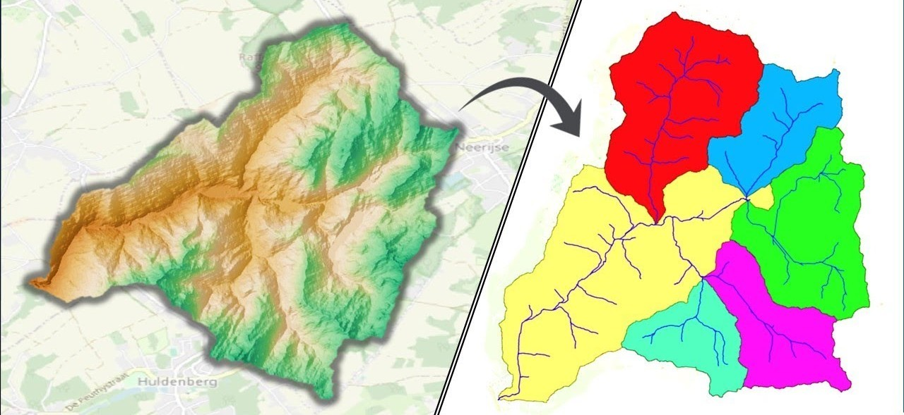

```

A escala global, los satélites dan cobertura continua (@fig-ospo). Su resolución es de unos pocos kilómetros para los sensores visibles e infrarrojos y de decenas de kilómetros para los de microondas pasivas. En un modelo, la resolución espacial define cuánta de la variación del terreno y de la lluvia se representa explícitamente.

```{r}
#| label: fig-ospo
#| fig-cap: "Observación satelital de la precipitación. Fuente: @NOAA_OSPO."
#| fig-alt: "Mapa satelital de estimación de precipitación"
#| echo: false

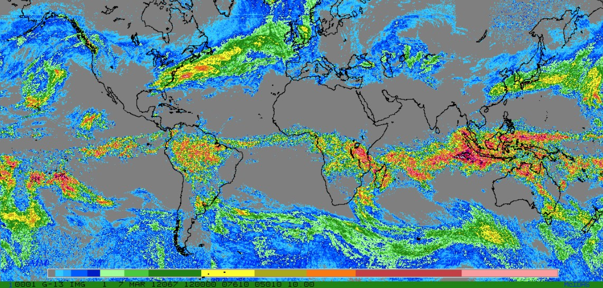

```

Cuanto más pequeñas son las escalas de espacio y tiempo, más datos hacen falta para predecir bien. A escalas pequeñas, la **heterogeneidad** y la **complejidad** de los procesos son mayores. A escalas grandes, como la escala sinóptica^[Fenómenos atmosféricos de cientos a miles de kilómetros y de varios días de duración, como frentes, ciclones y sistemas de alta y baja presión.], esa heterogeneidad se promedia y la respuesta del sistema se simplifica.

### Dificultades de medición {#sec-disponibilidad-medicion}

Los procesos hidrológicos ocurren a escalas que no siempre coinciden con las de medición. Un pluviómetro mide la lluvia en un punto, pero el diseño necesita la lluvia sobre toda la cuenca. Pasar de una a otra exige interpolar, por ejemplo con isoyetas (@fig-isoyeta).

```{r}
#| label: fig-isoyeta
#| fig-cap: "Mapa de isoyetas. Fuente: @IMN_CostaRica."
#| fig-alt: "Mapa de Costa Rica con curvas de igual precipitación anual"
#| echo: false

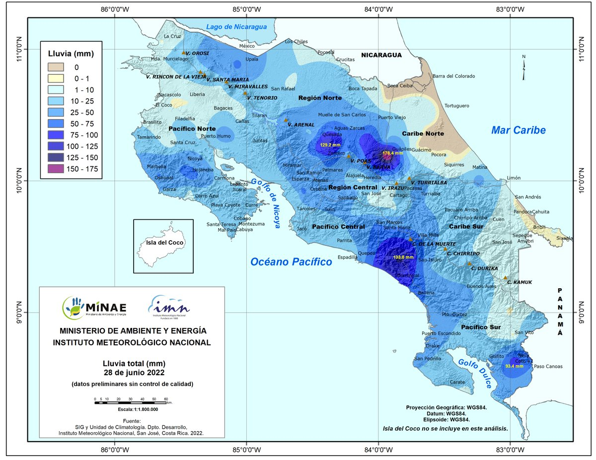

```

Ante la falta de datos se suele trabajar por niveles. Los conjuntos de datos globales dan información general a bajo costo. Los datos locales de alta resolución, como los aforos (@fig-aforo), requieren campañas de medición específicas y cuestan mucho más.

```{r}
#| label: fig-aforo
#| fig-cap: "Aforo de caudales. Fuente: @CIEDES_UCR."
#| fig-alt: "Fotografía de un aforo de caudal en un río"
#| echo: false

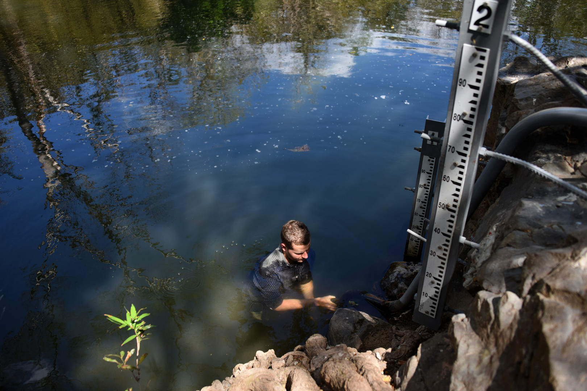

```

La **regionalización hidrológica** une los dos niveles: agrupa cuencas con comportamiento parecido (@fig-region) y estima la respuesta de las cuencas sin mediciones a partir de las que sí tienen.

```{r}
#| label: fig-region
#| fig-cap: "Regiones hidrológicas homogéneas. Fuente: @USACE_IWR."
#| fig-alt: "Mapa de regiones hidrológicas homogéneas"
#| echo: false

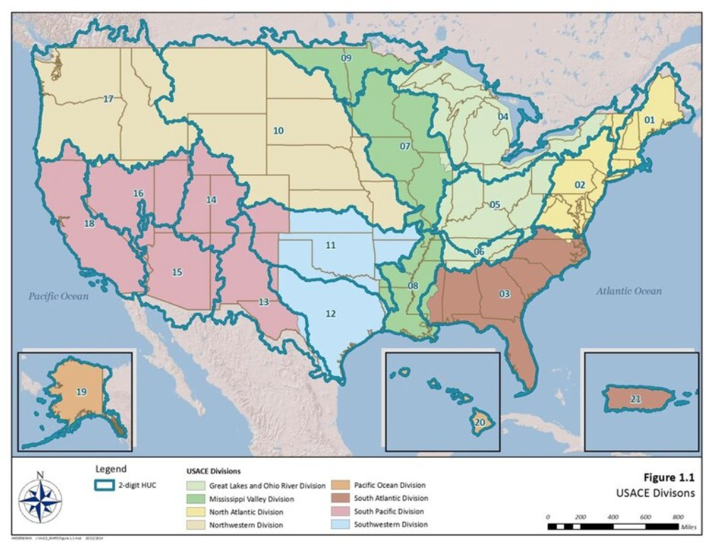

```

La escala funciona como un lente. Vista de lejos, a escala global o anual, la disponibilidad se ve como un promedio suave. Vista de cerca, a escala local o diaria, aparece toda su variabilidad.

## Disponibilidad y calidad del agua {#sec-disponibilidad-calidad}

La disponibilidad también depende de la **calidad**. Un agua contaminada no sirve para ciertos usos aunque haya mucha. Los factores que más limitan son:

-   salinidad y mineralización,
-   presencia de contaminantes orgánicos o metales pesados,
-   carga de sedimentos,
-   temperatura del agua.

Estas restricciones reducen el agua disponible para consumo humano, riego, industria o conservación, aun en regiones con mucha agua.

## Variabilidad temporal y confiabilidad {#sec-disponibilidad-confiabilidad}

Para la gestión y el diseño, la disponibilidad se analiza junto con su variabilidad en el tiempo:

-   **Estacionalidad:** la lluvia se concentra en pocos meses del año (@fig-estacionalidad).

```{r}
#| label: fig-estacionalidad
#| fig-cap: "Estacionalidad de Costa Rica. Fuente: @UCR_Fisica."
#| fig-alt: "Mapa de la estacionalidad de la lluvia en Costa Rica"
#| echo: false

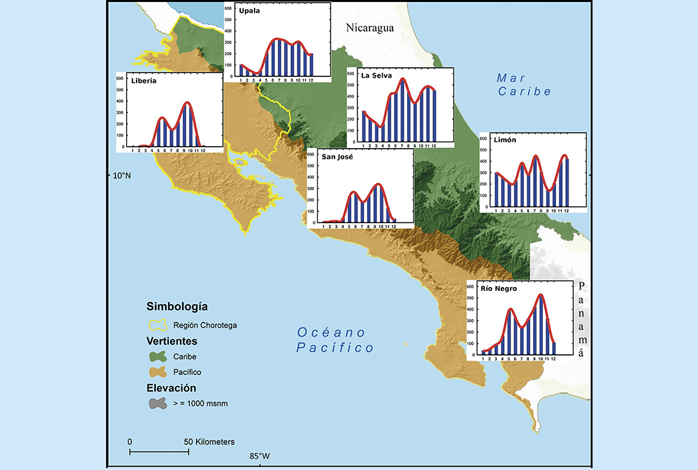

```

-   **Eventos extremos:** sequías, y en el otro extremo tormentas y huracanes como Otto en 2016 (@fig-otto).

```{r}
#| label: fig-otto
#| fig-cap: "Impacto del huracán Otto en Costa Rica. Fuente: @NOAA_OSPO."
#| fig-alt: "Imagen satelital del huracán Otto sobre Centroamérica"
#| echo: false

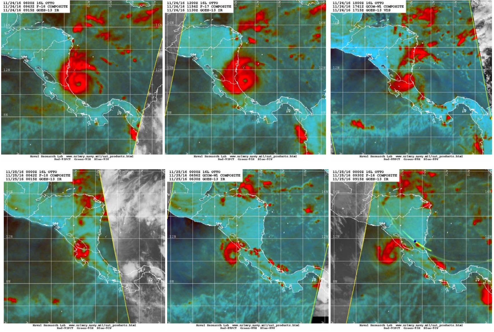

```

-   **Persistencia:** varios años seguidos con déficit o con exceso de agua, como los asociados a El Niño-Oscilación del Sur (@fig-enos).

```{r}
#| label: fig-enos
#| fig-cap: "El Niño-Oscilación del Sur. Fuente: @NOAA_PSL."
#| fig-alt: "Gráfico de anomalías de temperatura del Pacífico asociadas a El Niño-Oscilación del Sur"
#| echo: false

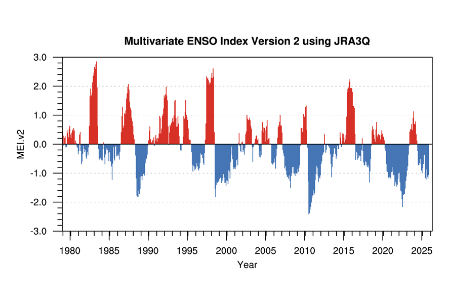

```

Estas características definen la **confiabilidad** del recurso, es decir, la probabilidad de satisfacer una demanda dada a lo largo del tiempo. Es el concepto con el que se dimensionan los embalses y las captaciones. En el capítulo siguiente hay un ejemplo de cálculo con la operación mensual de un embalse (@fig-ciclo-embalse).


## Implicaciones para la ingeniería civil {#sec-disponibilidad-ingenieria}

La evaluación de la disponibilidad hídrica es la base de:

-   el diseño de sistemas de abastecimiento de agua potable,
-   la planificación de sistemas de riego,
-   la gestión de embalses y obras de regulación,
-   la evaluación de proyectos hidroeléctricos,
-   la mitigación del riesgo asociado a sequías.

Si se estima mal, el resultado son obras sobredimensionadas o insuficientes, fallas de operación y conflictos por el uso del agua.



