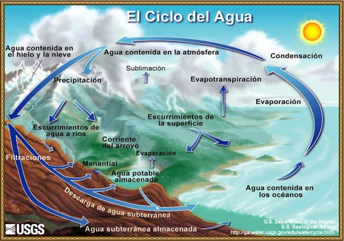
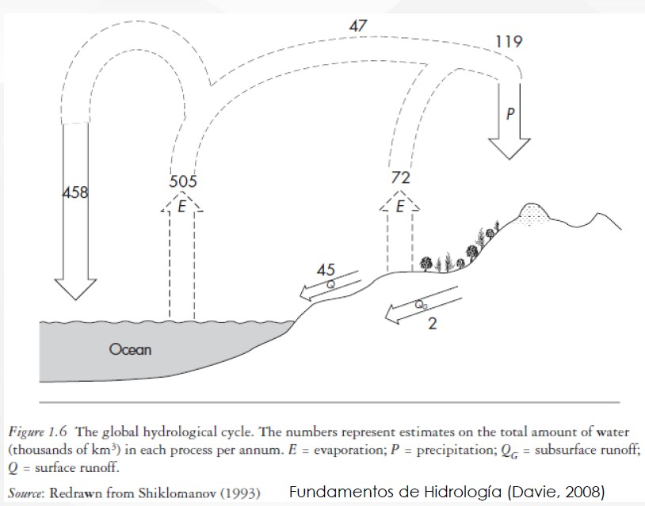
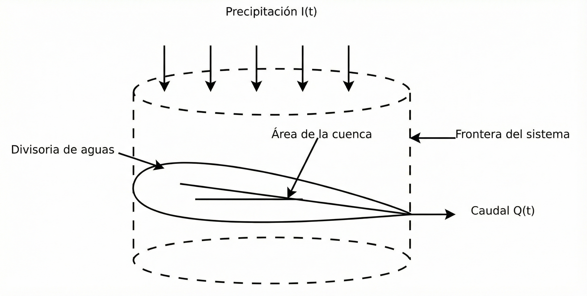
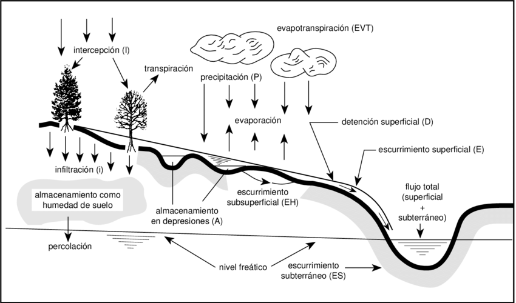
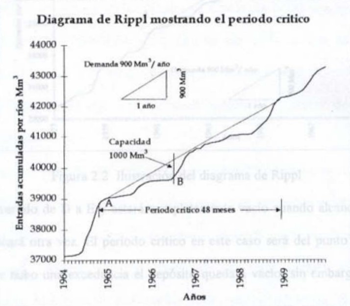

::: {.quote-block}
"Olvidamos que el ciclo del agua y el ciclo de la vida son uno solo."\
— *Jacques Cousteau*
:::

<!-- VERIFICAR: la cita se atribuye a Cousteau en muchas recopilaciones, pero no se ha encontrado la obra original. -->

## Qué es el ciclo hidrológico {#sec-ciclo-fundamentos}

El ciclo hidrológico es la circulación continua del agua entre la atmósfera, la superficie terrestre, el subsuelo y los océanos. Lo mueven dos fuerzas: la **energía solar**, que evapora el agua, y la **gravedad**, que la hace caer como precipitación y escurrir sobre el terreno y por el subsuelo.

El agua que participa en el ciclo forma la hidrosfera, descrita en el capítulo anterior. La hidrosfera se extiende unos 15 km hacia la atmósfera y cerca de 1 km dentro de la litosfera [@chow1988appliedhydrology].

El ciclo no tiene principio ni fin. El agua se evapora sobre todo desde los océanos y también desde los continentes. La circulación atmosférica transporta el vapor, que se enfría, se condensa y vuelve a la superficie como precipitación.

Al llegar al suelo, el agua sigue varios caminos. Una parte la intercepta la vegetación, otra escurre sobre el terreno como escorrentía superficial y otra se infiltra y avanza como flujo subsuperficial. El agua infiltrada puede percolar más abajo y recargar los acuíferos, desde donde sale después en manantiales o alimenta el caudal de los ríos. El agua interceptada, la que escurre y la almacenada en lagos y embalses vuelve a la atmósfera por evaporación, y el ciclo continúa (@fig-balance).

```{r}
#| label: fig-balance
#| fig-cap: "Ciclo hidrológico. Fuente: @usgsHydrosphere."
#| fig-alt: "Esquema del ciclo del agua con evaporación, precipitación, escorrentía, infiltración y flujo subterráneo"
#| echo: false


```

La @fig-cantidad muestra el ciclo a escala global, con los volúmenes anuales estimados de cada flujo entre el océano, la atmósfera y los continentes. La mayor parte de la evaporación del planeta ocurre en los océanos.

```{r}
#| label: fig-cantidad
#| fig-cap: "Ciclo hidrológico global y volúmenes anuales de cada flujo. Fuente: @Bob2025."
#| fig-alt: "Esquema del ciclo hidrológico global con flechas y volúmenes anuales de evaporación, precipitación y escorrentía"
#| echo: false



```

## El sistema hidrológico {#sec-ciclo-sistema}

Para cuantificar el ciclo, se representa como un **sistema hidrológico**: un volumen limitado por una frontera, con entradas, salidas y almacenamiento. La entrada principal suele ser la precipitación, y las salidas, el caudal y la evapotranspiración. En la mayoría de los estudios la frontera es la divisoria de aguas de una cuenca, que se define con detalle en el capítulo siguiente. Por ahora basta pensar en la cuenca como un sistema cuyas entradas, salidas y almacenamiento se pueden contar (@fig-bhs).

```{r}
#| label: fig-bhs
#| fig-cap: "Balance hídrico simplificado. Fuente: @SerranoPacheco_IC0808_Hidrologia."
#| fig-alt: "Esquema de una cuenca con las entradas, salidas y almacenamientos de agua"
#| echo: false



```

El agua almacenada en el sistema está en tres lugares:

- **Almacenamiento superficial:** agua en la vegetación (intercepción), en depresiones del terreno, lagos, embalses y canales.
- **Humedad del suelo:** agua retenida en la zona no saturada, disponible para las plantas.
- **Almacenamiento subterráneo:** agua contenida en los acuíferos.

La @fig-cantidad da el orden de magnitud de estos volúmenes a escala global.

## Conservación de la masa {#sec-ciclo-conservacion}

### Ecuación de continuidad

El análisis hidrológico parte de la **conservación de la masa**: el agua no se crea ni se destruye, solo cambia de estado (líquido, vapor o hielo) o pasa de un compartimento a otro (@fig-storage).

```{r}
#| label: fig-storage
#| fig-cap: "Ciclo del agua a escala de cuenca. Fuente: @Bob2025."
#| fig-alt: "Esquema de una cuenca con los almacenamientos superficial, del suelo y subterráneo y los flujos entre ellos"
#| echo: false



```

Aplicada a un sistema hidrológico durante un intervalo de tiempo, la conservación de la masa se llama **balance hídrico** y se escribe con la ecuación de continuidad:

$$
I - O = \Delta S
$$ {#eq-ciclo-continuidad}

donde $I$ es el volumen de agua que entra al sistema en el intervalo, $O$ es el volumen que sale y $\Delta S$ es el cambio del volumen almacenado, todos en m³ (o en mm de lámina sobre el área de la cuenca).

El balance se aplica a cualquier unidad hidrológica: una cuenca, un acuífero, una capa de suelo, un lago o un embalse.

### Balance hídrico de una cuenca

El estado de la cuenca en un instante $t$ es el agua que contiene en todas sus formas: el volumen que circula por ríos y quebradas, el almacenado en lagos y embalses, la humedad del suelo y el agua de los seres vivos. Ese total es la disponibilidad hídrica de la cuenca en ese instante [@SerranoPacheco_IC0808_Hidrologia].

Las entradas de agua a la cuenca son:

- **Precipitación:** lluvia, nieve, granizo y condensación.
- **Aporte subterráneo desde cuencas vecinas**, porque los límites de los acuíferos no siempre coinciden con las divisorias de aguas superficiales.
- **Transvases desde otras cuencas**, por ejemplo:
  - la descarga de una central hidroeléctrica que capta agua en otra cuenca, algo frecuente donde varios valles paralelos se conectan con canales o túneles hacia una sola central;
  - la descarga de aguas residuales de una ciudad que se abastece fuera de la cuenca. Es cada vez más común porque, al crecer las ciudades, el agua potable se trae de más lejos. São Paulo, en Brasil, es un caso conocido.

Las salidas de agua son:

- **Caudal en el punto de control**, es decir, el agua que sale de la cuenca por el cauce principal.
- **Evapotranspiración** de bosques y áreas cultivadas, con riego o sin él.
- **Evaporación** desde lagos, embalses y humedales.
- **Infiltración profunda** que recarga acuíferos que drenan fuera de la cuenca.
- **Extracciones y transvases** hacia otras cuencas, como captaciones para abastecimiento o riego.

## El balance hídrico en la ingeniería {#sec-ciclo-aplicaciones}

Todo estudio hidrológico de ingeniería civil cuantifica una parte del ciclo hidrológico. Puede ser el drenaje de una calle, el diseño de una presa o la estimación del agua disponible para una captación de consumo humano.

Ningún estudio modela el ciclo completo. Cada uno representa los procesos que importan para su problema. Para una obra de control de crecidas se simula la transformación de lluvia en escorrentía, que dura de pocas horas a algunos días. Para un sistema de abastecimiento interesa el balance hídrico de meses a varios años.

En ese sentido, todo análisis hidrológico aplicado es un balance hídrico. Algunas aplicaciones:

- **Operación de embalses.** El volumen almacenado se actualiza en cada intervalo con

  $$
  S_t = S_{t-1} + X_t - Y_t
  $$ {#eq-ciclo-embalse}

  donde $S_t$ es el volumen almacenado al final del intervalo $t$ (m³), $X_t$ es el volumen que entra al embalse durante el intervalo (m³) y $Y_t$ es el volumen que sale, sumando descargas, extracciones y evaporación (m³).

- **Tránsito de crecientes.** Describe cómo se propaga una crecida por un cauce o un embalse, con métodos hidrológicos como Muskingum o con métodos hidráulicos basados en las ecuaciones de Saint-Venant.

- **Evaluación de aguas subterráneas.** El balance distingue la explotación sostenible de un acuífero de la sobreexplotación de sus reservas. Se apoya en la ley de Darcy y en las pruebas de bombeo.

::: {.callout-note title="Ejemplo: operación mensual de un embalse pequeño"}
Un embalse de 6 hm³ de capacidad abastece una demanda constante de 1.5 hm³ por mes. Al inicio de enero tiene 4 hm³. Los volúmenes que entran cada mes durante dos años son los del código (datos ilustrativos, de una cuenca con estación seca de enero a abril). Calcule el volumen almacenado al final de cada mes con la @eq-ciclo-embalse, el agua que se vierte cuando el embalse se llena y la demanda que no se puede atender. Para simplificar, se desprecia la evaporación del embalse.

**Pseudocódigo**

1. Escribir las entradas mensuales, la capacidad, la demanda y el volumen inicial.
2. Para cada mes, sumar al volumen anterior la entrada y restar la demanda.
3. Si el resultado supera la capacidad, el exceso se vierte. Si es negativo, la diferencia es demanda no atendida y el embalse queda vacío.
4. Calcular la confiabilidad: el porcentaje de meses en que se atendió toda la demanda.

```{r}
#| label: ej-ciclo-embalse
#| code-fold: false

library(tidyverse)

# 1) Datos (volúmenes en hm³)
capacidad <- 6
demanda <- 1.5
volumen_inicial <- 4
entradas <- c(0.6, 0.4, 0.3, 0.5, 1.8, 2.6, 2.0, 2.4, 3.5, 4.0, 2.8, 1.2,
              0.5, 0.3, 0.2, 0.3, 1.2, 2.2, 1.8, 2.1, 3.2, 3.8, 2.5, 1.0)

# 2) y 3) Balance mes a mes
n_meses <- length(entradas)
volumen <- vertido <- deficit <- numeric(n_meses)
anterior <- volumen_inicial
for (k in seq_len(n_meses)) {
  disponible <- anterior + entradas[k] - demanda
  vertido[k] <- max(disponible - capacidad, 0)
  deficit[k] <- max(-disponible, 0)
  volumen[k] <- min(max(disponible, 0), capacidad)
  anterior <- volumen[k]
}

embalse <- tibble(mes = 1:n_meses, entrada = entradas,
                  volumen, vertido, deficit)

# 4) Confiabilidad (% de meses sin déficit)
confiabilidad <- 100 * mean(embalse$deficit == 0)

embalse %>% summarise(vertido_total = sum(vertido),
                      deficit_total = sum(deficit),
                      meses_con_deficit = sum(deficit > 0),
                      confiabilidad = confiabilidad)
```

```{r}
#| label: fig-ciclo-embalse
#| fig-cap: "Volumen almacenado en el embalse del ejemplo durante dos años."
#| fig-alt: "Línea del volumen almacenado que llega a cero en abril del primer año, alcanza la capacidad en octubre y vuelve a bajar en la estación seca del segundo año sin vaciarse"
#| code-fold: false

ggplot(embalse, aes(x = mes, y = volumen)) +
  geom_hline(yintercept = capacidad, linetype = "dashed") +
  geom_line(linewidth = 1, color = "steelblue") +
  geom_point(color = "steelblue") +
  scale_x_continuous(breaks = seq(1, 24, 2)) +
  labs(x = "Mes", y = "Volumen almacenado (hm³)") +
  theme_minimal()
```

**Interpretación.** El embalse empieza el primer año con 4 hm³, que no alcanzan para la estación seca: en abril se vacía y faltan 0.2 hm³. En la estación lluviosa se llena y vierte 2.6 hm³ que no se pueden guardar. Como empieza lleno el segundo año, pasa la estación seca sin déficit, aunque ese año entra menos agua. Se atendió toda la demanda en 23 de los 24 meses, una confiabilidad de `r round(confiabilidad, 1)` %. El resultado depende mucho del volumen inicial y de la capacidad: con un embalse más grande se aprovecharía el agua vertida. Este mismo cálculo, con series de muchos años y la evaporación del embalse, es la base del diseño de embalses de regulación.
:::

## El balance en la planificación {#sec-ciclo-planificacion}

Con el balance hídrico se cuantifica la disponibilidad real de agua, su variación en el espacio y el tiempo y la confiabilidad con que puede atender una demanda. Esa información es la base para planificar obras hidráulicas, gestionar los recursos hídricos de una cuenca y adaptarse a la variabilidad y al cambio climático. El diagrama de Rippl (@fig-rippl), que acumula entradas y demandas en el tiempo, es un ejemplo clásico: con él se estima el volumen de embalse necesario para atender una demanda.

```{r}
#| label: fig-rippl
#| fig-cap: "Diagrama de Rippl. Fuente: @Bob2025."
#| fig-alt: "Curva de volumen acumulado de entradas comparada con la recta de demanda acumulada"
#| echo: false



```

## Agua virtual {#sec-ciclo-agua-virtual}

El **agua virtual** es el volumen de agua dulce que se usa para producir un bien o un servicio. El término lo propuso Tony Allan a inicios de la década de 1990 [@allan1998virtual]. Cuando una región compra alimentos o productos industriales a otra, recibe también, sin verla, el agua con que se produjeron.

Para la hidrología, la idea importa porque una región con poca agua puede atender su demanda de alimentos sin agotar sus fuentes, al importar productos de cuencas con más agua. El balance hídrico de la cuenca no cambia, pero la presión sobre sus fuentes sí.

Igual que la huella hídrica, el agua virtual se divide según su origen:

- **Agua verde:** agua de lluvia almacenada en el suelo y consumida por los cultivos.
- **Agua azul:** agua extraída de ríos, lagos o acuíferos para riego o procesos industriales.
- **Agua gris:** volumen teórico de agua dulce necesario para diluir los contaminantes de la producción hasta cumplir las normas de calidad.

El @tbl-agua_virtual da dos valores de referencia. Son promedios mundiales: en un lugar concreto la cifra puede ser mucho mayor o menor según el clima, el riego y el sistema de producción.

```{r}
#| label: tbl-agua_virtual
#| tbl-cap: "Huella hídrica promedio mundial de dos productos (agua verde, azul y gris)."
#| echo: false
#| message: false
#| warning: false

library(dplyr)
library(tibble)
library(kableExtra)

tabla_agua_virtual <- tribble(
  ~producto, ~litros_por_kg,
  "Trigo", "1 827",
  "Carne de res", "15 400"
)

tabla_agua_virtual %>%
  kbl(
    format = "html",
    align = c("l", "r"),
    col.names = c("Producto", "Agua virtual (L/kg)")
  ) %>%
  kable_classic(html_font = "Latin Modern Roman") %>%
  kable_styling(full_width = FALSE, bootstrap_options = "hover") %>%
  row_spec(0, bold = TRUE)

```

Fuente: trigo, @mekonnen2011green; carne de res, @mekonnen2012animal.
