::: {.quote-block}
"La cuenca es la primera y la última nación, cuyos límites, aunque cambian un poco, son indiscutibles."\
— *Gary Snyder, "Coming into the Watershed", en A Place in Space (1995)*
:::

## Definición {#sec-cuenca-definicion}

La **cuenca hidrográfica** es la unidad espacial de trabajo de la hidrología. También se le llama cuenca de drenaje, área de drenaje o cuenca de captación.

Una cuenca es el área de terreno, delimitada por la **topografía**, que capta la precipitación y conduce la escorrentía superficial hacia un mismo punto, el **punto de control**. Ese punto lo define el estudio: el sitio de un puente, una captación, una estación de aforo o la entrada a una población.

El límite de la cuenca es la **divisoria de aguas**, también llamada parteaguas: una línea imaginaria que une los puntos más altos del terreno y separa la lluvia que escurre hacia la cuenca de la que escurre hacia las cuencas vecinas. Todo punto de la superficie terrestre pertenece a alguna cuenca.

En el capítulo anterior se vio que el ciclo hidrológico se cuantifica como un sistema con entradas, salidas y almacenamiento. La cuenca es ese sistema a escala local. Es un sistema abierto: recibe precipitación y energía solar, y entrega caudal en el punto de control, evapotranspiración e infiltración profunda.

### La cuenca como unidad de planificación {#sec-cuenca-planificacion}

La cuenca es también la unidad natural para planificar y gestionar el agua. Dentro de sus límites se relacionan la precipitación, la escorrentía, la infiltración y la evapotranspiración, y ahí se pueden evaluar la disponibilidad de agua, los conflictos entre usos y el efecto de las obras y de los cambios en el uso del suelo.

Costa Rica se divide en 34 cuencas hidrográficas principales, que drenan hacia la vertiente del Pacífico o hacia la del Caribe (@fig-cuencascr). Sobre ellas se planifica el abastecimiento de agua potable, la generación hidroeléctrica, el riego y la gestión del riesgo por inundaciones y sequías.

```{r}
#| label: fig-cuencascr
#| fig-cap: "Cuencas hidrográficas principales de Costa Rica. Los números corresponden al @tbl-cuencascr. Fuente: elaboración propia."
#| fig-alt: "Mapa de Costa Rica en CRTM05 dividido en las 34 cuencas hidrográficas principales, cada una con su número, sobre el relieve sombreado"
#| out-width: 100%
#| fig-width: 8.5
#| fig-height: 6.5

source("herramientas/mapas_cr.R")
capas <- leer_capas_cr()

# Diez colores que se repiten; cuencas vecinas suelen quedar distintas
paleta <- c("#4E79A7", "#F28E2B", "#E15759", "#76B7B2", "#59A14F",
            "#EDC948", "#B07AA1", "#FF9DA7", "#9C755F", "#BAB0AC")
cuencas <- capas$cuencas
cuencas$grupo <- factor(cuencas$cuenca_no %% 10)
etiquetas <- st_point_on_surface(cuencas)

ggplot() +
  capa_relieve(capas, alfa_max = 0.4) +
  geom_sf(data = cuencas, aes(fill = grupo), colour = "white",
          linewidth = 0.3, alpha = 0.55, show.legend = FALSE) +
  scale_fill_manual(values = paleta) +
  geom_sf_text(data = etiquetas, aes(label = cuenca_no),
               family = FUENTE_MAPA, size = 2.8) +
  contorno_cr(capas) +
  marco_cr(capas)
```

```{r}
#| label: tbl-cuencascr
#| tbl-cap: "Cuencas hidrográficas principales de Costa Rica y su área."
#| echo: false

library(kableExtra)

lista <- sf::st_drop_geometry(capas$cuencas)
lista <- lista[order(lista$cuenca_no), ]
lista$area_km2 <- formatC(lista$area_ha / 100, format = "f", digits = 0,
                          big.mark = " ")
n_filas <- ceiling(nrow(lista) / 2)
bloque <- function(i) lista[i, c("cuenca_no", "nombre", "area_km2")]
mitad_1 <- bloque(1:n_filas)
mitad_2 <- bloque((n_filas + 1):nrow(lista))
mitad_2[nrow(mitad_2) + seq_len(n_filas - nrow(mitad_2)), ] <- NA
cbind(mitad_1, mitad_2) %>%
  kbl(format = "html", row.names = FALSE, na = "",
      col.names = rep(c("N.°", "Cuenca", "Área (km²)"), 2),
      align = rep(c("c", "l", "r"), 2)) %>%
  kable_styling(full_width = FALSE, bootstrap_options = "condensed")
```

Un problema frecuente es que los límites de distritos, cantones y provincias no coinciden con los de las cuencas. Varias municipalidades comparten un mismo río, pero cada una decide sobre su parte, sin coordinarse con las demás.

La quebrada Seca, en Heredia, es un ejemplo (@fig-quebradaseca). El crecimiento urbano sin ordenamiento, las canalizaciones insuficientes y la falta de coordinación entre municipalidades han hecho que las inundaciones sean más frecuentes y más graves [@MasísCampos2020_BurioQuebradaSeca].

```{r}
#| label: fig-quebradaseca
#| fig-cap: "Cuenca de la quebrada Seca y el río Burío, Heredia. Fuente: @MasísCampos2020_BurioQuebradaSeca."
#| fig-alt: "Mapa de la cuenca de la quebrada Seca y el río Burío con la mancha urbana"
#| out-width: 100%
#| echo: false

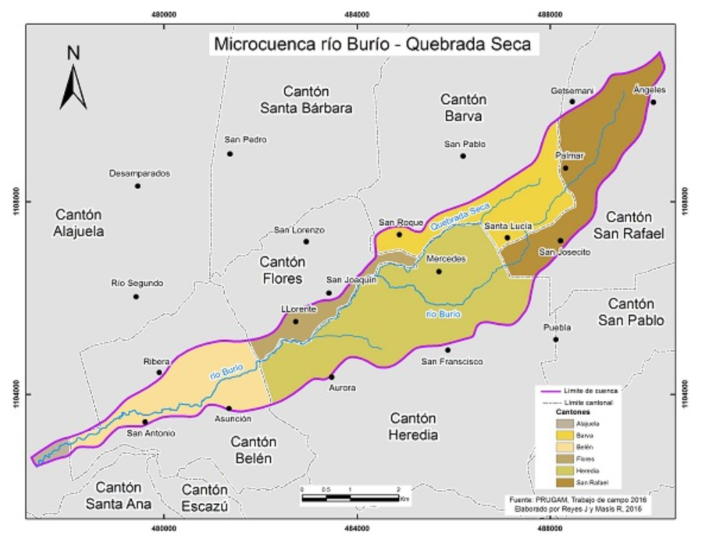
```

## La divisoria de aguas {#sec-cuenca-divisoria}

La divisoria sigue las crestas, cerros y lomas que separan el agua que escurre hacia el punto de control de la que escurre hacia otras cuencas. Sobre un mapa topográfico se traza uniendo los puntos más altos y cortando las curvas de nivel en ángulo recto, porque el agua baja siguiendo la máxima pendiente (@fig-divisoria).

```{r}
#| label: fig-divisoria
#| fig-cap: "Divisoria de aguas sobre un mapa de curvas de nivel. El terreno es sintético; la divisoria se obtuvo siguiendo, desde cada punto, la dirección de máxima pendiente y marcando los puntos cuyo recorrido llega al punto de control."
#| fig-alt: "Curvas de nivel de un valle que drena hacia el sur, con la divisoria en rojo siguiendo las crestas y el punto de control en la parte baja"
#| echo: false
#| fig-width: 6
#| fig-height: 6

library(ggplot2)

# Terreno sintético: un valle que drena al sur, cerrado por crestas
z_terreno <- function(x, y) {
  ancho <- 1.2 + 0.4 * pmin(y, 8.5)
  200 + 30 * y + 160 * abs(sin(pi * (x - 6) / (2 * ancho))) +
    250 * exp(-(y - 9.3 - 0.7 * sin(1.3 * x))^2 / 1.6) * exp(-(x - 6)^2 / 30) +
    40 * exp(-((x - 3.2)^2 + (y - 6)^2) / 1.5) +
    35 * exp(-((x - 8.8)^2 + (y - 4.5)^2) / 1.2)
}
n_malla <- 181
malla <- expand.grid(x = seq(0, 12, length.out = n_malla),
                     y = seq(0, 12, length.out = n_malla))
malla$z <- z_terreno(malla$x, malla$y)

# Cada punto sigue la máxima pendiente hasta cruzar la cota del punto de control
y_control <- 1.5
px <- malla$x
py <- malla$y
activo <- rep(TRUE, nrow(malla))
drena <- rep(FALSE, nrow(malla))
for (k in 1:3000) {
  i <- which(activo)
  if (length(i) == 0) break
  gx <- (z_terreno(px[i] + 1e-3, py[i]) - z_terreno(px[i] - 1e-3, py[i])) / 2e-3
  gy <- (z_terreno(px[i], py[i] + 1e-3) - z_terreno(px[i], py[i] - 1e-3)) / 2e-3
  modulo <- sqrt(gx^2 + gy^2) + 1e-9
  px[i] <- px[i] - 0.03 * gx / modulo
  py[i] <- py[i] - 0.03 * gy / modulo
  llego <- py[i] <= y_control
  drena[i[llego]] <- abs(px[i[llego]] - 6) < 0.4
  activo[i[llego | px[i] < 0 | px[i] > 12 | py[i] > 12]] <- FALSE
}
malla$cuenca <- as.numeric(drena & malla$y >= y_control)

ggplot(malla, aes(x, y)) +
  geom_contour(aes(z = z), binwidth = 40, colour = "grey60", linewidth = 0.3) +
  geom_contour(aes(z = cuenca), breaks = 0.5, colour = "#B2182B", linewidth = 1.1) +
  annotate("segment", x = 6, xend = 6, y = y_control, yend = 8.8,
           colour = "#2166AC", linewidth = 0.9) +
  annotate("point", x = 6, y = y_control, size = 3, colour = "black") +
  annotate("text", x = 6.3, y = 1.0, label = "Punto de control",
           family = "serif", hjust = 0) +
  annotate("text", x = 9.6, y = 8.3, label = "Divisoria",
           family = "serif", colour = "#B2182B", hjust = 0) +
  annotate("text", x = 6.2, y = 5.2, label = "Cauce principal",
           family = "serif", colour = "#2166AC", angle = 90) +
  coord_equal(xlim = c(1.5, 11.5), ylim = c(0.5, 11), expand = FALSE) +
  labs(x = "Distancia (km)", y = "Distancia (km)") +
  theme_minimal(base_family = "serif", base_size = 12)
```

Hay dos divisorias (@fig-divisoriaserrano):

1. **Divisoria topográfica o superficial.** La define el relieve y limita el área que aporta escorrentía superficial.
2. **Divisoria freática o subterránea.** Limita los acuíferos que alimentan el caudal base de la cuenca.

Las dos no siempre coinciden, porque el agua subterránea sigue la geología y el agua superficial sigue el relieve. Una parte de la recarga puede salir hacia una cuenca vecina, o entrar desde ella. En cuencas grandes la diferencia de área suele ser pequeña frente al total. En cuencas pequeñas, sobre todo en terrenos volcánicos o kársticos, puede pesar en el balance hídrico.

```{r}
#| label: fig-divisoriaserrano
#| fig-cap: "Corte transversal de una cuenca con las divisorias topográfica y freática. Fuente: @SerranoPacheco_IC0808_Hidrologia."
#| fig-alt: "Corte del terreno con dos cuencas vecinas, el nivel freático y las dos divisorias desplazadas"
#| echo: false

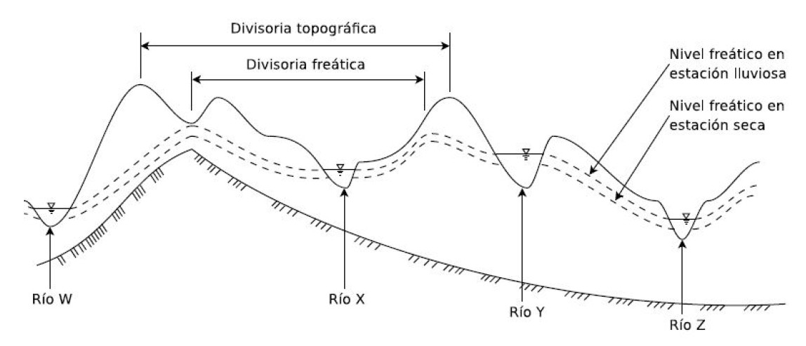
```

## Delimitación de cuencas {#sec-cuenca-delimitacion}

Delimitar una cuenca es trazar su divisoria a partir del punto de control. Sobre el área que resulta se calculan después el balance hídrico, los caudales de diseño y los tiempos de respuesta, así que un error en este paso se arrastra a todo el estudio.

La delimitación se puede hacer a mano, sobre cartografía topográfica, o con un sistema de información geográfica (SIG) a partir de un modelo digital de elevación (MDE). Los programas de SIG la hacen en segundos, pero sus resultados dependen de la calidad del MDE. Un modelo de baja resolución, con curvas de nivel muy separadas, con artefactos o con vacíos (por ejemplo, por nubes en las imágenes de origen) puede dar divisorias equivocadas. Por eso el resultado automático se revisa siempre contra la cartografía, las imágenes satelitales y, cuando se puede, una visita al sitio. La @fig-curvassnit muestra la cobertura de información topográfica disponible para Costa Rica.

```{r}
#| label: fig-curvassnit
#| fig-cap: "Información topográfica disponible para Costa Rica. Fuente: @snit2025."
#| fig-alt: "Mapa de Costa Rica con las zonas cubiertas por cada escala de información topográfica"
#| out-width: 100%
#| echo: false

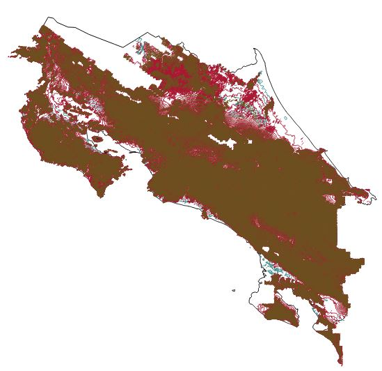
```

### Delimitación manual {#sec-cuenca-delimitacion-manual}

La delimitación sobre mapas de curvas de nivel sigue siendo útil para estudios preliminares, para la docencia y para revisar los resultados de un SIG (@fig-delim_manual). Los pasos son:

1. Ubicar el punto de control.
2. Identificar el cauce principal y sus afluentes aguas arriba del punto de control.
3. Ubicar las crestas y puntos altos que separan el agua que llega al punto de control de la que va hacia cuencas vecinas.
4. Trazar la divisoria desde el punto de control, uniendo esos puntos altos, cortando las curvas de nivel en ángulo recto y sin cruzar ningún cauce, hasta volver al punto de control.

```{r}
#| label: fig-delim_manual
#| fig-cap: "Delimitación manual de una cuenca sobre curvas de nivel. Fuente: @SerranoPacheco_IC0808_Hidrologia."
#| fig-alt: "Mapa de curvas de nivel con la red de drenaje y la divisoria trazada a mano"
#| echo: false

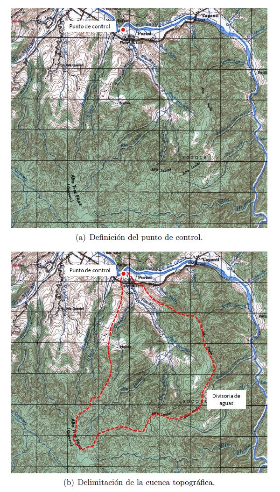
```

### Delimitación con SIG {#sec-cuenca-delimitacion-sig}

Con un MDE, el SIG delimita la cuenca en cinco pasos (@fig-delim_auto):

1. Corregir el MDE para eliminar depresiones sin salida (*sinks*), que interrumpen el flujo.
2. Calcular la dirección de flujo de cada celda hacia la vecina de mayor pendiente.
3. Calcular la acumulación de flujo, es decir, cuántas celdas drenan hacia cada celda. Las celdas con acumulación alta forman la red de drenaje.
4. Ubicar el punto de control sobre una celda de la red de drenaje.
5. Generar el polígono de la cuenca con todas las celdas que drenan hacia ese punto.

```{r}
#| label: fig-delim_auto
#| fig-cap: "Pasos de la delimitación de una cuenca con SIG. Fuente: @Islam2020_MicroWatershed_Bangladesh."
#| fig-alt: "Secuencia de mapas: modelo de elevación, dirección de flujo, acumulación de flujo y cuenca delimitada"
#| out-width: 100%
#| echo: false

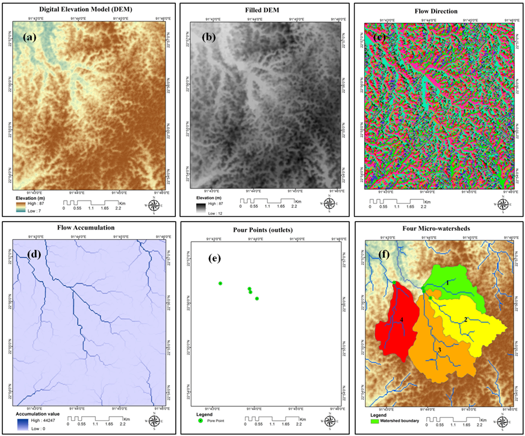
```

En la práctica profesional se combinan los dos métodos: el SIG hace el trazado y quien hace el estudio lo revisa con criterio hidrológico.

::: {.callout-warning title="Cuidado"}
El punto de control debe caer sobre el cauce en el MDE. Si se coloca a una o dos celdas del cauce, el SIG delimita una cuenca diminuta o la de un afluente. Antes de seguir, conviene comparar el área obtenida con la de algún estudio anterior o con una medición rápida sobre el mapa.
:::

## Red de drenaje {#sec-cuenca-red-drenaje}

La red de drenaje es el cauce principal con todos sus afluentes. Su forma y su densidad influyen en la rapidez con que la cuenca responde a una tormenta.

### Clasificación de los cauces {#sec-cuenca-tipos-cauce}

Según la permanencia del flujo, que depende de la posición del nivel freático respecto al lecho, los cauces son:

- **Permanentes (perennes):** llevan agua todo el año, porque el nivel freático se mantiene por encima del lecho y el acuífero aporta caudal base aun sin lluvia.
- **Intermitentes:** llevan agua en la estación lluviosa y se secan en la seca. El nivel freático está por encima del lecho solo en los meses húmedos.
- **Efímeros:** llevan agua solo durante una lluvia o poco después. El nivel freático está siempre por debajo del lecho, así que no reciben aporte subterráneo; al contrario, pierden agua hacia el acuífero (cauces influentes).

### Orden de los cauces {#sec-cuenca-orden}

El orden de los cauces describe la jerarquía de la red de drenaje. El sistema más usado es el de Horton [-@horton1945erosional], modificado por Strahler [-@strahler1957quantitative] (@fig-num_orden):

1. Los cauces que no reciben afluentes son de **orden 1**.
2. Cuando se unen dos cauces de orden $n$, el cauce que sigue es de orden $n + 1$.
3. Cuando un cauce de orden menor se une a uno de orden mayor, el cauce que sigue conserva el orden mayor.
4. El orden de la cuenca es el del cauce principal en el punto de control.

```{r}
#| label: fig-num_orden
#| fig-cap: "Orden de los cauces según Strahler."
#| fig-alt: "Red de drenaje con cada tramo numerado según su orden, de 1 en las cabeceras a 4 en la salida"
#| echo: false

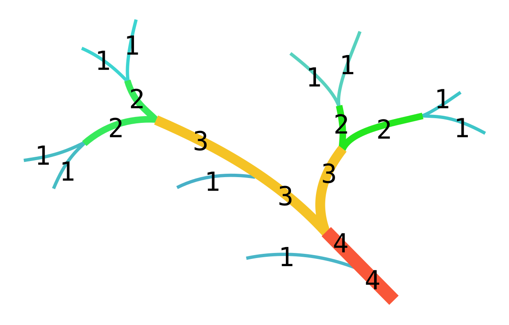
```

Un orden alto indica una red más ramificada y un terreno más disectado por los cauces. En esas cuencas el agua llega pronto a un cauce, lo que tiende a acortar el tiempo de concentración. El orden depende de la escala del mapa: en un mapa más detallado aparecen más cauces de orden 1 y el orden de la cuenca sube. Por eso solo se comparan órdenes obtenidos con la misma escala.

### Razón de bifurcación {#sec-cuenca-bifurcacion}

La **razón de bifurcación** mide cuántos cauces de un orden hay por cada cauce del orden siguiente:

$$
R_b = \frac{N_u}{N_{u+1}}
$$ {#eq-cuenca-bifurcacion}

donde $N_u$ es el número de cauces de orden $u$ y $N_{u+1}$ es el número de cauces de orden $u + 1$.

Se calcula para cada par de órdenes y se resume con el promedio. Strahler [-@strahler1957quantitative] reunió mediciones de varias regiones y encontró valores de 4.0 a 5.1 entre los órdenes 1 y 2, y de 2.8 a 4.9 entre los órdenes 2 y 3. También observó que $R_b$ cambia poco de una región a otra cuando la geología no impone una forma particular a la red. Valores mucho mayores aparecen cuando la geología alarga la cuenca o la divide en franjas, y suelen ir con crecidas más bajas y repartidas en el tiempo. Valores bajos corresponden a cuencas más redondeadas, en las que los afluentes llegan al cauce principal casi al mismo tiempo y producen picos más altos.

::: {.callout-note title="Ejemplo: razón de bifurcación de una cuenca de orden 6"}

En una cuenca de orden 6 se contaron los cauces de cada orden sobre un mapa a escala 1:50 000: 1554 de orden 1, 328 de orden 2, 73 de orden 3, 12 de orden 4, 3 de orden 5 y 1 de orden 6. Calcule la razón de bifurcación de cada par de órdenes y la razón media.

**Resolución a mano**

1. Razón de cada par de órdenes:
   - orden 1 a 2: $1554/328 = 4.74$;
   - orden 2 a 3: $328/73 = 4.49$;
   - orden 3 a 4: $73/12 = 6.08$;
   - orden 4 a 5: $12/3 = 4.00$;
   - orden 5 a 6: $3/1 = 3.00$.
2. Razón media: $(4.74 + 4.49 + 6.08 + 4.00 + 3.00)/5 = 22.31/5 = 4.46$.

**Pseudocódigo**

1. Escribir el número de cauces de cada orden.
2. Dividir cada número entre el del orden siguiente.
3. Promediar las razones.

```{r}
#| label: ej-cuenca-bifurcacion
#| code-fold: false

library(tidyverse)

# 1) Número de cauces por orden
red <- tibble(
  orden = 1:6,
  n_cauces = c(1554, 328, 73, 12, 3, 1)
)

# 2) R_b de cada orden respecto al siguiente
red <- red %>%
  mutate(r_b = n_cauces / lead(n_cauces))

# 3) Razón de bifurcación media
r_b_media <- mean(red$r_b, na.rm = TRUE)

red
r_b_media
```

```{r}
#| label: tbl-razon-bifurcacion
#| tbl-cap: "Número de cauces por orden y razón de bifurcación."
#| echo: false

library(kableExtra)

red %>%
  mutate(r_b = if_else(is.na(r_b), "", sprintf("%.1f", r_b))) %>%
  kbl(format = "html", align = "c",
      col.names = c("Orden u", "Número de cauces N<sub>u</sub>", "R<sub>b</sub> = N<sub>u</sub> / N<sub>u+1</sub>"),
      escape = FALSE) %>%
  kable_styling(full_width = FALSE, bootstrap_options = "hover") %>%
  footnote(general = sprintf("Razón de bifurcación media: %.1f", r_b_media),
           general_title = "")
```

**Interpretación.** La razón media es 4.5, del mismo orden que los valores que reportó Strahler para cuencas sin un control geológico marcado. El valor de 6.1 entre los órdenes 3 y 4 indica que en esa parte de la red hay más cauces pequeños de lo normal, algo que conviene revisar en el mapa geológico.
:::

El @tbl-orden-vs-bifurcacion resume la diferencia entre los dos indicadores.

| Aspecto | Orden de los cauces | Razón de bifurcación |
|---|---|---|
| Qué describe | La posición de cada cauce en la jerarquía de la red | Cuánto se ramifica la red de un orden al siguiente |
| A qué se aplica | A cada tramo de cauce | A la red completa |
| Qué dice de la respuesta | Un orden alto indica una red más desarrollada, pero no dice cómo se ramifica | Valores bajos se asocian con picos más altos; valores altos, con crecidas más repartidas |

: Orden de los cauces y razón de bifurcación. Fuente: adaptado de @McCuen1997. {#tbl-orden-vs-bifurcacion}

## Forma y tamaño de la cuenca {#sec-cuenca-forma}

El tamaño de la cuenca controla sobre todo el volumen de escorrentía. Su forma y su red de drenaje controlan cómo se reparte ese volumen en el tiempo.

### Área {#sec-cuenca-area}

El **área de drenaje** $A$ es la proyección horizontal de la superficie encerrada por la divisoria (@fig-pro_cuenca). Es la característica más usada en el diseño hidrológico: casi todos los métodos para estimar caudales la usan.

```{r}
#| label: fig-pro_cuenca
#| fig-cap: "El área de la cuenca se mide en la proyección horizontal."
#| fig-alt: "Esquema de una cuenca sobre el relieve y su proyección sobre un plano horizontal"
#| echo: false

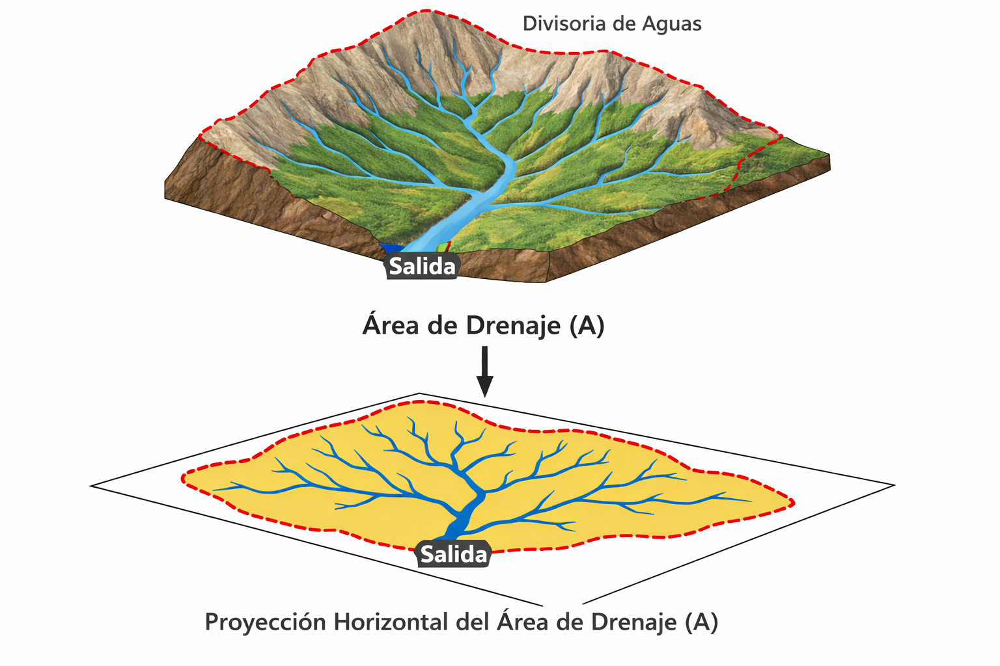
```

### Perímetro {#sec-cuenca-perimetro}

El **perímetro** $P$ es la longitud de la divisoria de aguas. Como el área, se mide sobre la proyección horizontal.

### Longitud del cauce principal {#sec-cuenca-longitud}

El **cauce principal** es el que va desde el punto de control hasta el punto hidráulicamente más alejado de la cuenca. Se identifica recorriendo la red aguas arriba desde el punto de control: en cada confluencia se sigue el cauce de mayor orden y, si los dos tienen el mismo, el de mayor área drenada o mayor longitud aguas arriba.

La **longitud del cauce principal** $L$ se mide a lo largo del cauce, con todas sus curvas, desde el punto de control hasta la divisoria (@fig-LCP). No es la distancia en línea recta.

```{r}
#| label: fig-LCP
#| fig-cap: "Longitud del cauce principal."
#| fig-alt: "Cuenca con el cauce principal resaltado desde la salida hasta la divisoria"
#| echo: false

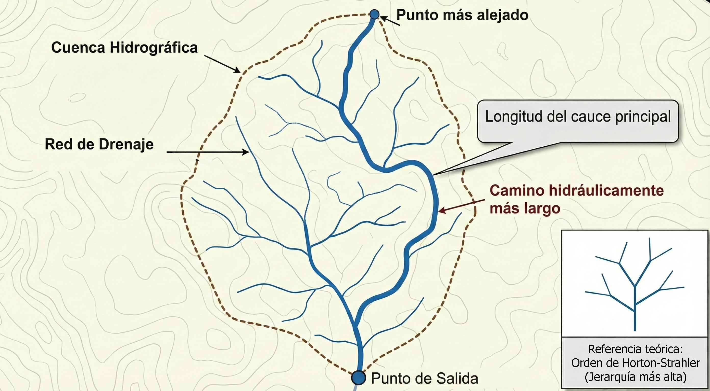
```

### Coeficiente de compacidad {#sec-cuenca-compacidad}

El **coeficiente de compacidad** o índice de Gravelius $K_c$ compara el perímetro de la cuenca con el de un círculo de la misma área:

$$
K_c = \frac{P}{2\sqrt{\pi A}} \approx 0.28\,\frac{P}{\sqrt{A}}
$$ {#eq-cuenca-kc}

donde $P$ es el perímetro de la cuenca (km) y $A$ es su área (km²). $K_c$ es adimensional.

Como el círculo es la figura con el menor perímetro para un área dada, $K_c$ vale 1 para una cuenca circular y crece a medida que la cuenca se alarga o su contorno se vuelve más irregular. En una cuenca con $K_c$ cercano a 1 los afluentes llegan al punto de control casi al mismo tiempo, lo que favorece crecidas rápidas y con picos altos. En una cuenca alargada la escorrentía llega más repartida en el tiempo y es menos probable que una tormenta cubra toda la cuenca a la vez. Para leer un valor de $K_c$ conviene compararlo con el de figuras simples. En un rectángulo de lados $a$ y $b$, con $a = r\,b$, el área es $r\,b^2$ y el perímetro es $2b(r + 1)$, de modo que $K_c = (r + 1)/\sqrt{\pi r}$. El @tbl-compacidad da los valores para varias proporciones y propone una lectura de cada intervalo.

| Intervalo de $K_c$ | Figuras de referencia | Lectura |
|:---:|:---|:---|
| 1.00 a 1.15 | Círculo (1.00) y cuadrado (1.13) | Compacta |
| 1.15 a 1.30 | Rectángulos 2:1 (1.20) y 3:1 (1.30) | Ligeramente alargada |
| 1.30 a 1.60 | Rectángulo 4:1 (1.41) | Alargada |
| Más de 1.60 | Rectángulos 6:1 (1.61) y 8:1 (1.80) | Muy alargada |

: Coeficiente de compacidad de figuras de referencia y lectura propuesta en este libro. {#tbl-compacidad}

Los intervalos del cuadro son una guía de interpretación construida con la geometría, no una norma. En una cuenca real el contorno es irregular, y eso por sí solo aumenta $K_c$; por eso el valor de una cuenca tiende a indicar una forma algo más alargada de la que tiene.

```{r}
#| label: fig-factor_forma
#| fig-cap: "Formas de cuenca y su índice de Gravelius. Fuente: @Guizani2022_DebrecenWaterBalance."
#| fig-alt: "Siluetas de cuencas, de redonda a alargada, con el valor de Kc de cada una"
#| echo: false

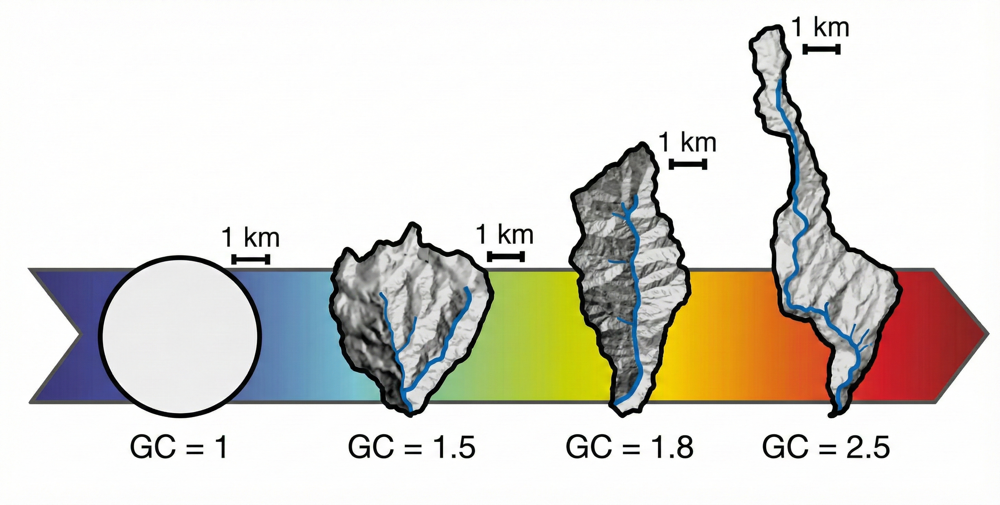
```

::: {.callout-note title="Ejemplo: coeficiente de compacidad"}
Una cuenca tiene un área de 50 km² y un perímetro de 30 km. Con la @eq-cuenca-kc:

$$
K_c = 0.28 \times \frac{30}{\sqrt{50}} = 0.28 \times 4.24 = 1.19
$$

Según el @tbl-compacidad, su $K_c$ es el de un rectángulo de proporción cercana a 2:1: la cuenca es compacta a ligeramente alargada. Ante una tormenta que la cubra completa, los aportes de los afluentes tienden a llegar juntos al punto de control, y el hidrograma tendrá un pico marcado.
:::

### Factor de forma {#sec-cuenca-factor-forma}

El **factor de forma** de Horton [-@horton1945erosional] compara el ancho medio de la cuenca con su longitud. El ancho medio $B$ es el área dividida entre la longitud, $B = A/L$, y el factor de forma es:

$$
K_f = \frac{B}{L} = \frac{A}{L^2}
$$ {#eq-cuenca-kf}

donde $A$ es el área de la cuenca (km²) y $L$ es la longitud axial de la cuenca (km). $K_f$ es adimensional.

La longitud axial es la distancia desde el punto de control hasta el punto más alejado de la divisoria, medida aproximadamente en la dirección del cauce principal. Muchos textos usan en su lugar la longitud del cauce principal; lo importante es decir cuál se usó, porque el resultado cambia.

Un $K_f$ alto indica una cuenca ancha y corta, con respuesta rápida y picos altos. Un $K_f$ bajo indica una cuenca alargada, en la que el agua recorre distancias mayores y la crecida se reparte en el tiempo (@tbl-factor-forma y @fig-fac_forma_kf).

Igual que con $K_c$, el valor se interpreta mejor frente a figuras simples. En un rectángulo de proporción $r{:}1$ medido a lo largo del lado mayor, $K_f = 1/r$. En un círculo medido a lo largo del diámetro, $K_f = \pi/4 = 0.79$.

| Intervalo de $K_f$ | Figuras de referencia | Forma de la cuenca | Respuesta típica |
|:---:|:---|:---|:---|
| Más de 0.50 | Cuadrado (1.00) y círculo (0.79) | Compacta | Rápida, con picos altos |
| 0.25 a 0.50 | Rectángulos 2:1 (0.50) y 3:1 (0.33) | Moderadamente alargada | Intermedia |
| Menos de 0.25 | Rectángulos 4:1 (0.25) y 8:1 (0.13) | Alargada | Lenta, con picos bajos |

: Factor de forma de figuras de referencia y lectura propuesta en este libro. {#tbl-factor-forma}

```{r}
#| label: fig-fac_forma_kf
#| fig-cap: "Forma de la cuenca según su factor de forma."
#| fig-alt: "Dos cuencas, una compacta y otra alargada, con su factor de forma"
#| echo: false

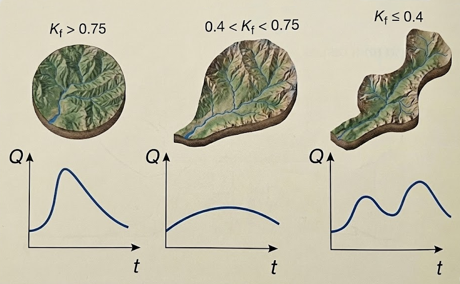
```

::: {.callout-note title="Ejemplo: factor de forma"}
Una cuenca tiene un área de 120 km² y una longitud axial de 18 km. Con la @eq-cuenca-kf:

$$
K_f = \frac{120}{18^2} = \frac{120}{324} = 0.37
$$

Según el @tbl-factor-forma, la cuenca es moderadamente alargada, parecida a un rectángulo casi 3 veces más largo que ancho. La escorrentía de las cabeceras tarda bastante más en llegar al punto de control que la de la parte baja, así que el hidrograma será más tendido que el de una cuenca compacta de igual área.
:::

### Densidad de drenaje {#sec-cuenca-densidad}

La **densidad de drenaje** es la longitud total de cauces por unidad de área:

$$
D_d = \frac{\sum L_i}{A}
$$ {#eq-cuenca-dd}

donde $\sum L_i$ es la suma de las longitudes de todos los cauces de la cuenca, permanentes, intermitentes y efímeros (km), y $A$ es el área de la cuenca (km²). $D_d$ se expresa en km/km².

La densidad de drenaje resume el efecto conjunto de la geología, el suelo, el clima y la vegetación [@Bloschl2013PUB]:

- Una **densidad alta** indica una red densa y ramificada. Suele aparecer en suelos poco permeables o fáciles de erosionar, con pendientes fuertes y poca vegetación. El agua llega pronto a un cauce, el tiempo de concentración es corto y los picos son altos.
- Una **densidad baja** indica una red poco desarrollada. Suele aparecer en materiales muy permeables, pendientes suaves o suelos resistentes a la erosión. Más agua se infiltra antes de llegar a un cauce y la respuesta es más lenta.

```{r}
#| label: fig-drenaje
#| fig-cap: "Densidad de drenaje y respuesta de la cuenca."
#| fig-alt: "Dos cuencas, una con red densa y otra con red escasa, y sus hidrogramas"
#| echo: false

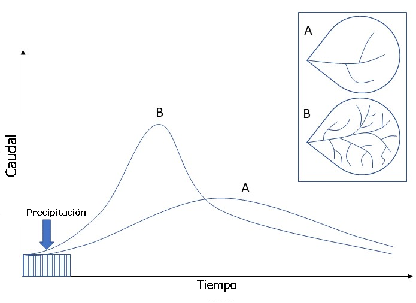
```

No hay un rango universal. Strahler [-@strahler1957quantitative] mostró que $D_d$ varía en más de dos órdenes de magnitud: en las tierras malas (*badlands*), sobre arcillas desnudas, encontró entre 200 y 900 millas de cauce por milla cuadrada, es decir, unos 120 a 560 km/km², mientras que en terrenos permeables y con buena cobertura vegetal los valores son de pocos kilómetros por kilómetro cuadrado o menos. Además, el valor depende de la escala del mapa con que se trazaron los cauces: un mapa más detallado muestra más cauces pequeños y da una $D_d$ mayor. Por eso $D_d$ sirve sobre todo para comparar cuencas medidas con la misma cartografía.

::: {.callout-warning title="Cuidado"}
La densidad de drenaje depende de la escala del mapa. Un mapa o un MDE de baja resolución no muestra los cauces pequeños y suaviza las curvas de los ríos, así que subestima $\sum L_i$. Solo se comparan densidades medidas con la misma escala.
:::

::: {.callout-note title="Ejemplo: densidad de drenaje"}
Una cuenca tiene un área de 52.87 km² y la suma de las longitudes de sus cauces es 86.06 km. Con la @eq-cuenca-dd:

$$
D_d = \frac{86.06}{52.87} = 1.63 \ \text{km/km}^2
$$

El valor está en la parte media alta del rango típico. La red está bien desarrollada y la cuenca responderá con relativa rapidez, aunque no tanto como una cuenca con 2.5 km/km² o más.
:::

### Sinuosidad del cauce {#sec-cuenca-sinuosidad}

La **sinuosidad** mide cuánto se curva un cauce:

$$
S = \frac{L}{L_v}
$$ {#eq-cuenca-sinuosidad}

donde $L$ es la longitud del tramo medida a lo largo del thalweg, la línea que une los puntos más profundos del cauce, y $L_v$ es la longitud del mismo tramo medida en línea recta o siguiendo el eje del valle, en las mismas unidades.

Un cauce recto tiene $S = 1$. Cuanto más curvo, mayor es $S$ (@fig-sinuosidad). Un cauce más sinuoso recorre una distancia mayor para el mismo desnivel, así que su pendiente es menor, el agua va más despacio y la crecida tarda más en pasar. Un umbral muy usado es $S = 1.5$: por encima de ese valor el cauce se considera meándrico [@leopold1957channel].

```{r}
#| label: fig-sinuosidad
#| fig-cap: "Sinuosidad de un cauce: longitud por el cauce contra longitud en línea recta."
#| fig-alt: "Tramo de río curvo con la longitud medida por el cauce y la línea recta entre sus extremos"
#| echo: false

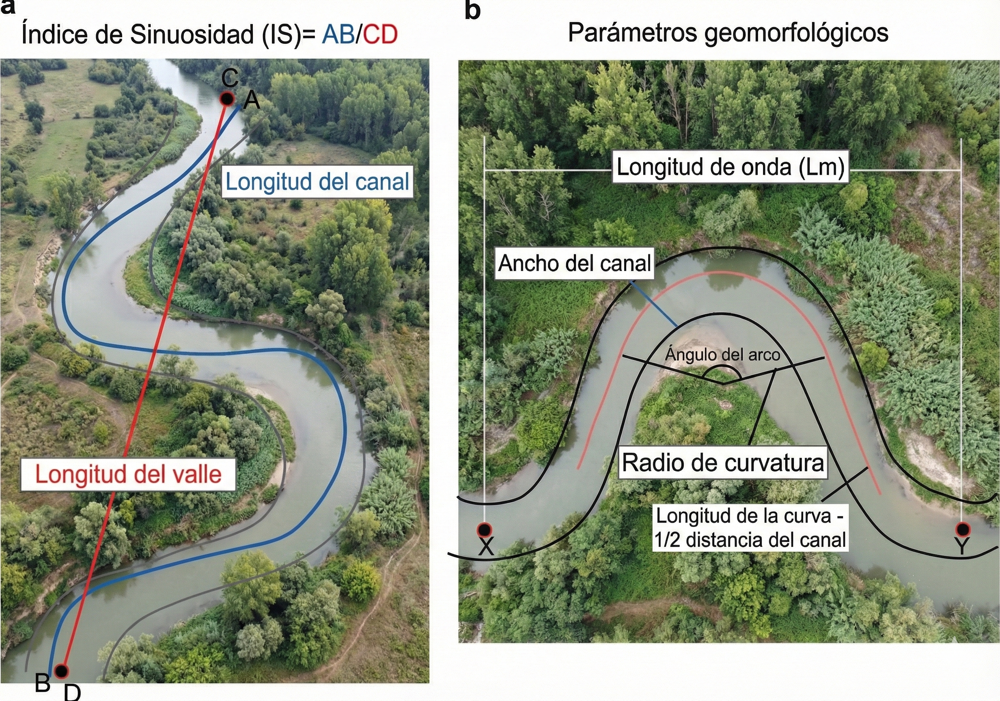
```

::: {.callout-note title="Ejemplo: sinuosidad de un tramo"}
Un tramo de río mide 12.6 km siguiendo el cauce y 8.4 km en línea recta. Con la @eq-cuenca-sinuosidad:

$$
S = \frac{12.6}{8.4} = 1.50
$$

El tramo está justo en el límite de los cauces meándricos. Su pendiente es dos tercios de la que tendría un cauce recto con el mismo desnivel, y el tiempo de tránsito de una crecida por el tramo será mayor.
:::

### Patrón del cauce en planta {#sec-cuenca-alineamiento}

Según su forma en planta, los cauces naturales se agrupan en tres tipos (@fig-alineamiento):

- **Rectos.** El eje del cauce es casi rectilíneo, aunque el flujo oscila de una orilla a otra. En llanuras aluviales son raros en estado natural; muchos son tramos rectificados por obras.
- **Meándricos.** Forman curvas alternas en forma de S. Son típicos de llanuras con pendientes suaves y orillas fáciles de erosionar. Las curvas alargan el recorrido y reducen la pendiente y la velocidad del agua.
- **Trenzados.** El cauce se divide en varios canales que se separan y se vuelven a unir alrededor de barras de sedimento. Aparecen con pendientes relativamente fuertes, caudales muy variables y mucho sedimento grueso, y cambian de forma con cada crecida.

```{r}
#| label: fig-alineamiento
#| fig-cap: "Patrones de cauce en planta: recto, meándrico y trenzado. Fuente: @Charlton2008."
#| fig-alt: "Tres esquemas de cauce visto en planta: recto, meándrico y trenzado"
#| echo: false

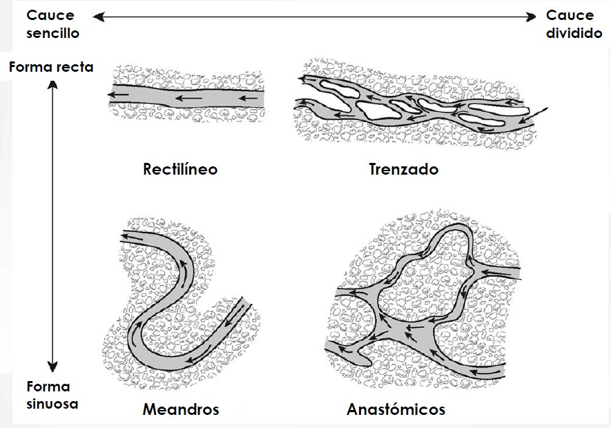
```

::: {.callout-warning title="Cuidado"}
Un cauce trenzado no es lo mismo que un cauce anastomosado. El trenzado tiene canales separados por barras de sedimento que cambian con cada crecida. El anastomosado tiene canales separados por islas estables con vegetación.
:::

### Patrones de drenaje {#sec-cuenca-patrones}

El patrón de drenaje es la forma que toma la red de cauces vista en un mapa (@fig-patrones). Lo controlan la geología (tipo de roca, fallas, fracturas y pliegues) y la topografía, así que el patrón da pistas sobre la geología de la cuenca.

```{r}
#| label: fig-patrones
#| fig-cap: "Patrones de drenaje."
#| fig-alt: "Nueve esquemas de redes de drenaje: dendrítico, paralelo, enrejado, radial, centrífugo, centrípeto, distributario, rectangular y anular"
#| echo: false

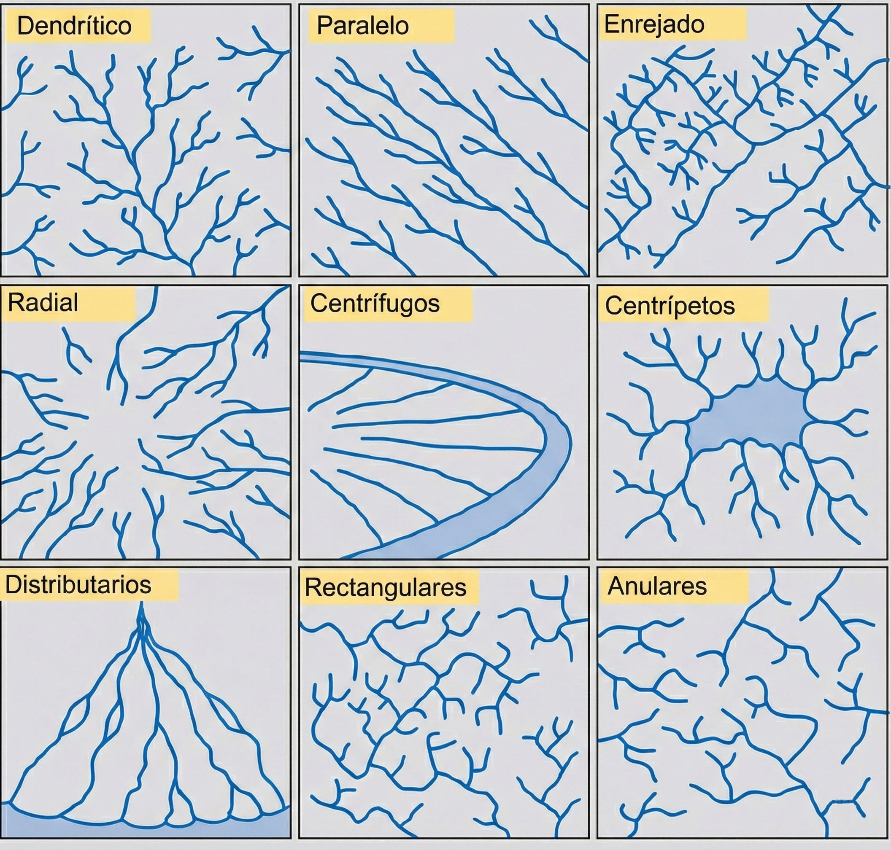
```

- **Dendrítico.** Ramificado como un árbol, con afluentes que llegan en ángulos variados. Se forma sobre rocas o sedimentos de resistencia uniforme, sin fallas que orienten el flujo. Es el más común.
- **Paralelo.** Cauces casi paralelos, con afluentes que llegan en ángulos agudos. Se forma sobre pendientes regionales fuertes y uniformes o donde fallas paralelas orientan el flujo.
- **Enrejado.** Cauces principales paralelos con afluentes que llegan casi en ángulo recto. Se forma sobre franjas alternas de rocas duras y blandas, como en terrenos plegados.
- **Rectangular.** Cauces que cambian de dirección en ángulo recto, siguiendo un sistema de fracturas o fallas. Es menos regular que el enrejado.
- **Radial.** Los cauces bajan en todas direcciones desde un punto alto, como en los conos volcánicos.
- **Centrífugo.** Variante del radial en la que los cauces se abren desde una zona alta hacia un colector que la rodea en arco, como se ve en la figura.
- **Centrípeto.** Los cauces convergen hacia un punto bajo central, como en cráteres, calderas y cuencas endorreicas, es decir, cuencas cuya salida es un lago o una laguna interior y no el mar.
- **Anular.** Cauces principales en anillos concéntricos, con afluentes en ángulo recto. Se forma en domos o cuencas estructurales erosionados.
- **Distributario.** El cauce se divide aguas abajo en varios brazos que se abren sobre una llanura, como en los abanicos aluviales y los deltas.

## Relieve {#sec-cuenca-relieve}

El relieve controla la velocidad con que el agua llega al punto de control. Las pendientes, las elevaciones y su distribución en la cuenca influyen en el tiempo de concentración, en la sincronía de los aportes y en la forma del hidrograma [@Aparicio1992].

### Elevaciones {#sec-cuenca-elevaciones}

La distribución de las elevaciones se resume con cuatro valores:

- la **elevación máxima**, en las cabeceras;
- la **elevación mínima**, en el punto de control;
- la **elevación media**, que se relaciona con la temperatura y la lluvia de la cuenca;
- la **elevación mediana**, la que deja la mitad del área por encima y la mitad por debajo. Representa mejor a la cuenca que la media cuando unas pocas zonas muy altas suben el promedio.

```{r}
#| label: fig-DEM
#| fig-cap: "Modelo digital de elevación de la cuenca del río La Estrella."
#| fig-alt: "Mapa de la cuenca del río La Estrella coloreado según la elevación"
#| out-width: 100%
#| echo: false

knitr::include_graphics("assets/img/DEM.png")
```

<!-- CITA PENDIENTE: fuente del MDE y de los datos de áreas por elevación del río La Estrella. -->

### Histograma de elevaciones {#sec-cuenca-histograma}

El **histograma de elevaciones** muestra qué porcentaje del área de la cuenca está en cada intervalo de elevación. Para construirlo se divide el rango de elevaciones en intervalos (por ejemplo, de 50, 100 o 200 m), se mide el área de cada intervalo en el MDE o en el mapa de curvas de nivel y se expresa como porcentaje del área total. Intervalos pequeños dan más detalle; intervalos grandes, una visión de conjunto.

La @fig-histo2 muestra el histograma de la cuenca del río La Estrella, construido a partir de las áreas por debajo de cada cota obtenidas del MDE de la @fig-DEM.

```{r}
#| label: fig-histo2
#| fig-cap: "Histograma de elevaciones de la cuenca del río La Estrella."
#| fig-alt: "Barras horizontales del porcentaje de área por intervalo de 100 m; la mayor parte del área está por debajo de 600 m"

library(tidyverse)

# Área por debajo de cada cota (m²), obtenida del MDE
estrella <- tibble(
  cota = seq(83.04, 2283.04, by = 100),
  area_bajo_m2 = c(
    105741200, 217689700, 293419600, 355367300, 414231200,
    457549800, 494993600, 526764100, 550515100, 570622400,
    590035700, 611034000, 631324800, 650484600, 666875300,
    680265200, 690575500, 698378300, 703818400, 707048900,
    709171300, 709985700, 710048400
  )
)

# Área de cada intervalo y porcentaje del área total
estrella <- estrella %>%
  mutate(
    area_km2 = (area_bajo_m2 - lag(area_bajo_m2, default = 0)) / 1e6,
    porcentaje = 100 * area_km2 / sum(area_km2),
    intervalo = if_else(row_number() == 1, "Menos de 83",
                        sprintf("%.0f a %.0f", cota - 100, cota)),
    intervalo = fct_inorder(intervalo)
  )

ggplot(estrella, aes(x = porcentaje, y = intervalo)) +
  geom_col(fill = "#5B9BD5") +
  labs(x = "Porcentaje del área de la cuenca (%)",
       y = "Intervalo de elevación (m s. n. m.)") +
  theme_minimal()
```

En el río La Estrella el área se concentra en las partes bajas: la mitad de la cuenca, de 710 km², está por debajo de unos 380 m, y por encima de unos 1480 m solo queda el 6 %.

::: {.callout-note title="Ejemplo: histograma de elevaciones a partir de áreas acumuladas"}
De una cuenca de 52.9 km² se conoce el área que queda por debajo de cada cota. La elevación mínima está por debajo de 200 m y la máxima es 1000 m.

| Cota (m s. n. m.) | Área por debajo de la cota (km²) |
|:---:|:---:|
| 200 | 5.2 |
| 400 | 14.8 |
| 600 | 28.1 |
| 800 | 41.0 |
| 1000 | 52.9 |

Construya el histograma de elevaciones con intervalos de 200 m.

**Resolución a mano**

1. Área de cada intervalo: se resta cada área acumulada de la siguiente.
   - menos de 200 m: 5.2 km²;
   - 200 a 400 m: $14.8 - 5.2 = 9.6$ km²;
   - 400 a 600 m: $28.1 - 14.8 = 13.3$ km²;
   - 600 a 800 m: $41.0 - 28.1 = 12.9$ km²;
   - 800 a 1000 m: $52.9 - 41.0 = 11.9$ km².
2. Porcentaje: se divide cada área entre 52.9 km² y se multiplica por 100. Se obtiene 9.8 %, 18.1 %, 25.1 %, 24.4 % y 22.5 %, que suman 100 %.
3. Se dibuja una barra por intervalo con altura igual a su porcentaje.

**Pseudocódigo**

1. Escribir las cotas y las áreas acumuladas.
2. Restar cada área acumulada de la siguiente para obtener el área de cada intervalo.
3. Dividir entre el área total para obtener el porcentaje.
4. Graficar el porcentaje de cada intervalo.

```{r}
#| label: ej-cuenca-histograma
#| code-fold: false

library(tidyverse)

# 1) Área por debajo de cada cota (km²)
acumulada <- tibble(
  cota = c(200, 400, 600, 800, 1000),
  area_bajo = c(5.2, 14.8, 28.1, 41.0, 52.9)
)

# 2) y 3) Área y porcentaje de cada intervalo
histograma <- acumulada %>%
  mutate(
    area_km2 = area_bajo - lag(area_bajo, default = 0),
    porcentaje = 100 * area_km2 / max(area_bajo),
    intervalo = if_else(cota == 200, "Menos de 200",
                        paste(cota - 200, "a", cota)),
    intervalo = fct_inorder(intervalo)
  )

histograma
```

```{r}
#| label: fig-histoejemplo
#| fig-cap: "Histograma de elevaciones de la cuenca del ejemplo."
#| fig-alt: "Cinco barras horizontales; los intervalos de 400 a 600 m y de 600 a 800 m tienen las barras más largas"
#| code-fold: false

# 4) Histograma
ggplot(histograma, aes(x = porcentaje, y = intervalo)) +
  geom_col(fill = "darkseagreen3", color = "black") +
  labs(x = "Porcentaje del área (%)",
       y = "Intervalo de elevación (m s. n. m.)") +
  theme_minimal()
```

**Interpretación.** Los intervalos de 400 a 600 m y de 600 a 800 m concentran casi la mitad del área (25 % y 24 %). La cuenca es sobre todo de altitud media, y la lluvia y la temperatura de esa franja serán las que más pesen en su respuesta.
:::

### Curva hipsométrica {#sec-cuenca-hipsometrica}

La **curva hipsométrica** muestra, para cada elevación, qué porcentaje del área de la cuenca queda por encima de ella. Por convención, la elevación va en el eje vertical y el porcentaje de área en el horizontal: a la elevación máxima le corresponde 0 % y a la mínima, 100 % (@fig-hipso2).

```{r}
#| label: fig-hipso2
#| fig-cap: "Curva hipsométrica de una cuenca."
#| fig-alt: "Curva decreciente de elevación contra porcentaje de área por encima de cada cota"
#| echo: false

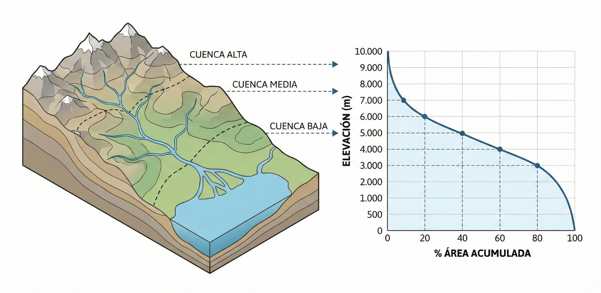
```

Para construirla:

1. Se delimitan las franjas entre curvas de nivel consecutivas (@fig-hipso3).
2. Se mide el área de cada franja.
3. Se suman las áreas desde la cota más alta hacia abajo, para obtener el área por encima de cada cota.
4. Se expresa esa área como porcentaje del área total.
5. Se grafica la elevación contra el porcentaje.

```{r}
#| label: fig-hipso3
#| fig-cap: "Franja de la cuenca comprendida entre dos curvas de nivel."
#| fig-alt: "Mapa de una cuenca con una franja sombreada entre dos curvas de nivel"
#| out-width: 60%
#| echo: false

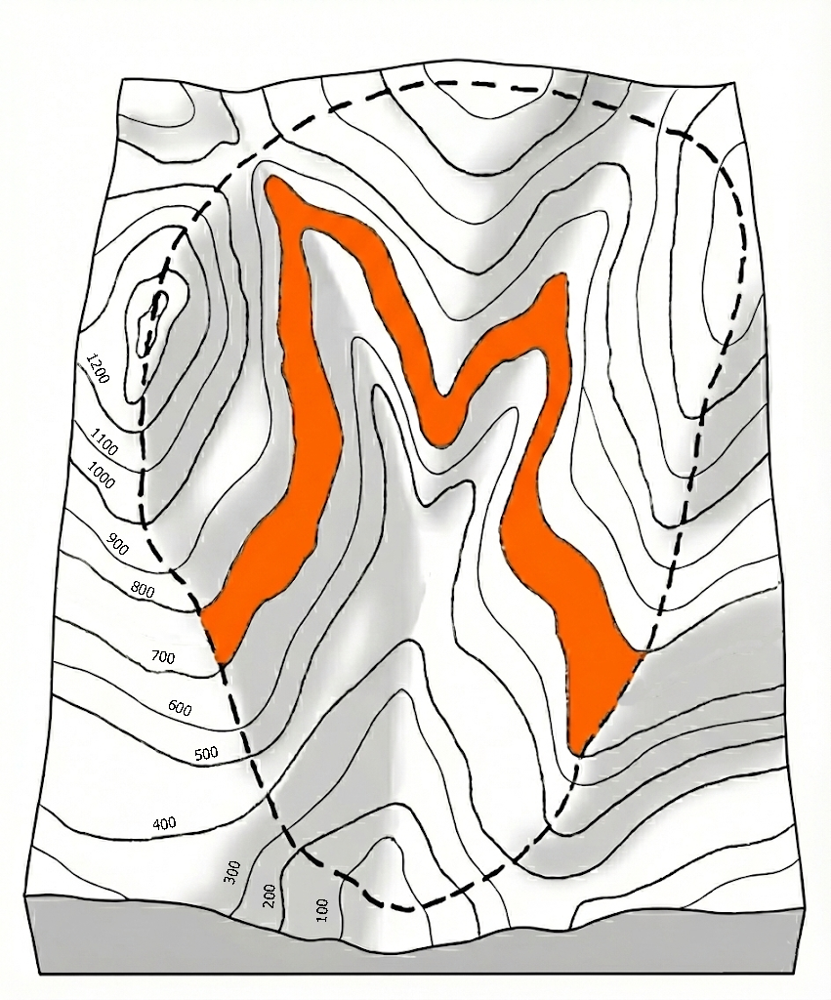
```

Strahler [-@strahler1952hypsometric; -@strahler1957quantitative] relacionó la forma de la curva con la etapa de erosión de la cuenca (@fig-hipso). Él habló de etapas de desequilibrio, de equilibrio y de monadnock; en los textos de hidrología se les llama juventud, madurez y vejez:

- **Curva convexa** (con mucha área a gran altura): cuenca joven, en plena erosión, con valles profundos y mucha masa todavía por erosionar.
- **Curva en forma de S:** cuenca madura, en la que la erosión y el depósito están cerca del equilibrio.
- **Curva cóncava** (con mucha área a poca altura): cuenca vieja, muy erosionada, con relieve suave y amplias zonas planas.

```{r}
#| label: fig-hipso
#| fig-cap: "Forma de la curva hipsométrica según la etapa de erosión de la cuenca."
#| fig-alt: "Tres curvas hipsométricas: convexa para una cuenca joven, en S para una madura y cóncava para una vieja"
#| echo: false

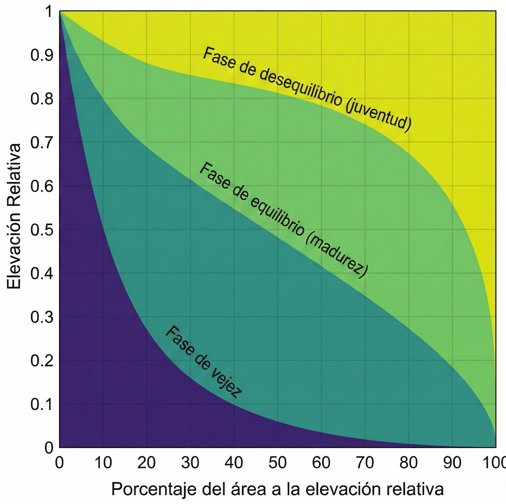
```

::: {.callout-note title="Ejemplo: curva hipsométrica"}
Una cuenca va de 500 a 900 m s. n. m. Se midió el área de cada franja de 50 m:

| Franja (m s. n. m.) | 900 a 850 | 850 a 800 | 800 a 750 | 750 a 700 | 700 a 650 | 650 a 600 | 600 a 550 | 550 a 500 |
|---|:-:|:-:|:-:|:-:|:-:|:-:|:-:|:-:|
| Área (km²) | 2.40 | 4.10 | 6.80 | 9.30 | 11.20 | 8.70 | 5.50 | 3.00 |

Construya la curva hipsométrica y calcule la elevación mediana.

**Resolución a mano**

1. Área total: $2.40 + 4.10 + 6.80 + 9.30 + 11.20 + 8.70 + 5.50 + 3.00 = 51.0$ km².
2. Área por encima de cada cota: se acumulan las franjas desde arriba.

| Cota (m s. n. m.) | 900 | 850 | 800 | 750 | 700 | 650 | 600 | 550 | 500 |
|---|:-:|:-:|:-:|:-:|:-:|:-:|:-:|:-:|:-:|
| Área por encima (km²) | 0 | 2.4 | 6.5 | 13.3 | 22.6 | 33.8 | 42.5 | 48.0 | 51.0 |
| Porcentaje (%) | 0 | 4.7 | 12.7 | 26.1 | 44.3 | 66.3 | 83.3 | 94.1 | 100 |

: Cálculo a mano de la curva hipsométrica. {#tbl-hipso-mano}

3. Se grafica la cota (eje vertical) contra el porcentaje (eje horizontal) y se unen los puntos.
4. Elevación mediana. La mitad del área son 25.5 km². Por encima de 700 m hay 22.6 km², así que faltan $25.5 - 22.6 = 2.9$ km² dentro de la franja de 700 a 650 m, que tiene 11.2 km². Interpolando linealmente: $700 - 50 \times 2.9/11.2 = 700 - 12.9 = 687$ m s. n. m.

**Pseudocódigo**

1. Escribir la cota inferior de cada franja y su área, de la más alta a la más baja.
2. Acumular las áreas: el área por encima de cada cota inferior es la suma de las franjas que están arriba.
3. Agregar la cota máxima con 0 % de área.
4. Convertir a porcentaje y graficar elevación contra porcentaje.
5. Interpolar la cota a la que corresponde el 50 % del área.

```{r}
#| label: ej-cuenca-hipsometrica
#| code-fold: false

library(tidyverse)

# 1) Cota inferior de cada franja y su área (km²), de arriba hacia abajo
franjas <- tibble(
  cota_inferior = seq(850, 500, by = -50),
  area_km2 = c(2.40, 4.10, 6.80, 9.30, 11.20, 8.70, 5.50, 3.00)
)
area_total <- sum(franjas$area_km2)

# 2) y 3) Área por encima de cada cota, con la cota máxima al inicio
hipso <- bind_rows(
  tibble(cota = 900, area_encima = 0),
  franjas %>% transmute(cota = cota_inferior, area_encima = cumsum(area_km2))
) %>%
  mutate(porcentaje = 100 * area_encima / area_total)

hipso

# 5) Elevación mediana: cota con 50 % del área por encima
cota_mediana <- approx(hipso$porcentaje, hipso$cota, xout = 50)$y
cota_mediana
```

```{r}
#| label: fig-curva-hipsometrica
#| fig-cap: "Curva hipsométrica de la cuenca del ejemplo."
#| fig-alt: "Curva de elevación contra porcentaje de área por encima, de 900 m con 0 % a 500 m con 100 %"
#| code-fold: false

# 4) Curva hipsométrica
ggplot(hipso, aes(x = porcentaje, y = cota)) +
  geom_line(linewidth = 1) +
  geom_point(size = 2) +
  geom_hline(yintercept = cota_mediana, linetype = "dashed") +
  scale_x_continuous(breaks = seq(0, 100, 10)) +
  labs(x = "Área por encima de la cota (%)", y = "Elevación (m s. n. m.)") +
  theme_minimal()
```

**Interpretación.** El área total es 51.0 km² y la elevación mediana es de unos `r round(cota_mediana)` m: la mitad de la cuenca está por encima de esa cota. La curva tiene forma de S, con la mayor parte del área entre 600 y 750 m, lo que corresponde a una cuenca madura.
:::

### Rectángulo equivalente {#sec-cuenca-rectangulo}

El **rectángulo equivalente** [@roche1963hydrologie] representa la cuenca como un rectángulo con la misma área y el mismo perímetro, y por tanto el mismo $K_c$. Las curvas de nivel se convierten en rectas paralelas al lado menor, separadas de modo que el área entre cada par de rectas sea igual al área entre las mismas curvas en la cuenca real (@fig-rec_equi). Así, el rectángulo conserva la curva hipsométrica de la cuenca.

Si $L$ es el lado mayor y $l$ el lado menor, se debe cumplir:

$$
A = L\,l, \qquad P = 2\,(L + l)
$$ {#eq-cuenca-rectangulo-condiciones}

Al combinar estas dos condiciones con la @eq-cuenca-kc se obtienen los lados:

$$
L = \frac{K_c\sqrt{A}}{1.12}\left[1 + \sqrt{1 - \left(\frac{1.12}{K_c}\right)^2}\right], \qquad
l = \frac{K_c\sqrt{A}}{1.12}\left[1 - \sqrt{1 - \left(\frac{1.12}{K_c}\right)^2}\right]
$$ {#eq-cuenca-rectangulo}

donde $A$ es el área de la cuenca (km²), $K_c$ es el coeficiente de compacidad y $L$ y $l$ resultan en km. Las ecuaciones solo tienen solución real si $K_c \geq 1.12$; una cuenca más compacta no tiene rectángulo equivalente.

```{r}
#| label: fig-rec_equi
#| fig-cap: "Rectángulo equivalente de una cuenca."
#| fig-alt: "Cuenca irregular junto a un rectángulo de igual área con las curvas de nivel como rectas paralelas"
#| echo: false

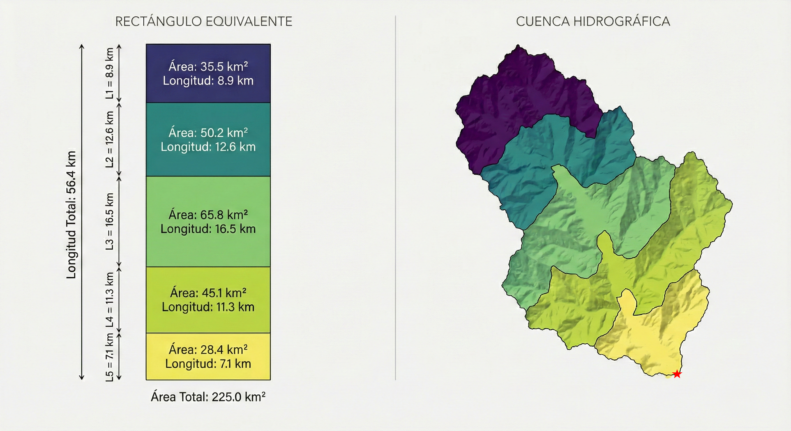
```

::: {.callout-note title="Ejemplo: rectángulo equivalente"}
Una cuenca tiene un área de 180 km² y un perímetro de 62 km. Calcule los lados de su rectángulo equivalente.

**Resolución a mano**

1. Coeficiente de compacidad: $K_c = 0.28 \times 62/\sqrt{180} = 0.28 \times 62/13.42 = 1.294$.
2. Término de la raíz: $1.12/K_c = 1.12/1.294 = 0.866$; al cuadrado, 0.749; y $\sqrt{1 - 0.749} = 0.501$.
3. Factor común: $K_c\sqrt{A}/1.12 = 1.294 \times 13.42 / 1.12 = 15.50$ km.
4. Lados: $L = 15.50 \times (1 + 0.501) = 23.26$ km y $l = 15.50 \times (1 - 0.501) = 7.74$ km.
5. Verificación: $23.26 \times 7.74 = 180.0$ km² y $2 \times (23.26 + 7.74) = 62.0$ km.

**Pseudocódigo**

1. Calcular $K_c$ con la @eq-cuenca-kc.
2. Calcular $L$ y $l$ con la @eq-cuenca-rectangulo.
3. Verificar que $L\,l = A$ y $2(L + l) = P$.

```{r}
#| label: ej-cuenca-rectangulo
#| code-fold: false

# Datos de la cuenca
area_km2 <- 180
perimetro_km <- 62

# 1) Coeficiente de compacidad
k_c <- 0.28 * perimetro_km / sqrt(area_km2)

# 2) Lados del rectángulo equivalente
raiz <- sqrt(1 - (1.12 / k_c)^2)
lado_mayor <- k_c * sqrt(area_km2) / 1.12 * (1 + raiz)
lado_menor <- k_c * sqrt(area_km2) / 1.12 * (1 - raiz)

# 3) Verificación
round(c(k_c = k_c, L = lado_mayor, l = lado_menor,
        area = lado_mayor * lado_menor,
        perimetro = 2 * (lado_mayor + lado_menor)), 2)
```

**Interpretación.** Con $K_c = 1.29$, el rectángulo mide unos 23.3 km por 7.7 km. Conserva el área y, con una diferencia mínima por el factor 0.28 redondeado, el perímetro. La cuenca se comporta como una franja tres veces más larga que ancha, y sobre ese rectángulo se calcula el índice de pendiente de la sección siguiente.
:::

### Índice de pendiente {#sec-cuenca-indice-pendiente}

El **índice de pendiente** de Roche [@roche1963hydrologie] resume el relieve de la cuenca a partir del rectángulo equivalente. Cada franja entre curvas de nivel aporta según su desnivel y según la fracción del área que ocupa:

$$
I_p = \frac{1}{\sqrt{L}} \sum_{i=1}^{n} \sqrt{\beta_i\,(a_i - a_{i-1})}
$$ {#eq-cuenca-ip}

donde $L$ es el lado mayor del rectángulo equivalente, $n$ es el número de franjas, $a_i$ y $a_{i-1}$ son las cotas de las curvas de nivel que limitan la franja $i$ (en las mismas unidades que $L$) y $\beta_i = A_i/A$ es la fracción del área total que ocupa la franja $i$.

Un $I_p$ alto indica un relieve fuerte, con escorrentía rápida, mayor capacidad de arrastre de sedimentos y mayor susceptibilidad a la erosión.

::: {.callout-note title="Ejemplo: índice de pendiente"}
Una cuenca de 60 km² va de 500 a 1000 m s. n. m. y su rectángulo equivalente tiene un lado mayor de 24 km. Las franjas entre curvas de nivel cada 100 m tienen estas áreas:

| Franja (m s. n. m.) | 500 a 600 | 600 a 700 | 700 a 800 | 800 a 900 | 900 a 1000 |
|---|:-:|:-:|:-:|:-:|:-:|
| Área (km²) | 6.0 | 14.0 | 18.0 | 12.0 | 10.0 |

Calcule el índice de pendiente.

**Resolución a mano**

Cada franja tiene un desnivel de 100 m = 0.1 km, en las mismas unidades que $L$.

| Franja (m s. n. m.) | Área (km²) | $\beta_i = A_i/60$ | $\sqrt{0.1\,\beta_i}$ |
|---|:-:|:-:|:-:|
| 500 a 600 | 6.0 | 0.100 | 0.1000 |
| 600 a 700 | 14.0 | 0.233 | 0.1528 |
| 700 a 800 | 18.0 | 0.300 | 0.1732 |
| 800 a 900 | 12.0 | 0.200 | 0.1414 |
| 900 a 1000 | 10.0 | 0.167 | 0.1291 |
| Suma | 60.0 | 1.000 | 0.6965 |

: Cálculo a mano del índice de pendiente. {#tbl-ip-mano}

Con la @eq-cuenca-ip: $I_p = 0.6965/\sqrt{24} = 0.6965/4.899 = 0.142$.

**Pseudocódigo**

1. Escribir el área de cada franja y su desnivel, en km.
2. Calcular la fracción de área $\beta_i$ de cada franja.
3. Sumar $\sqrt{\beta_i\,\Delta a_i}$ de todas las franjas.
4. Dividir entre $\sqrt{L}$.

```{r}
#| label: ej-cuenca-ip
#| code-fold: false

library(tidyverse)

lado_mayor_km <- 24

# 1) Área (km²) y desnivel (km) de cada franja
franjas_ip <- tibble(
  franja = c("500 a 600", "600 a 700", "700 a 800", "800 a 900", "900 a 1000"),
  area_km2 = c(6.0, 14.0, 18.0, 12.0, 10.0),
  desnivel_km = 0.1
)

# 2) y 3) Fracción de área y término de la suma
franjas_ip <- franjas_ip %>%
  mutate(beta = area_km2 / sum(area_km2),
         termino = sqrt(beta * desnivel_km))

# 4) Índice de pendiente
i_p <- sum(franjas_ip$termino) / sqrt(lado_mayor_km)

franjas_ip
i_p
```

**Interpretación.** La suma de los términos es `r round(sum(franjas_ip$termino), 3)` y el índice de pendiente vale `r round(i_p, 3)`. Por sí solo el número dice poco: su utilidad está en comparar cuencas o subcuencas calculadas con el mismo procedimiento. Una subcuenca con un $I_p$ mayor tendrá, en igualdad de otras condiciones, una respuesta más rápida.
:::

### Pendiente de las laderas {#sec-cuenca-pendiente-laderas}

La pendiente de las laderas controla la velocidad del flujo sobre el terreno y la capacidad del agua para erosionar [@Linsley1958]. Mientras el área define cuánta agua escurre, la pendiente define qué tan rápido llega a los cauces, y con ello el tiempo de concentración y el caudal pico. Además:

- con pendientes mayores el agua corre más rápido y queda menos tiempo para infiltrarse;
- las laderas largas y empinadas, con poca vegetación, sufren más erosión, con surcos y cárcavas;
- en pendientes muy fuertes, por encima de 50 % a 75 %, aumenta el riesgo de deslizamientos y flujos de detritos.

La pendiente media de las laderas se calcula hoy con un SIG a partir del MDE. Sobre mapas de curvas de nivel se usa el **método de Horton**: se superpone una cuadrícula a la cuenca, se cuentan las intersecciones de las líneas de la cuadrícula con las curvas de nivel y se calcula la pendiente en cada dirección [@Aparicio1992]:

$$
S = \frac{n\,e}{\sum L}
$$ {#eq-cuenca-horton}

donde $n$ es el número de intersecciones de las líneas de la cuadrícula con las curvas de nivel, $e$ es la equidistancia entre curvas de nivel y $\sum L$ es la longitud total de las líneas de la cuadrícula dentro de la cuenca, en las mismas unidades que $e$.

La pendiente media es el promedio de las pendientes calculadas con las líneas horizontales y con las verticales de la cuadrícula: $S_m = (S_x + S_y)/2$. En su forma completa, Horton multiplicaba el resultado por $\sec\theta$, donde $\theta$ es el ángulo entre las líneas de la cuadrícula y las curvas de nivel; como ese ángulo varía mucho dentro de la cuenca, en la práctica se toma $\sec\theta = 1$ [@Aparicio1992].

Para describir el terreno, en Costa Rica se usan las categorías de pendiente de la metodología oficial de capacidad de uso de las tierras [@mag2019capacidad], que se resumen en el @tbl-pendientes.

| Categoría | Pendiente (%) | Relieve |
|:---:|:---:|:---|
| a | 0 a 3 | Plano o casi plano |
| b | 4 a 8 | Ligeramente ondulado |
| c | 9 a 15 | Moderadamente ondulado |
| d | 16 a 30 | Ondulado |
| e | 31 a 55 | Fuertemente ondulado |
| f | 56 a 75 | Escarpado |
| g | Más de 75 | Fuertemente escarpado |

: Categorías de pendiente según el relieve. Fuente: @mag2019capacidad. {#tbl-pendientes}

### Pendiente del cauce principal {#sec-cuenca-pendiente-cauce}

La pendiente del cauce principal controla la velocidad del agua en el cauce y, con ella, el tiempo de concentración. El perfil de un río no es recto: suele ser cóncavo hacia arriba, con pendientes fuertes en las cabeceras y suaves cerca de la salida. Por eso se usan tres formas de resumirlo en un solo valor.

**Pendiente media, $S_1$.** Es el desnivel total entre la longitud del cauce (@fig-s1):

$$
S_1 = \frac{h_{max} - h_{min}}{L}
$$ {#eq-cuenca-s1}

donde $h_{max}$ es la elevación del extremo superior del cauce principal (m), $h_{min}$ es la elevación del punto de control (m) y $L$ es la longitud del cauce principal (m).

Es fácil de calcular, pero ignora la forma del perfil: dos ríos con los mismos extremos tienen la misma $S_1$ aunque uno tenga un tramo muy plano que retrasa la crecida.

```{r}
#| label: fig-s1
#| fig-cap: "Pendiente media del cauce principal, S1."
#| fig-alt: "Perfil longitudinal de un río con una recta que une sus dos extremos"
#| echo: false

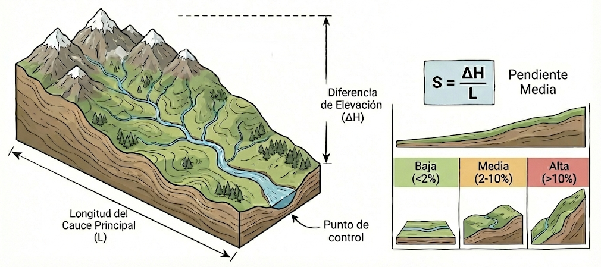
```

**Pendiente compensada, $S_2$.** Es la pendiente de una recta trazada desde el punto de control de modo que el área bajo la recta sea igual al área bajo el perfil del río (@fig-s2):

$$
S_2 = \frac{z_A - h_{min}}{L}
$$ {#eq-cuenca-s2}

donde $z_A$ es la elevación del extremo superior de esa recta (m), $h_{min}$ es la elevación del punto de control (m) y $L$ es la longitud del cauce principal (m). Como el área bajo la recta es un triángulo sobre $h_{min}$, $z_A = h_{min} + 2\,A_p/L$, donde $A_p$ es el área entre el perfil y la horizontal de $h_{min}$.

```{r}
#| label: fig-s2
#| fig-cap: "Pendiente compensada del cauce principal, S2. Fuente: @Porras2025."
#| fig-alt: "Perfil de un río con una recta desde la salida que deja igual área por encima y por debajo"
#| echo: false

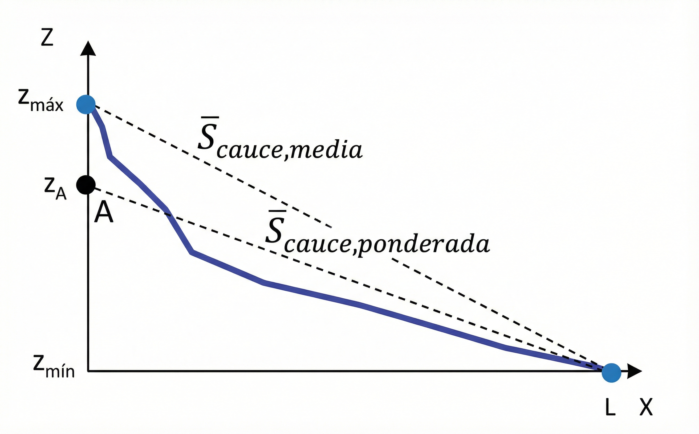
```

**Pendiente de Taylor y Schwarz, $S_3$.** Es la pendiente de un canal uniforme de la misma longitud que el río en el que el agua tardaría lo mismo en recorrerlo [@taylor1952unit]. Parte de que la velocidad del flujo es proporcional a la raíz de la pendiente, $V \propto \sqrt{S}$, como en las ecuaciones de Manning y Chézy [@Aparicio1992]. Si el cauce se divide en $n$ tramos de longitud $l_i$ y pendiente $S_i$, el tiempo de recorrido es proporcional a $\sum l_i/\sqrt{S_i}$, y la pendiente equivalente es:

$$
S_3 = \left[\frac{\sum_{i=1}^{n} l_i}{\sum_{i=1}^{n} \dfrac{l_i}{\sqrt{S_i}}}\right]^2
$$ {#eq-cuenca-s3}

donde $l_i$ es la longitud del tramo $i$ (m) y $S_i$ es su pendiente (m/m). Si los $n$ tramos tienen la misma longitud, la ecuación se reduce a:

$$
S_3 = \left[\frac{n}{\sum_{i=1}^{n} \dfrac{1}{\sqrt{S_i}}}\right]^2
$$ {#eq-cuenca-s3-iguales}

$S_3$ da más peso a los tramos planos, que son los que más retrasan el agua, y por eso es la que mejor se relaciona con el tiempo de concentración (@fig-s3).

```{r}
#| label: fig-s3
#| fig-cap: "Pendiente de Taylor y Schwarz, S3: el perfil se divide en tramos de pendiente uniforme. Fuente: @Porras2025."
#| fig-alt: "Perfil de un río dividido en tramos, cada uno con su pendiente"
#| echo: false

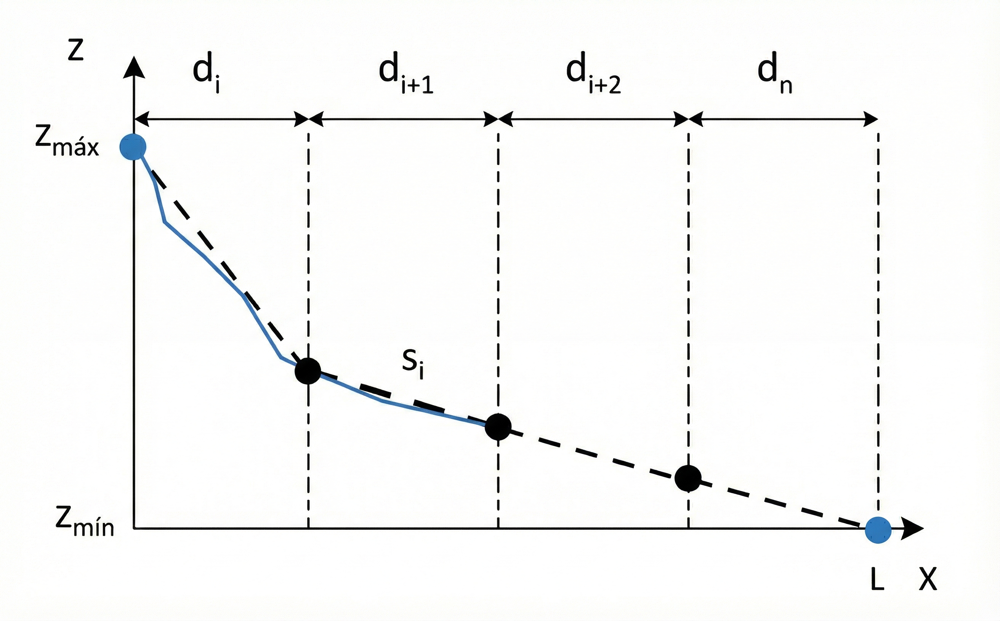
```

::: {.callout-note title="Ejemplo: pendiente de Taylor y Schwarz"}
Un cauce de 2000 m se dividió en cinco tramos de 400 m con desniveles de 8, 10, 12, 15 y 20 m, del tramo más bajo al más alto. Calcule $S_1$ y $S_3$.

**Resolución a mano**

1. Pendiente de cada tramo, $S_i = \Delta h_i / 400$: 0.0200, 0.0250, 0.0300, 0.0375 y 0.0500.
2. Pendiente media: $S_1 = (8 + 10 + 12 + 15 + 20)/2000 = 65/2000 = 0.0325$.
3. Para $S_3$ se calcula $l_i/\sqrt{S_i}$ en cada tramo:

| Tramo | $S_i$ | $\sqrt{S_i}$ | $l_i/\sqrt{S_i}$ |
|:-:|:-:|:-:|:-:|
| 1 | 0.0200 | 0.1414 | 2828.4 |
| 2 | 0.0250 | 0.1581 | 2529.8 |
| 3 | 0.0300 | 0.1732 | 2309.4 |
| 4 | 0.0375 | 0.1936 | 2065.6 |
| 5 | 0.0500 | 0.2236 | 1788.9 |
| Suma | | | 11 522.1 |

: Cálculo a mano de la pendiente de Taylor y Schwarz. {#tbl-taylor-mano}

4. Con la @eq-cuenca-s3: $S_3 = (2000/11\,522.1)^2 = 0.1736^2 = 0.0301$.

Como los tramos tienen la misma longitud, la @eq-cuenca-s3-iguales da lo mismo: $S_3 = [5/(1/0.1414 + 1/0.1581 + 1/0.1732 + 1/0.1936 + 1/0.2236)]^2 = (5/28.81)^2 = 0.0301$.

**Pseudocódigo**

1. Escribir la longitud y el desnivel de cada tramo.
2. Calcular la pendiente de cada tramo, $S_i = \Delta h_i / l_i$.
3. Calcular $S_1$ con el desnivel total.
4. Calcular $S_3$ con la @eq-cuenca-s3.

```{r}
#| label: ej-cuenca-taylor
#| code-fold: false

library(tidyverse)

# 1) Longitud (m) y desnivel (m) de cada tramo
tramos <- tibble(
  tramo = 1:5,
  longitud_m = 400,
  desnivel_m = c(8, 10, 12, 15, 20)
)

# 2) Pendiente de cada tramo y tiempo relativo de recorrido
tramos <- tramos %>%
  mutate(pendiente = desnivel_m / longitud_m,
         tiempo_relativo = longitud_m / sqrt(pendiente))

# 3) Pendiente media
s_1 <- sum(tramos$desnivel_m) / sum(tramos$longitud_m)

# 4) Pendiente de Taylor y Schwarz
s_3 <- (sum(tramos$longitud_m) / sum(tramos$tiempo_relativo))^2

tramos
round(c(S1 = s_1, S3 = s_3), 4)
```

**Interpretación.** La pendiente media es 0.0325 y la de Taylor y Schwarz es 0.0301. $S_3$ sale menor porque los tramos bajos, más planos, pesan más en el tiempo de recorrido. Si se usara $S_1$ en una fórmula de tiempo de concentración, se obtendría un tiempo algo más corto que el real.
:::

## Geología {#sec-cuenca-geologia}

La topografía define por dónde escurre el agua en superficie. La geología define cuánta agua puede entrar al subsuelo, cuánta se almacena y cuánta vuelve después a los cauces como flujo base. También influye en la química del agua (@fig-geologia).

El agua subterránea ocupa los vacíos de las rocas y los sedimentos:

- **Poros primarios:** se formaron junto con el material, como los espacios entre los granos de una arena.
- **Poros secundarios:** se formaron después, por fracturas, fallas o disolución, como en las calizas y en muchas rocas volcánicas.

La capacidad de almacenamiento se describe con estos parámetros:

- **Porosidad** $n$: volumen de vacíos entre volumen total, $n = V_v/V_t$.
- **Porosidad eficaz** $n_e$: fracción de vacíos conectados entre sí, por los que el agua puede circular.
- **Rendimiento específico** $S_y$: volumen de agua que un material saturado libera por gravedad, por unidad de volumen.
- **Retención específica** $S_r$: volumen de agua que queda retenido por capilaridad, por unidad de volumen.

Los dos últimos suman la porosidad: $n = S_y + S_r$. Una arcilla puede tener una porosidad alta y aun así liberar muy poca agua, porque casi toda queda retenida.

```{r}
#| label: fig-geologia
#| fig-cap: "Mapa geológico de Costa Rica. Fuente: @denyer2007mapa."
#| fig-alt: "Mapa de Costa Rica coloreado según las unidades geológicas"
#| out-width: 100%
#| echo: false

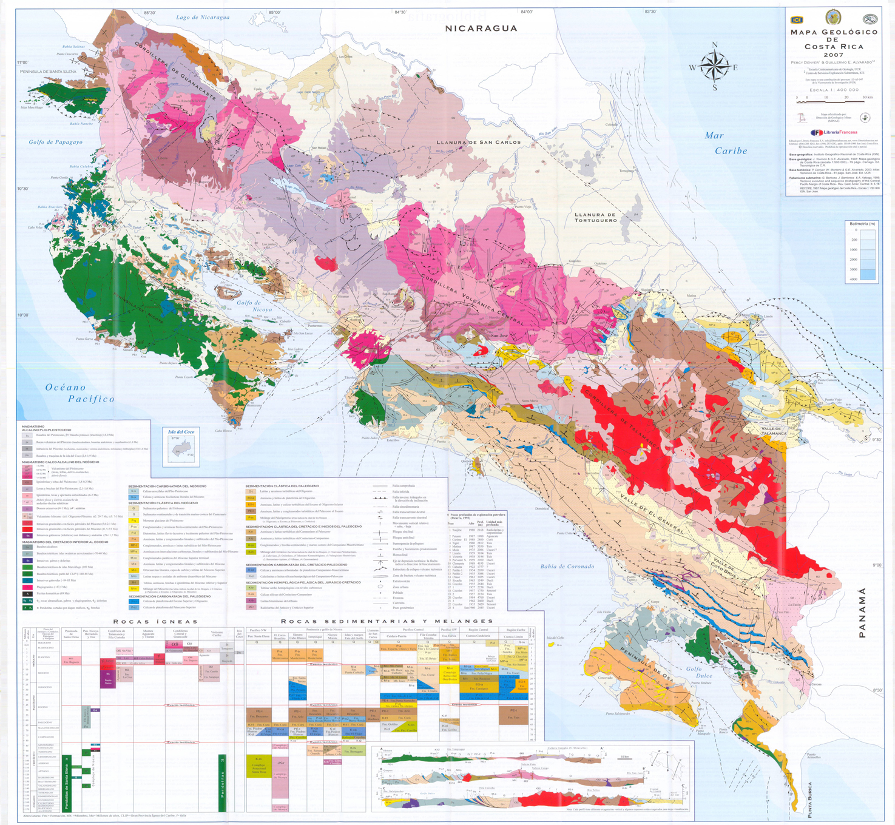
```

## Cobertura y uso del suelo {#sec-cuenca-cobertura}

El área y la forma de una cuenca no cambian en la escala de tiempo de un proyecto. La cobertura del suelo sí, por causas naturales o humanas, y con ella cambia la respuesta de la cuenca a la lluvia.

Conviene distinguir dos términos:

- La **cobertura** es lo que cubre físicamente el terreno: bosque, pasto, cultivos, agua, roca o superficies impermeables como techos y pavimentos.
- El **uso** es la actividad humana que se hace en el terreno: agrícola, urbano, forestal, de conservación. Un mismo uso, como el ganadero, puede tener coberturas distintas.

La vegetación y el suelo regulan el agua de tres maneras:

- **Intercepción.** El follaje y las ramas retienen parte de la lluvia, que se evapora sin llegar al suelo. En bosques puede ser una fracción importante de la lluvia de los eventos pequeños.
- **Infiltración.** Las raíces abren macroporos por los que el agua entra al suelo, y la cobertura amortigua el golpe de las gotas, que de otra forma sella la superficie.
- **Evapotranspiración.** Las plantas toman agua del suelo y la devuelven a la atmósfera. Es una de las salidas principales del balance hídrico de la cuenca.

```{r}
#| label: fig-cober
#| fig-cap: "Cobertura del suelo de Costa Rica según las capas oficiales del SNIT: bosque y cultivos de 2019, edificaciones de 2020 y pastos de 2022, en celdas de 300 m. En blanco quedan las zonas sin ninguna de esas coberturas, como cuerpos de agua y humedales. Fuente: elaboración propia con datos del SNIT [@snit2025]."
#| fig-alt: "Mapa de Costa Rica en CRTM05 coloreado por cobertura: bosque arbóreo, manglar, pastos, cultivos y zonas urbanas"
#| out-width: 100%
#| fig-width: 8.5
#| fig-height: 7

source("herramientas/mapas_cr.R")
capas <- leer_capas_cr()

# Clases y colores de la cobertura (raster de 100 m, agregado a 300 m para dibujar)
clases <- read.csv("datos/mapas/cobertura_clases.csv", fileEncoding = "UTF-8")
cobertura <- terra::rast("datos/mapas/cobertura_snit_100m.tif")
cobertura <- terra::aggregate(cobertura, fact = 3, fun = "modal", na.rm = TRUE)
celdas <- terra::as.data.frame(cobertura, xy = TRUE, na.rm = TRUE)
names(celdas)[3] <- "codigo"
celdas$clase <- factor(clases$clase[match(celdas$codigo, clases$codigo)],
                       levels = clases$clase)

ggplot() +
  geom_raster(data = celdas, aes(x = x, y = y, fill = clase)) +
  capa_relieve(capas, alfa_max = 0.35) +
  contorno_cr(capas) +
  scale_fill_manual(values = setNames(clases$color_sugerido, clases$clase),
                    name = "Cobertura") +
  guides(fill = guide_legend(nrow = 2, byrow = TRUE)) +
  marco_cr(capas)
```

Según esas capas, el bosque arbóreo ocupa unos 27 700 km², algo más de la mitad del país. Le siguen los pastos, con unos 13 600 km², y los cultivos, con unos 6100 km². Las zonas urbanas son menos del 2 % del territorio, pero concentran las superficies impermeables que más cambian la respuesta de una cuenca, como se ve en la sección siguiente.

## Cuencas urbanas {#sec-cuenca-urbana}

En una cuenca natural, la vegetación y los suelos permeables retienen el agua y la liberan poco a poco. El hidrograma es suave, el tiempo de concentración largo y los picos moderados.

La urbanización cambia eso. Techos, calles, aceras y estacionamientos reemplazan la vegetación y el suelo, así que se pierde la intercepción y se reduce la infiltración. Una fracción mucho mayor de la lluvia se convierte en escorrentía, y el agua llega más rápido a los cauces. El resultado son hidrogramas más altos y más cortos.

Además, en una ciudad la divisoria ya no la define solo la topografía (@fig-urbana2). Las calles y cunetas llevan el agua hacia los tragantes, y de ahí las tuberías pluviales la conducen a donde fueron diseñadas, que puede ser otra cuenca topográfica. La delimitación de una cuenca urbana se hace con el trazado del sistema pluvial, no solo con las curvas de nivel (@fig-urbana).

```{r}
#| label: fig-urbana2
#| fig-cap: "Cuenca natural y cuenca urbana sobre una misma zona. Imagen de Google Earth Engine (2025)."
#| fig-alt: "Imagen satelital con dos límites de cuenca superpuestos, el topográfico y el que define el sistema pluvial"
#| out-width: 100%
#| echo: false

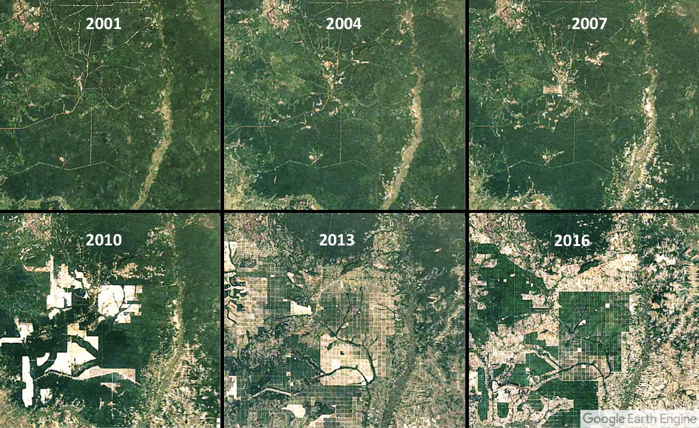
```

```{r}
#| label: fig-urbana
#| fig-cap: "Delimitación de una cuenca natural y de una cuenca urbana."
#| fig-alt: "Esquema comparativo de la divisoria topográfica y la divisoria definida por calles y tuberías"
#| echo: false

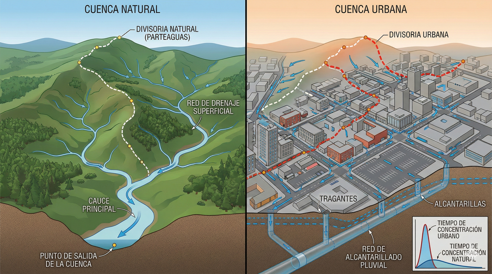
```

Estos cambios hacen a las ciudades más vulnerables a lluvias intensas, aun de corta duración. Los capítulos de hidrología urbana tratan el diseño del drenaje pluvial y las medidas para reducir la escorrentía.

## Fuentes de información en Costa Rica {#sec-cuenca-fuentes}

Para caracterizar una cuenca en Costa Rica se puede recurrir a:

- atlas digitales, como el [Atlas de Costa Rica del TEC](https://repositoriotec.tec.ac.cr/handle/2238/6749);
- mapas oficiales de suelos del [MAG](https://www.mag.go.cr/bibliotecavirtual/av-1630.pdf);
- imágenes satelitales, fotografías aéreas y cartografía del [SNIT](https://www.snitcr.go.cr/ico_servicios_ogc);
- informes geológicos, como los de la Escuela Centroamericana de Geología de la UCR;
- estudios anteriores sobre la cuenca.

::: {.callout-note title="Para profundizar: las leyes de Horton" collapse="true"}
Robert E. Horton [-@horton1945erosional] propuso tres leyes empíricas sobre la organización de las redes de drenaje. Las tres dicen que las propiedades de los cauces cambian en progresión geométrica con el orden:

1. **Ley de los números de cauces.** El número de cauces de cada orden disminuye en progresión geométrica al subir de orden, con razón $R_b$.
2. **Ley de las longitudes.** La longitud media de los cauces de cada orden aumenta en progresión geométrica, con razón $R_L$. Una ley parecida, propuesta después por Schumm, vale para las áreas de drenaje medias, con razón $R_A$.
3. **Ley de las pendientes.** La pendiente media de los cauces disminuye al subir de orden.

Estas leyes se cumplen en casi cualquier red natural, y por eso se usan para estimar características de cuencas sin mediciones detalladas.
:::
