::: {.quote-block}
"Cuando se puede medir aquello de lo que se habla y expresarlo en números, se sabe algo de ello."\
— *William Thomson (lord Kelvin), conferencia "Electrical Units of Measurement" (1883)*
:::

Casi todo cálculo hidrológico empieza con un registro: la lluvia diaria de una estación, la temperatura con que se estima la evapotranspiración o los aforos con que se construye la curva de descarga de un río. Muchos procesos de la cuenca no se pueden deducir solo con la física, así que el diseño se apoya en relaciones empíricas que se ajustan con datos medidos. Si los datos son malos, el caudal de diseño también lo será, por bueno que sea el método.

Este capítulo describe qué se mide, con qué instrumentos y con qué limitaciones. Conocer el instrumento ayuda a interpretar el dato: un pluviómetro que se lee una vez al día no da intensidades, un tanque evaporímetro sobrestima la evaporación de un embalse y un aforo hecho en aguas bajas no dice mucho de una crecida.

## Variables meteorológicas {#sec-fuentes-meteorologicas}

### Precipitación {#sec-fuentes-precipitacion}

La **precipitación** es el agua, líquida o sólida, que cae de las nubes y llega a la superficie: lluvia, llovizna, granizo y nieve. Es la entrada principal de cualquier balance hídrico y de casi todos los modelos de crecidas.

Se mide como la altura de la lámina de agua que se acumularía sobre una superficie horizontal, en milímetros. Un milímetro de lluvia equivale a un litro por metro cuadrado.

**Pluviómetro.** Es un recipiente cilíndrico con una boca de área conocida que recoge la lluvia. El agua se mide a mano con una probeta graduada, por lo general una vez al día y a una hora fija, por ejemplo a las 7:00. La Organización Meteorológica Mundial (OMM) recomienda bocas de entre 200 y 500 cm² [@wmo2018guia]. En sitios de difícil acceso se usan **pluviómetros totalizadores**, que acumulan la lluvia de semanas o meses bajo una capa de aceite que impide la evaporación. El pluviómetro da el total del periodo, pero no dice cómo se repartió la lluvia dentro de él.

**Pluviógrafo.** Registra la lluvia acumulada en función del tiempo. Con ese registro se calculan intensidades y se analizan tormentas, que es lo que piden las curvas IDF y el diseño de drenajes. Hay tres tipos:

- **De balanza:** pesa el agua acumulada y registra el peso en una banda de papel o en un registrador digital (*datalogger*).
- **De flotador:** el agua levanta un flotador que mueve una plumilla sobre un tambor giratorio (@fig-pluviografo). Un sifón vacía el recipiente cuando se llena.
- **De balancín o cubeta basculante:** un balancín con dos compartimentos se vuelca cada vez que recibe una cantidad fija de agua, por lo general 0.1 o 0.2 mm, y cada vuelco envía un pulso eléctrico al registrador (@fig-pluvio). Es el que usan las estaciones automáticas, porque la información se puede transmitir en tiempo real.

```{r}
#| label: fig-pluvio
#| fig-cap: "Pluviómetro de balancín."
#| fig-alt: "Esquema de un pluviómetro con embudo colector, balancín de doble cubeta, pivote, imán y registrador de datos"
#| echo: false
#| out-width: 70%

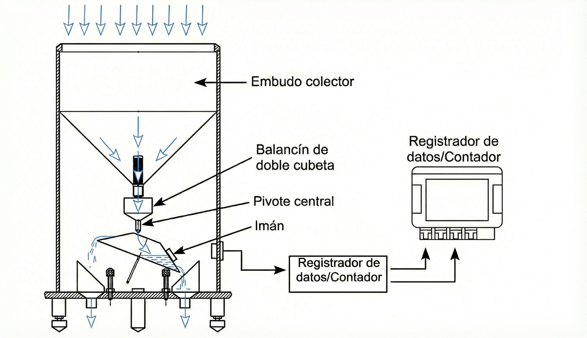
```

```{r}
#| label: fig-pluviografo
#| fig-cap: "Pluviógrafo de flotador: instrumento, banda de registro y esquema. Fuente: @Sanguesa2025_PluviographDataset."
#| fig-alt: "Fotografía de un pluviógrafo, de su tambor con la banda de papel y un esquema del embudo, el recipiente y la plumilla"
#| echo: false
#| out-width: 100%

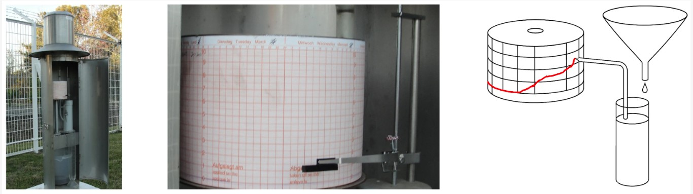
```

::: {.callout-warning title="Cuidado"}
El pluviómetro mide la lluvia en un punto. El viento desvía parte de las gotas alrededor de la boca, de modo que el instrumento tiende a registrar menos lluvia de la que cae, sobre todo con viento fuerte y llovizna [@wmo2018guia]. Un árbol o un edificio cercano también cambian la lectura.
:::

#### Radar y satélites {#sec-fuentes-radar}

Los sensores remotos miden la lluvia sobre áreas extensas, que es justo lo que no da un pluviómetro.

El **radar meteorológico** emite pulsos de microondas que rebotan en las gotas y los cristales de hielo. Lo que mide es la reflectividad $Z$, que se convierte en intensidad de lluvia $R$ con una relación potencial:

$$
Z = a\,R^b
$$ {#eq-fuentes-zr}

donde $Z$ es la reflectividad (mm⁶/m³), $R$ es la intensidad de lluvia (mm/h), y $a$ y $b$ son coeficientes empíricos que dependen del tipo de lluvia. La relación clásica de Marshall y Palmer usa $a = 200$ y $b = 1.6$ para lluvia estratiforme [@marshall1948distribution]. Para lluvia convectiva, la red de radares de los Estados Unidos usa $a = 300$ y $b = 1.4$ [@fulton1998wsr88d]. El radar cubre radios de más de 100 km, con celdas del orden de un kilómetro y un barrido nuevo cada pocos minutos (@fig-radar). Su estimación se corrige con pluviómetros, porque los coeficientes cambian de una tormenta a otra.

```{r}
#| label: fig-radar
#| fig-cap: "Lluvia detectada por un radar meteorológico sobre Centroamérica. Fuente: Instituto Nicaragüense de Estudios Territoriales (2020)."
#| fig-alt: "Imagen de radar con manchas de lluvia en verde, azul y amarillo sobre Nicaragua y el norte de Costa Rica"
#| echo: false
#| out-width: 50%

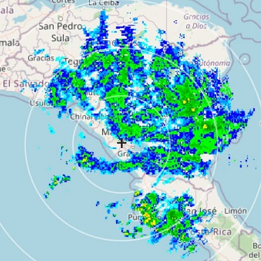
```

Los **satélites** estiman la lluvia con dos tipos de sensores. Los infrarrojos miden la temperatura del tope de las nubes: las nubes más frías y altas suelen dar más lluvia. Los de microondas responden directamente a las gotas y al hielo dentro de la nube, pero pasan por un mismo sitio pocas veces al día. Productos como CHIRPS combinan ambas fuentes con datos de estaciones y entregan series diarias desde 1981 con celdas de 0.05° [@CHIRPS], unos 5.5 km en Costa Rica (@fig-satelite).

```{r}
#| label: fig-satelite
#| fig-cap: "Precipitación media de mayo a agosto (1991–2020) estimada con CHIRPS. Fuente: @CHIRPS."
#| fig-alt: "Mapa de Costa Rica con la lluvia media de mayo a agosto en tonos de verde y azul"
#| echo: false
#| out-width: 55%

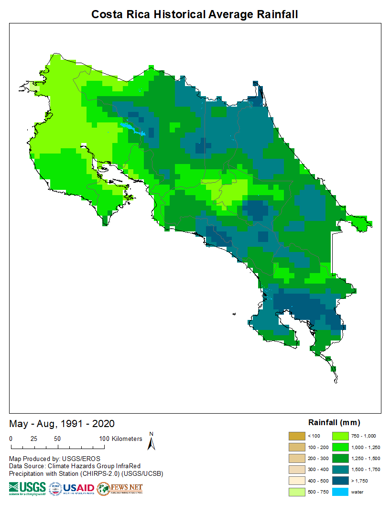
```

La lluvia medida en las estaciones se representa en mapas con **isoyetas**, líneas que unen puntos de igual precipitación (@fig-isoyetas). El cálculo de la lluvia media sobre una cuenca con isoyetas y otros métodos se trata en el capítulo de precipitación.

```{r}
#| label: fig-isoyetas
#| fig-cap: "Lluvia total del 28 de junio de 2022 en Costa Rica (datos preliminares). Fuente: @IMN_CostaRica."
#| fig-alt: "Mapa de Costa Rica con la lluvia de un día en tonos de azul, con máximos de más de 150 mm en el centro del país"
#| echo: false
#| out-width: 85%

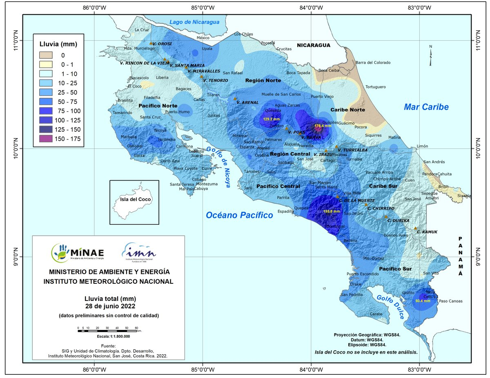
```

### Temperatura {#sec-fuentes-temperatura}

La **temperatura del aire** controla la evapotranspiración, la forma en que cae la precipitación y las propiedades del agua. Al subir la temperatura baja la viscosidad del agua, lo que cambia su movimiento en el suelo y en los acuíferos (@sec-fuentes-conductividad).

Se mide con:

- **Termómetros de líquido en vidrio:** el de máxima usa mercurio y tiene un estrangulamiento que impide que el líquido regrese; el de mínima usa alcohol y un índice que queda en el valor más bajo.
- **Termógrafos:** registran la temperatura en una banda de papel con una lámina bimetálica.
- **Sensores electrónicos:** termistores o termopares conectados al registrador de una estación automática.

Los instrumentos se colocan dentro de una caseta o pantalla ventilada que los protege del sol directo (@fig-higro). Con las lecturas se calculan estas variables:

- **Temperaturas máxima y mínima** ($T_{\text{máx}}$, $T_{\text{mín}}$): los valores extremos del día.
- **Temperatura media diaria** ($T_{\text{media}}$): el promedio de las lecturas horarias o, cuando solo hay extremas, $T_{\text{media}} = (T_{\text{máx}} + T_{\text{mín}})/2$. Las dos definiciones no dan lo mismo, así que conviene saber cuál se usó en una serie.
- **Temperatura media mensual y anual:** el promedio de las medias diarias del mes o del año.
- **Temperatura de punto de rocío** ($T_d$): la temperatura a la que hay que enfriar el aire, a presión constante, para que se sature (@sec-fuentes-humedad).

La distribución espacial de la temperatura se representa con **isotermas**. En Costa Rica la domina el relieve: las costas son las zonas más cálidas y las cumbres de las cordilleras las más frías (@fig-isoterma).

```{r}
#| label: fig-isoterma
#| fig-cap: "Temperatura media anual de Costa Rica (1970–2000). Fuente: @IMN_CostaRica."
#| fig-alt: "Mapa de Costa Rica con la temperatura media anual, roja en las costas y azul en las cordilleras"
#| echo: false
#| out-width: 80%

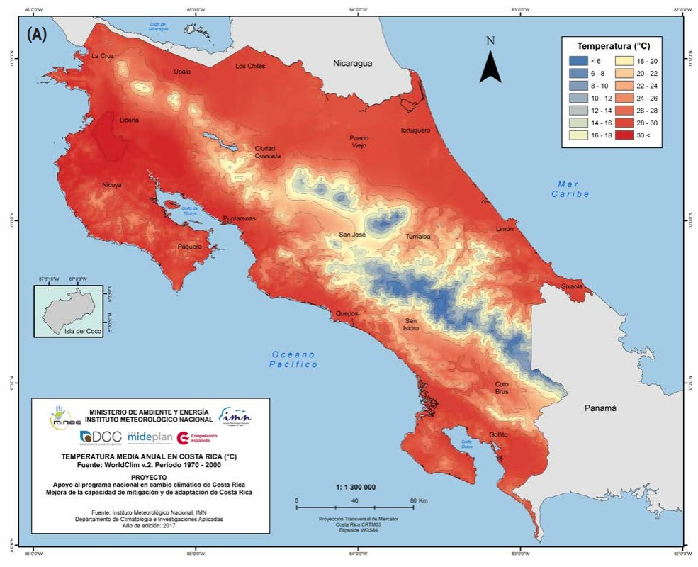
```

### Humedad del aire {#sec-fuentes-humedad}

La **humedad relativa** ($HR$) compara el vapor de agua que contiene el aire con el máximo que podría contener a la misma temperatura:

$$
HR = 100\,\frac{e_a}{e_s}
$$ {#eq-fuentes-hr}

donde $HR$ es la humedad relativa (%), $e_a$ es la presión real de vapor (kPa) y $e_s$ es la presión de saturación de vapor a la temperatura del aire (kPa).

La **presión de saturación de vapor** depende solo de la temperatura. La FAO usa esta aproximación [@allen1998fao56]:

$$
e_s(T) = 0.6108\,\exp\!\left(\frac{17.27\,T}{T + 237.3}\right)
$$ {#eq-fuentes-es}

donde $e_s$ está en kPa y $T$ en °C. La **presión real de vapor** $e_a$ mide el vapor que hay en el aire. Es igual a la presión de saturación evaluada en el punto de rocío, $e_a = e_s(T_d)$, y cambia poco durante el día. La diferencia $e_s - e_a$ es el **déficit de presión de vapor**: cuanto mayor es, más seco está el aire y más rápido evapora (@sec-fuentes-evaporacion).

Como $e_s$ crece con la temperatura, la humedad relativa baja durante el día aunque el aire no pierda vapor. Antes del amanecer, con la temperatura mínima, la $HR$ llega a menudo a casi 100 % y se forman rocío y neblina.

La humedad se mide con:

- **Psicrómetro:** dos termómetros, uno seco y otro con el bulbo cubierto por una muselina húmeda. La evaporación enfría el bulbo húmedo, y con la diferencia entre ambas lecturas se obtiene la humedad con tablas o ecuaciones. El **psicrómetro de Assmann** tiene un ventilador que fuerza el paso del aire y da lecturas más estables.
- **Higrómetro de cabello:** el cabello se alarga cuando aumenta la humedad y mueve una aguja o una plumilla. Combinado con un termógrafo forma el **higrotermógrafo**.
- **Sensor capacitivo:** un polímero cambia su capacitancia con la humedad. Es el de las estaciones automáticas, y casi siempre viene en el mismo cuerpo que el sensor de temperatura (@fig-higro).

```{r}
#| label: fig-higro
#| fig-cap: "Instrumentos para medir la temperatura y la humedad. Fuente: @IMN_CostaRica."
#| fig-alt: "Higrotermógrafo, pantalla solar, termómetros de máxima y mínima y sensor electrónico de temperatura y humedad"
#| echo: false
#| out-width: 70%

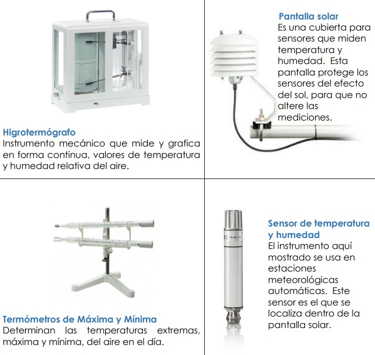
```

::: {.callout-note title="Ejemplo: humedad relativa a partir del punto de rocío"}
Una estación automática registra a las 14:00 una temperatura del aire de 26.0 °C y un punto de rocío de 18.0 °C. Calcule la presión de saturación, la presión real de vapor, la humedad relativa y el déficit de presión de vapor.

**Solución:**

1. Presión de saturación a 26.0 °C, con la @eq-fuentes-es:
$$
e_s = 0.6108\,\exp\!\left(\frac{17.27 \times 26.0}{26.0 + 237.3}\right) = 0.6108\,\exp(1.7054) = 0.6108 \times 5.503 = 3.361\ \mathrm{kPa}
$$
2. Presión real de vapor, que es la de saturación a 18.0 °C:
$$
e_a = 0.6108\,\exp\!\left(\frac{17.27 \times 18.0}{18.0 + 237.3}\right) = 0.6108\,\exp(1.2176) = 0.6108 \times 3.379 = 2.064\ \mathrm{kPa}
$$
3. Humedad relativa, con la @eq-fuentes-hr: $HR = 100 \times 2.064/3.361 = 61.4\ \%$.
4. Déficit de presión de vapor: $e_s - e_a = 3.361 - 2.064 = 1.297$ kPa.

**Pseudocódigo**

1. Definir la función de la presión de saturación.
2. Evaluarla a la temperatura del aire para obtener $e_s$.
3. Evaluarla en el punto de rocío para obtener $e_a$.
4. Calcular la humedad relativa y el déficit.

```{r}
#| label: ej-fuentes-humedad
#| code-fold: false

# 1) Presión de saturación de vapor (kPa), con T en °C
presion_saturacion <- function(temp) 0.6108 * exp(17.27 * temp / (temp + 237.3))

temp_aire <- 26.0    # °C
temp_rocio <- 18.0   # °C

# 2) y 3) Presiones de saturación y real
e_s <- presion_saturacion(temp_aire)
e_a <- presion_saturacion(temp_rocio)

# 4) Humedad relativa (%) y déficit de presión de vapor (kPa)
hr <- 100 * e_a / e_s
deficit <- e_s - e_a

round(c(e_s = e_s, e_a = e_a, hr = hr, deficit = deficit), 3)
```

**Interpretación.** A las 14:00 el aire tiene un 61 % de humedad relativa y un déficit de 1.30 kPa. Si en la madrugada la temperatura baja a 18 °C y el vapor no cambia, la humedad relativa llegará a 100 % y habrá rocío. El déficit es el término que mueve la evaporación en el método de Penman-Monteith que se usa en el capítulo de evapotranspiración.
:::

### Radiación solar y brillo solar {#sec-fuentes-radiacion}

La radiación es energía que viaja como ondas electromagnéticas. En hidrología interesa por dos razones: es la fuente de energía de la evaporación y calienta el aire y el suelo. Se distinguen dos tipos según la longitud de onda (@fig-radiacion):

- **Radiación de onda corta:** la que viene del Sol, con longitudes de onda de 0.3 a 3 μm. Incluye el ultravioleta, la luz visible y el infrarrojo cercano.
- **Radiación de onda larga:** la que emiten la superficie terrestre y la atmósfera, con longitudes de onda mayores de 3 μm. También se llama radiación terrestre o infrarroja térmica.

```{r}
#| label: fig-radiacion
#| fig-cap: "Espectro de la radiación solar en el tope de la atmósfera y en la superficie. Fuente: adaptado de Seiscubos (2025)."
#| fig-alt: "Curvas de intensidad de la radiación solar contra longitud de onda, con las bandas ultravioleta, visible e infrarroja"
#| echo: false
#| out-width: 65%

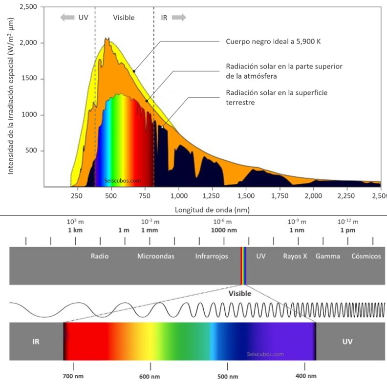
```

La **radiación global** que llega a una superficie horizontal es la suma de la **radiación directa**, que viene del disco solar, y la **radiación difusa**, que la atmósfera y las nubes dispersan en todas las direcciones (@fig-rad2). Depende de la latitud, del día del año, de la hora y de la nubosidad [@Porras2025].

```{r}
#| label: fig-rad2
#| fig-cap: "Radiación solar directa y difusa."
#| fig-alt: "Dibujo del sol, nubes y una casa, con una flecha recta de radiación directa y flechas onduladas de radiación difusa"
#| echo: false
#| out-width: 75%

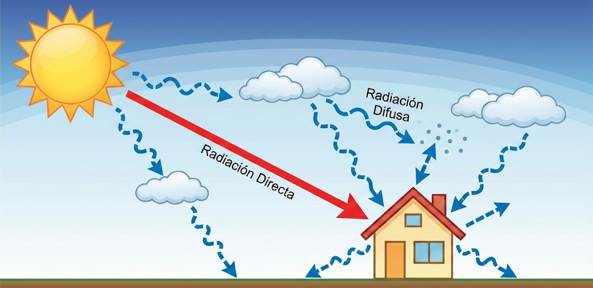
```

La radiación se mide con radiómetros (@fig-piro):

- **Piranómetro:** mide la radiación global sobre una superficie horizontal, con una termopila o un fotodiodo bajo una cúpula de vidrio.
- **Pirheliómetro:** mide solo la radiación directa. Sigue al Sol y apunta siempre hacia él.
- **Radiómetro neto:** mide la diferencia entre la radiación que llega y la que sale de la superficie, de onda corta y larga.
- **Heliógrafo:** mide el brillo solar, que se describe más abajo.

```{r}
#| label: fig-piro
#| fig-cap: "Instrumentos para medir la radiación solar. Fuente: @IMN_CostaRica."
#| fig-alt: "Piranómetro, heliógrafo, pirheliómetro y radiómetro ultravioleta con una descripción de cada uno"
#| echo: false
#| out-width: 70%

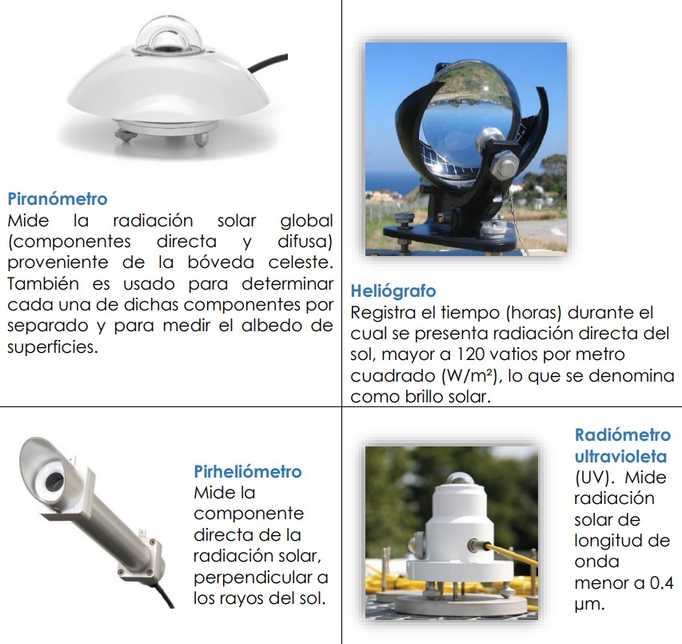
```

La radiación instantánea se expresa en W/m². La energía diaria se acumula en MJ/(m²·d); 1 MJ/(m²·d) equivale a 11.6 W/m² de promedio en el día. En textos antiguos aparece el langley, 1 Ly = 1 cal/cm² = 0.0419 MJ/m². La @fig-global_solar_atlas muestra la radiación global media en el mundo [@globalsolaratlas].

```{r}
#| label: fig-global_solar_atlas
#| fig-cap: "Radiación solar global media diaria y anual. Fuente: @globalsolaratlas."
#| fig-alt: "Mapa del mundo con la radiación solar global, de morado en latitudes altas a rojo en los desiertos"
#| echo: false
#| out-width: 90%

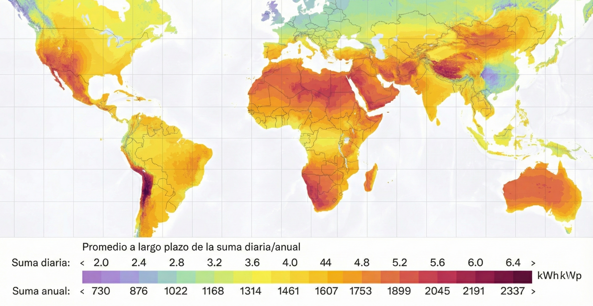
```

El **brillo solar** (o insolación, o heliofanía) es el número de horas del día en que la radiación directa supera 120 W/m², el umbral que fija la OMM [@wmo2018guia]. Se usa por dos razones: indica la nubosidad, y sirve para estimar la radiación global donde no hay piranómetro.

El instrumento clásico es el **heliógrafo de Campbell-Stokes** (@fig-helio). Una esfera de vidrio de unos 10 cm de diámetro concentra los rayos del Sol y quema una banda de cartulina graduada en horas. Cuando una nube tapa el Sol, la quemadura se interrumpe, y la suma de los tramos quemados da las horas de brillo solar $n$. En el hemisferio norte la esfera se orienta hacia el sur, en un sitio sin sombras. Las estaciones automáticas usan sensores fotoeléctricos que hacen lo mismo.

```{r}
#| label: fig-helio
#| fig-cap: "Heliógrafo de Campbell-Stokes. Fuente: Guías Prácticas (2025)."
#| fig-alt: "Fotografía y esquema de un heliógrafo con su esfera de cristal, el portabandas y la banda de registro"
#| echo: false
#| out-width: 60%

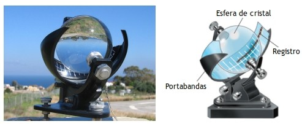
```

El brillo solar se normaliza con la **duración relativa de la insolación** $n/N$, donde $N$ es la duración astronómica del día, que depende de la latitud y de la fecha. Con cielo despejado todo el día $n/N = 1$; con cielo cubierto, $n/N = 0$. Con ella, la radiación global se estima con la ecuación de Ångström-Prescott, en la forma que recomienda la FAO [@allen1998fao56]:

$$
R_s = \left(a_s + b_s\,\frac{n}{N}\right) R_a
$$ {#eq-fuentes-angstrom}

donde $R_s$ es la radiación solar global (MJ/(m²·d)), $R_a$ es la radiación extraterrestre, la que llegaría sin atmósfera (MJ/(m²·d)), $n$ es el brillo solar (h), $N$ es la duración astronómica del día (h), y $a_s$ y $b_s$ son coeficientes empíricos (adimensionales). Sin calibración local, la FAO recomienda $a_s = 0.25$ y $b_s = 0.50$. $R_a$ y $N$ se calculan con la latitud y el día del año, o se leen en las tablas de @allen1998fao56.

En Costa Rica el brillo solar es mayor en el Pacífico norte y menor en las montañas y en la vertiente del Caribe, donde la nubosidad es casi permanente (@fig-brillo).

```{r}
#| label: fig-brillo
#| fig-cap: "Brillo solar anual en Costa Rica. Fuente: @IMN_CostaRica."
#| fig-alt: "Mapa de Costa Rica con las horas de brillo solar, más altas en Guanacaste y más bajas en las montañas y el Caribe"
#| echo: false
#| out-width: 70%

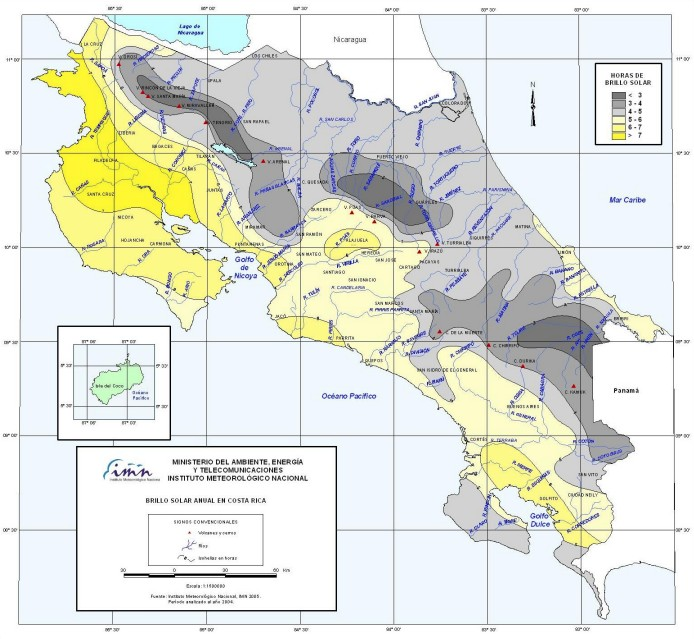
```

### Presión atmosférica {#sec-fuentes-presion}

La **presión atmosférica** es el peso de la columna de aire sobre una unidad de área. Interesa en hidrología por dos razones. Las diferencias de presión entre regiones generan el viento, que transporta la humedad. Y la presión entra en las ecuaciones de evaporación: a igualdad de déficit de vapor y de viento, la evaporación aumenta cuando baja la presión, como ocurre en sitios altos [@chow1988appliedhydrology].

En meteorología la presión se expresa en hectopascales (hPa), que equivalen a milibares (mb): 1 hPa = 1 mb = 100 Pa. La presión de la atmósfera estándar al nivel del mar es 1013.25 hPa, que corresponde a una columna de 760 mm de mercurio. Se mide con tres tipos de barómetro (@fig-presion):

- **De mercurio:** mide la altura de una columna de mercurio. Ya casi no se usa por la toxicidad del mercurio.
- **Aneroide:** una cápsula metálica sellada al vacío se deforma con la presión y mueve una aguja.
- **Electrónico:** un transductor de presión conectado al registrador de una estación automática.

```{r}
#| label: fig-presion
#| fig-cap: "Barómetros de mercurio, aneroide y electrónico. Fuente: @IMN_CostaRica."
#| fig-alt: "Fotografías de un barómetro de mercurio tipo Fortín, un barómetro aneroide y un sensor electrónico, con su descripción"
#| echo: false
#| out-width: 100%

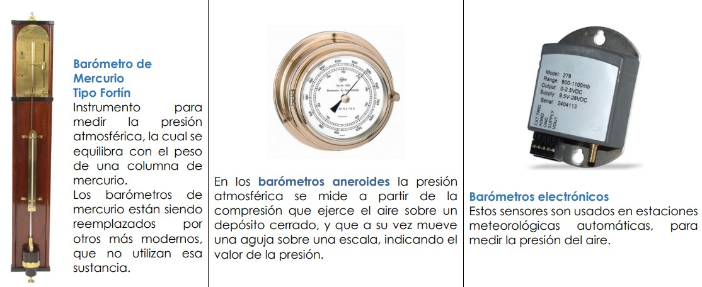
```

La presión baja con la altitud. Si la temperatura disminuye linealmente con la altura, como en la atmósfera estándar, la presión a una altitud $z$ es [@chow1988appliedhydrology]:

$$
p = 1013.25 \left(\frac{288.15 - 0.0065\,z}{288.15}\right)^{5.256}
$$ {#eq-fuentes-presion}

donde $p$ es la presión atmosférica (hPa) y $z$ es la altitud sobre el nivel del mar (m). El exponente sale de $g/(\alpha R_a)$, con la gravedad $g$, el gradiente térmico $\alpha = 0.0065$ K/m y la constante del aire seco $R_a$. Con la @eq-fuentes-presion, la presión en San José, a unos 1150 m, es de unos 883 hPa, un 13 % menos que en la costa.

La presión también cambia en el tiempo. Además de las variaciones que traen los sistemas de alta y baja presión, hay un ciclo diario con dos máximos, cerca de las 10:00 y las 22:00, y dos mínimos, cerca de las 04:00 y las 16:00. Se llama **marea barométrica** y es más marcada en el trópico.

Los mapas de presión al nivel del mar se dibujan con **isobaras**, líneas de igual presión (@fig-isobaras). El viento sopla desde las altas hacia las bajas presiones, desviado por la rotación de la Tierra.

```{r}
#| label: fig-isobaras
#| fig-cap: "Mapa de isobaras en superficie del Atlántico Norte y Europa. Fuente: Agencia Estatal de Meteorología de España (2023)."
#| fig-alt: "Mapa del Atlántico Norte y Europa con isobaras, centros de alta y baja presión y frentes"
#| echo: false
#| out-width: 80%

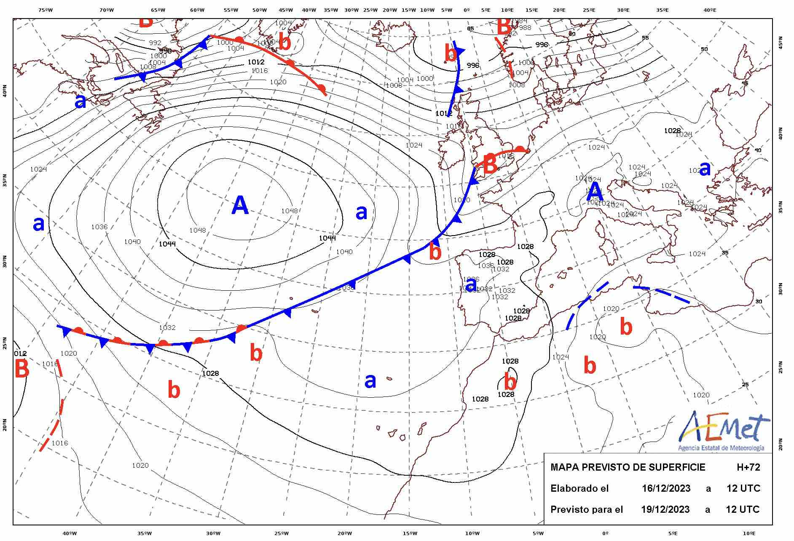
```

### Viento {#sec-fuentes-viento}

El **viento** es el movimiento horizontal del aire. En hidrología cumple varias funciones:

- **Transporta la humedad** desde los océanos hacia los continentes.
- **Mantiene la evaporación**, porque reemplaza el aire saturado que queda sobre una superficie de agua por aire más seco.
- **Distribuye la lluvia**, sobre todo cuando empuja el aire húmedo contra las montañas y lo obliga a subir.

Tres fuerzas controlan el viento: la diferencia de presión, que lo empuja de las altas a las bajas presiones; la fuerza de Coriolis, que por la rotación terrestre lo desvía a la derecha en el hemisferio norte y a la izquierda en el sur, y la fricción con el terreno, que lo frena cerca del suelo.

El viento es un vector, así que se mide su velocidad y su dirección (@fig-viento):

- **Velocidad:** en m/s, km/h o nudos (1 nudo = 0.514 m/s). Se mide con un **anemómetro**, por lo general de cazoletas, cuyo eje gira más rápido cuanto más fuerte es el viento. También hay anemómetros de hélice.
- **Dirección:** la dirección *desde donde* sopla, en grados medidos desde el norte geográfico en el sentido de las agujas del reloj. Un viento del este viene de 90°. Se mide con una **veleta**.
- **Sensores ultrasónicos:** miden las dos cosas con el tiempo de viaje de pulsos de sonido, sin partes móviles.

```{r}
#| label: fig-viento
#| fig-cap: "Instrumentos para medir la velocidad y la dirección del viento. Fuente: @IMN_CostaRica."
#| fig-alt: "Anemómetro de cazoletas, veleta, sensor integrado y sensor ultrasónico, con una descripción de cada uno"
#| echo: false
#| out-width: 100%

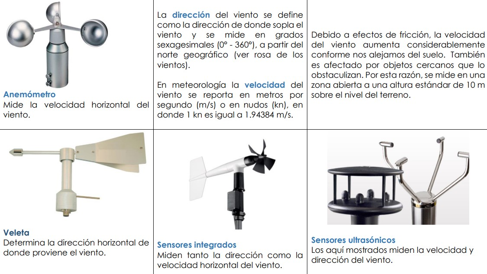
```

::: {.callout-warning title="Cuidado"}
El texto de la @fig-viento dice que 1 nudo es igual a 1.94384 m/s. Es al revés: 1 m/s = 1.944 nudos, y 1 nudo = 0.514 m/s.
:::

Por la fricción, el viento es más lento cerca del suelo y aumenta con la altura. La OMM fija la medición a 10 m [@wmo2018guia], pero las ecuaciones de evapotranspiración de la FAO piden el viento a 2 m. La conversión, para un perfil logarítmico sobre pasto corto, es [@allen1998fao56]:

$$
u_2 = u_z\,\frac{4.87}{\ln(67.8\,z - 5.42)}
$$ {#eq-fuentes-viento}

donde $u_2$ es la velocidad a 2 m (m/s), $u_z$ es la velocidad medida a la altura $z$ (m/s) y $z$ es la altura del anemómetro (m). Para un anemómetro a 10 m, $u_2 = 0.748\,u_{10}$.

En estudios de energía eólica se usa también la ley potencial:

$$
u = u_1 \left(\frac{z}{z_1}\right)^k
$$ {#eq-fuentes-ley-potencial}

donde $u$ es la velocidad a la altura $z$, $u_1$ es la velocidad medida a la altura $z_1$, y $k$ es un exponente que depende de la rugosidad del terreno y de la estabilidad del aire. En terreno abierto con atmósfera neutra se usa a menudo $k = 1/7$ [@peterson1978power].

La **rosa de los vientos** resume un registro de viento: para cada dirección, por lo general 8 o 16 rumbos, muestra con qué frecuencia sopla el viento y con qué velocidades (@fig-rosa).

```{r}
#| label: fig-rosa
#| fig-cap: "Rosa de los vientos. Fuente: Meteoblue (2025)."
#| fig-alt: "Rosa de los vientos de 16 rumbos con barras de colores por intervalo de velocidad, dominada por vientos del suroeste"
#| echo: false
#| out-width: 55%

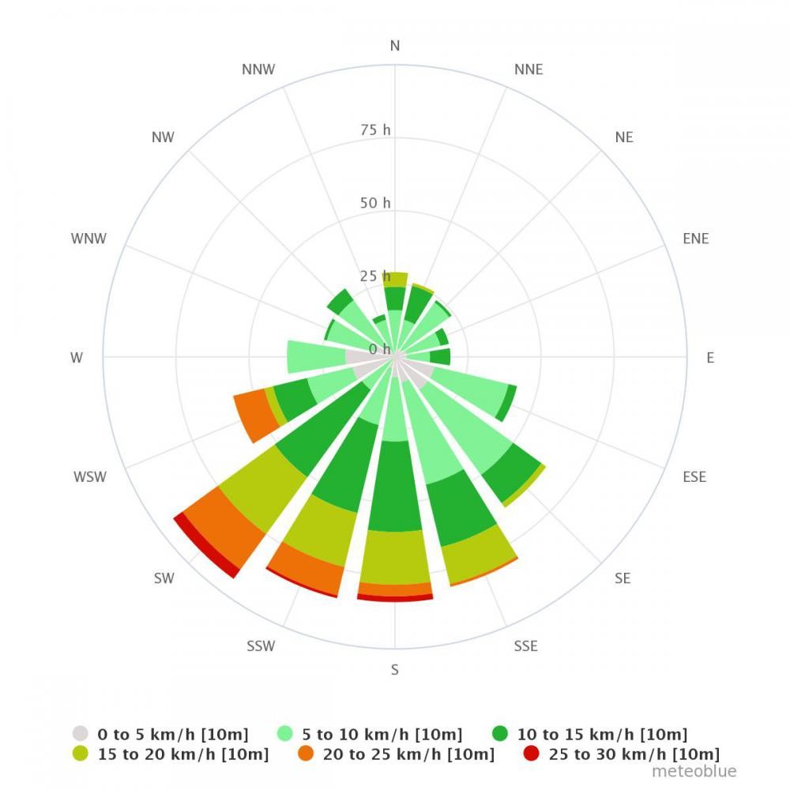
```

### Nubosidad {#sec-fuentes-nubosidad}

La **nubosidad** es la fracción del cielo cubierta por nubes. Las nubes son gotas de agua o cristales de hielo de unas pocas centésimas de milímetro, suspendidos en el aire. Regulan el balance de energía de la superficie con dos efectos opuestos (@fig-balance_rad):

- **Reflejan** parte de la radiación solar de vuelta al espacio. Una capa gruesa y baja refleja mucho más que una nube alta y delgada.
- **Absorben y reemiten** la radiación de onda larga que sale de la superficie. Por eso las noches nubladas son más cálidas que las despejadas: las nubes impiden que el suelo se enfríe rápido.

```{r}
#| label: fig-balance_rad
#| fig-cap: "Balance de radiación medio anual de la Tierra (W/m²). Fuente: @letreut2007historical."
#| fig-alt: "Diagrama con los flujos de radiación solar y terrestre entre el espacio, la atmósfera, las nubes y la superficie, con sus valores"
#| echo: false
#| out-width: 90%

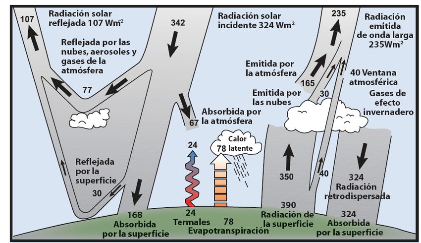
```

La nubosidad se estima a simple vista y se reporta en **octavos** (octas) de cielo cubierto: 0 es cielo despejado y 8 cielo cubierto [@wmo2018guia]. Algunos registros antiguos la dan en décimos.

Para la aviación interesa el **techo de nubes**: la altura de la base de la capa más baja que cubre más de la mitad del cielo. Hoy se mide con ceilómetros, que emiten pulsos de láser hacia arriba y miden el tiempo del eco. El método antiguo usaba de noche un proyector de luz y medía el ángulo con que se veía la mancha en la nube a una distancia conocida (@fig-nubes2).

```{r}
#| label: fig-nubes2
#| fig-cap: "Medición del techo de nubes con un haz de luz. Fuente: @SerranoPacheco_IC0808_Hidrologia."
#| fig-alt: "Esquema de un proyector que ilumina la base de una nube y de un observador que mide el ángulo de elevación"
#| echo: false
#| out-width: 75%

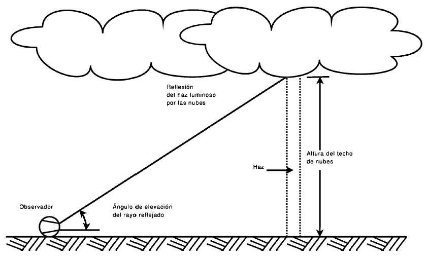
```

Los nombres de las nubes combinan cuatro raíces latinas (@fig-nubes):

- **Cirrus:** nubes altas, tenues y fibrosas. En el trópico están por encima de unos 6000 m.
- **Cumulus:** masas aisladas de base plana y desarrollo vertical.
- **Stratus:** capas continuas que cubren gran parte del cielo.
- **Nimbus:** se agrega para indicar que la nube produce precipitación, como en *nimbostratus* o *cumulonimbus*.

```{r}
#| label: fig-nubes
#| fig-cap: "Clasificación de las nubes según su altura. Fuente: adaptado de Dirección Meteorológica de Chile (2020)."
#| fig-alt: "Dibujo de los diez géneros de nubes ordenados en niveles alto, medio y bajo, con sus alturas en el trópico, latitudes medias y regiones polares"
#| echo: false
#| out-width: 95%

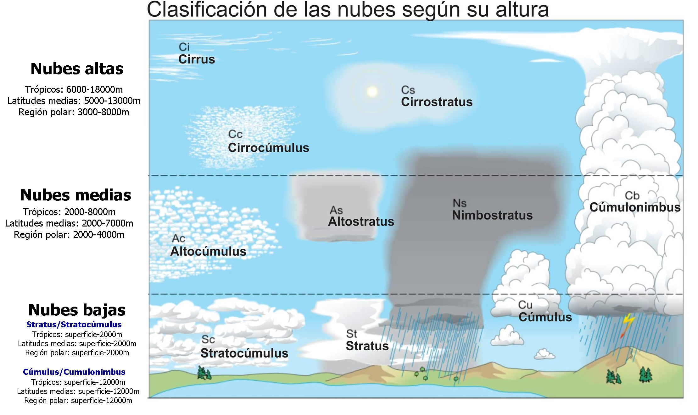
```

### Evaporación {#sec-fuentes-evaporacion}

La **evaporación** es el paso del agua de líquido a vapor. Para que ocurra hay que aportar el **calor latente de vaporización** $\lambda$, que a 20 °C es de unos 2.45 MJ/kg [@allen1998fao56]. Evaporar 1 mm de agua sobre un metro cuadrado, es decir, 1 kg, consume entonces 2.45 MJ. Por eso la evaporación conecta el balance de agua con el balance de energía.

La tasa de evaporación depende de tres condiciones (@fig-evapo):

1. **Energía disponible**, sobre todo la radiación solar.
2. **Déficit de presión de vapor** entre la superficie del agua y el aire.
3. **Transporte del vapor**: el viento y la turbulencia retiran el aire húmedo que queda sobre la superficie.

```{r}
#| label: fig-evapo
#| fig-cap: "Condiciones que controlan la tasa de evaporación."
#| fig-alt: "Tres paneles: la radiación solar que calienta el agua, la diferencia de presión de vapor entre la superficie y el aire, y el viento que retira el aire húmedo"
#| echo: false
#| out-width: 100%

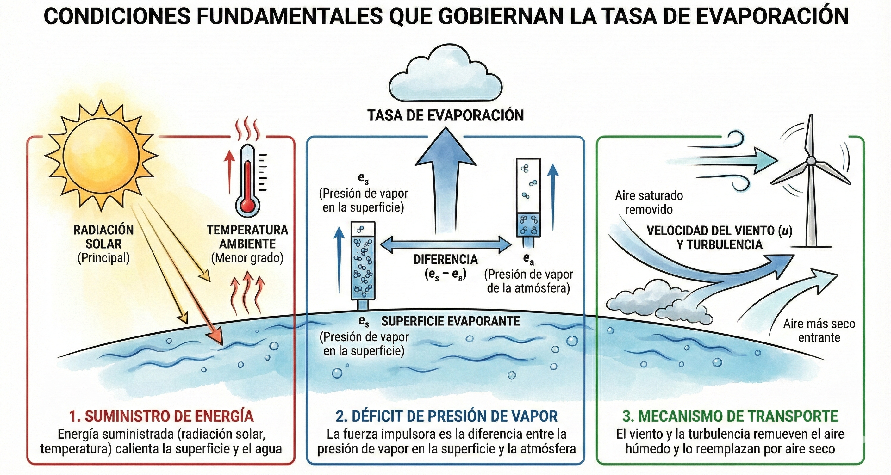
```

Las dos últimas condiciones se resumen en la ley de Dalton:

$$
E = C\,(e_s - e_a)
$$ {#eq-fuentes-dalton}

donde $E$ es la evaporación (mm/d), $e_s$ es la presión de saturación de vapor a la temperatura de la superficie del agua (kPa), $e_a$ es la presión real de vapor del aire (kPa) y $C$ es un coeficiente que depende del viento (mm/(d·kPa)).

Se distinguen dos magnitudes:

- **Evaporación potencial:** la que ocurriría desde una superficie de agua libre extensa, sin limitación de agua.
- **Evaporación real:** la que ocurre de verdad. Desde el suelo es menor que la potencial cuando el suelo se seca.

El instrumento más usado es el **tanque evaporímetro clase A**: un recipiente de hierro galvanizado de 120.7 cm de diámetro y 25 cm de profundidad, montado sobre una tarima de madera [@allen1998fao56] (@fig-Evaporation_Pan).

```{r}
#| label: fig-Evaporation_Pan
#| fig-cap: "Tanque evaporímetro clase A. Fuente: @IMN_CostaRica."
#| fig-alt: "Fotografía de un tanque evaporímetro circular con malla protectora, sobre una tarima en un campo, junto a un anemómetro"
#| echo: false
#| out-width: 40%

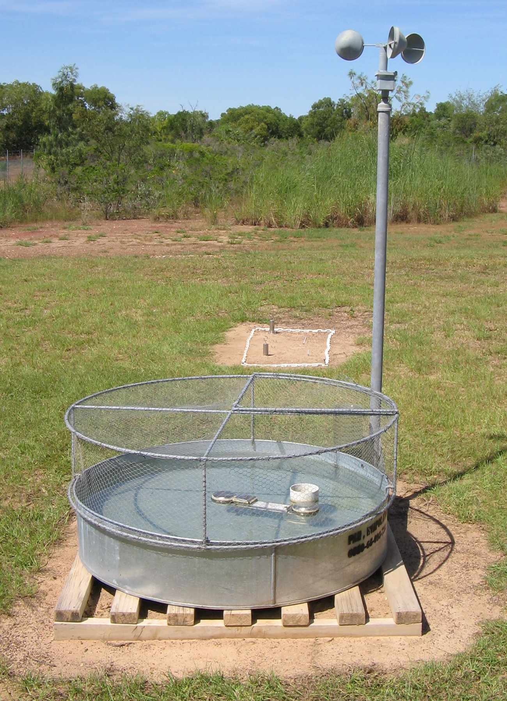
```

Cada día se mide el nivel y se repone el agua hasta una marca fija. La evaporación del día sale de un balance:

$$
E = P + \Delta d
$$ {#eq-fuentes-tanque}

donde $E$ es la evaporación (mm), $P$ es la precipitación del día (mm) y $\Delta d$ es la lámina de agua agregada para volver a la marca (mm). Si llovió tanto que hubo que retirar agua, $\Delta d$ es negativa.

El tanque evapora más que un lago: es pequeño, guarda poco calor y sus paredes reciben sol y viento. La evaporación del embalse se estima con un **coeficiente del tanque** $K_p$:

$$
E_L = K_p\,E_{\text{tanque}}
$$ {#eq-fuentes-kp}

donde $E_L$ es la evaporación del lago o embalse (mm), $E_{\text{tanque}}$ es la evaporación del tanque (mm) y $K_p$ es el coeficiente del tanque (adimensional). $K_p$ suele estar entre 0.60 y 0.85, y para valores anuales se usa a menudo 0.70 [@chow1988appliedhydrology]. El tema se amplía en el capítulo de evaporación.

## Variables del suelo {#sec-fuentes-suelo}

### Humedad del suelo {#sec-fuentes-humedad-suelo}

La **humedad del suelo** es el agua retenida en los poros por adhesión a las partículas y por cohesión entre moléculas de agua. Decide cómo se reparte la lluvia: un suelo húmedo infiltra menos y genera más escorrentía que uno seco.

Por encima del nivel freático está la **zona no saturada** o **vadosa**, donde los poros tienen aire y agua. Ahí el agua se presenta de tres formas:

1. **Agua gravitacional:** ocupa los poros grandes y drena por gravedad hacia abajo, donde recarga los acuíferos o alimenta el flujo subsuperficial.
2. **Agua capilar:** queda retenida en los poros pequeños por capilaridad. Es la que usan las plantas.
3. **Agua higroscópica:** una película muy delgada adherida a las partículas, retenida con tanta fuerza que ni las plantas ni la gravedad la mueven.

De ahí salen tres valores que describen el almacenamiento del suelo (@fig-suelo):

- **Capacidad de campo** ($CC$): la humedad que queda después de que el agua gravitacional drena, por lo general dos o tres días después de una lluvia fuerte.
- **Punto de marchitez permanente** ($PMP$): la humedad por debajo de la cual las plantas ya no pueden extraer agua y se marchitan sin recuperarse.
- **Agua disponible:** la diferencia entre la capacidad de campo y el punto de marchitez. Es el agua que el suelo puede entregar a las plantas.

```{r}
#| label: fig-suelo
#| fig-cap: "Retención y disponibilidad de agua según la textura del suelo. Fuente: adaptado de @McCuen1997."
#| fig-alt: "Gráfico de porosidad, agua disponible y retención específica contra tamaño de grano, junto a tres bulbos de humedad en suelos arcilloso, franco y arenoso"
#| echo: false
#| out-width: 100%

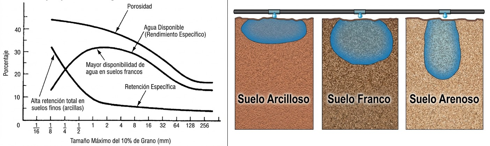
```

El contenido de agua se expresa de dos formas:

$$
w = \frac{M_w}{M_s}
$$ {#eq-fuentes-w}

$$
\theta = \frac{V_w}{V_t}
$$ {#eq-fuentes-theta}

donde $w$ es la humedad gravimétrica (adimensional), $M_w$ es la masa de agua (g), $M_s$ es la masa de suelo seco (g), $\theta$ es la humedad volumétrica (adimensional), $V_w$ es el volumen de agua (cm³) y $V_t$ es el volumen total de la muestra (cm³). La humedad volumétrica es la que se usa en hidrología, porque multiplicada por un espesor de suelo da una lámina de agua: $\theta = 0.25$ en 40 cm de suelo son 100 mm de agua.

Las dos se relacionan con la densidad aparente del suelo $\rho_b$ (masa de suelo seco entre volumen total) y la densidad del agua $\rho_w$:

$$
\theta = w\,\frac{\rho_b}{\rho_w}
$$ {#eq-fuentes-conversion}

Un suelo con $w = 0.20$ y $\rho_b = 1.3$ g/cm³ tiene $\theta = 0.20 \times 1.3 = 0.26$.

El método de referencia es el **gravimétrico**: se toma una muestra, se pesa húmeda, se seca en horno a 105 °C hasta peso constante (unas 24 h) y se pesa otra vez. La diferencia es el agua. Es exacto, pero destruye la muestra y da un solo dato por visita. En el campo se usan:

- **Tensiómetros:** miden la succión con que el suelo retiene el agua. Son precisos en suelos húmedos, pero dejan de funcionar con succiones mayores de unos 0.85 bar.
- **Bloques de resistencia eléctrica:** bloques de yeso o nailon enterrados; su resistencia baja cuando se humedecen.
- **Sonda de neutrones:** emite neutrones rápidos que se frenan al chocar con el hidrógeno del agua. El conteo de neutrones lentos se calibra contra la humedad volumétrica.
- **Sondas electromagnéticas:** la reflectometría en el dominio del tiempo (TDR) y las sondas capacitivas miden la constante dieléctrica del suelo. Como la del agua, cerca de 80, es mucho mayor que la del suelo seco, de 2 a 5, la medición depende sobre todo del contenido de agua (@fig-suelo2).

```{r}
#| label: fig-suelo2
#| fig-cap: "Sondas electromagnéticas para medir la humedad del suelo. Fuente: @kargas2012performance."
#| fig-alt: "Tres sondas enterradas en el suelo: dos de varillas con cable coaxial y una de tubo de acceso con sensores a 20, 30 y 40 cm"
#| echo: false
#| out-width: 65%

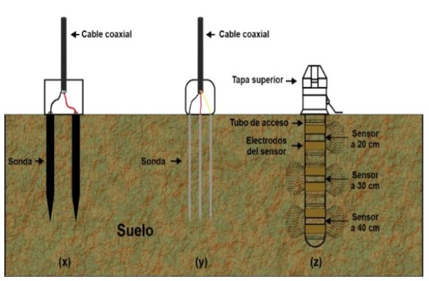
```

### Infiltración {#sec-fuentes-infiltracion}

La **infiltración** es la entrada del agua desde la superficie al suelo. La **percolación** es el movimiento posterior del agua dentro del suelo hacia capas más profundas o hacia el nivel freático (@fig-suelo3). Son dos procesos distintos: el primero controla cuánta lluvia se convierte en escorrentía y el segundo cuánta recarga llega al acuífero.

```{r}
#| label: fig-suelo3
#| fig-cap: "Infiltración y percolación del agua en el suelo."
#| fig-alt: "Corte de suelo con agua que entra desde la superficie, un frente de humedad y flechas de percolación, junto a bloques de suelo permeable e impermeable"
#| echo: false
#| out-width: 95%

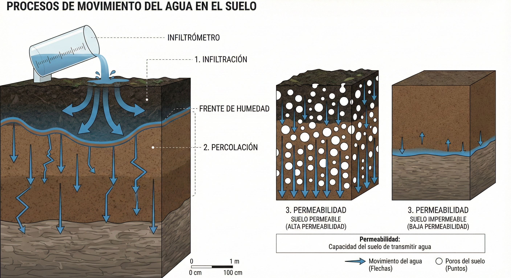
```

En una tormenta, la infiltración es la principal pérdida, es decir, la parte de la lluvia que no llega a escurrir. Se distinguen:

- **Capacidad de infiltración** $f_p$: la tasa máxima a la que el suelo puede absorber agua en un momento dado (mm/h).
- **Tasa de infiltración** $f$: la tasa real (mm/h). Si la intensidad de la lluvia $i$ es menor que $f_p$, toda la lluvia se infiltra y $f = i$. Si es mayor, $f = f_p$, el agua se encharca y el exceso escurre.

La capacidad de infiltración baja durante la lluvia, rápido al principio y luego más despacio, hasta un valor casi constante llamado **infiltración básica**. Depende de:

1. **La textura:** las arenas, con poros grandes, infiltran mucho más que las arcillas.
2. **La humedad inicial:** un suelo seco succiona el agua y empieza infiltrando rápido; al humedecerse, la tasa baja.
3. **La cobertura vegetal:** protege el suelo del golpe de las gotas, que forma costras que sellan los poros, y sus raíces abren macroporos.
4. **La compactación:** la maquinaria y el pisoteo del ganado reducen los poros y la infiltración.

En el campo se mide con el **infiltrómetro de doble anillo**: dos cilindros concéntricos hincados en el suelo, con el agua a nivel constante en ambos. El anillo exterior evita que el agua del interior se escape hacia los lados, así que la infiltración medida en el interior es casi vertical. La lámina de agua ejerce una presión que no existe con lluvia natural, por lo que el método tiende a sobrestimar la infiltración.

Los **simuladores de lluvia** reproducen con boquillas el tamaño y la energía de las gotas sobre una parcela pequeña. Capturan el sellado de la superficie y no imponen una lámina de agua, así que se acercan más a lo que pasa en una tormenta.

### Conductividad hidráulica {#sec-fuentes-conductividad}

La **conductividad hidráulica** $K$ mide qué tan fácil transmite el agua un suelo o una roca. Tiene unidades de velocidad (m/s, cm/s o m/d), pero no es la velocidad del agua en los poros. Depende del medio poroso (tamaño, forma y conexión de los poros) y del fluido, a través de su viscosidad y su densidad.

- **Conductividad saturada** $K_s$: la del suelo con todos los poros llenos de agua. En un suelo homogéneo es constante.
- **Conductividad no saturada** $K(\theta)$: la del suelo con aire y agua en los poros. Baja muy rápido cuando el suelo se seca, porque el agua queda en los poros más pequeños y su camino se vuelve más tortuoso.

El flujo en un medio poroso sigue la **ley de Darcy**:

$$
Q = K\,A\,i
$$ {#eq-fuentes-darcy}

$$
i = \frac{\Delta h}{L}
$$ {#eq-fuentes-gradiente}

donde $Q$ es el caudal (m³/s), $K$ es la conductividad hidráulica (m/s), $A$ es el área total de la sección, granos y poros (m²), $i$ es el gradiente hidráulico (adimensional), $\Delta h$ es la pérdida de carga hidráulica (m) y $L$ es la longitud del recorrido (m). El cociente $Q/A = K\,i$ es la **descarga específica** o velocidad de Darcy. El agua avanza en realidad más rápido, a $K\,i/n_e$, porque solo pasa por los poros conectados, de porosidad eficaz $n_e$.

La conductividad depende de:

1. **La textura:** las arenas y gravas limpias tienen valores altos; las arcillas, muy bajos.
2. **La temperatura del agua:** $K$ es inversamente proporcional a la viscosidad, y la viscosidad del agua a 32 °C (0.77 mPa·s) es la mitad que a 4 °C (1.57 mPa·s) [@chow1988appliedhydrology]. Con el mismo suelo y el mismo gradiente, el flujo se duplica.
3. **La estructura:** las grietas, los canales de raíces y los macroporos crean flujos preferenciales que aumentan $K$; la compactación la reduce.

En el laboratorio, $K_s$ se mide con permeámetros [@freeze1979groundwater]:

- **De carga constante**, para arenas y gravas. Se mantiene fija la diferencia de carga $\Delta H$ y se mide el caudal $Q$ que atraviesa la muestra. De la ley de Darcy:

$$
K = \frac{Q\,L}{A\,\Delta H}
$$ {#eq-fuentes-carga-constante}

- **De carga variable**, para limos y arcillas, que dejan pasar tan poca agua que el caudal no se mide bien. El agua entra desde un tubo delgado y se mide cuánto baja su nivel en un tiempo $t$:

$$
K = \frac{a\,L}{A\,t}\,\ln\!\left(\frac{H_1}{H_2}\right)
$$ {#eq-fuentes-carga-variable}

donde $a$ es el área del tubo (cm²), $A$ es el área de la muestra (cm²), $L$ es la longitud de la muestra (cm), $t$ es el tiempo de la prueba (s), $H_1$ es la carga al inicio y $H_2$ la carga al final (cm). Si $a$, $A$ y $L$ están en cm y $t$ en s, $K$ sale en cm/s.

::: {.callout-note title="Ejemplo: conductividad hidráulica con el permeámetro de carga variable"}
Una muestra de suelo de 10 cm de diámetro y 12 cm de largo se ensaya en un permeámetro de carga variable con un tubo de 1 cm de diámetro. El nivel del agua en el tubo baja de 100 cm a 60 cm en 30 min. Calcule $K_s$ en cm/s y en m/d.

**Solución:**

1. Áreas: $a = \pi \times 1^2/4 = 0.785$ cm² y $A = \pi \times 10^2/4 = 78.54$ cm².
2. Tiempo: $t = 30 \times 60 = 1800$ s.
3. Con la @eq-fuentes-carga-variable:
$$
K_s = \frac{0.785 \times 12}{78.54 \times 1800}\,\ln\!\left(\frac{100}{60}\right) = 6.67 \times 10^{-5} \times 0.511 = 3.41 \times 10^{-5}\ \mathrm{cm/s}
$$
4. En m/d: $3.41 \times 10^{-5} \times 0.01 \times 86\,400 = 0.029$ m/d.

**Pseudocódigo**

1. Calcular el área del tubo y la de la muestra.
2. Pasar el tiempo a segundos.
3. Aplicar la @eq-fuentes-carga-variable.
4. Convertir de cm/s a m/d.

```{r}
#| label: ej-fuentes-permeametro
#| code-fold: false

# 1) Áreas del tubo y de la muestra (cm²)
area_tubo <- pi * 1^2 / 4
area_muestra <- pi * 10^2 / 4
largo_cm <- 12

# 2) Tiempo (s) y cargas inicial y final (cm)
tiempo_s <- 30 * 60
h_1 <- 100
h_2 <- 60

# 3) Conductividad hidráulica saturada (cm/s)
k_cms <- area_tubo * largo_cm / (area_muestra * tiempo_s) * log(h_1 / h_2)

# 4) Conversión a m/d
k_md <- k_cms / 100 * 86400

signif(c(k_cms = k_cms, k_md = k_md), 3)
```

**Interpretación.** Un $K_s$ de $3.4 \times 10^{-5}$ cm/s equivale a unos 3 cm por día, o 1.2 mm/h, un valor propio de un limo. Una lluvia de 20 mm/h superaría con creces la capacidad de ese suelo una vez saturado, y casi toda escurriría.
:::

En el campo, $K$ se mide con:

- **El método del pozo barrenado** (*auger hole*), cuando el nivel freático está cerca de la superficie: se extrae agua de un pozo y se mide la velocidad con que el nivel se recupera.
- **Las pruebas de bombeo**, que dan un valor medio sobre un volumen grande de acuífero a partir del abatimiento en pozos de observación.
- **Las pruebas de *slug***: se introduce o se retira de golpe un cilindro en el pozo y se mide cómo vuelve el nivel.
- **El permeámetro de Guelph**, portátil, que mide $K_s$ por encima del nivel freático.

## Medición de caudales {#sec-fuentes-caudales}

El **caudal** es el volumen de agua que pasa por una sección de un cauce por unidad de tiempo, en m³/s o L/s. Es la variable que más se usa en el diseño de puentes, alcantarillas, vertederos de presas y drenajes, y en la evaluación de la oferta de agua. También resume el estado de la cuenca, porque integra la lluvia, la infiltración, el almacenamiento y la evapotranspiración.

### Aforos {#sec-fuentes-aforos}

El **aforo** es la medición del caudal en una sección y en un momento dado. Se basa en la ecuación de continuidad:

$$
Q = A\,\bar{v}
$$ {#eq-fuentes-continuidad}

donde $Q$ es el caudal (m³/s), $A$ es el área mojada de la sección (m²) y $\bar{v}$ es la velocidad media del agua en la sección (m/s).

Los aforos sirven para construir la curva de descarga de una estación, calibrar modelos de lluvia y escorrentía, cerrar balances hídricos y verificar caudales de diseño. Los métodos se agrupan en directos e indirectos [@chow1988appliedhydrology; @wmo2010aforo].

**Métodos directos.** Miden el flujo mientras ocurre:

- **Volumétrico:** se mide el tiempo $t$ que tarda el agua en llenar un recipiente de volumen $V$, y $Q = V/t$. Es el más exacto, pero solo sirve para caudales pequeños, como manantiales o tuberías.
- **Velocidad y área:** es el método de uso general en ríos. La sección se divide en franjas verticales y en cada vertical se mide la profundidad y la velocidad con un molinete o correntómetro (@fig-aforo-seccion). En aguas poco profundas basta medir a 0.6 de la profundidad, contada desde la superficie; en aguas más hondas se promedian las lecturas a 0.2 y 0.8 de la profundidad. El caudal es la suma de los productos de área y velocidad de cada franja.
- **Por dilución:** se inyecta un trazador, como sal o un colorante, a una tasa constante $q$ y con concentración $C_1$. Aguas abajo, donde el trazador ya se mezcló, se mide la concentración $C_2$. Si el río ya tenía una concentración $C_0$, el caudal es el de la @eq-fuentes-dilucion. Funciona bien en ríos de montaña muy turbulentos, donde el molinete no da buenas lecturas.
- **Acústico (ADCP):** un perfilador acústico de efecto Doppler, montado en una lancha o un flotador, mide la velocidad en toda la columna de agua y la profundidad mientras cruza el río. Un aforo toma minutos.

$$
Q = q\,\frac{C_1 - C_2}{C_2 - C_0}
$$ {#eq-fuentes-dilucion}

```{r}
#| label: fig-aforo-seccion
#| fig-cap: "Aforo por el método de velocidad y área. Fuente: adaptado de @SerranoPacheco_IC0808_Hidrologia."
#| fig-alt: "Sección de un río dividida en franjas verticales, con las profundidades de medición a 0.2, 0.6 y 0.8 de la profundidad y un perfil de velocidad"
#| echo: false
#| out-width: 90%

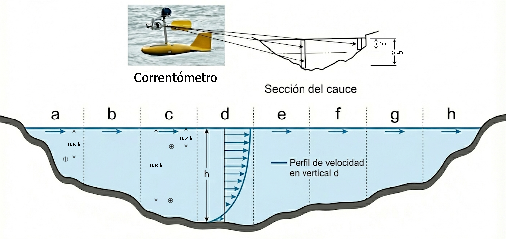
```

::: {.callout-note title="Ejemplo: aforo por velocidad y área"}
En un río de 12 m de ancho se midieron siete verticales separadas 1.5 m. En las verticales de menos de 0.75 m de profundidad se midió la velocidad a 0.6 de la profundidad; en las demás, a 0.2 y 0.8. Calcule el caudal con el método de la sección media, en el que cada vertical representa una franja de 1.5 m de ancho centrada en ella.

| Vertical | Distancia (m) | Profundidad (m) | $v_{0.6}$ (m/s) | $v_{0.2}$ (m/s) | $v_{0.8}$ (m/s) |
|:-:|:-:|:-:|:-:|:-:|:-:|
| 1 | 1.5 | 0.45 | 0.32 | | |
| 2 | 3.0 | 0.80 | | 0.62 | 0.44 |
| 3 | 4.5 | 1.10 | | 0.85 | 0.61 |
| 4 | 6.0 | 1.25 | | 0.95 | 0.69 |
| 5 | 7.5 | 1.15 | | 0.90 | 0.64 |
| 6 | 9.0 | 0.90 | | 0.70 | 0.50 |
| 7 | 10.5 | 0.50 | 0.35 | | |

: Datos del aforo (datos de ejemplo). {#tbl-aforo-datos}

**Solución:**

1. Velocidad media de cada vertical: $v_{0.6}$ o el promedio $(v_{0.2} + v_{0.8})/2$.
2. Área de cada franja: profundidad por 1.5 m.
3. Caudal de cada franja: área por velocidad.

| Vertical | $\bar{v}$ (m/s) | Área (m²) | Caudal (m³/s) |
|:-:|:-:|:-:|:-:|
| 1 | 0.32 | 0.675 | 0.216 |
| 2 | 0.53 | 1.200 | 0.636 |
| 3 | 0.73 | 1.650 | 1.205 |
| 4 | 0.82 | 1.875 | 1.538 |
| 5 | 0.77 | 1.725 | 1.328 |
| 6 | 0.60 | 1.350 | 0.810 |
| 7 | 0.35 | 0.750 | 0.263 |
| Suma | | 9.225 | 5.995 |

: Cálculo a mano del aforo. {#tbl-aforo-mano}

4. Caudal total: $Q = 6.00$ m³/s. Área mojada: $A = 9.23$ m². Velocidad media de la sección: $\bar{v} = 6.00/9.23 = 0.65$ m/s.

**Pseudocódigo**

1. Escribir la profundidad y las velocidades medidas en cada vertical.
2. Calcular la velocidad media de cada vertical.
3. Calcular el área y el caudal de cada franja.
4. Sumar los caudales y las áreas, y calcular la velocidad media de la sección.

```{r}
#| label: ej-fuentes-aforo
#| code-fold: false

library(tidyverse)

# 1) Datos del aforo; NA donde no se midió
ancho_franja <- 1.5   # m
aforo <- tibble(
  vertical = 1:7,
  profundidad = c(0.45, 0.80, 1.10, 1.25, 1.15, 0.90, 0.50),
  v_06 = c(0.32, NA, NA, NA, NA, NA, 0.35),
  v_02 = c(NA, 0.62, 0.85, 0.95, 0.90, 0.70, NA),
  v_08 = c(NA, 0.44, 0.61, 0.69, 0.64, 0.50, NA)
)

# 2) y 3) Velocidad media, área y caudal de cada franja
aforo <- aforo %>%
  mutate(v_media = if_else(is.na(v_06), (v_02 + v_08) / 2, v_06),
         area = profundidad * ancho_franja,
         caudal = area * v_media)

# 4) Totales de la sección
caudal_total <- sum(aforo$caudal)
area_total <- sum(aforo$area)

aforo %>% select(vertical, v_media, area, caudal)
round(c(Q = caudal_total, A = area_total, v = caudal_total / area_total), 3)
```

**Interpretación.** El río lleva 6.0 m³/s con una velocidad media de 0.65 m/s. Las tres franjas centrales aportan dos tercios del caudal, así que un error en esas velocidades pesa mucho más que uno en las orillas. Por eso se recomienda que ninguna franja lleve más del 10 % del caudal total [@wmo2010aforo]; aquí la franja 4 lleva el 26 %, y un aforo real usaría más verticales.
:::

**Métodos indirectos.** Miden el nivel del agua $h$ y calculan el caudal con una relación conocida:

- **Estructuras de control:** vertederos y canaletas construidos para que el caudal dependa solo de la carga sobre la cresta (@fig-vertedor y @fig-vertedor2). Se usan en cauces pequeños y en canales.
- **Sección y pendiente:** después de una crecida se levantan las marcas de agua máxima, la geometría del cauce y la pendiente, y se estima el caudal pico con la ecuación de Manning. Sirve para crecidas que nadie aforó.
- **Curva de descarga:** la relación entre nivel y caudal de una estación, que se describe abajo.

```{r}
#| label: fig-vertedor
#| fig-cap: "Vertedero rectangular en un cauce pequeño."
#| fig-alt: "Fotografía de un vertedero rectangular de concreto y madera en una quebrada, con el agua cayendo sobre la cresta"
#| echo: false
#| out-width: 70%

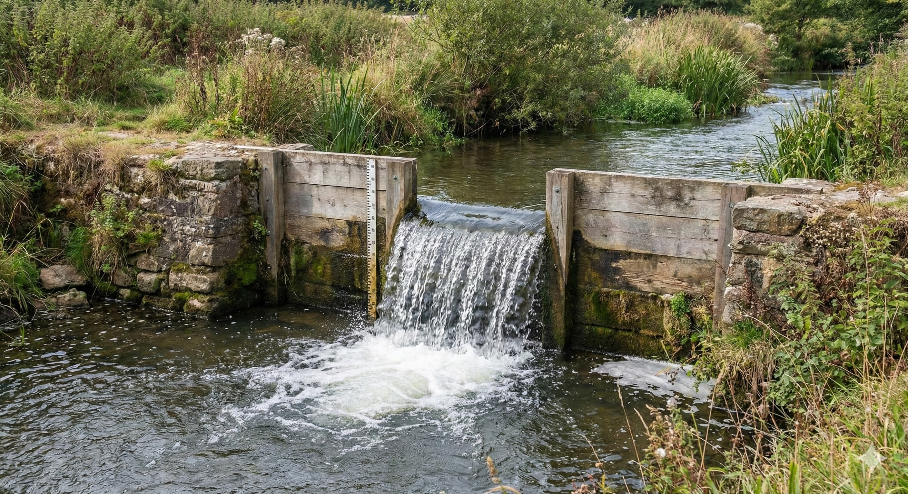
```

```{r}
#| label: fig-vertedor2
#| fig-cap: "Ecuaciones de los vertederos rectangular, triangular y trapezoidal."
#| fig-alt: "Esquemas de un vertedero rectangular, uno triangular en V y uno trapezoidal, cada uno con su ecuación de caudal"
#| echo: false
#| out-width: 75%

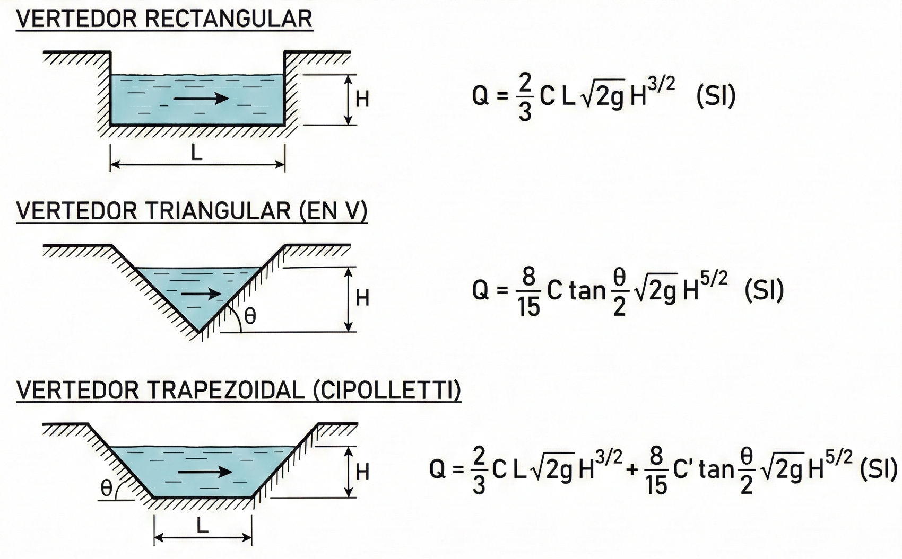
```

### Curva de descarga {#sec-fuentes-curva-descarga}

Aforar todos los días es caro, pero leer el nivel del agua es fácil: basta una regla graduada (limnímetro) o un sensor de nivel (limnígrafo). Por eso cada estación tiene una **curva de descarga** o **curva de calibración**, una relación $Q = f(h)$ que se ajusta con aforos hechos a distintos niveles. Con ella, el registro continuo de niveles se convierte en un registro continuo de caudales. La forma más común es la potencial [@chow1988appliedhydrology]:

$$
Q = a\,(h - h_0)^n
$$ {#eq-fuentes-curva-descarga}

donde $Q$ es el caudal (m³/s), $h$ es el nivel leído en la regla (m), $h_0$ es el nivel de caudal nulo (m), y $a$ y $n$ son coeficientes de ajuste. El nivel de caudal nulo se obtiene del levantamiento del punto más bajo del control, o se ajusta junto con $a$ y $n$. Si se toman logaritmos, la @eq-fuentes-curva-descarga se vuelve una recta, $\ln Q = \ln a + n \ln(h - h_0)$, y los coeficientes salen de una regresión lineal.

::: {.callout-note title="Ejemplo: ajuste de una curva de descarga"}
En una estación se hicieron seis aforos a distintos niveles (datos de ejemplo). El levantamiento del control dio un nivel de caudal nulo $h_0 = 0.20$ m. Ajuste la @eq-fuentes-curva-descarga y estime el caudal para un nivel de 1.60 m.

| $h$ (m) | 0.45 | 0.70 | 1.00 | 1.40 | 1.85 | 2.40 |
|:--|:-:|:-:|:-:|:-:|:-:|:-:|
| $Q$ (m³/s) | 0.90 | 2.63 | 6.06 | 11.25 | 19.81 | 30.91 |

: Aforos de la estación (datos de ejemplo). {#tbl-curva-datos}

**Solución:**

1. Se calculan $x = \ln(h - h_0)$ e $y = \ln Q$:

| $h$ (m) | $Q$ (m³/s) | $x$ | $y$ | $x\,y$ | $x^2$ |
|:-:|:-:|:-:|:-:|:-:|:-:|
| 0.45 | 0.90 | −1.3863 | −0.1054 | 0.1461 | 1.9218 |
| 0.70 | 2.63 | −0.6931 | 0.9670 | −0.6703 | 0.4805 |
| 1.00 | 6.06 | −0.2231 | 1.8017 | −0.4020 | 0.0498 |
| 1.40 | 11.25 | 0.1823 | 2.4204 | 0.4413 | 0.0332 |
| 1.85 | 19.81 | 0.5008 | 2.9862 | 1.4954 | 0.2508 |
| 2.40 | 30.91 | 0.7885 | 3.4311 | 2.7053 | 0.6217 |
| Suma | | −0.8310 | 11.5010 | 3.7157 | 3.3577 |

: Cálculo a mano de la regresión. {#tbl-curva-mano}

2. Pendiente de la recta, con $N = 6$ aforos:
$$
n = \frac{N \sum xy - \sum x \sum y}{N \sum x^2 - \left(\sum x\right)^2} = \frac{6 \times 3.7157 - (-0.8310)(11.5010)}{6 \times 3.3577 - (-0.8310)^2} = \frac{31.852}{19.456} = 1.637
$$
3. Ordenada: $\ln a = \left(\sum y - n \sum x\right)/N = (11.5010 + 1.637 \times 0.8310)/6 = 2.144$, de donde $a = e^{2.144} = 8.53$.
4. Curva: $Q = 8.53\,(h - 0.20)^{1.637}$.
5. Para $h = 1.60$ m: $Q = 8.53 \times 1.40^{1.637} = 8.53 \times 1.735 = 14.8$ m³/s.

**Pseudocódigo**

1. Escribir los niveles y caudales aforados y el nivel de caudal nulo.
2. Calcular los logaritmos de $h - h_0$ y de $Q$.
3. Ajustar una recta por mínimos cuadrados.
4. Recuperar $a$ y $n$.
5. Calcular el caudal para el nivel pedido y dibujar la curva con los aforos.

```{r}
#| label: fig-curva_descarga
#| fig-cap: "Curva de descarga ajustada y aforos de la estación del ejemplo."
#| fig-alt: "Puntos de seis aforos y una curva creciente de nivel contra caudal que pasa por ellos"
#| code-fold: false

library(tidyverse)

# 1) Aforos (datos de ejemplo) y nivel de caudal nulo
aforos <- tibble(
  nivel = c(0.45, 0.70, 1.00, 1.40, 1.85, 2.40),     # m
  caudal = c(0.90, 2.63, 6.06, 11.25, 19.81, 30.91)  # m³/s
)
h_0 <- 0.20

# 2) y 3) Recta en logaritmos
ajuste <- lm(log(caudal) ~ log(nivel - h_0), data = aforos)

# 4) Coeficientes de la curva
a <- exp(coef(ajuste)[[1]])
n <- coef(ajuste)[[2]]
round(c(a = a, n = n), 3)

# 5) Caudal para h = 1.60 m y gráfico
round(a * (1.60 - h_0)^n, 1)

curva <- tibble(nivel = seq(h_0, 2.6, by = 0.02)) %>%
  mutate(caudal = a * (nivel - h_0)^n)

ggplot() +
  geom_line(data = curva, aes(caudal, nivel), color = "#1C6BA0", linewidth = 1) +
  geom_point(data = aforos, aes(caudal, nivel), size = 2.5) +
  labs(x = "Caudal (m³/s)", y = "Nivel en la regla (m)") +
  theme_minimal()
```

**Interpretación.** La curva $Q = 8.53\,(h - 0.20)^{1.637}$ pasa muy cerca de los seis aforos, y para 1.60 m da 14.8 m³/s. Solo vale dentro del rango aforado: para un nivel de 3.0 m daría 46 m³/s, pero por encima de 2.40 m el río puede desbordarse y la forma de la sección cambia.
:::

::: {.callout-warning title="Cuidado"}
La curva de descarga cambia cuando el cauce cambia. Una crecida que erosiona o sedimenta el control, la vegetación o una obra nueva aguas abajo desplazan la curva. Por eso se siguen haciendo aforos y la curva se revisa con cada uno. Los caudales de crecida que se obtienen extrapolando la curva más allá del aforo más alto son los menos confiables del registro.
:::

## Medición de sedimentos {#sec-fuentes-sedimentos}

El **sedimento** es el material que la erosión desprende de las laderas y de los cauces y que el agua transporta. Medirlo sirve para estimar la vida útil de los embalses, diseñar canales estables y evaluar la calidad del agua, porque muchos contaminantes viajan pegados a las partículas finas.

El sedimento se mueve de dos formas (@fig-lavado):

- **Carga de fondo:** arenas, gravas y cantos que ruedan, se deslizan o saltan en contacto con el lecho.
- **Carga en suspensión:** limos y arcillas que la turbulencia mantiene dentro de la corriente. La parte más fina, que no se encuentra en el lecho y viaja a la misma velocidad que el agua, se llama **carga de lavado**.

```{r}
#| label: fig-lavado
#| fig-cap: "Formas de transporte del sedimento en un cauce. Fuente: adaptado de @rheinheimer2017tools."
#| fig-alt: "Corte de un cauce con partículas que ruedan y saltan sobre el lecho, una partícula en suspensión y la carga de lavado cerca de la superficie"
#| echo: false
#| out-width: 75%

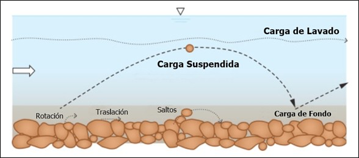
```

La concentración de sedimento cambia con la profundidad y a lo ancho del río, así que una muestra superficial no basta:

- **Sedimento en suspensión:** se usan muestreadores integradores en profundidad, como el DH-48 o el D-74, que se bajan y se suben a velocidad constante para recoger agua de toda la vertical. Su boquilla deja entrar el agua a la misma velocidad que la corriente (@fig-sediment).
- **Carga de fondo:** es más difícil de medir. Se usan trampas o muestreadores de presión diferencial como el Helley-Smith, que se apoyan sobre el lecho durante unos minutos.

```{r}
#| label: fig-sediment
#| fig-cap: "Muestreo de sedimento en suspensión desde un puente. Fuente: @usgsHydrosphere."
#| fig-alt: "Técnico que baja con una grúa un muestreador de sedimento en forma de pez a un río desde un puente"
#| echo: false
#| out-width: 65%

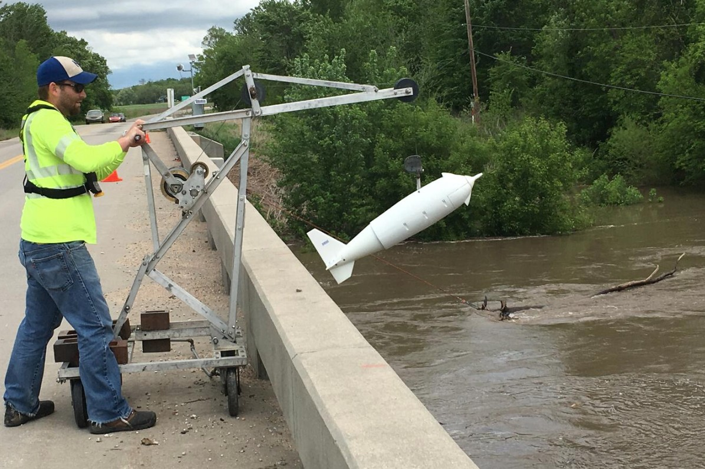
```

## Medición de la calidad del agua {#sec-fuentes-calidad}

La **calidad del agua** es su aptitud para un uso: consumo humano, riego, industria o mantenimiento de los ecosistemas. Cantidad y calidad van juntas: en estiaje el río diluye menos los vertidos, y en crecida arrastra más sedimento y contaminantes desde las laderas.

Los indicadores se agrupan en tres tipos:

1. **Físicos:** temperatura, que controla cuánto oxígeno puede disolver el agua; color; olor; turbiedad, que mide las partículas en suspensión, y conductividad eléctrica, que aumenta con los sólidos disueltos.
2. **Químicos:**
    - **pH:** mide la acidez. El reglamento de Costa Rica pide entre 6.5 y 8.5 para las aguas de mejor calidad [@minae2007calidad].
    - **Oxígeno disuelto:** es el indicador más directo de la salud del río. El reglamento lo evalúa como porcentaje de saturación [@minae2007calidad].
    - **Nutrientes** (nitrógeno y fósforo): en exceso producen eutrofización, el crecimiento desmedido de algas.
    - **Demanda bioquímica de oxígeno** (DBO₅): el oxígeno que consumen los microorganismos al degradar la materia orgánica en cinco días.
3. **Biológicos:** organismos patógenos, como las bacterias coliformes (*Escherichia coli*), los virus y los protozoos (*Giardia*, *Cryptosporidium*).

Hay que distinguir la **concentración** $C$, la masa de una sustancia por unidad de volumen de agua, de la **carga** $L$, la masa que el río transporta por unidad de tiempo:

$$
L = C\,Q
$$ {#eq-fuentes-carga}

donde $L$ es la carga (g/s), $C$ es la concentración (mg/L, que es lo mismo que g/m³) y $Q$ es el caudal (m³/s). Un río con 20 mg/L de sedimento y 6 m³/s lleva 120 g/s, unas 10 toneladas por día. Las cargas son las que se suman en los balances de masa de una cuenca o un embalse.

Las muestras se toman de tres formas:

- **Muestra puntual:** una sola muestra en un sitio y un momento. Sirve para cuerpos de agua bien mezclados.
- **Muestra integrada:** la mezcla de volúmenes iguales tomados a varias profundidades o a lo ancho del cauce. Representa mejor la sección.
- **Sensores en sitio:** sondas multiparamétricas que miden pH, conductividad, temperatura y oxígeno disuelto directamente en el agua y en tiempo real (@fig-hanna). Evitan los errores del transporte y almacenamiento de las muestras.

```{r}
#| label: fig-hanna
#| fig-cap: "Sonda multiparamétrica para medir la calidad del agua. Fuente: Hanna Instruments (2025)."
#| fig-alt: "Medidor portátil con pantalla y sonda conectada por cable, junto a su maletín, frente a un río"
#| echo: false
#| out-width: 45%

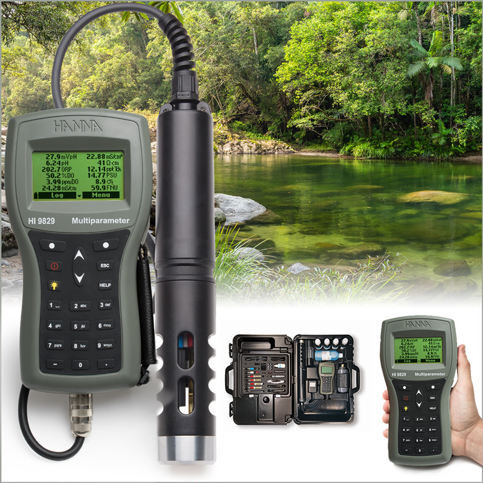
```

Los demás parámetros, como nutrientes, metales o coliformes, se analizan en laboratorio, por ejemplo en el Laboratorio de Ingeniería Ambiental de la Escuela de Ingeniería Civil de la Universidad de Costa Rica (@fig-ambiental).

```{r}
#| label: fig-ambiental
#| fig-cap: "Análisis de calidad del agua en laboratorio. Fuente: @CIEDES_UCR."
#| fig-alt: "Investigadora que pesa una muestra en una balanza analítica en un laboratorio"
#| echo: false
#| out-width: 65%

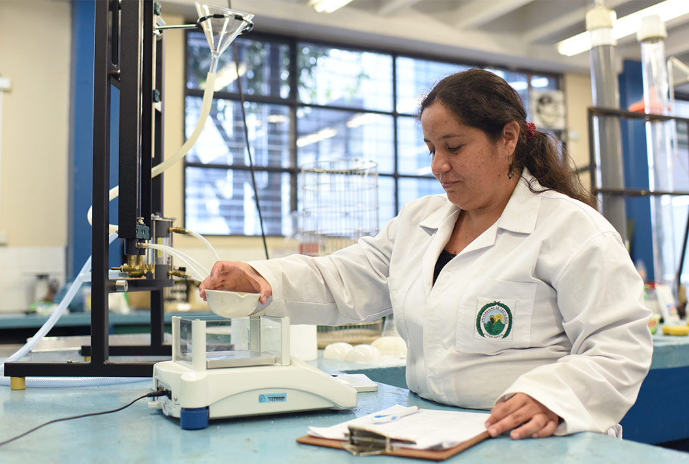
```

## La red de estaciones de Costa Rica {#sec-fuentes-red-cr}

En Costa Rica las estaciones meteorológicas e hidrológicas las operan sobre todo el Instituto Meteorológico Nacional (IMN) y el Instituto Costarricense de Electricidad (ICE), además de universidades y otras instituciones (@fig-cr_estaciones). Miden precipitación, temperatura, humedad, viento, radiación, niveles y caudales. Con esos datos se pronostica el tiempo, se emiten alertas, se operan los embalses y se diseñan las obras.

```{r}
#| label: fig-cr_estaciones
#| fig-cap: "Estaciones meteorológicas del IMN y del ICE en Costa Rica. Fuente: @IMN_CostaRica."
#| fig-alt: "Mapa de relieve de Costa Rica con puntos rojos para las estaciones del ICE y azules para las del IMN, concentradas en el centro del país"
#| echo: false
#| out-width: 70%

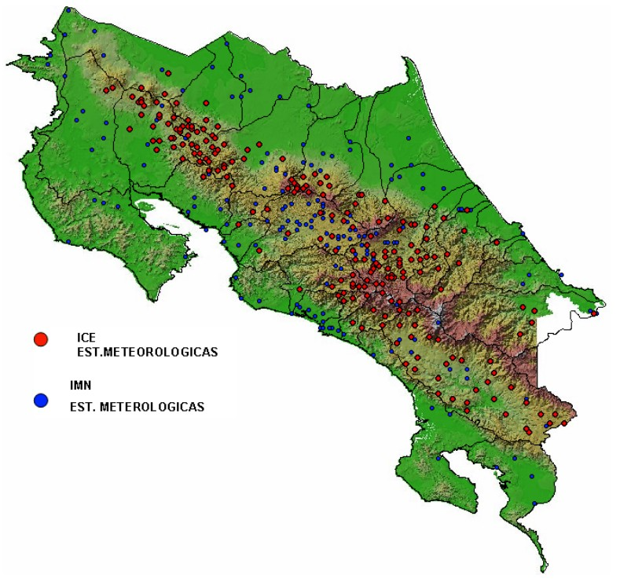
```

La principal limitación para el análisis hidrológico es que la lluvia se mide en puntos. En un país con montañas altas, pendientes fuertes y lluvias convectivas y orográficas, la lluvia cambia mucho en pocos kilómetros, y una estación no representa a toda una cuenca. Además, como se ve en la @fig-cr_estaciones, las estaciones se concentran en el centro del país y escasean en otras zonas.

Por eso la lluvia de una cuenca se estima con métodos que pasan de los puntos al área: polígonos de Thiessen, isoyetas, interpolación geoestadística, regresiones con la elevación y la combinación con radar y satélites (@fig-espacial). Cada método agrega supuestos propios, y el error de la estimación crece donde hay pocas estaciones. Estos métodos se tratan en el capítulo de precipitación.

```{r}
#| label: fig-espacial
#| fig-cap: "Componentes de un análisis geoestadístico. Fuente: Biostats (2013)."
#| fig-alt: "Histograma, mapa de puntos, variograma, covariables y efecto espacial que se combinan en un mapa interpolado"
#| echo: false
#| out-width: 75%

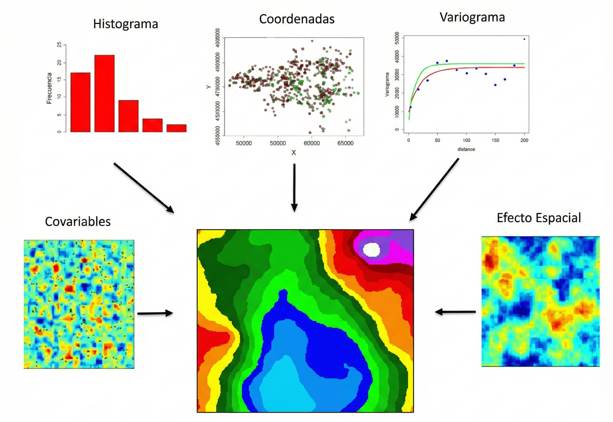
```

En Costa Rica, la cantidad de estaciones y la continuidad de sus registros limitan lo que se puede concluir en un estudio. Antes de usar una serie hay que saber qué instrumento la midió, cuántos huecos tiene y si la estación cambió de sitio. El control de calidad y el relleno de registros se tratan en el capítulo 8.
