::: {.quote-block}
"Los remolinos grandes tienen remolinos pequeños que se alimentan de su velocidad, y los pequeños tienen otros menores, y así hasta la viscosidad."\
— *Lewis Fry Richardson, Weather Prediction by Numerical Process (1922)*
:::

La atmósfera mueve el agua del ciclo hidrológico. Evapora el agua de los océanos, la transporta miles de kilómetros y la devuelve como lluvia cuando el aire sube y se enfría. Para interpretar un registro de lluvia o de temperatura, o para entender por qué el Caribe y el Pacífico de Costa Rica tienen regímenes tan distintos, hace falta conocer cómo funciona la atmósfera. Este capítulo reúne los principios que se usan después en los capítulos de precipitación, evaporación y balance hídrico.

## Tiempo y clima {#sec-meteo-tiempo-clima}

La meteorología estudia la atmósfera y sus fenómenos. Se ocupa del tiempo, que es el estado de la atmósfera en un lugar y un momento dados: la temperatura, la presión, el viento o la lluvia de esta tarde.

La climatología estudia el clima, que es el comportamiento del tiempo en periodos largos. Se describe con estadísticas: promedios, variabilidad y extremos. Por convención, la Organización Meteorológica Mundial (OMM) calcula las normales climatológicas con periodos de 30 años, por ejemplo 1991–2020. La diferencia entre ambas disciplinas se resume en el @tbl-meteovsclima.

| Disciplina | Escala de tiempo | Pregunta típica | Uso en hidrología |
|:--|:--|:--|:--|
| Meteorología | Horas a días | ¿Cuánto lloverá mañana en la cuenca? | Pronóstico de crecidas y operación de embalses |
| Climatología | Décadas | ¿Qué lluvia diaria se supera en promedio una vez cada 50 años? | Diseño de obras, balances hídricos, estudios de disponibilidad |

: Diferencias entre meteorología y climatología. {#tbl-meteovsclima}

Ambas se apoyan en las mismas leyes físicas: la conservación de la masa (del aire y del vapor de agua), la conservación de la energía (radiación, calor sensible y calor latente) y las leyes del movimiento, que gobiernan el viento.

En hidrología, la meteorología y la climatología sirven para:

- Interpretar los registros de las estaciones y reconocer datos dudosos.
- Elegir el método para rellenar datos faltantes, por ejemplo con una estación vecina de la misma vertiente y no de la opuesta.
- Juzgar si una estación representa la cuenca o solo su entorno inmediato.
- Diseñar obras que toleren la variabilidad del clima y los cambios esperados.

## La atmósfera {#sec-meteo-atmosfera}

### Composición {#sec-meteo-composicion}

La atmósfera tiene una masa de unos $5.1\times10^{18}$ kg [@trenberth2005mass]. El aire seco es una mezcla de nitrógeno (78 %), oxígeno (21 %) y argón (0.9 %), con trazas de otros gases (@tbl-atmosfera). Por la turbulencia, esas proporciones se mantienen casi constantes hasta unos 100 km de altura [@wallace2006atmospheric].

| Gas | Fórmula | Volumen (%) | ppm | Papel en el clima y el ciclo del agua |
|:----------------|:-------:|----------:|---------:|:----------------------------------------|
| Nitrógeno | N₂ | 78.08 | 780 800 | Casi inerte; no absorbe radiación solar ni terrestre |
| Oxígeno | O₂ | 20.95 | 209 500 | Absorbe radiación ultravioleta en la alta atmósfera y da origen al ozono |
| Argón | Ar | 0.934 | 9340 | Gas noble, inerte |
| Dióxido de carbono | CO₂ | 0.041 | 410 | Gas de efecto invernadero; aumenta por la quema de combustibles fósiles |
| Neón | Ne | 0.0018 | 18 | Gas noble, inerte |
| Helio | He | 0.0005 | 5.2 | Gas noble, inerte |
| Metano | CH₄ | 0.0002 | 1.9 | Gas de efecto invernadero |
| Kriptón | Kr | 0.0001 | 1.1 | Gas noble, inerte |
| Hidrógeno | H₂ | 0.00005 | 0.5 | Sin efecto apreciable |
| Óxido nitroso | N₂O | 0.00003 | 0.33 | Gas de efecto invernadero |
| Xenón | Xe | 0.000009 | 0.09 | Gas noble, inerte |
| Vapor de agua | H₂O | 0 a 4 | 0 a 40 000 | Principal gas de efecto invernadero; forma las nubes y la lluvia |
| Ozono | O₃ | Variable | Hasta 10 | Absorbe la radiación ultravioleta; se concentra en la estratosfera |

: Composición de la atmósfera en fracción de volumen y en partes por millón (ppm). Los valores de CO₂, CH₄ y N₂O son los de 2019; el vapor de agua varía con el lugar y el momento. Fuente: @wallace2006atmospheric y @ipcc2021spm. {#tbl-atmosfera}

Los gases que siguen a los tres principales suman menos del 0.05 % del aire, pero entre ellos están el dióxido de carbono, el metano y el óxido nitroso, que controlan buena parte del efecto invernadero (@sec-meteo-balance). Como las fracciones van de 78 % a menos de una cienmilésima, la @fig-atmosfera las muestra en escala logarítmica.

```{r}
#| label: fig-atmosfera
#| fig-cap: "Fracción en volumen de los gases del aire seco, en escala logarítmica. Los puntos anaranjados son gases de efecto invernadero. Fuente: elaboración propia con datos de @wallace2006atmospheric y @ipcc2021spm."
#| fig-alt: "Gráfico de puntos horizontal con once gases ordenados de mayor a menor fracción, desde el nitrógeno con 78 % hasta el xenón con 0.0000087 %, en escala logarítmica"
#| echo: false
#| out-width: 85%
#| fig-width: 8
#| fig-height: 5

library(tidyverse)

gases <- tribble(
  ~gas, ~formula, ~porcentaje,
  "Nitrógeno", "N₂", 78.08,
  "Oxígeno", "O₂", 20.95,
  "Argón", "Ar", 0.934,
  "Dióxido de carbono", "CO₂", 0.041,
  "Neón", "Ne", 0.00182,
  "Helio", "He", 0.000524,
  "Metano", "CH₄", 0.00019,
  "Kriptón", "Kr", 0.000114,
  "Hidrógeno", "H₂", 0.00005,
  "Óxido nitroso", "N₂O", 0.000033,
  "Xenón", "Xe", 0.0000087
) %>%
  mutate(etiqueta = fct_reorder(paste0(gas, " (", formula, ")"), porcentaje),
         invernadero = gas %in% c("Dióxido de carbono", "Metano", "Óxido nitroso"))

ggplot(gases, aes(porcentaje, etiqueta)) +
  geom_segment(aes(x = 1e-6, xend = porcentaje, yend = etiqueta), colour = "grey75") +
  geom_point(aes(colour = invernadero), size = 3.2) +
  geom_text(aes(label = format(porcentaje, scientific = FALSE, drop0trailing = TRUE)),
            hjust = -0.25, size = 3.3, family = "serif") +
  scale_x_log10(limits = c(1e-6, 1000), breaks = 10^(-6:2),
                labels = c("0.000001", "0.00001", "0.0001", "0.001", "0.01",
                           "0.1", "1", "10", "100")) +
  scale_colour_manual(values = c(`FALSE` = "#1C6BA0", `TRUE` = "#D55E00"),
                      labels = c("Otros gases", "Gases de efecto invernadero"), name = NULL) +
  labs(x = "Fracción en volumen del aire seco (%)", y = NULL) +
  theme_minimal(base_size = 12, base_family = "serif") +
  theme(panel.grid.minor = element_blank(), panel.grid.major.y = element_blank(),
        legend.position = "bottom", axis.text.x = element_text(angle = 30, hjust = 1))
```

El vapor de agua es el componente que más le importa a la hidrología, y también el más variable: va de casi cero en los desiertos fríos a cerca de 4 % del volumen en el aire tropical. La mayor parte está en los primeros kilómetros sobre la superficie, porque su fuente es la evaporación de océanos, suelos y plantas, y porque el aire frío de los niveles altos lo condensa (@fig-vapor). El aire contiene además aerosoles, partículas sólidas y líquidas en suspensión (polvo, sal marina, humo) que sirven de núcleos de condensación para formar las gotas de las nubes.

```{r}
#| label: fig-vapor
#| fig-cap: "Vapor de agua en la atmósfera visto desde satélite. Fuente: @NOAA_OSPO."
#| fig-alt: "Animación de imágenes satelitales del canal de vapor de agua, con masas húmedas en blanco que se desplazan sobre fondo oscuro"
#| echo: false
#| out-width: 60%

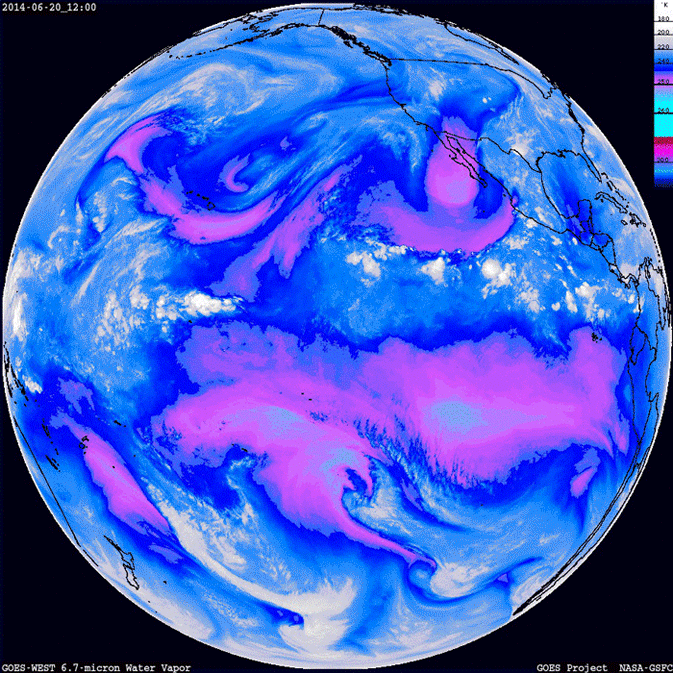
```

### Capas de la atmósfera {#sec-meteo-capas}

La atmósfera se divide en capas según cómo cambia la temperatura con la altura (@fig-meteo-perfil). La presión, en cambio, baja siempre: a 5.5 km ya es la mitad de la del nivel del mar, y a 50 km es menor que 1 hPa, lo que significa que el 99.9 % de la masa del aire está por debajo de esa altura.

- **Troposfera.** Va de la superficie hasta la tropopausa, a unos 16 o 17 km en el trópico y a unos 8 km sobre los polos. Contiene entre el 75 % y el 80 % de la masa del aire y casi todo el vapor de agua, así que en ella se forman las nubes y la lluvia. La temperatura baja con la altura, en promedio 6.5 °C por kilómetro.
- **Estratosfera.** Va de la tropopausa hasta unos 50 km. La temperatura se mantiene constante y después sube, porque el ozono absorbe la radiación ultravioleta del Sol. Esa inversión frena los movimientos verticales: por eso las nubes de tormenta se aplanan en la tropopausa y forman el yunque.
- **Mesosfera.** Entre 50 y 85 km. La temperatura vuelve a bajar hasta unos −90 °C en la mesopausa, el punto más frío de la atmósfera.
- **Termosfera.** Por encima de 85 km. El aire es tan escaso que unas pocas moléculas absorben la radiación solar de mayor energía y alcanzan temperaturas de 500 a 2000 °C, según la actividad del Sol. Más allá de unos 500 km está la exosfera, donde los gases ligeros escapan al espacio.

```{r}
#| label: fig-meteo-perfil
#| fig-cap: "Temperatura y presión de la atmósfera estándar hasta 100 km. Por encima de 85 km el perfil es solo indicativo. Fuente: elaboración propia con datos de @noaa1976standard."
#| fig-alt: "Perfil vertical de temperatura que baja en la troposfera, sube en la estratosfera, baja en la mesosfera y sube en la termosfera, con las capas sombreadas y la presión anotada a la derecha"
#| echo: false
#| out-width: 75%
#| fig-width: 7
#| fig-height: 6.5

# Atmósfera estándar de 1976: temperatura en la base de cada capa (K)
# y gradiente vertical (K/km), con la altitud en km
capas_std <- tibble(
  z_base = c(0, 11, 20, 32, 47, 51, 71),
  t_base = c(288.15, 216.65, 216.65, 228.65, 270.65, 270.65, 214.65),
  gradiente = c(-6.5, 0, 1.0, 2.8, 0, -2.8, -2.0)
)
perfil <- tibble(z = seq(0, 84.85, by = 0.05)) %>%
  mutate(i = findInterval(z, capas_std$z_base),
         t_c = capas_std$t_base[i] + capas_std$gradiente[i] * (z - capas_std$z_base[i]) - 273.15)
# Termosfera: solo la tendencia
termosfera <- tibble(z = seq(84.85, 100, by = 0.05)) %>%
  mutate(t_c = -86.3 + 0.004 * (z - 84.85)^2.6)

bandas <- tibble(capa = c("Troposfera", "Estratosfera", "Mesosfera", "Termosfera"),
                 z0 = c(0, 11, 50, 85), z1 = c(11, 50, 85, 100),
                 relleno = c("#DCEAF5", "#EEF4FA", "#DCEAF5", "#EEF4FA"))
pausas <- tibble(z = c(11, 50, 85), nombre = c("Tropopausa", "Estratopausa", "Mesopausa"))
# Presión de la atmósfera estándar a algunas alturas
presion <- tibble(z = c(1, 5.5, 16, 32, 45, 65, 80),
                  etiqueta = c("899 hPa", "505 hPa", "103 hPa", "8.7 hPa",
                               "1.4 hPa", "0.1 hPa", "0.009 hPa"))

ggplot() +
  geom_rect(data = bandas, aes(xmin = -Inf, xmax = Inf, ymin = z0, ymax = z1),
            fill = bandas$relleno) +
  geom_hline(data = pausas, aes(yintercept = z), colour = "grey55",
             linetype = "dashed", linewidth = 0.4) +
  geom_text(data = pausas, aes(x = -118, y = z, label = nombre), vjust = -0.4, hjust = 0,
            size = 3.3, colour = "grey30", family = "serif", fontface = "italic") +
  geom_text(data = bandas, aes(x = 38, y = (z0 + z1) / 2, label = capa), hjust = 1,
            size = 4.2, family = "serif", fontface = "bold", colour = "#1C3F5E") +
  geom_path(data = perfil, aes(t_c, z), colour = "#1C6BA0", linewidth = 1.2) +
  geom_path(data = termosfera, aes(t_c, z), colour = "#1C6BA0", linewidth = 1.2,
            linetype = "22") +
  geom_text(data = presion, aes(x = 78, y = z, label = etiqueta), hjust = 1, size = 3.2,
            family = "serif", colour = "#D55E00") +
  annotate("text", x = 78, y = 97.5, label = "Presión", hjust = 1, size = 3.4,
           family = "serif", colour = "#D55E00", fontface = "bold") +
  scale_x_continuous(limits = c(-120, 80), breaks = seq(-120, 80, 20), expand = c(0, 0)) +
  scale_y_continuous(limits = c(0, 100), breaks = seq(0, 100, 10), expand = c(0, 0)) +
  labs(x = "Temperatura (°C)", y = "Altitud (km)") +
  theme_minimal(base_size = 12, base_family = "serif") +
  theme(panel.grid.minor = element_blank(),
        panel.grid.major = element_line(colour = "white", linewidth = 0.3))
```

La atmósfera estándar de la @fig-meteo-perfil representa condiciones medias de latitudes medias, con la tropopausa a 11 km. Sobre Costa Rica la tropopausa está más alta, cerca de 16 km, y por eso las tormentas tropicales pueden crecer mucho más en vertical que las de latitudes medias.

## Elementos del tiempo {#sec-meteo-elementos}

El estado de la atmósfera se describe con unas pocas variables, llamadas elementos del tiempo: temperatura, presión, humedad, viento, nubosidad y precipitación. Cómo se miden se explicó en el capítulo de fuentes de información (@sec-fuentes-meteorologicas). Aquí interesa cómo se relacionan entre sí.

### Temperatura {#sec-meteo-temperatura}

La temperatura del aire mide la energía cinética media de sus moléculas. En la troposfera baja con la altura, en promedio 6.5 °C/km. Ese valor es el de la atmósfera estándar; el gradiente real cambia con la hora, la humedad y el tipo de masa de aire. A veces la temperatura sube con la altura en una capa, y se habla de inversión térmica (@sec-meteo-inversiones).

En el trópico la variación diaria de la temperatura suele ser mayor que la variación entre meses. La máxima del día ocurre a primera hora de la tarde y la mínima poco antes de la salida del sol, porque durante la noche el suelo pierde calor por radiación infrarroja sin recibir energía solar. En latitudes medias, en cambio, domina la variación estacional: los meses más cálidos llegan uno o dos meses después del solsticio de verano, por la inercia térmica del suelo y del océano. Las regiones continentales tienen amplitudes anuales mayores que las costeras, porque el agua se calienta y se enfría más despacio que la tierra.

### Presión atmosférica {#sec-meteo-presion}

La presión atmosférica es el peso de la columna de aire sobre una unidad de área. Al nivel del mar, en la atmósfera estándar, vale 1013.25 hPa, es decir, 101.325 kPa. Equivale a una columna de agua de 10.33 m, o a 1.033 kgf/cm².

El aire se comporta como un gas ideal. Para una masa de aire de volumen $V$ que contiene $n$ moles:

$$
P\,V = n\,R^*\,T
$$ {#eq-meteo-gases}

donde $P$ es la presión (Pa), $V$ es el volumen (m³), $n$ es el número de moles, $R^* = 8.314\ \mathrm{J/(mol\,K)}$ es la constante universal de los gases y $T$ es la temperatura absoluta (K). En meteorología es más cómodo escribirla con la densidad:

$$
P = \rho\,R_d\,T
$$ {#eq-meteo-gas-densidad}

donde $\rho$ es la densidad del aire (kg/m³) y $R_d = 287\ \mathrm{J/(kg\,K)}$ es la constante del aire seco [@wallace2006atmospheric]. Con $P = 101\,325$ Pa y $T = 288$ K da $\rho = 1.23$ kg/m³.

La presión baja con la altura porque cada capa de aire sostiene el peso de las que tiene encima. En una atmósfera en reposo se cumple la ecuación hidrostática:

$$
\frac{dP}{dz} = -\rho\,g
$$ {#eq-meteo-hidrostatica}

donde $z$ es la altitud (m) y $g = 9.81\ \mathrm{m/s^2}$ es la aceleración de la gravedad. Si se integra con la @eq-meteo-gas-densidad y se supone que la temperatura baja 6.5 °C/km desde 15 °C al nivel del mar, se obtiene la presión de la atmósfera estándar [@noaa1976standard]:

$$
P = 1013.25 \left( \frac{288.15 - 0.0065\,z}{288.15} \right)^{5.256}
$$ {#eq-meteo-presion-altitud}

donde $P$ está en hPa y $z$ en metros. Vale en la troposfera, hasta 11 km. El @tbl-meteo-atm-estandar da algunos valores.

```{r}
#| label: tbl-meteo-atm-estandar
#| tbl-cap: "Presión y temperatura de la atmósfera estándar. Fuente: elaboración propia con la ecuación de la atmósfera estándar [@noaa1976standard]."
#| echo: false

atm_std <- tibble(z = c(0, 500, 1000, 1500, 2000, 3000, 4000)) %>%
  mutate(p = 1013.25 * ((288.15 - 0.0065 * z) / 288.15)^5.256,
         t = 15 - 0.0065 * z)

atm_std %>%
  mutate(z = as.character(z), p = sprintf("%.1f", p), t = sprintf("%.1f", t)) %>%
  knitr::kable(col.names = c("Altitud (m)", "Presión (hPa)", "Temperatura (°C)"),
               align = "ccc")
```

La presión al nivel del mar cambia poco de un día a otro, unos pocos hectopascales, salvo al paso de un sistema de baja presión o de un huracán. En el trópico tiene además una oscilación de dos ciclos por día, la marea barométrica, con máximos cerca de las 10:00 y las 22:00 y mínimos cerca de las 04:00 y las 16:00, hora local.

::: {.callout-note title="Ejemplo: presión atmosférica a distintas altitudes"}

Con la @eq-meteo-presion-altitud, estime la presión atmosférica a 0 m, 1150 m (más o menos la elevación de San José) y 3400 m (cerca de la cima del cerro de la Muerte). Después calcule la constante psicrométrica $\gamma = 0.665\times10^{-3}\,P$, con $P$ en kPa y $\gamma$ en kPa/°C, que entra en el cálculo de la evapotranspiración de referencia [@allen1998fao56].

**Solución:**

Para $z = 1150$ m:

1. Base: $(288.15 - 0.0065 \times 1150)/288.15 = 280.675/288.15 = 0.97406$.
2. Potencia: $0.97406^{5.256} = 0.87097$.
3. Presión: $P = 1013.25 \times 0.87097 = 882.5$ hPa $= 88.25$ kPa.
4. Constante psicrométrica: $\gamma = 0.665\times10^{-3} \times 88.25 = 0.0587$ kPa/°C.

Para $z = 3400$ m, la base es $266.05/288.15 = 0.92330$, la potencia da $0.65745$ y $P = 666.2$ hPa, con $\gamma = 0.0443$ kPa/°C. Al nivel del mar, $P = 1013.25$ hPa y $\gamma = 0.0674$ kPa/°C.

**Pseudocódigo**

1. Definir las altitudes.
2. Calcular la presión con la ecuación de la atmósfera estándar.
3. Pasar la presión a kPa y calcular $\gamma$.
4. Calcular cuánto baja la presión respecto al nivel del mar.

```{r}
#| label: ej-meteo-presion

library(tidyverse)

# 1) Altitudes (m)
sitios <- tibble(
  sitio = c("Nivel del mar", "San José (aprox.)", "Cerro de la Muerte (aprox.)"),
  z = c(0, 1150, 3400)
)

sitios <- sitios %>%
  mutate(
    # 2) Presión de la atmósfera estándar (hPa)
    p_hpa = 1013.25 * ((288.15 - 0.0065 * z) / 288.15)^5.256,
    # 3) Constante psicrométrica (kPa/°C), con P en kPa
    gamma = 0.665e-3 * p_hpa / 10,
    # 4) Reducción respecto al nivel del mar (%)
    reduccion = 100 * (1 - p_hpa / 1013.25)
  )

sitios
```

La presión a 3400 m es un 34 % menor que al nivel del mar. Con ella baja la constante psicrométrica, y eso cambia la evapotranspiración que se calcula con la ecuación de Penman-Monteith. Por eso en una cuenca de montaña se usa la presión de la elevación de la estación, no la del nivel del mar.

:::

### Humedad {#sec-meteo-humedad}

El vapor de agua del aire se puede expresar de varias formas, que se relacionan entre sí con la temperatura:

- **Presión de vapor** ($e$): la parte de la presión del aire que se debe al vapor de agua (kPa).
- **Presión de vapor de saturación** ($e_s$): la presión de vapor máxima que admite el aire a una temperatura dada. Crece casi exponencialmente con la temperatura (@eq-fuentes-es).
- **Humedad relativa** ($HR$): el cociente $100\,e/e_s$, en porcentaje (@eq-fuentes-hr).
- **Humedad absoluta** ($\rho_v$): masa de vapor por unidad de volumen de aire (g/m³).
- **Punto de rocío** ($T_d$): temperatura a la que hay que enfriar el aire, sin cambiar su presión ni su contenido de vapor, para que se sature.

Como $e_s$ depende tanto de la temperatura, la humedad relativa sube en la noche y baja en la tarde aunque el aire tenga la misma cantidad de vapor. Para comparar masas de aire conviene usar el punto de rocío o la presión de vapor, que no cambian con el ciclo diario de temperatura.

La pendiente de la curva de saturación la da la ecuación de Clausius-Clapeyron:

$$
\frac{1}{e_s}\,\frac{de_s}{dT} = \frac{L_v}{R_v\,T^2}
$$ {#eq-meteo-clausius}

donde $L_v = 2.5\times10^{6}\ \mathrm{J/kg}$ es el calor latente de vaporización, $R_v = 461.5\ \mathrm{J/(kg\,K)}$ es la constante del vapor de agua y $T$ es la temperatura (K). A 288 K el lado derecho vale 0.065 K⁻¹: por cada grado de calentamiento, el aire saturado puede contener entre 6 % y 7 % más vapor. Esa cifra explica buena parte de lo que se espera de la lluvia intensa con el cambio climático (@sec-meteo-cambio-climatico).

### Viento {#sec-meteo-viento}

El viento es el movimiento horizontal del aire. Los movimientos verticales se llaman corrientes ascendentes o descendentes. En hidrología el viento importa por dos razones: transporta el vapor desde los océanos hacia los continentes, y renueva el aire sobre una superficie que evapora, por lo que aparece en las fórmulas de evaporación.

Tres fuerzas controlan el viento:

- **Fuerza del gradiente de presión.** Empuja el aire de las zonas de alta presión hacia las de baja presión. Es la que inicia el movimiento, y es mayor cuanto más juntas están las isobaras en un mapa.
- **Fuerza de Coriolis.** Es una fuerza aparente que aparece porque la Tierra gira. Desvía el aire hacia la derecha en el hemisferio norte y hacia la izquierda en el sur, sin cambiar su rapidez. Su valor por unidad de masa se da en la @eq-meteo-coriolis.
- **Fricción.** El roce con el terreno frena el viento y lo desvía hacia la baja presión. Su efecto se siente en la capa límite, que va de unos cientos de metros a 1 o 2 km de espesor según la hora y la rugosidad del terreno (bosques, edificios, relieve). Por eso el viento medido a 10 m de altura en una ciudad es más débil que el medido en un aeropuerto abierto.

$$
F_c = 2\,\Omega\,v\,\sin\varphi
$$ {#eq-meteo-coriolis}

donde $F_c$ es la aceleración de Coriolis (m/s²), $\Omega = 7.292\times10^{-5}\ \mathrm{rad/s}$ es la velocidad angular de la Tierra, $v$ es la velocidad del viento (m/s) y $\varphi$ es la latitud. A 10° N, la latitud de Costa Rica, $\sin\varphi = 0.17$, y la fuerza es apenas la cuarta parte de la que hay a 45°. Por eso cerca del ecuador el viento no se ajusta a las isobaras como en latitudes medias, y los huracanes casi nunca se forman a menos de 5° del ecuador, donde el giro no alcanza a organizarse [@wallace2006atmospheric].

### Ascenso del aire y enfriamiento adiabático {#sec-meteo-adiabatico}

Cuando el aire sube, encuentra menos presión, se expande y se enfría, aunque no ceda calor a su entorno. Ese enfriamiento se llama adiabático, y es el mecanismo que forma casi todas las nubes y casi toda la lluvia.

Mientras el aire no está saturado, se enfría a razón del gradiente adiabático seco:

$$
\Gamma_d = \frac{g}{c_p} \approx 9.8\ \mathrm{^\circ C/km}
$$ {#eq-meteo-adiabatico-seco}

donde $c_p = 1004\ \mathrm{J/(kg\,K)}$ es el calor específico del aire a presión constante. Al llegar a su punto de rocío, el vapor empieza a condensarse y libera calor latente. Desde ahí el aire se enfría más despacio, con el gradiente adiabático húmedo $\Gamma_s$, que va de unos 4 °C/km en aire cálido a unos 7 °C/km en aire frío [@wallace2006atmospheric]. La altura donde empieza la condensación es la base de las nubes, o nivel de condensación por ascenso. Se estima con:

$$
z_{\text{NCA}} \approx 125\,(T - T_d)
$$ {#eq-meteo-nca}

donde $z_{\text{NCA}}$ es la altura sobre el punto de partida (m), $T$ es la temperatura del aire (°C) y $T_d$ es su punto de rocío (°C) [@lawrence2005relationship].

El aire sube por cuatro causas:

- **Convección.** El suelo calentado por el sol calienta el aire en contacto con él, que se vuelve menos denso y sube. Es el origen de los aguaceros de la tarde en el Valle Central.
- **Ascenso orográfico.** El viento choca con una montaña y la remonta (@fig-foehn).
- **Frentes.** Una masa de aire frío, más densa, se mete por debajo de una cálida y la levanta (@fig-frente_frio). En Costa Rica los frentes llegan debilitados, como empujes fríos que entre noviembre y marzo traen lluvias al Caribe y viento fuerte al Pacífico Norte.
- **Convergencia.** Cuando el aire confluye en superficie, no tiene más salida que subir; cuando diverge, el aire de arriba baja a reemplazarlo (@fig-conver_diver). La Zona de Convergencia Intertropical (@sec-meteo-hadley) es el caso más importante para Costa Rica.

```{r}
#| label: fig-frente_frio
#| fig-cap: "Frente frío: el aire frío avanza por debajo del aire cálido y lo obliga a subir."
#| fig-alt: "Bloque esquemático con una cuña de aire frío que levanta aire cálido y forma un cumulonimbo con lluvia sobre el frente"
#| echo: false
#| out-width: 75%

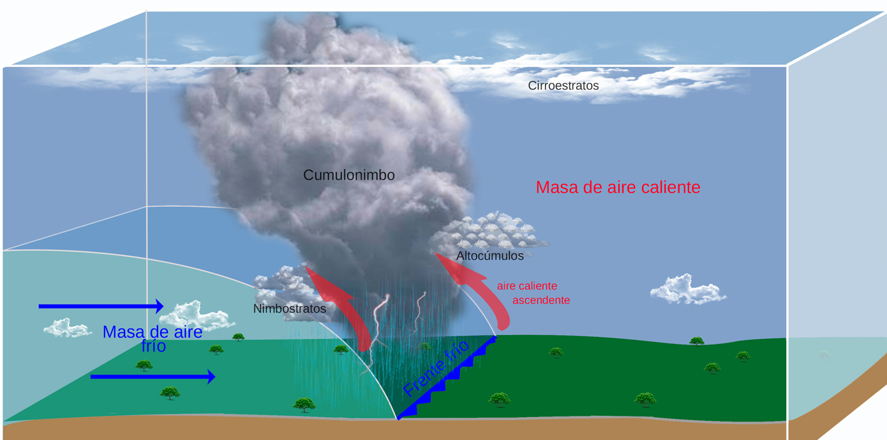
```

```{r}
#| label: fig-conver_diver
#| fig-cap: "Convergencia y divergencia del aire en superficie, con las isobaras de un centro de alta (A) y uno de baja (B) presión."
#| fig-alt: "Esquema con aire que converge y sube sobre una baja presión y aire que baja y diverge sobre una alta presión"
#| echo: false
#| out-width: 55%

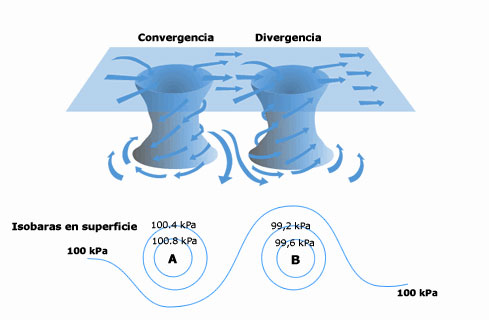
```

Cuando el aire remonta una cordillera, deja buena parte de su humedad como lluvia en la ladera de barlovento. Del otro lado baja sin nubes, se calienta con el gradiente seco y llega al pie de la montaña más caliente y más seco que en el punto de partida. Ese viento cálido y seco de sotavento es el efecto Foehn (@fig-foehn).

```{r}
#| label: fig-foehn
#| fig-cap: "Efecto Foehn: el aire se enfría con el gradiente húmedo al subir por barlovento y se calienta con el gradiente seco al bajar por sotavento. Fuente: Instituto Geográfico Nacional de España."
#| fig-alt: "Montaña con nubes y lluvia en la ladera izquierda y aire cálido y seco que baja por la derecha, con escalas de temperatura a ambos lados"
#| echo: false
#| out-width: 80%

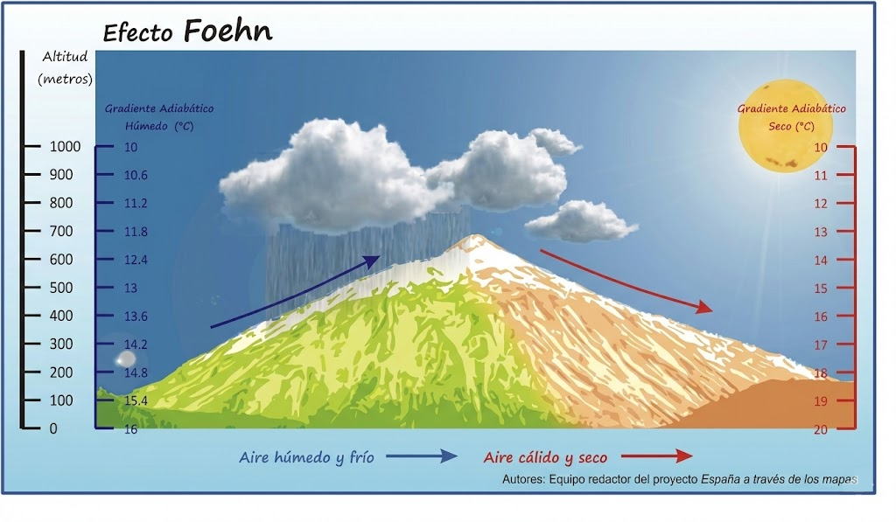
```

::: {.callout-note title="Ejemplo: aire que cruza la cordillera de Talamanca"}

El viento alisio lleva aire del Caribe a 26 °C, con punto de rocío de 19 °C, hacia la cordillera de Talamanca. El aire remonta la cordillera hasta 3000 m y baja por la vertiente del Pacífico hasta un valle a 700 m. Suponga un gradiente seco de 9.8 °C/km, un gradiente húmedo constante de 6.0 °C/km y que toda el agua que se condensa cae como lluvia en barlovento. Estime la temperatura del aire en la cima y en el valle, y compárela con la que tendría el aire a 700 m en la ladera del Caribe. Los datos son de ejemplo.

**Solución:**

1. Base de las nubes (@eq-meteo-nca): $z_{\text{NCA}} = 125 \times (26 - 19) = 875$ m.
2. De 0 a 875 m el aire sube seco: $T = 26 - 9.8 \times 0.875 = 17.4$ °C.
3. De 875 a 3000 m sube saturado: $T = 17.4 - 6.0 \times 2.125 = 4.7$ °C en la cima.
4. Baja seco de 3000 a 700 m: $T = 4.7 + 9.8 \times 2.30 = 27.2$ °C en el valle.
5. En la ladera del Caribe, a 700 m, el aire todavía no se ha saturado: $T = 26 - 9.8 \times 0.70 = 19.1$ °C.

El aire llega al valle de sotavento 8.1 °C más caliente que a la misma altura en barlovento.

**Pseudocódigo**

1. Definir la temperatura, el punto de rocío, los gradientes y las altitudes.
2. Calcular la base de las nubes.
3. Calcular la temperatura en la base, en la cima y en el valle de sotavento.
4. Calcular la temperatura a la misma altura en barlovento y comparar.

```{r}
#| label: ej-meteo-foehn

# 1) Datos (°C, m y °C/km)
t0 <- 26; td <- 19
gamma_seco <- 9.8; gamma_humedo <- 6.0
z_cima <- 3000; z_valle <- 700

# 2) Nivel de condensación por ascenso (m)
z_nca <- 125 * (t0 - td)

# 3) Temperaturas a lo largo del recorrido
t_nca   <- t0 - gamma_seco * z_nca / 1000
t_cima  <- t_nca - gamma_humedo * (z_cima - z_nca) / 1000
t_valle <- t_cima + gamma_seco * (z_cima - z_valle) / 1000

# 4) Misma altura en barlovento (debajo de la base de las nubes)
t_barlovento <- t0 - gamma_seco * z_valle / 1000

round(c(z_nca = z_nca, t_nca = t_nca, t_cima = t_cima, t_valle = t_valle,
        t_barlovento = t_barlovento, diferencia = t_valle - t_barlovento), 1)
```

La diferencia sale de que el aire perdió su humedad al subir: el calor latente que liberó la condensación se queda en el aire. Es la razón de que en Costa Rica la vertiente que da al viento dominante sea mucho más lluviosa que la opuesta. En el análisis de una cuenca de montaña conviene revisar en qué vertiente está cada estación antes de usarla para rellenar o interpolar datos de otra.

:::

### Estabilidad e inversiones térmicas {#sec-meteo-inversiones}

Si el aire que sube queda más caliente que su entorno, sigue subiendo solo: la atmósfera es inestable y se forman nubes de gran desarrollo vertical. Si queda más frío, vuelve a bajar: la atmósfera es estable. La comparación se hace entre el gradiente real del entorno y los gradientes adiabáticos. Un gradiente real mayor que 9.8 °C/km es siempre inestable; uno menor que el gradiente húmedo es siempre estable.

Una inversión térmica es una capa en la que la temperatura sube con la altura. Es la condición más estable que existe, porque el aire frío y denso queda abajo. Las inversiones frenan los movimientos verticales, atrapan el humo y la contaminación y limitan el crecimiento de las nubes. Se forman por:

- El enfriamiento del suelo en noches despejadas y sin viento, que enfría el aire de abajo.
- El paso de aire cálido sobre aire frío o sobre una superficie fría.
- El descenso del aire en los anticiclones, que lo calienta por compresión. Es la inversión de los alisios, que en el Caribe limita la altura de las nubes de buen tiempo.

La tropopausa también es una inversión, a escala planetaria.

## Energía del sistema Tierra-atmósfera {#sec-meteo-energia}

### Transmisión del calor {#sec-meteo-calor}

La energía se mueve en la atmósfera por cuatro mecanismos (@fig-calor):

- **Radiación.** Transferencia por ondas electromagnéticas, sin necesidad de un medio. Es la única forma en que la energía del Sol llega a la Tierra.
- **Conducción.** Transferencia por contacto entre moléculas. El aire conduce mal el calor, así que solo cuenta en los primeros milímetros sobre el suelo o el agua.
- **Convección.** Transporte vertical de calor por el movimiento del aire o del agua.
- **Advección.** Transporte horizontal de calor y de humedad por el viento. Lleva la energía del ecuador hacia los polos y el vapor del mar hacia la tierra.

```{r}
#| label: fig-calor
#| fig-cap: "Mecanismos de transmisión del calor en la atmósfera."
#| fig-alt: "Cuatro paneles con ilustraciones de radiación, convección, conducción y advección"
#| echo: false
#| out-width: 80%

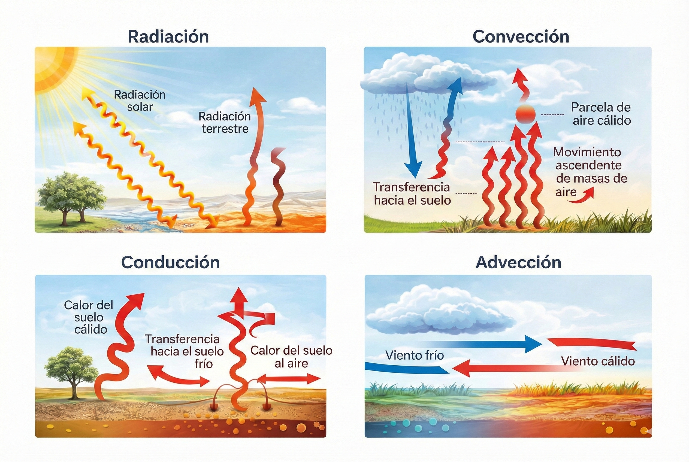
```

Todo cuerpo emite radiación según su temperatura. La ley de Stefan-Boltzmann da la energía emitida por unidad de área:

$$
R = \varepsilon\,\sigma\,T^4
$$ {#eq-meteo-stefan}

donde $R$ es la radiación emitida (W/m²), $\varepsilon$ es la emisividad de la superficie (1 para un cuerpo negro; entre 0.95 y 0.99 para el agua, el suelo y la vegetación), $\sigma = 5.67\times10^{-8}\ \mathrm{W/(m^2\,K^4)}$ es la constante de Stefan-Boltzmann y $T$ es la temperatura absoluta (K). Una superficie a 15 °C (288 K) emite unos 390 W/m². Como la superficie de la Tierra es mucho más fría que la del Sol, emite en longitudes de onda más largas: el Sol emite radiación de onda corta (visible e infrarrojo cercano) y la Tierra radiación de onda larga (infrarrojo térmico).

### Insolación {#sec-meteo-insolacion}

La energía que llega del Sol se llama insolación. Fuera de la atmósfera, sobre una superficie perpendicular a los rayos y a la distancia media Tierra-Sol, vale 1361 W/m²; es la constante solar [@kopp2011new]. La que llega a un punto del suelo depende de cuatro factores:

- **Altura del Sol.** Cuanto más alto está el Sol, más concentrada llega la energía. Un mismo haz de rayos que cae inclinado se reparte sobre un área mayor (@fig-latitud).
- **Espesor de atmósfera atravesado.** Con el Sol cerca del horizonte, los rayos recorren más aire y pierden más energía por absorción y dispersión.
- **Duración del día.** A 10° N el día dura entre 11.4 y 12.6 horas a lo largo del año; a 45° N, entre 8.6 y 15.4 horas (calculado con las ecuaciones de @allen1998fao56). Por eso en Costa Rica la radiación cambia poco de un mes a otro, salvo por la nubosidad.
- **Nubosidad.** Las nubes reflejan la radiación solar. En la época lluviosa de Costa Rica, la radiación que llega al suelo puede ser menor que en la época seca, aunque el Sol esté más alto.

```{r}
#| label: fig-latitud
#| fig-cap: "Distribución de la radiación solar según la latitud: cerca del ecuador los rayos llegan más perpendiculares y concentran más energía por unidad de área."
#| fig-alt: "Esquema del Sol y la Tierra con rayos paralelos que se reparten en áreas pequeñas cerca del ecuador y en áreas grandes cerca de los polos"
#| echo: false
#| out-width: 80%

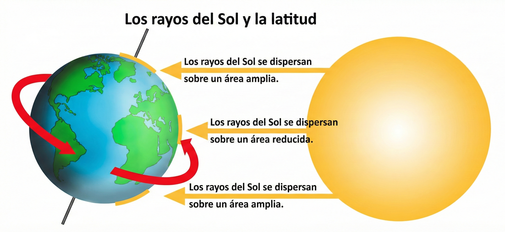
```

### Balance de energía y efecto invernadero {#sec-meteo-balance}

Para que la temperatura media de la Tierra se mantenga, la energía que entra debe ser igual a la que sale. La @fig-balance_rad, en el capítulo anterior, resume el balance medio. De cada 342 W/m² que llegan en promedio al tope de la atmósfera [@letreut2007historical]:

- 107 W/m² (31 %) se reflejan al espacio, sobre todo en las nubes y en superficies claras. Esa fracción es el albedo de la Tierra.
- 67 W/m² (20 %) los absorbe la atmósfera.
- 168 W/m² (49 %) los absorbe la superficie.

La superficie devuelve esa energía a la atmósfera de tres formas: como calor latente en la evaporación (78 W/m², que se liberan después cuando el vapor se condensa en las nubes), como calor sensible por conducción y convección (24 W/m²) y como radiación de onda larga. Sin contar la radiación, unas tres cuartas partes de la energía que la superficie entrega a la atmósfera se van en evaporar agua: el ciclo hidrológico es también el principal transporte de energía del planeta.

El vapor de agua, el CO₂, el metano y otros gases dejan pasar casi toda la radiación solar, pero absorben la radiación de onda larga que emite la superficie y devuelven una parte hacia abajo (@fig-invernadero). Ese es el efecto invernadero. El ejemplo siguiente estima cuánto calienta.

```{r}
#| label: fig-invernadero
#| fig-cap: "Efecto invernadero: la radiación solar de onda corta atraviesa la atmósfera y los gases de efecto invernadero retienen parte de la radiación infrarroja que emite la superficie."
#| fig-alt: "Ilustración del Sol y la Tierra con flechas amarillas de radiación solar y flechas rojas de radiación infrarroja que rebotan en una capa de gases"
#| echo: false
#| out-width: 75%

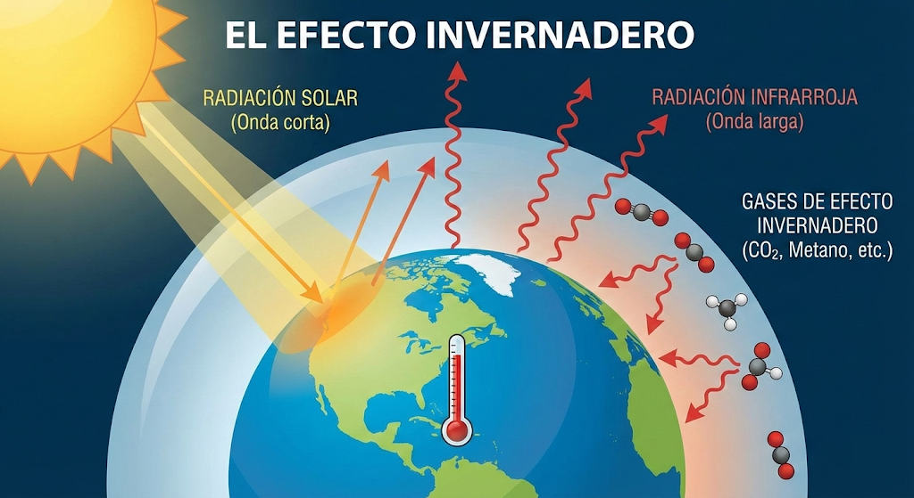
```

::: {.callout-note title="Ejemplo: temperatura de la Tierra sin efecto invernadero"}

Estime la temperatura que tendría la superficie de la Tierra si la atmósfera no absorbiera radiación de onda larga. Use una constante solar $S_0 = 1361$ W/m², un albedo $\alpha = 0.30$ y suponga que la Tierra emite como un cuerpo negro. Compare con la temperatura media observada, de unos 15 °C.

**Solución:**

La Tierra intercepta la radiación solar con un disco de área $\pi r^2$, pero la emite desde toda su esfera, de área $4\pi r^2$. En equilibrio:

$$
S_0\,(1 - \alpha)\,\pi r^2 = \sigma\,T_e^4\,4\pi r^2
\quad\Rightarrow\quad
T_e = \left[\frac{S_0\,(1-\alpha)}{4\,\sigma}\right]^{1/4}
$$ {#eq-meteo-temperatura-equilibrio}

donde $T_e$ es la temperatura de equilibrio (K).

1. Energía absorbida por unidad de área de la esfera: $1361 \times (1 - 0.30)/4 = 238.2$ W/m².
2. Cociente: $238.2 / 5.67\times10^{-8} = 4.201\times10^{9}$ K⁴.
3. Raíz cuarta: $T_e = 254.6$ K $= -18.6$ °C.
4. Diferencia con la temperatura observada: $15 - (-18.6) = 33.6$ °C.

**Pseudocódigo**

1. Definir $S_0$, $\alpha$ y $\sigma$.
2. Calcular la energía absorbida por unidad de área.
3. Despejar la temperatura con la ley de Stefan-Boltzmann.
4. Restar la temperatura de equilibrio a la temperatura observada.

```{r}
#| label: ej-meteo-equilibrio

# 1) Datos
s0 <- 1361        # constante solar (W/m²)
albedo <- 0.30
sigma <- 5.67e-8  # W/(m² K⁴)

# 2) Energía absorbida por unidad de área de la esfera (W/m²)
absorbida <- s0 * (1 - albedo) / 4

# 3) Temperatura de equilibrio (K y °C)
t_e <- (absorbida / sigma)^(1 / 4)
t_e_c <- t_e - 273.15

# 4) Calentamiento debido al efecto invernadero (°C)
efecto <- 15 - t_e_c

round(c(absorbida = absorbida, t_e_k = t_e, t_e_c = t_e_c, efecto = efecto), 1)
```

Sin efecto invernadero, la superficie estaría unos 33 °C más fría y casi toda el agua del planeta estaría congelada. El resultado también muestra la sensibilidad del sistema: un cambio de solo 1 % en la energía absorbida mueve la temperatura de equilibrio unos 0.6 °C.

:::

### Calentamiento desigual {#sec-meteo-calentamiento}

La superficie de la Tierra no se calienta igual en todas partes, y esa diferencia es la que pone en marcha el viento, la convección y la lluvia. Además de la latitud y la nubosidad, influyen las propiedades de la superficie:

- **Albedo.** La nieve fresca refleja más del 80 % de la radiación solar; un bosque, entre 10 % y 20 %, y el océano, menos del 10 %.
- **Capacidad calorífica.** El agua almacena mucho calor y lo suelta despacio. Por eso las costas tienen menos diferencia de temperatura entre el día y la noche que el interior, y por eso existen las brisas de mar y de tierra.
- **Cobertura del suelo.** La vegetación usa parte de la energía en evapotranspirar, y así se calienta menos. Las superficies urbanas impermeables almacenan calor y lo liberan de noche, lo que forma las islas de calor urbanas.

::: {.callout-note title="Para profundizar: los cinturones de Van Allen" collapse="true"}
La Tierra está rodeada por dos zonas en forma de anillo donde el campo magnético atrapa protones y electrones de alta energía: los cinturones de Van Allen (@fig-allen). El interior está entre unos 1000 y 6000 km de altura y el exterior entre unos 13 000 y 60 000 km. Las partículas viajan en espiral de un polo magnético al otro. Cuando el viento solar es intenso, parte de ellas entra en la alta atmósfera cerca de los polos, excita los átomos de oxígeno y nitrógeno y produce las auroras. Estos cinturones no influyen en el tiempo ni en el ciclo del agua, pero muestran cómo el campo magnético desvía la mayor parte del viento solar.

```{r}
#| label: fig-allen
#| fig-cap: "Cinturones de radiación de Van Allen y desvío del viento solar por el campo magnético terrestre. Fuente: adaptado de astronomynotes.com."
#| fig-alt: "Esquema de la Tierra con las líneas del campo magnético, dos cinturones de radiación a cada lado y partículas del viento solar que se desvían"
#| echo: false
#| out-width: 85%

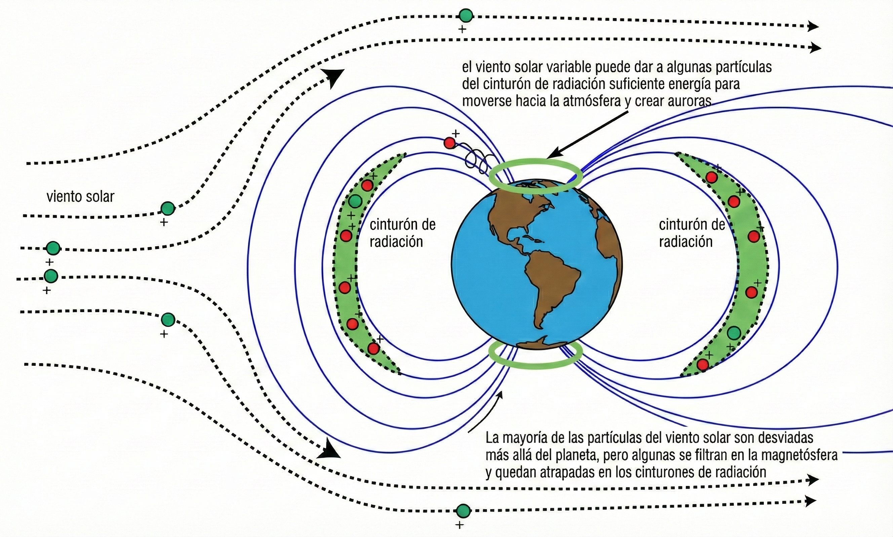
```
:::

## Circulación de la atmósfera {#sec-meteo-circulacion}

### Circulación general {#sec-meteo-hadley}

El ecuador recibe más energía de la que emite y los polos emiten más de la que reciben. La atmósfera y los océanos llevan el excedente hacia los polos. En cada hemisferio, la atmósfera lo hace con tres grandes células de circulación: la de Hadley, entre el ecuador y unos 30° de latitud; la de Ferrel, en latitudes medias; y la Polar (@fig-hadley).

```{r}
#| label: fig-hadley
#| fig-cap: "Células de circulación general de la atmósfera y vientos dominantes en superficie. Fuente: CEUPE (2025)."
#| fig-alt: "Globo terrestre con las células de Hadley, Ferrel y polares a cada lado y flechas de los alisios, los vientos del oeste y los polares del este"
#| echo: false
#| out-width: 75%

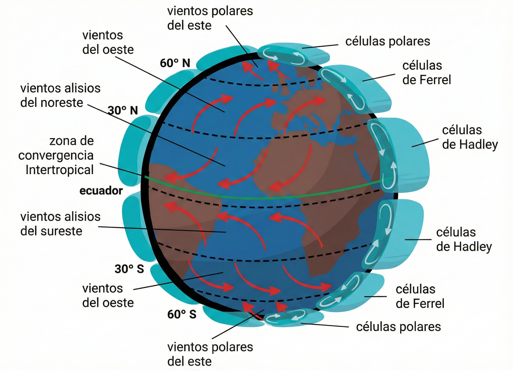
```

La célula de Hadley es la que gobierna el clima de Costa Rica. Funciona en cuatro pasos:

1. **Ascenso cerca del ecuador.** El aire cálido y húmedo de las latitudes bajas sube en una franja de nubes de tormenta y lluvias intensas, la Zona de Convergencia Intertropical (ZCIT). Casi toda la lluvia de la célula cae aquí, durante el ascenso.
2. **Flujo hacia los polos en altura.** Ya seco, el aire se desplaza cerca de la tropopausa hacia latitudes mayores y se enfría por radiación.
3. **Descenso subtropical.** Cerca de los 30° de latitud el aire baja, se calienta por compresión y se seca todavía más. Así se forman los anticiclones subtropicales, como el de las Azores, y los grandes desiertos del planeta.
4. **Retorno en superficie.** El aire vuelve hacia el ecuador cerca del suelo. La fuerza de Coriolis lo desvía y forma los vientos alisios, del noreste en el hemisferio norte y del sureste en el sur.

La ZCIT sigue al Sol con algunas semanas de retraso: entre mayo y octubre está sobre Centroamérica o cerca de ella, y entre diciembre y marzo se retira hacia el sur. Junto con los alisios, ese vaivén define la época lluviosa y la seca de la vertiente del Pacífico de Costa Rica.

### El chorro de bajo nivel del Caribe {#sec-meteo-chorro}

Sobre el mar Caribe los alisios forman una banda de vientos máximos a menos de 1 km de altura, con su núcleo cerca del nivel de 925 hPa: el chorro de bajo nivel del Caribe [@amador2008intra]. No debe confundirse con las corrientes en chorro de latitudes medias, que soplan a más de 30 m/s cerca de la tropopausa. El chorro del Caribe lleva grandes cantidades de vapor desde el Atlántico hacia Centroamérica (@fig-chorro).

```{r}
#| label: fig-chorro
#| fig-cap: "Chorro de bajo nivel del Caribe sobre Costa Rica. Fuente: @Cigefi."
#| fig-alt: "Bloque de Costa Rica con el viento del este que llega del Caribe, sube por la cordillera con nubes y lluvia y baja seco hacia el Pacífico"
#| echo: false
#| out-width: 75%

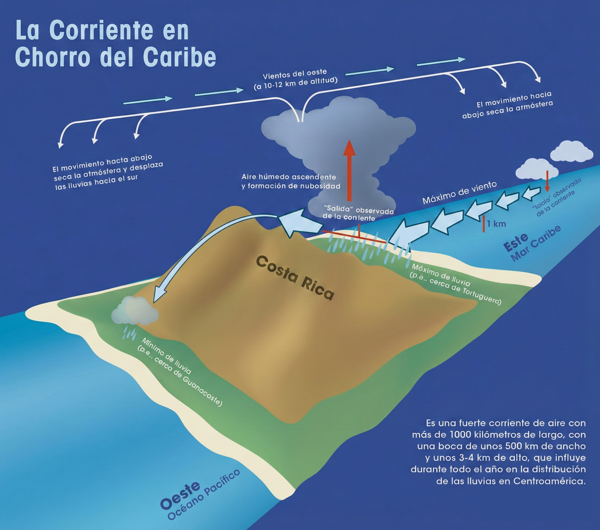
```

El chorro tiene dos máximos al año, uno en julio y otro, más débil, en enero y febrero [@amador2008intra]. Sus efectos en Costa Rica se ven con claridad en los registros de lluvia:

- **Vertiente del Caribe.** El aire húmedo choca con las cordilleras y sube. El ascenso orográfico produce lluvias casi todo el año, así que buena parte del Caribe costarricense no tiene una estación seca definida.
- **Vertiente del Pacífico.** Cuando el chorro se intensifica en julio y agosto, el aire baja por sotavento, se seca y frena la convección. La lluvia disminuye a mitad de la época lluviosa: es el veranillo o canícula [@magana1999midsummer]. Por eso muchas estaciones del Pacífico tienen un régimen bimodal, con un máximo en junio y otro en septiembre u octubre.
- **Relación con el ENOS.** En años de El Niño el chorro suele ser más intenso en julio, lo que refuerza la lluvia del Caribe y el déficit del Pacífico [@amador2008intra].

### Escalas de los fenómenos atmosféricos {#sec-meteo-escalas}

Los movimientos del aire van desde la circulación general, que abarca el planeta, hasta remolinos de pocos centímetros. Cada escala tiene su tiempo característico y afecta a la hidrología de otra forma (@tbl-escala). Los límites entre escalas son convencionales; los del cuadro siguen la propuesta de @orlanski1975rational.

| Escala | Tamaño horizontal | Duración típica | Ejemplos | Importancia hidrológica |
|:--|:--|:--|:--|:--|
| Planetaria | Más de 10 000 km | Semanas a años | Células de Hadley, ZCIT, ENOS | Régimen de lluvias y años secos o húmedos |
| Sinóptica | 2000 a 10 000 km | Días a una semana | Anticiclones, ondas tropicales, empujes fríos | Temporales de varios días sobre cuencas grandes |
| Mesoescala | 2 a 2000 km | Horas a días | Huracanes, sistemas convectivos, tormentas, brisas | Lluvias intensas y crecidas súbitas en cuencas pequeñas |
| Microescala | Menos de 2 km | Segundos a minutos | Turbulencia, remolinos, intercambio suelo-aire | Evaporación y evapotranspiración |

: Escalas de los fenómenos atmosféricos. Fuente: adaptado de @orlanski1975rational. {#tbl-escala}

Los mapas del tiempo de escala sinóptica muestran los grandes sistemas, como los huracanes de la @fig-sinop. Las tormentas de mesoescala, en cambio, pueden concentrar la lluvia en franjas de pocos kilómetros (@fig-lluvia).

```{r}
#| label: fig-sinop
#| fig-cap: "Huracanes en el Atlántico vistos desde satélite. Fuente: @NOAA_OSPO."
#| fig-alt: "Imagen satelital del Atlántico y el Caribe con dos huracanes de ojo bien definido"
#| echo: false
#| out-width: 70%

knitr::include_graphics("assets/img/sinop.jfif")
```

```{r}
#| label: fig-lluvia
#| fig-cap: "Tormenta convectiva, con la lluvia concentrada en una franja de pocos kilómetros. Fuente: @NOAA_OSPO."
#| fig-alt: "Fotografía en blanco y negro de una cortina de lluvia intensa que cae de una nube sobre un valle"
#| echo: false
#| out-width: 70%

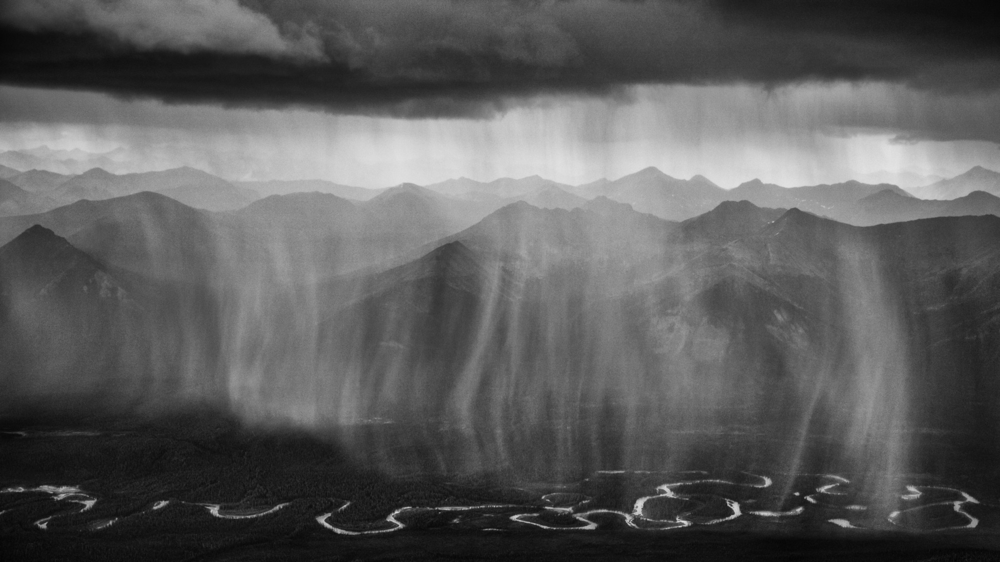
```

Para el diseño hidrológico, la escala de la tormenta se compara con el tamaño de la cuenca. Una tormenta convectiva puede cubrir por completo una cuenca urbana de 5 km² y dejar seca la estación vecina, mientras que en una cuenca de 2000 km² las crecidas grandes suelen venir de sistemas sinópticos que llueven varios días seguidos.

## Corrientes oceánicas {#sec-meteo-corrientes}

::: {.pregunta}
¿Por qué, si Nueva York y Madrid están casi en la misma latitud, los inviernos de Nueva York son mucho más fríos y nevados que los de Madrid?
:::

Las dos ciudades están cerca del paralelo 40.5° N (@fig-meteo-nueva-york-madrid). La latitud define cuánta energía solar llega, pero no basta para explicar el clima: también cuenta cómo el océano y el viento transportan el calor.

```{r}
#| label: fig-meteo-nueva-york-madrid
#| fig-cap: "Nueva York y Madrid, casi en el mismo paralelo, a ambos lados del Atlántico Norte."
#| fig-alt: "Mapa del Atlántico Norte con una línea discontinua en el paralelo 40.5° N que pasa por Nueva York y por Madrid"
#| echo: false
#| out-width: 85%
#| fig-width: 8
#| fig-height: 4.6

mundo <- map_data("world")
ciudades <- tibble(nombre = c("Nueva York", "Madrid"),
                   lon = c(-74.01, -3.70), lat = c(40.71, 40.42))

ggplot() +
  geom_polygon(data = mundo, aes(long, lat, group = group),
               fill = "grey88", colour = "white", linewidth = 0.2) +
  geom_hline(yintercept = 40.5, colour = "#1C6BA0", linetype = "dashed") +
  geom_point(data = ciudades, aes(lon, lat), shape = 21, fill = "#D55E00",
             colour = "white", size = 3.5, stroke = 0.8) +
  geom_text(data = ciudades, aes(lon, lat, label = nombre), vjust = -1.1,
            family = "serif", size = 4, fontface = "bold") +
  annotate("text", x = -40, y = 41.8, label = "Paralelo 40.5° N",
           family = "serif", colour = "#1C6BA0", size = 3.6) +
  coord_quickmap(xlim = c(-95, 20), ylim = c(20, 62), expand = FALSE) +
  scale_x_continuous(labels = function(x) paste0(abs(x), "°", ifelse(x < 0, " O", ifelse(x > 0, " E", "")))) +
  scale_y_continuous(labels = function(y) paste0(y, "° N")) +
  labs(x = NULL, y = NULL) +
  theme_minimal(base_size = 12, base_family = "serif") +
  theme(panel.background = element_rect(fill = "#EEF4FA", colour = NA),
        panel.grid = element_line(colour = "white"))
```

Tres razones explican la diferencia:

- **Corrientes oceánicas.** La corriente del Golfo y su continuación, la deriva del Atlántico Norte, llevan agua cálida desde el Caribe hacia Europa (@fig-corrientes).
- **Vientos dominantes.** En latitudes medias soplan los vientos del oeste. En Europa llegan después de cruzar el Atlántico y traen aire templado y húmedo. En Nueva York llegan después de cruzar el continente, y en invierno traen aire frío de Canadá.
- **Influencia marítima o continental.** El océano amortigua los extremos de temperatura. La costa este de Norteamérica recibe sobre todo aire continental, con inviernos más fríos y veranos más cálidos.

```{r}
#| label: fig-corrientes
#| fig-cap: "Corrientes oceánicas superficiales cálidas (rojo) y frías (azul). Fuente: EOM (2026)."
#| fig-alt: "Planisferio con flechas rojas y azules que muestran los giros de las corrientes oceánicas en cada océano"
#| echo: false
#| out-width: 85%

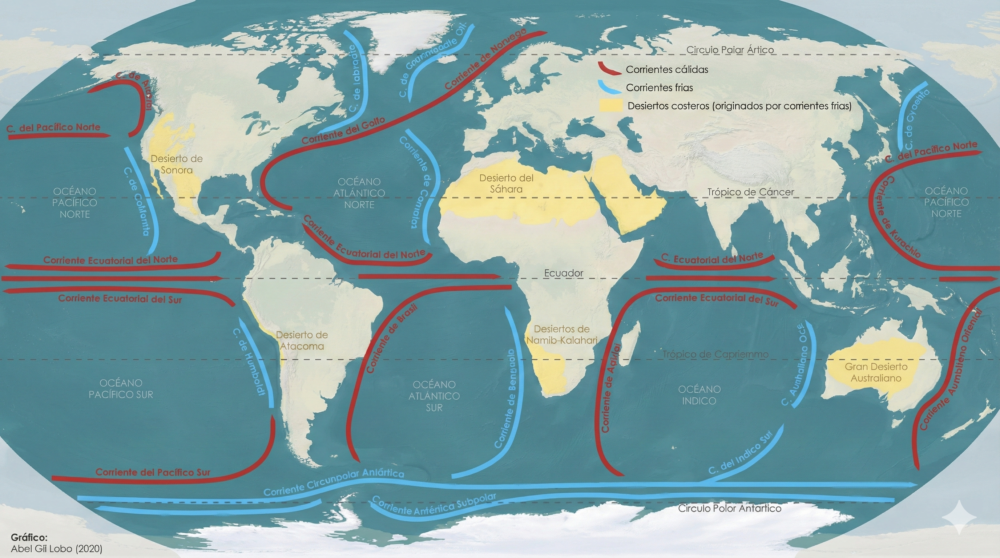
```

Las corrientes oceánicas son flujos persistentes de agua que mueven calor desde el ecuador hacia latitudes altas. Las superficiales las ponen en marcha los vientos permanentes; la fuerza de Coriolis las desvía y las costas las encauzan en grandes giros. Las profundas se mueven por diferencias de densidad, que dependen de la temperatura y la salinidad.

El océano se calienta desde arriba, al revés que la atmósfera, y por eso su estructura térmica es estable. Tiene tres capas:

1. **Capa de mezcla.** Desde la superficie hasta unas decenas de metros o hasta 200 m. El viento la mezcla y su temperatura sigue los cambios del tiempo y de las estaciones.
2. **Termoclina.** Debajo de la capa de mezcla, la temperatura baja rápido con la profundidad.
3. **Aguas profundas.** Por debajo de unos 1000 m, el agua es fría y su temperatura casi no cambia.

En el Pacífico frente a Sudamérica, y también en el golfo de Papagayo durante la época seca, el viento aparta el agua superficial y hace subir agua fría de la termoclina. Ese afloramiento enfría el mar y reduce la evaporación y la lluvia en la costa.

## Variabilidad climática: El Niño-Oscilación del Sur {#sec-meteo-enos}

El clima de un lugar no se repite igual cada año. En el trópico, la principal fuente de esas diferencias entre años es El Niño-Oscilación del Sur (ENOS), un acople entre el océano y la atmósfera del Pacífico ecuatorial que se repite sin un periodo fijo cada 2 a 7 años. Tiene dos componentes:

- **Oceánico (El Niño y La Niña):** anomalías de la temperatura superficial del mar en el Pacífico ecuatorial central y oriental.
- **Atmosférico (Oscilación del Sur):** el cambio de la diferencia de presión al nivel del mar entre Tahití, en el Pacífico central, y Darwin, en el norte de Australia.

Los dos componentes están unidos por la circulación de Walker, una célula a lo largo del ecuador con aire que sube sobre Indonesia, donde el mar es cálido, y baja sobre el Pacífico oriental, donde el mar es frío.

El estado del ENOS se sigue con el Índice Oceánico de El Niño (ONI, por sus siglas en inglés): la anomalía de la temperatura del mar en la región Niño 3.4 (5° N a 5° S, 170° O a 120° O), promediada en tres meses. Se habla de El Niño cuando el ONI es de +0.5 °C o más durante al menos cinco trimestres seguidos, y de La Niña cuando es de −0.5 °C o menos [@noaacpc2024oni]. Las fases son:

- **El Niño (fase cálida).** Los alisios del Pacífico se debilitan, el agua cálida se extiende hacia el este y el afloramiento frente a Perú se debilita. La lluvia del Pacífico occidental se traslada hacia el Pacífico central y oriental. Los eventos suelen llegar a su máximo hacia fin de año, entre noviembre y enero.
- **La Niña (fase fría).** Los alisios y la circulación de Walker se refuerzan, y el Pacífico oriental se enfría más de lo normal. Los eventos de La Niña suelen durar más que los de El Niño y a veces se repiten dos o tres años seguidos.
- **Neutra.** Ninguna de las dos condiciones.

Por medio de cambios en la circulación, el ENOS altera la lluvia en regiones muy lejanas del Pacífico. Esas conexiones a distancia se llaman teleconexiones (@tbl-enos-impactos).

| Región | Durante El Niño | Durante La Niña |
|:--|:--|:--|
| Costa de Perú y Ecuador | Lluvias intensas e inundaciones | Condiciones más secas que lo normal |
| Sur de Estados Unidos | Inviernos más húmedos | Inviernos más secos y cálidos |
| Costa Rica, vertiente del Pacífico | Déficit de lluvia y sequía | Exceso de lluvia e inundaciones |
| Costa Rica, vertiente del Caribe | Exceso de lluvia | Déficit de lluvia |
| Indonesia y Australia | Sequías e incendios forestales | Lluvias intensas e inundaciones |

: Efectos típicos de las fases del ENOS. No todos los eventos los producen. Fuente: @IMN_ClimaVariabilidadCC y @wallace2006atmospheric. {#tbl-enos-impactos}

::: {.callout-tip title="En la práctica"}
El ENOS afecta casi todo el análisis hidrológico en Costa Rica:

- **Disponibilidad de agua.** Los caudales de estiaje de los ríos del Pacífico bajan en años de El Niño, y eso afecta embalses, riego y acueductos. Al evaluar una fuente conviene revisar los caudales de los años El Niño del registro.
- **Análisis de frecuencia.** Una serie corta que cae casi toda en años de una misma fase da lluvias o caudales de diseño sesgados. Antes de ajustar una distribución, conviene ver qué fases del ENOS cubre el registro.
- **Pronóstico estacional.** El Instituto Meteorológico Nacional (IMN) publica perspectivas climáticas basadas en el estado del ENOS, útiles para planificar la operación de embalses y sistemas de abastecimiento.
:::

## Cambio climático {#sec-meteo-cambio-climatico}

El cambio climático es un cambio del clima que persiste durante décadas o más: de sus promedios, de su variabilidad o de sus extremos. No debe confundirse con la variabilidad climática, como el ENOS, que son oscilaciones de unos años alrededor de un mismo estado. El calentamiento global es una parte del cambio climático: el aumento de la temperatura media del aire y del océano. Entre 1850–1900 y 2011–2020, la temperatura media de la superficie subió 1.09 °C [@ipcc2021spm].

Cualquier factor que altere el balance de energía de la @sec-meteo-balance es un forzamiento:

- **Naturales:** cambios en la órbita de la Tierra, en la actividad del Sol y erupciones volcánicas que inyectan aerosoles en la estratosfera y enfrían el planeta por uno o dos años.
- **Humanos:** sobre todo la emisión de gases de efecto invernadero (CO₂, metano y óxido nitroso) por la quema de combustibles fósiles, la deforestación y la agricultura. En 2019 la concentración de CO₂ llegó a 410 ppm, la mayor en al menos dos millones de años [@ipcc2021spm].

### Efectos en el ciclo del agua {#sec-meteo-cambio-ciclo}

Por la @eq-meteo-clausius, un aire más caliente puede contener más vapor: entre 6 % y 7 % más por grado. Ese vapor extra alimenta las tormentas, y por eso la lluvia más intensa tiende a crecer a una tasa parecida, aunque la lluvia total del planeta crezca mucho menos [@trenberth2003changing]. Las consecuencias para la hidrología son:

- **Redistribución de la lluvia.** En general, las regiones húmedas tienden a recibir más lluvia y las secas menos, aunque con grandes diferencias regionales.
- **Extremos más intensos.** Aguaceros más fuertes, con más crecidas súbitas, y a la vez sequías más largas por la mayor evaporación.
- **Calidad del agua.** El agua más caliente disuelve menos oxígeno.
- **Glaciares y nieve.** En las cuencas que dependen del deshielo, el caudal máximo llega antes en la primavera y el estiaje se vuelve más severo.
- **Nivel del mar.** El nivel medio subió 1.3 mm/año entre 1901 y 1971 y 3.7 mm/año entre 2006 y 2018, por la expansión térmica del agua y el deshielo [@ipcc2021spm]. Eso aumenta la intrusión salina en los acuíferos costeros y el nivel de las crecidas en las desembocaduras.

### Implicaciones para la ingeniería {#sec-meteo-cambio-ingenieria}

El diseño hidrológico clásico supone que el clima es estacionario: que la lluvia y los caudales del pasado son una buena muestra de los del futuro. Con el cambio climático ese supuesto deja de cumplirse [@milly2008stationarity]. Una alcantarilla o un puente diseñados con las lluvias máximas de 1970–2000 pueden quedar cortos para las de 2050.

Para estimar el clima futuro se usan modelos climáticos globales, que resuelven las ecuaciones físicas de la atmósfera y el océano. Se corren con escenarios de emisiones y desarrollo; los del sexto informe del Grupo Intergubernamental de Expertos sobre el Cambio Climático (IPCC) se llaman SSP, por *Shared Socioeconomic Pathways*. Sus resultados no son pronósticos, sino rangos de futuros posibles, y sirven para ver qué tan sensible es una cuenca o una obra a cambios plausibles del clima. Los capítulos sobre cambio climático, desde el [de definición y fundamentos](<29-Definición y fundamentos del cambio climático.qmd>), retoman el tema desde el análisis y el diseño.
