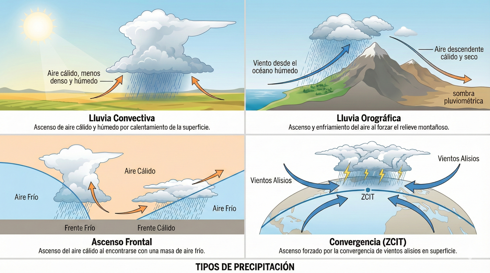
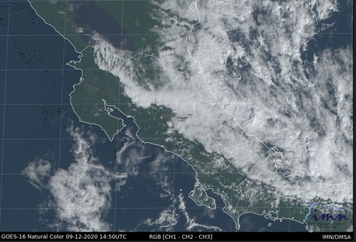
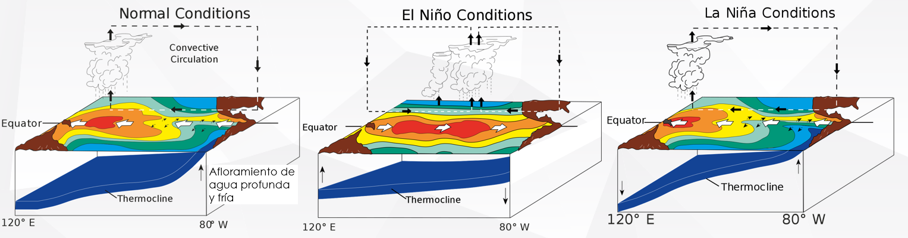
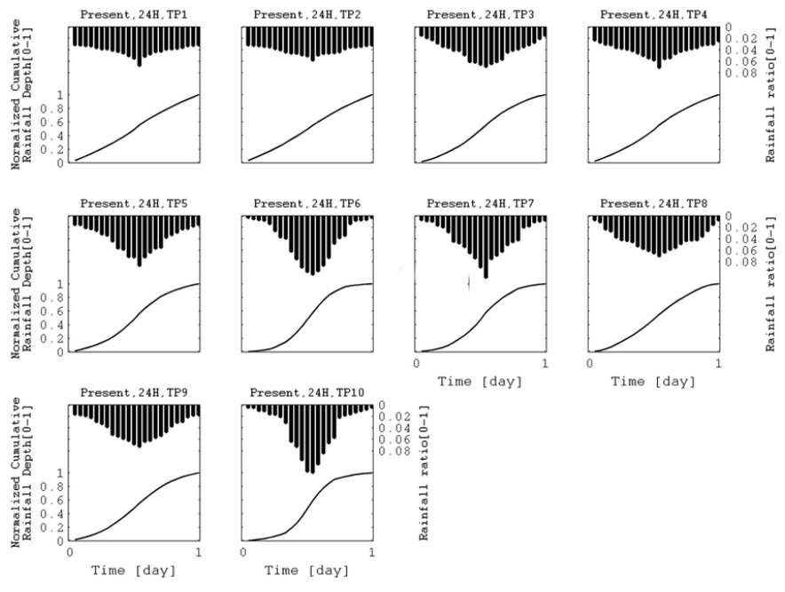
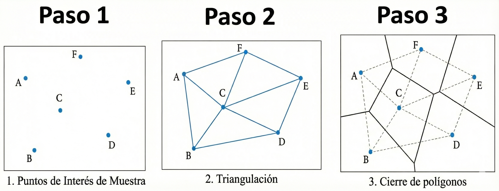
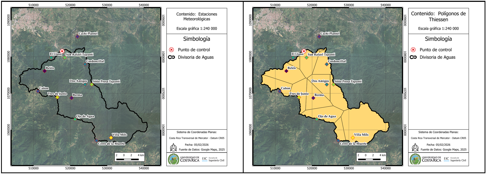
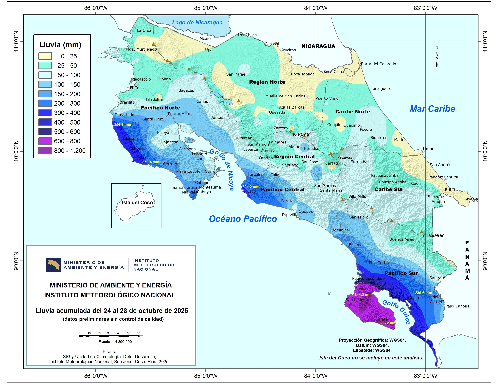
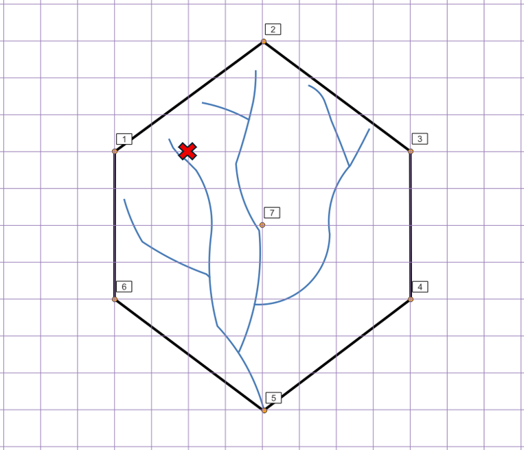

::: {.quote-block}
"Algunas personas sienten la lluvia. Otras solo se mojan."\
— *Frase popular, atribuida a Bob Marley*
:::

La precipitación es el agua, líquida o sólida, que se forma en las nubes y llega a la superficie. Es la entrada principal del balance hídrico de una cuenca y el dato con que empiezan casi todos los cálculos de crecidas. En el capítulo anterior se vio cómo sube y se enfría el aire (@sec-meteo-adiabatico). Este capítulo explica cómo ese enfriamiento se convierte en lluvia, cómo se reparte la lluvia en el espacio y en el tiempo, y cómo se pasa de la lluvia medida en las estaciones a la lluvia media de una cuenca.

## Formación de la precipitación {#sec-precip-formacion}

Para que el vapor de agua se convierta en lluvia se necesitan tres condiciones:

1. **Saturación.** El aire debe enfriarse hasta su punto de rocío, casi siempre porque sube (@sec-meteo-adiabatico).
2. **Núcleos de condensación.** El vapor no se condensa solo: necesita partículas diminutas de sal marina, polvo o humo sobre las cuales formar gotas.
3. **Crecimiento de las gotas.** Las gotas de nube son tan pequeñas que el aire las sostiene. Para caer, tienen que crecer hasta pesar más de lo que las corrientes ascendentes pueden levantar.

La tercera condición es la más exigente. Una gota de lluvia típica tiene un radio cien veces mayor que el de una gota de nube, es decir, un volumen un millón de veces mayor (@fig-lluvia_2). La condensación sola tardaría días en hacer crecer tanto una gota, así que se necesitan otros mecanismos [@wallace2006atmospheric]:

- **Colisión y coalescencia.** Las gotas más grandes caen más rápido, chocan con las pequeñas y se unen a ellas. Es el mecanismo de las nubes cálidas, que están completamente por encima de 0 °C, y produce buena parte de la lluvia en el trópico.
- **Crecimiento de cristales de hielo.** En las nubes frías conviven gotas de agua sobreenfriada (líquida por debajo de 0 °C) y cristales de hielo. Como la presión de vapor de saturación es menor sobre el hielo que sobre el agua, los cristales crecen a costa de las gotas. Al caer se juntan en copos y, si atraviesan aire cálido, se funden y llegan como lluvia. Es el mecanismo dominante en latitudes medias y también actúa en las tormentas tropicales, cuya parte alta está muy por debajo de 0 °C.

```{r}
#| label: fig-lluvia_2
#| fig-cap: "Tamaño, concentración y velocidad de caída típicos de las partículas que intervienen en la formación de la lluvia. Los círculos no están a escala. Fuente: elaboración propia con datos de @wallace2006atmospheric."
#| fig-alt: "Cuatro círculos de tamaño creciente, de un núcleo de condensación a una gota de lluvia, unidos por flechas de condensación y de colisión y coalescencia, con el radio, la concentración y la velocidad de caída de cada uno"
#| echo: false
#| out-width: 95%
#| fig-width: 8.5
#| fig-height: 4.3

library(tidyverse)

# Valores típicos de cada partícula
particulas <- tibble(
  nombre = c("Núcleo de\ncondensación", "Gota de nube\ntípica", "Gota de nube\ngrande", "Gota de lluvia\ntípica"),
  radio  = c("0.1 µm", "10 µm", "50 µm", "1 mm"),
  conc   = c("1 000 000 por litro", "1 000 000 por litro", "1000 por litro", "1 por litro"),
  vel    = c("0.000001 m/s", "0.01 m/s", "0.27 m/s", "6.5 m/s"),
  x      = c(1, 2.6, 4.2, 6.1),
  r_dib  = c(0.06, 0.16, 0.30, 0.62)   # radio dibujado, no a escala
)
circulo <- function(x0, r, n = 100) {
  a <- seq(0, 2 * pi, length.out = n)
  tibble(x = x0 + r * cos(a), y = 1.6 + r * sin(a))
}
circulos <- particulas %>%
  mutate(d = map2(x, r_dib, circulo)) %>%
  select(nombre, d) %>%
  unnest(d)
flechas <- tibble(
  x = c(1.25, 2.9, 4.65), xend = c(2.3, 3.75, 5.35),
  etiqueta = c("Condensación\n(vapor sobre el núcleo)", "Condensación y\nprimeras colisiones",
               "Colisión y coalescencia\n(o crecimiento de cristales de hielo)")
)
filas <- tibble(y = c(0.36, 0.12, -0.12), texto = c("Tamaño", "Concentración", "Velocidad"))

ggplot() +
  geom_polygon(data = circulos, aes(x, y, group = nombre),
               fill = "#9CC3E0", colour = "#1C6BA0", linewidth = 0.7) +
  annotate("point", x = 1, y = 1.6, size = 1.6, colour = "#D55E00") +
  geom_segment(data = flechas, aes(x = x, xend = xend, y = 2.55, yend = 2.55),
               arrow = arrow(length = unit(0.18, "cm"), type = "closed"), colour = "grey35") +
  geom_text(data = flechas, aes(x = (x + xend) / 2, y = 2.62, label = etiqueta),
            vjust = 0, size = 3.2, family = "serif", colour = "grey20", lineheight = 0.9) +
  geom_text(data = particulas, aes(x, 0.78, label = nombre), size = 3.7, family = "serif",
            fontface = "bold", lineheight = 0.9, colour = "#1C3F5E") +
  geom_text(data = particulas, aes(x, 0.36, label = paste0("Radio: ", radio)),
            size = 3.4, family = "serif") +
  geom_text(data = particulas, aes(x, 0.12, label = conc), size = 3.4, family = "serif") +
  geom_text(data = particulas, aes(x, -0.12, label = paste0("Caída: ", vel)),
            size = 3.4, family = "serif") +
  geom_text(data = filas, aes(0.3, y, label = texto), hjust = 1, size = 3.2,
            family = "serif", fontface = "italic", colour = "grey40") +
  coord_equal(xlim = c(-0.9, 7), ylim = c(-0.3, 3.2), expand = FALSE) +
  theme_void(base_family = "serif")
```

### Formas de la precipitación {#sec-precip-formas}

La forma en que llega la precipitación depende de la temperatura dentro de la nube y en el aire cercano al suelo [@wmo2018guia]:

- **Lluvia:** gotas de agua de más de 0.5 mm de diámetro.
- **Llovizna:** gotas de menos de 0.5 mm, muy numerosas, que caen despacio. Aporta poca lámina.
- **Lluvia engelante:** gotas sobreenfriadas que se congelan al tocar una superficie fría.
- **Nieve:** cristales de hielo ramificados, solos o unidos en copos.
- **Hielo granulado** (*sleet* o *ice pellets*): bolitas de hielo transparente que se forman cuando la lluvia se congela al atravesar una capa fría cerca del suelo.
- **Granizo menudo** (*graupel*): bolitas de hielo blancas y blandas de 2 a 5 mm.
- **Granizo:** trozos de hielo de más de 5 mm, formados por capas sucesivas en las corrientes ascendentes de un cumulonimbo. En Costa Rica cae a veces en tormentas intensas.

### Tipos según la causa del ascenso {#sec-precip-tipos}

La precipitación se clasifica también según lo que hace subir el aire (@fig-tipos_lluvia). La clasificación importa en hidrología porque cada tipo tiene una intensidad, una duración y un área característicos:

- **Convectiva.** El calentamiento del suelo hace subir el aire con fuerza. Produce aguaceros intensos, cortos y de pocos kilómetros de extensión. Es la lluvia típica de las tardes de la época lluviosa en el Valle Central y la que más pesa en el diseño de drenajes urbanos.
- **Orográfica.** El viento obliga al aire a subir por una cordillera. Llueve mucho en la ladera de barlovento y poco en la de sotavento, que queda en sombra pluviométrica. Puede durar días.
- **Frontal o ciclónica.** El aire sube sobre un frente o en el centro de un sistema de baja presión. Da lluvias de intensidad moderada, larga duración y gran extensión. En Costa Rica los temporales asociados a ondas tropicales, empujes fríos y ciclones cercanos causan muchas de las crecidas de las cuencas grandes.
- **Por convergencia.** El aire sube donde convergen los vientos, como en la Zona de Convergencia Intertropical (ZCIT).

En la práctica los tipos se combinan: una tormenta convectiva crece más sobre una montaña, y un huracán lejano refuerza el viento que produce lluvia orográfica en el Pacífico.

```{r}
#| label: fig-tipos_lluvia
#| fig-cap: "Tipos de precipitación según la causa del ascenso del aire: convectiva, orográfica, frontal y por convergencia."
#| fig-alt: "Cuatro ilustraciones: aire que sube por calentamiento del suelo, aire que sube por una montaña, aire cálido que sube sobre un frente frío y vientos alisios que convergen en la ZCIT"
#| echo: false
#| out-width: 85%


```

### Cómo se expresa la precipitación {#sec-precip-unidades}

La precipitación se expresa como la altura de la lámina de agua que se acumularía sobre una superficie horizontal, en milímetros. Un milímetro de lluvia equivale a un litro por metro cuadrado, o a 10 m³ por hectárea. Así, 50 mm sobre una cuenca de 10 km² son 500 000 m³ de agua.

## Distribución espacial {#sec-precip-espacial}

### Latitud y circulación general {#sec-precip-latitud}

A escala del planeta, la lluvia sigue a la circulación general de la atmósfera (@sec-meteo-hadley). La @fig-dist_lluvia muestra la lluvia media anual por banda de latitud, promediada sobre tierra y océano:

- **ZCIT.** El máximo, de más de 2000 mm al año, está entre 5° y 10° N, donde convergen los alisios y el aire sube. Costa Rica está en el borde norte de esa franja.
- **Subtrópicos.** Hacia los 20° a 30° de latitud la lluvia baja a 600 o 700 mm, porque el aire desciende y se seca. Ahí están los grandes desiertos, como el Sahara y los de Australia.
- **Latitudes medias.** Entre 40° y 60° la lluvia vuelve a subir, hasta unos 1000 mm, por los frentes y los ciclones extratropicales.
- **Polos.** Llueve o nieva menos de 300 mm al año. El aire frío contiene muy poco vapor, como indica la ecuación de Clausius-Clapeyron (@eq-meteo-clausius).

```{r}
#| label: fig-dist_lluvia
#| fig-cap: "Precipitación media anual por latitud, promedio de tierra y océano, 1991–2020. Fuente: elaboración propia con datos GPCP versión 2.3 [@adler2018gpcp]."
#| fig-alt: "Curva de precipitación anual contra latitud con un máximo de unos 2200 mm cerca de 6° N, mínimos de unos 650 mm hacia 25° N y 25° S, máximos secundarios de unos 1000 mm en latitudes medias y valores menores que 300 mm en los polos; Costa Rica está marcada entre 8° y 11° N"
#| echo: false
#| out-width: 95%
#| fig-width: 8.5
#| fig-height: 4.8

# Precipitación anual por banda de latitud de 2.5° (ver datos/LEEME.md)
zonal <- read_csv("datos/precipitacion_zonal_gpcp.csv", show_col_types = FALSE)
media_global <- 983   # mm/año, promedio ponderado por el área de cada banda

zonas <- tibble(
  lat = c(4, -24, 24, -50, 45, -82, 82),
  p = c(2330, 430, 430, 1330, 1200, 420, 420),
  etiqueta = c("ZCIT", "Subtrópicos:\ndescenso del aire", "Subtrópicos:\ndescenso del aire",
               "Latitudes medias:\nfrentes y ciclones", "Latitudes medias:\nfrentes y ciclones",
               "Polos", "Polos")
)

ggplot(zonal, aes(lat, p_mm_anio)) +
  annotate("rect", xmin = 8, xmax = 11.2, ymin = -Inf, ymax = Inf,
           fill = "#D55E00", alpha = 0.15) +
  annotate("text", x = 12.5, y = 2350, label = "Costa Rica", hjust = 0,
           family = "serif", size = 3.5, colour = "#D55E00") +
  geom_area(fill = "#9CC3E0", alpha = 0.7) +
  geom_line(colour = "#1C6BA0", linewidth = 1) +
  geom_hline(yintercept = media_global, linetype = "dashed", colour = "grey40") +
  annotate("text", x = 88, y = media_global + 80, label = "Media global: 983 mm",
           hjust = 1, family = "serif", size = 3.4, colour = "grey30") +
  geom_text(data = zonas[-1, ], aes(lat, p, label = etiqueta), family = "serif", size = 3.3,
            lineheight = 0.9, colour = "#1C3F5E") +
  # Máximo de la ZCIT
  annotate("point", x = zonal$lat[which.max(zonal$p_mm_anio)], y = max(zonal$p_mm_anio),
           colour = "#1C3F5E", size = 2.2) +
  annotate("text", x = 3, y = max(zonal$p_mm_anio) + 120, hjust = 1, family = "serif", size = 3.4,
           colour = "#1C3F5E", label = paste0("ZCIT: ", max(zonal$p_mm_anio), " mm a 6° N")) +
  scale_x_continuous(breaks = seq(-75, 75, 15), expand = c(0, 0),
                     labels = c(paste0(seq(75, 15, -15), "° S"), "Ecuador",
                                paste0(seq(15, 75, 15), "° N"))) +
  scale_y_continuous(limits = c(0, 2600), breaks = seq(0, 2500, 500), expand = c(0, 0),
                     labels = scales::label_number(big.mark = " ")) +
  labs(x = "Latitud", y = "Precipitación media anual (mm)") +
  theme_minimal(base_size = 12, base_family = "serif") +
  theme(panel.grid.minor = element_blank())
```

### Distancia al mar {#sec-precip-continentalidad}

Cerca del 85 % de la evaporación del planeta ocurre en los océanos [@trenberth2007estimates]. Por eso las costas que reciben viento del mar suelen ser húmedas, y el aire que avanza hacia el interior de un continente va perdiendo humedad. En un país angosto como Costa Rica la distancia al mar importa menos que la orientación respecto al viento dominante.

### Relieve {#sec-precip-relieve}

Las montañas obligan al aire a subir, y por eso concentran la lluvia en la ladera de barlovento (@fig-orografia). Del otro lado, el aire baja seco y cálido (@sec-meteo-adiabatico). En Costa Rica este contraste es muy marcado: las laderas del Caribe de las cordilleras reciben lluvia casi todo el año, mientras que el Pacífico Norte tiene una época seca de cinco o seis meses [@IMN_CostaRica].

```{r}
#| label: fig-orografia
#| fig-cap: "Nubosidad sobre Costa Rica vista por el satélite GOES-16: las nubes se acumulan en la vertiente del Caribe y el Pacífico queda despejado. Fuente: @IMN_CostaRica."
#| fig-alt: "Imagen satelital en color natural de Costa Rica con nubes densas sobre el Caribe y las cordilleras y cielo despejado sobre el Pacífico"
#| echo: false
#| out-width: 65%


```

La lluvia anual suele aumentar con la altitud. En una región homogénea, esa relación se aproxima con una recta:

$$
P = a + b\,H
$$ {#eq-precip-altitud}

donde $P$ es la precipitación anual (mm), $H$ es la altitud de la estación (m) y $a$ y $b$ son coeficientes que se ajustan por regresión con las estaciones de la región. La relación no sirve de una vertiente a otra, porque a la misma altitud llueve mucho más en barlovento que en sotavento. En montañas altas, además, la lluvia aumenta hasta una altitud de máxima precipitación y después disminuye, porque el aire ya perdió buena parte de su vapor.

## Distribución temporal {#sec-precip-temporal}

Para el diseño no basta con saber cuánta lluvia cae: también importa cuándo y con qué rapidez. La lluvia varía en tres escalas de tiempo.

### Entre años {#sec-precip-interanual}

El total anual cambia de un año a otro. En Costa Rica la principal causa es El Niño-Oscilación del Sur (@sec-meteo-enos): en años de El Niño llueve menos en el Pacífico y más en el Caribe, y en años de La Niña ocurre lo contrario (@fig-precip-enos). Una serie de lluvias que cubra pocos años puede caer casi toda en una misma fase y dar promedios engañosos.

```{r}
#| label: fig-precip-enos
#| fig-cap: "Circulación y temperatura del Pacífico ecuatorial en condiciones normales, de El Niño y de La Niña. Fuente: @Bob2025."
#| fig-alt: "Tres bloques del Pacífico ecuatorial con la termoclina, el agua cálida en rojo y la circulación de Walker para las condiciones normales, El Niño y La Niña"
#| echo: false
#| out-width: 95%


```

### Entre meses {#sec-precip-estacional}

La variación estacional define el régimen de lluvias. En Costa Rica hay dos regímenes principales (@fig-estacionalidad):

- **Pacífico:** época seca bien definida de diciembre a marzo o abril, y época lluviosa de mayo a noviembre con una disminución en julio y agosto, el veranillo (@sec-meteo-chorro).
- **Caribe:** lluvia casi todo el año, con mínimos relativos en marzo y en septiembre y octubre, justo cuando el Pacífico tiene sus meses más lluviosos.

### Dentro de una tormenta {#sec-precip-tormenta}

Dentro de una tormenta la intensidad cambia de un minuto a otro. Dos tormentas con la misma lámina total producen crecidas distintas si en una la lluvia se concentra en media hora y en la otra se reparte en seis. Por eso, para el diseño se estudian los patrones de distribución temporal: la forma típica en que se reparte la lluvia de las tormentas de una región (@fig-dist_temp).

```{r}
#| label: fig-dist_temp
#| fig-cap: "Patrones típicos de distribución temporal de la lluvia diaria. Cada panel muestra la fracción de la lluvia en cada intervalo (barras) y la lámina acumulada normalizada (curva). Fuente: @Kimura2014FloodHyetograph."
#| fig-alt: "Diez paneles con hietogramas normalizados y curvas acumuladas, con el máximo de lluvia al inicio, al centro o al final del día"
#| echo: false
#| out-width: 75%


```

En Costa Rica hay estudios de este tipo para algunas cuencas, como los de @Murillo1994 sobre las intensidades en la cuenca del río Virilla, @Maroto2011 sobre la distribución temporal de la lluvia en el valle del Guarco y @Sandi2012 sobre la tormenta tropical Tomás en la cuenca del Virilla. Cuando existen, conviene usarlos en lugar de patrones de otros países.

## Análisis de una tormenta {#sec-precip-analisis-tormenta}

### Intensidad, duración y frecuencia {#sec-precip-idf}

Una tormenta se describe con tres magnitudes:

1. **Intensidad** ($i$): lámina de lluvia por unidad de tiempo, en mm/h.
2. **Duración** ($d$): tiempo que se considera, ya sea el de toda la tormenta o el de un intervalo dentro de ella.
3. **Frecuencia:** qué tan seguido se supera una intensidad dada para cierta duración. Se expresa como una probabilidad anual de excedencia $p$ o como su inverso, el periodo de retorno $T = 1/p$, en años.

La intensidad media en un intervalo es:

$$
i = \frac{\Delta h}{\Delta t}
$$ {#eq-precip-intensidad}

donde $i$ es la intensidad (mm/h), $\Delta h$ es la lámina de lluvia del intervalo (mm) y $\Delta t$ es la duración del intervalo (h). La intensidad media de una tormenta disminuye cuanto mayor es la duración que se considera, porque los periodos más largos incluyen ratos de lluvia débil. La relación entre las tres magnitudes forma las curvas de intensidad, duración y frecuencia (curvas IDF), que se tratan en su propio capítulo.

### Curva masa e hietograma {#sec-precip-graficos}

El registro de un pluviógrafo se representa de dos maneras:

- **Curva masa:** la lluvia acumulada contra el tiempo. Nunca baja, y su pendiente en cada tramo es la intensidad (@fig-masa).
- **Hietograma:** un gráfico de barras con la lámina o la intensidad de cada intervalo (@fig-hieto). Es la forma en que la lluvia entra a los modelos de lluvia-escorrentía.

::: {.callout-note title="Ejemplo: hietograma, curva masa e intensidades máximas de una tormenta"}

Un pluviógrafo registró la tormenta del @tbl-precip-tormenta en intervalos de 10 min. Construya el hietograma y la curva masa, y calcule la intensidad máxima para duraciones de 10, 30 y 60 min. Los datos son de ejemplo.

```{r}
#| label: tbl-precip-tormenta
#| tbl-cap: "Lluvia registrada en cada intervalo de 10 min."
#| echo: false

tibble(intervalo = paste0(seq(0, 110, 10), "–", seq(10, 120, 10)),
       lamina = c(1.2, 2.5, 4.8, 9.6, 15.3, 11.0, 6.2, 3.9, 2.4, 1.5, 0.9, 0.5)) %>%
  knitr::kable(col.names = c("Intervalo (min)", "Lluvia (mm)"), align = "cc")
```

**Solución:**

1. **Lámina acumulada.** Se suman los valores en orden: 1.2, 3.7, 8.5, 18.1, 33.4, 44.4, 50.6, 54.5, 56.9, 58.4, 59.3 y 59.8 mm. La tormenta dejó 59.8 mm en 2 h.
2. **Intensidad de cada intervalo** (@eq-precip-intensidad). Como $\Delta t = 10$ min $= 1/6$ h, se multiplica cada lámina por 6. El intervalo de 40 a 50 min da $15.3 \times 6 = 91.8$ mm/h.
3. **Máximo de 30 min.** Se suman tres intervalos seguidos y se busca la suma mayor: de 30 a 60 min, $9.6 + 15.3 + 11.0 = 35.9$ mm, así que $i = 35.9/0.5 = 71.8$ mm/h.
4. **Máximo de 60 min.** Seis intervalos seguidos: de 20 a 80 min, $4.8 + 9.6 + 15.3 + 11.0 + 6.2 + 3.9 = 50.8$ mm, así que $i = 50.8$ mm/h.

Con la curva masa el cálculo es más directo: la lluvia máxima en una duración $d$ es la mayor diferencia entre dos puntos de la curva separados por $d$.

**Pseudocódigo**

1. Escribir la lámina de cada intervalo y el paso de tiempo.
2. Calcular la intensidad de cada intervalo y la lámina acumulada.
3. Para cada duración, calcular la mayor diferencia de la lámina acumulada entre puntos separados por esa duración, y dividirla entre la duración.
4. Graficar el hietograma y la curva masa.

```{r}
#| label: ej-precip-tormenta

library(tidyverse)

# 1) Lámina de cada intervalo (mm) y paso de tiempo (min)
dt <- 10
tormenta <- tibble(
  fin = seq(dt, 120, by = dt),   # fin del intervalo (min)
  lamina = c(1.2, 2.5, 4.8, 9.6, 15.3, 11.0, 6.2, 3.9, 2.4, 1.5, 0.9, 0.5)
)

# 2) Intensidad (mm/h) y lámina acumulada (mm)
tormenta <- tormenta %>%
  mutate(intensidad = lamina / (dt / 60),
         acumulada = cumsum(lamina))

# 3) Intensidad máxima para cada duración (mm/h)
acum0 <- c(0, tormenta$acumulada)
maximos <- tibble(duracion = c(10, 30, 60)) %>%
  mutate(lamina_max = map_dbl(duracion, ~ max(diff(acum0, lag = .x / dt))),
         i_max = lamina_max / (duracion / 60))

maximos
```

```{r}
#| label: fig-hieto
#| fig-cap: "Hietograma de la tormenta del ejemplo. Las barras anaranjadas son los 30 min de mayor intensidad."
#| fig-alt: "Gráfico de barras de intensidad contra tiempo cada 10 minutos, con un máximo de 91.8 mm/h entre 40 y 50 minutos y las tres barras centrales resaltadas"

# 4a) Hietograma; se resaltan los 30 min más intensos
tormenta <- tormenta %>%
  mutate(maximo_30 = fin %in% c(40, 50, 60))

ggplot(tormenta, aes(x = fin - dt / 2, y = intensidad, fill = maximo_30)) +
  geom_col(width = dt, colour = "white") +
  geom_text(aes(label = sprintf("%.1f", intensidad)), vjust = -0.4, size = 3.2,
            family = "serif") +
  scale_fill_manual(values = c(`FALSE` = "#1C6BA0", `TRUE` = "#D55E00"),
                    labels = c("Resto de la tormenta", "30 min más intensos"), name = NULL) +
  scale_x_continuous(breaks = seq(0, 120, 20), expand = c(0.02, 0)) +
  scale_y_continuous(limits = c(0, 100), expand = c(0, 0)) +
  labs(x = "Tiempo desde el inicio (min)", y = "Intensidad (mm/h)") +
  theme_minimal(base_size = 12, base_family = "serif") +
  theme(panel.grid.minor = element_blank(), panel.grid.major.x = element_blank(),
        legend.position = "top")
```

```{r}
#| label: fig-masa
#| fig-cap: "Curva masa de la tormenta del ejemplo. La pendiente del tramo resaltado es la intensidad máxima de 30 min."
#| fig-alt: "Curva de lluvia acumulada contra tiempo en forma de S, que llega a 59.8 mm a los 120 minutos, con el tramo de 30 a 60 minutos resaltado y su pendiente de 71.8 mm/h"

# 4b) Curva masa, con el tramo de 30 a 60 min resaltado
masa <- tibble(t = c(0, tormenta$fin), acumulada = acum0)
tramo <- masa %>% filter(t >= 30, t <= 60)

ggplot(masa, aes(t, acumulada)) +
  geom_line(colour = "#1C6BA0", linewidth = 1) +
  geom_point(colour = "#1C6BA0", size = 1.8) +
  geom_line(data = tramo, colour = "#D55E00", linewidth = 1.8) +
  annotate("segment", x = 30, xend = 60, y = 8.5, yend = 8.5, linetype = "dashed", colour = "grey40") +
  annotate("segment", x = 60, xend = 60, y = 8.5, yend = 44.4, linetype = "dashed", colour = "grey40") +
  annotate("text", x = 45, y = 5.5, label = "30 min", family = "serif", size = 3.4) +
  annotate("text", x = 62, y = 26, label = "35.9 mm", hjust = 0, family = "serif", size = 3.4) +
  annotate("text", x = 22, y = 36, label = "i = 35.9 / 0.5 = 71.8 mm/h", family = "serif",
           size = 3.6, colour = "#D55E00") +
  scale_x_continuous(breaks = seq(0, 120, 20), expand = c(0.01, 0)) +
  scale_y_continuous(limits = c(0, 65), breaks = seq(0, 60, 10), expand = c(0, 0)) +
  labs(x = "Tiempo desde el inicio (min)", y = "Lluvia acumulada (mm)") +
  theme_minimal(base_size = 12, base_family = "serif") +
  theme(panel.grid.minor = element_blank())
```

La intensidad máxima baja de 91.8 mm/h para 10 min a 71.8 mm/h para 30 min y a 50.8 mm/h para 60 min, aunque se trate de la misma tormenta. Por eso, en el método racional la intensidad de diseño se toma para una duración igual al tiempo de concentración de la cuenca: una cuenca pequeña, con $t_c$ de 10 min, responde a los picos más cortos e intensos de la tormenta.

:::

## Precipitación media sobre una cuenca {#sec-precip-media-cuenca}

Las estaciones miden la lluvia en un punto, pero los balances hídricos y los modelos de lluvia-escorrentía necesitan la precipitación media de la cuenca: la lámina uniforme que, repartida sobre toda el área, daría el mismo volumen de agua que la lluvia real. En la literatura en inglés se abrevia MAP (*mean areal precipitation*). En la @sec-fuentes-puntos-area se compararon los métodos para obtenerla; aquí se aplican los más usados.

Todos los métodos calculan un promedio ponderado de las estaciones:

$$
\bar{P} = \sum_{i=1}^{n} w_i\,P_i, \qquad \sum_{i=1}^{n} w_i = 1
$$ {#eq-precip-media}

donde $\bar{P}$ es la precipitación media de la cuenca (mm), $P_i$ es la precipitación de la estación $i$ (mm), $w_i$ es su peso (adimensional) y $n$ es el número de estaciones. Lo que cambia de un método a otro es cómo se asignan los pesos.

### Promedio aritmético {#sec-precip-aritmetico}

Todas las estaciones dentro de la cuenca pesan lo mismo, $w_i = 1/n$:

$$
\bar{P} = \frac{1}{n}\sum_{i=1}^{n} P_i
$$ {#eq-precip-aritmetico}

Solo da un resultado aceptable si el terreno es suave, las estaciones están bien repartidas y sus lecturas no difieren mucho entre sí. En cuencas de montaña o con estaciones agrupadas en una sola zona es el método menos confiable.

### Polígonos de Thiessen {#sec-precip-thiessen}

El método de @thiessen1911precipitation supone que en cada punto de la cuenca llueve lo mismo que en la estación más cercana. El peso de cada estación es la fracción del área de la cuenca más cercana a ella que a cualquier otra:

$$
\bar{P} = \frac{1}{A}\sum_{i=1}^{n} A_i\,P_i, \qquad w_i = \frac{A_i}{A}
$$ {#eq-precip-thiessen}

donde $A_i$ es el área del polígono de la estación $i$ dentro de la cuenca (km²) y $A$ es el área de la cuenca (km²). Las estaciones cercanas a la divisoria cuentan aunque estén fuera, si su polígono entra en la cuenca.

Los polígonos se construyen en tres pasos (@fig-thiessen):

1. Se unen las estaciones vecinas con segmentos que forman triángulos. En un sistema de información geográfica (SIG) se usa la triangulación de Delaunay, en la que ningún círculo que pasa por los tres vértices de un triángulo contiene otra estación.
2. Se traza la mediatriz de cada segmento: la perpendicular que pasa por su punto medio. Todos sus puntos están a la misma distancia de las dos estaciones.
3. Las mediatrices se cortan y forman los polígonos, que se recortan con la divisoria de la cuenca.

En un SIG el resultado se llama diagrama de Voronoi. La @fig-thiessen3 muestra los polígonos de la cuenca del río Grande de Orosi, y la @fig-thiessen-parrita, en el capítulo anterior, los de la cuenca del río Parrita.

```{r}
#| label: fig-thiessen
#| fig-cap: "Construcción de los polígonos de Thiessen: estaciones, triangulación y trazado de las mediatrices."
#| fig-alt: "Tres paneles: seis estaciones como puntos, las mismas unidas por triángulos y los polígonos formados por las mediatrices de los lados"
#| echo: false
#| out-width: 90%


```

```{r}
#| label: fig-thiessen3
#| fig-cap: "Estaciones meteorológicas y polígonos de Thiessen de la cuenca del río Grande de Orosi."
#| fig-alt: "Dos mapas de la cuenca del río Grande de Orosi sobre imagen satelital: a la izquierda las estaciones y a la derecha la cuenca dividida en polígonos"
#| echo: false
#| out-width: 95%


```

Una vez calculados, los pesos sirven para cualquier evento mientras no cambie la red. Esa es su ventaja. Sus limitaciones son tres: no considera el relieve, crea saltos bruscos de lluvia en los bordes de los polígonos, y hay que rehacerlo cada vez que falta el dato de una estación.

::: {.callout-note title="Ejemplo: precipitación media con polígonos de Thiessen"}

En una cuenca de 175 km² hay cinco estaciones. El área de cada polígono dentro de la cuenca y la lluvia de un evento se dan en el @tbl-thiessen-ejemplo. Calcule la precipitación media con los polígonos de Thiessen y compárela con el promedio aritmético.

```{r}
#| label: tbl-thiessen-ejemplo
#| tbl-cap: "Lluvia del evento y área de cada polígono de Thiessen."
#| echo: false

tibble(estacion = c("A", "B", "C", "D", "E"),
       lluvia = c(3.90, 3.35, 3.55, 3.50, 3.10),
       area = c(25.0, 20.8, 61.3, 11.0, 56.9)) %>%
  knitr::kable(col.names = c("Estación", "Lluvia (mm)", "Área del polígono (km²)"),
               align = "ccc")
```

**Solución:**

1. **Pesos** (@eq-precip-thiessen). Para la estación A, $w_A = 25.0/175 = 0.143$. Igual para las demás: $w_B = 0.119$, $w_C = 0.350$, $w_D = 0.063$ y $w_E = 0.325$. Los pesos suman 1.
2. **Aportes.** $0.143 \times 3.90 = 0.558$ mm para A; para las demás, 0.399, 1.243, 0.221 y 1.008 mm.
3. **Precipitación media:** $\bar{P} = 0.558 + 0.399 + 1.243 + 0.221 + 1.008 = 3.43$ mm.
4. **Promedio aritmético:** $(3.90 + 3.35 + 3.55 + 3.50 + 3.10)/5 = 3.48$ mm.

**Pseudocódigo**

1. Escribir la lluvia y el área del polígono de cada estación.
2. Calcular el peso de cada estación como su área entre el área total.
3. Multiplicar cada lluvia por su peso y sumar.
4. Calcular el promedio aritmético para comparar.

```{r}
#| label: ej-precip-thiessen

library(tidyverse)

# 1) Datos de las estaciones
thiessen <- tibble(
  estacion = c("A", "B", "C", "D", "E"),
  lluvia = c(3.90, 3.35, 3.55, 3.50, 3.10),   # mm
  area = c(25.0, 20.8, 61.3, 11.0, 56.9)      # km²
)

# 2) y 3) Pesos y aporte de cada estación
thiessen <- thiessen %>%
  mutate(peso = area / sum(area),
         aporte = peso * lluvia)
thiessen

# Precipitación media (mm)
p_thiessen <- sum(thiessen$aporte)

# 4) Promedio aritmético (mm)
p_aritmetico <- mean(thiessen$lluvia)

round(c(thiessen = p_thiessen, aritmetico = p_aritmetico), 2)
```

Los dos métodos dan 3.43 y 3.48 mm. La diferencia es pequeña porque las lluvias son parecidas, pero viene de que el promedio aritmético le da a la estación A, la más lluviosa, el mismo peso que a la C, cuyo polígono es más del doble de grande. Con lluvias más contrastadas, como las de una cuenca de montaña, la diferencia crece.

:::

### Isoyetas {#sec-precip-isoyetas}

Las isoyetas son líneas que unen puntos de igual precipitación, como las curvas de nivel de un mapa topográfico (@fig-isoyetas2). Se trazan a partir de las estaciones, y quien las dibuja puede incorporar lo que sabe del relieve y de la tormenta: que llueve más en las laderas de barlovento, o que un aguacero se concentró en un sector. Por eso, con una red densa y buen criterio, es el método más fiel de los clásicos. A cambio, depende de quien lo hace y hay que trazar un mapa nuevo para cada evento.

```{r}
#| label: fig-isoyetas2
#| fig-cap: "Lluvia acumulada en Costa Rica del 24 al 28 de octubre de 2025 (datos preliminares). Fuente: @IMN_CostaRica."
#| fig-alt: "Mapa de Costa Rica con franjas de colores según la lluvia acumulada, con los mayores valores, de 600 a 1200 mm, en el Pacífico Sur"
#| echo: false
#| out-width: 85%


```

La precipitación media es el promedio de la lluvia de cada franja entre isoyetas, ponderado por su área:

$$
\bar{P} = \frac{1}{A}\sum_{j=1}^{m} A_j\,\bar{P}_j
$$ {#eq-precip-isoyetas}

donde $A_j$ es el área de la franja $j$ dentro de la cuenca (km²), $\bar{P}_j$ es su precipitación representativa (mm), que suele tomarse como el promedio de las dos isoyetas que la limitan, y $m$ es el número de franjas.

::: {.callout-note title="Ejemplo: precipitación media con isoyetas"}

En una cuenca de 50 km² se trazaron las isoyetas de 40, 60, 80 y 100 mm de un evento. Las áreas entre isoyetas, medidas sobre el mapa recortado con la divisoria, son 12 km² entre 40 y 60 mm, 18 km² entre 60 y 80 mm, 14 km² entre 80 y 100 mm, y 6 km² en la zona central por encima de 100 mm, donde se supone un valor máximo de 120 mm. Calcule la precipitación media.

**Solución:**

1. **Verificación de áreas:** $12 + 18 + 14 + 6 = 50$ km², igual al área de la cuenca.
2. **Lluvia representativa de cada franja** (promedio de sus isoyetas): 50, 70, 90 y 110 mm.
3. **Productos área por lluvia:** $12 \times 50 = 600$; $18 \times 70 = 1260$; $14 \times 90 = 1260$; $6 \times 110 = 660$. Suman 3780 km²·mm.
4. **Precipitación media** (@eq-precip-isoyetas): $\bar{P} = 3780/50 = 75.6$ mm.

**Pseudocódigo**

1. Escribir los límites y el área de cada franja.
2. Verificar que las áreas sumen el área de la cuenca.
3. Calcular la lluvia representativa de cada franja y el producto por su área.
4. Dividir la suma de los productos entre el área de la cuenca.

```{r}
#| label: ej-precip-isoyetas

library(tidyverse)

# 1) Franjas entre isoyetas (mm) y su área (km²)
area_cuenca <- 50
franjas <- tibble(
  p_inferior = c(40, 60, 80, 100),
  p_superior = c(60, 80, 100, 120),
  area = c(12, 18, 14, 6)
)

# 2) Verificación de áreas
sum(franjas$area) == area_cuenca

# 3) Lluvia representativa y producto por el área
franjas <- franjas %>%
  mutate(p_media = (p_inferior + p_superior) / 2,
         producto = area * p_media)
franjas

# 4) Precipitación media de la cuenca (mm)
sum(franjas$producto) / area_cuenca
```

La precipitación media es de 75.6 mm. El resultado depende del valor que se supuso para la zona central (120 mm): si fuera 110 mm, la media bajaría a 75.0 mm. Cuando la isoyeta mayor encierra un área grande, conviene estimar ese valor con la estación que está dentro y no con una isoyeta supuesta.

:::

### Inverso de la distancia {#sec-precip-idw}

El método del inverso de la distancia (IDW, por sus siglas en inglés) estima la lluvia en un punto sin medición como un promedio de las estaciones, con pesos que bajan con la distancia [@shepard1968two]:

$$
P_x = \frac{\sum_{i=1}^{n} P_i / d_i^{\,p}}{\sum_{i=1}^{n} 1 / d_i^{\,p}}
$$ {#eq-precip-idw}

donde $P_x$ es la precipitación estimada en el punto $x$ (mm), $P_i$ es la precipitación de la estación $i$ (mm), $d_i$ es la distancia del punto a la estación (km) y $p$ es un exponente. Con $p = 2$ el método se llama del inverso del cuadrado de la distancia, que es la opción más común. Un exponente mayor da más peso a la estación más cercana, y uno menor suaviza el campo de lluvia. Conviene escogerlo comparando, con validación cruzada, qué valor reproduce mejor las estaciones de la región.

Para obtener la media de la cuenca se cubre la cuenca con una malla, se estima la lluvia en el centro de cada celda y se promedian las celdas que caen dentro. Así lo hacen los SIG.

::: {.callout-note title="Ejemplo: lluvia en un punto con el inverso del cuadrado de la distancia"}

Estime la lluvia media anual en un punto sin estación que está a 2 km de la estación 1 (1500 mm), a 4 km de la estación 2 (2200 mm) y a 5 km de la estación 3 (1100 mm). Use $p = 2$. Los datos son de ejemplo.

**Solución:**

1. **Pesos sin normalizar:** $1/2^2 = 0.250$; $1/4^2 = 0.0625$; $1/5^2 = 0.040$. Suman 0.3525.
2. **Numerador:** $0.250 \times 1500 + 0.0625 \times 2200 + 0.040 \times 1100 = 375 + 137.5 + 44 = 556.5$.
3. **Estimación** (@eq-precip-idw): $P_x = 556.5/0.3525 = 1579$ mm.

La estación 1, la más cercana, se lleva el 71 % del peso ($0.250/0.3525$).

**Pseudocódigo**

1. Escribir la lluvia de cada estación y su distancia al punto.
2. Calcular los pesos $1/d^p$.
3. Dividir la suma de lluvias ponderadas entre la suma de pesos.

```{r}
#| label: ej-precip-idw

# 1) Lluvia anual (mm) y distancia al punto (km)
lluvia <- c(1500, 2200, 1100)
distancia <- c(2, 4, 5)
p <- 2

# 2) Pesos y fracción de cada estación
pesos <- 1 / distancia^p
round(pesos / sum(pesos), 3)

# 3) Lluvia estimada en el punto (mm)
sum(pesos * lluvia) / sum(pesos)
```

El punto recibe 1579 mm, cerca de la lluvia de la estación 1. El promedio aritmético de las tres estaciones daría 1600 mm, pero dejaría que la estación 2, la más lejana, pesara lo mismo que la más cercana.

:::

### Ejercicio propuesto {#sec-precip-ejercicio}

La @fig-cuenca_ejemplo muestra una cuenca sobre una cuadrícula de 1 km de lado, con siete estaciones. La estación 5 está en el punto de control. El @tbl-precip-promedio-multianual da la lluvia media anual de cada estación en un registro de 25 años.

```{r}
#| label: fig-cuenca_ejemplo
#| fig-cap: "Cuenca del ejercicio sobre una cuadrícula de 1 km, con siete estaciones y el punto X."
#| fig-alt: "Cuenca hexagonal con su red de drenaje sobre una cuadrícula, siete estaciones numeradas en los vértices y el centro, y una X roja cerca de la estación 1"
#| echo: false
#| out-width: 55%


```

| Estación | 1 | 2 | 3 | 4 | 5 | 6 | 7 |
|:--|:-:|:-:|:-:|:-:|:-:|:-:|:-:|
| Lluvia media anual (mm) | 1500 | 2200 | 1100 | 1750 | 1600 | 800 | 1200 |

: Lluvia media anual de las estaciones del ejercicio. {#tbl-precip-promedio-multianual}

Con estos datos:

a) Trace las isoyetas y calcule la lluvia media anual de la cuenca. Puede medir el área entre isoyetas contando cuadros.
b) Estime la lluvia media anual en el punto X con el inverso del cuadrado de la distancia.
c) Construya los polígonos de Thiessen y calcule la lluvia media anual de la cuenca.
d) Compare los tres resultados con el promedio aritmético de las siete estaciones y explique las diferencias.

::: {.callout-tip title="En la práctica"}
En los estudios profesionales los polígonos de Thiessen, las isoyetas y las mallas de inverso de la distancia se construyen con un SIG, como QGIS, o con R. El capítulo de fuentes de información muestra cómo hacerlo en R con el paquete `sf` (@fig-thiessen-parrita). El video siguiente muestra el procedimiento en un SIG.

<iframe width="560" height="315" src="https://www.youtube.com/embed/Te5QsFMGFuY" title="Construcción de polígonos de Thiessen e isoyetas en un SIG" frameborder="0" allow="accelerometer; clipboard-write; encrypted-media; gyroscope; picture-in-picture; web-share" allowfullscreen></iframe>
:::
