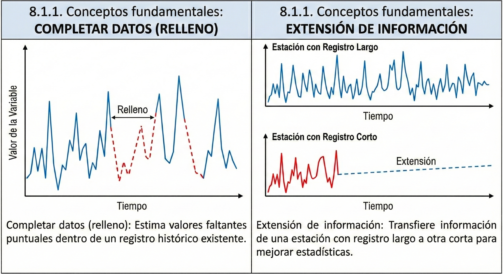

::: {.quote-block}
"Cuando se puede medir aquello de lo que se habla y expresarlo en números, se sabe algo de ello; pero cuando no se puede medir, cuando no se puede expresar en números, el conocimiento es escaso e insatisfactorio."\
— *Lord Kelvin, conferencia Electrical units of measurement (1883)*
:::

Casi todos los registros de lluvia o de caudal tienen huecos: falla el instrumento, falta el observador o se pierden archivos. Otros no tienen huecos, pero cambian sin que cambie el clima, porque la estación se movió o el pluviómetro se reemplazó. Como el análisis de frecuencia y los modelos de simulación necesitan series continuas y homogéneas, antes de usar un registro hay que revisarlo y después rellenarlo con métodos cuyo error se pueda estimar. Este capítulo trata las dos tareas, en ese orden.

## Relleno y extensión de registros {#sec-registros-conceptos}

Son dos operaciones distintas (@fig-datos):

- **Relleno.** Se estiman los valores que faltan dentro del periodo de registro de una estación, por ejemplo tres meses de 2001 en una serie de 1986–2010.
- **Extensión.** Se alarga el registro corto de una estación con la información de otra que tiene un registro largo, para estimar mejor la media y la varianza de largo plazo.

```{r}
#| label: fig-datos
#| fig-cap: "Relleno de datos faltantes y extensión de un registro."
#| fig-alt: "Esquema de dos series de una estación: en una se rellenan huecos dentro del periodo de registro y en la otra se alarga la serie hacia años sin medición"
#| fig-align: center
#| out-width: 100%
#| echo: false
#| class: fig-border


```

La diferencia importa para escoger el método. Para rellenar unos pocos datos basta con la mejor estimación de cada uno. Para extender una serie, en cambio, hay que conservar también su variabilidad: una serie extendida con valores medios tiene una varianza menor que la real y subestima las sequías y las crecidas (@sec-registros-regresion).

## Control de calidad {#sec-registros-calidad}

Un dato malo hace más daño que un dato faltante, porque el faltante se ve y el malo no. Antes de rellenar se revisa la serie con tres preguntas:

1. **¿Los valores son posibles?** Lluvias negativas, caudales que no cambian durante semanas, ceros en meses lluviosos o un valor diez veces mayor que el máximo histórico suelen ser errores de digitación, de unidades o de instrumento.
2. **¿Concuerdan con las estaciones vecinas?** Un día de 150 mm en una estación con las vecinas en cero puede ser un aguacero local, pero también la suma de varios días anotada en uno solo.
3. **¿La serie es homogénea?** Una serie es homogénea cuando todos sus valores pertenecen a la misma población estadística, es decir, cuando su media y su varianza no cambian por causas ajenas al clima.

Las causas más comunes de pérdida de homogeneidad no son climáticas: el traslado de la estación, un cambio en el entorno (una construcción o árboles que crecen junto al pluviómetro), el cambio de instrumento o de observador, o un error de calibración. El método clásico para detectarlas es la curva de doble masa.

## Análisis de doble masa {#sec-registros-doble-masa}

::: {.pregunta}
¿Cómo se sabe si una estación empezó a medir menos lluvia porque llovió menos o porque algo cambió en la estación?
:::

La respuesta está en las vecinas. Si llovió menos, las estaciones de la región también lo registraron. Si solo cambió la estación en estudio, su lluvia acumulada se separa de la acumulada de las demás. La curva de doble masa compara las dos acumuladas [@searcy1960double]:

- En el eje horizontal va la lluvia anual acumulada del patrón, que es el promedio de varias estaciones vecinas confiables de la misma región climática (idealmente tres o más).
- En el eje vertical va la lluvia anual acumulada de la estación en estudio.

Si la estación es consistente, los puntos forman una recta, porque cada año la estación recibe aproximadamente la misma fracción de la lluvia del patrón. Un cambio de pendiente que se mantiene durante varios años indica un cambio en la estación. Los quiebres de uno o dos años no se toman en cuenta: son parte de la variabilidad natural.

La curva se construye con totales anuales o estacionales. Con datos diarios o mensuales la variabilidad natural tapa los cambios de pendiente.

### Factor de ajuste {#sec-registros-factor}

Si hay un quiebre y se decide que el periodo reciente es el correcto (porque la estación actual está mejor instalada, por ejemplo), el periodo antiguo se lleva a la escala del reciente con el factor de ajuste:

$$
F_a = \frac{M_a}{M_o}
$$ {#eq-registros-factor}

donde $F_a$ es el factor de ajuste (adimensional), $M_a$ es la pendiente de la curva en el periodo que se considera correcto y $M_o$ es la pendiente en el periodo que se corrige. La pendiente de cada tramo es la lluvia acumulada de la estación en ese tramo dividida entre la del patrón en el mismo tramo. Cada valor del periodo que se corrige se multiplica por el factor:

$$
P_{\text{aj}} = F_a \, P_o
$$ {#eq-registros-ajuste}

donde $P_o$ es la lluvia observada (mm) y $P_{\text{aj}}$ es la lluvia ajustada (mm). Un $F_a > 1$ indica que el periodo corregido medía menos que el actual, y un $F_a < 1$, que medía más.

### Pruebas de estabilidad {#sec-registros-pruebas}

La curva muestra dónde puede estar el quiebre, pero el ojo encuentra quiebres en cualquier serie. Antes de corregir se verifica con dos pruebas estadísticas si los dos tramos (antes y después del quiebre) pueden venir de la misma población. Las dos usan los valores anuales de la estación en cada tramo, con $n_1$ y $n_2$ años, medias $\bar{x}_1$ y $\bar{x}_2$ y desviaciones estándar $s_1$ y $s_2$.

**Estabilidad de la media.** La hipótesis nula es que las medias de los dos tramos son iguales. Con varianzas iguales, el estadístico de la prueba $t$ es:

$$
t_c = \frac{\bar{x}_1 - \bar{x}_2}{s_p \sqrt{\dfrac{1}{n_1} + \dfrac{1}{n_2}}},
\qquad
s_p = \sqrt{\frac{(n_1 - 1)\,s_1^2 + (n_2 - 1)\,s_2^2}{n_1 + n_2 - 2}}
$$ {#eq-registros-t}

donde $s_p$ es la desviación estándar combinada. Si $|t_c|$ es mayor que el valor crítico $t_{0.975}$ con $n_1 + n_2 - 2$ grados de libertad (nivel de significancia de 5 %, prueba bilateral), las medias son distintas.

**Estabilidad de la varianza.** La hipótesis nula es que las varianzas son iguales. El estadístico $F$ es el cociente entre la varianza mayor y la menor:

$$
F_c = \frac{s_{\text{mayor}}^2}{s_{\text{menor}}^2}
$$ {#eq-registros-f}

Si $F_c$ es mayor que el valor crítico $F_{0.95}$, con $n - 1$ grados de libertad del tramo de varianza mayor en el numerador y $n - 1$ del otro tramo en el denominador, las varianzas son distintas.

Basta con que una de las dos pruebas rechace la hipótesis nula para considerar que la serie no es homogénea. Si ninguna la rechaza, el quiebre aparente no justifica una corrección y la serie se deja como está.

::: {.callout-note title="Ejemplo: consistencia de dos estaciones con la curva de doble masa"}

El @tbl-registros-anual tiene la lluvia anual de cinco estaciones de una misma región climática en 1970–1986. Los datos son hipotéticos. Las curvas de doble masa preliminares de C y D se ven irregulares. Use como patrón el promedio de A, B y E y verifique si C y D son consistentes. Si alguna no lo es, corríjala tomando como correcto el periodo reciente.

```{r}
#| label: tbl-registros-anual
#| tbl-cap: "Lluvia anual (mm) de las cinco estaciones del ejemplo."
#| echo: false

library(tidyverse)
library(kableExtra)

tibble(
  anio = 1970:1986,
  A = c(1010, 1005, 1067, 1051, 801, 1411, 1222, 1012, 1153, 1140, 829, 1165, 1170, 1264, 1200, 942, 1166),
  B = c(1161, 978, 1226, 880, 1146, 1353, 1018, 751, 1059, 1223, 1003, 1120, 989, 1056, 1261, 811, 969),
  C = c(780, 1041, 1027, 825, 933, 1584, 1215, 832, 918, 781, 782, 865, 956, 1102, 1058, 710, 1158),
  D = c(949, 784, 890, 810, 798, 801, 880, 683, 824, 1056, 796, 1121, 1286, 1044, 991, 875, 1202),
  E = c(1135, 970, 1158, 1022, 821, 1483, 1174, 771, 1188, 967, 1088, 963, 1287, 1190, 1283, 873, 1209)
) %>%
  kbl(col.names = c("Año", "A", "B", "C", "D", "E"), align = "c") %>%
  kable_styling(full_width = FALSE, bootstrap_options = c("condensed", "hover"))
```

**Solución:**

1. **Patrón.** Para cada año se promedian A, B y E. En 1970: $(1010 + 1161 + 1135)/3 = 1102.0$ mm. El patrón acumulado llega a 9675 mm en 1978 y a 18 398 mm en 1986.
2. **Curvas de doble masa.** Se acumulan C, D y el patrón y se grafican (@fig-registros-doble-masa). La curva de D cambia de pendiente en 1979. La de C tiene ondulaciones, pero ningún tramo largo con otra pendiente.
3. **Pruebas para D**, con el tramo I en 1970–1978 ($n_1 = 9$) y el tramo II en 1979–1986 ($n_2 = 8$):
    - Medias y desviaciones: $\bar{x}_1 = 824.3$ mm, $s_1 = 75.8$ mm; $\bar{x}_2 = 1046.4$ mm, $s_2 = 161.4$ mm.
    - Desviación combinada: $s_p = \sqrt{(8 \times 75.8^2 + 7 \times 161.4^2)/15} = 123.4$ mm.
    - Prueba $t$ (@eq-registros-t): $t_c = (824.3 - 1046.4)/(123.4\sqrt{1/9 + 1/8}) = -222.1/59.96 = -3.70$. Como $|t_c| = 3.70 > t_{0.975;\,15} = 2.13$, las medias son distintas.
    - Prueba $F$ (@eq-registros-f): $F_c = 161.4^2/75.8^2 = 4.53 > F_{0.95;\,7,\,8} = 3.50$. Las varianzas también son distintas.
4. **Pruebas para C**, con el mismo quiebre: $t_c = 0.86 < 2.13$ y $F_c = 2.27 < F_{0.95;\,8,\,7} = 3.73$. Ninguna prueba rechaza la hipótesis nula, así que C no se corrige.
5. **Factor de ajuste para D.** En el tramo I, D acumula 7419 mm y el patrón 9675 mm: $M_o = 7419/9675 = 0.767$. En el tramo II, D acumula $15\,790 - 7419 = 8371$ mm y el patrón $18\,398 - 9675 = 8723$ mm: $M_a = 0.960$. Entonces $F_a = 0.960/0.767 = 1.252$ (@eq-registros-factor).
6. **Corrección.** Cada año de 1970–1978 se multiplica por 1.252. Por ejemplo, 1970 pasa de 949 a $1.252 \times 949 = 1188$ mm (@eq-registros-ajuste).

**Pseudocódigo**

1. Escribir la lluvia anual de las estaciones.
2. Calcular el patrón como promedio de las estaciones de referencia y acumular el patrón y las estaciones en estudio.
3. Separar los dos tramos y aplicar las pruebas $t$ y $F$ a los valores anuales de cada estación.
4. Si alguna prueba rechaza la hipótesis nula, calcular las pendientes de los tramos y el factor de ajuste.
5. Multiplicar el tramo antiguo por el factor y graficar la curva corregida.

```{r}
#| label: ej-registros-doble-masa

library(tidyverse)

# 1) Lluvia anual (mm), datos de ejemplo
lluvia <- tibble(
  anio = 1970:1986,
  A = c(1010, 1005, 1067, 1051, 801, 1411, 1222, 1012, 1153, 1140, 829, 1165, 1170, 1264, 1200, 942, 1166),
  B = c(1161, 978, 1226, 880, 1146, 1353, 1018, 751, 1059, 1223, 1003, 1120, 989, 1056, 1261, 811, 969),
  C = c(780, 1041, 1027, 825, 933, 1584, 1215, 832, 918, 781, 782, 865, 956, 1102, 1058, 710, 1158),
  D = c(949, 784, 890, 810, 798, 801, 880, 683, 824, 1056, 796, 1121, 1286, 1044, 991, 875, 1202),
  E = c(1135, 970, 1158, 1022, 821, 1483, 1174, 771, 1188, 967, 1088, 963, 1287, 1190, 1283, 873, 1209)
)

# 2) Patrón y acumulados
lluvia <- lluvia %>%
  mutate(patron = (A + B + E) / 3,
         patron_acum = cumsum(patron),
         C_acum = cumsum(C),
         D_acum = cumsum(D))

# 3) Pruebas t y F entre tramos (quiebre en 1979, alfa = 0.05)
pruebas <- function(x, tramo2) {
  x1 <- x[!tramo2]; x2 <- x[tramo2]
  prueba_t <- t.test(x1, x2, var.equal = TRUE)
  v <- c(var(x1), var(x2)); n <- c(length(x1), length(x2))
  mayor <- which.max(v); menor <- which.min(v)
  tibble(t_c = unname(prueba_t$statistic),
         t_crit = qt(0.975, sum(n) - 2),
         F_c = v[mayor] / v[menor],
         F_crit = qf(0.95, n[mayor] - 1, n[menor] - 1))
}

tramo2 <- lluvia$anio >= 1979
bind_rows(C = pruebas(lluvia$C, tramo2),
          D = pruebas(lluvia$D, tramo2), .id = "estacion") %>%
  mutate(across(where(is.numeric), ~ round(.x, 2)))
```

En D las dos pruebas rechazan la hipótesis nula; en C, ninguna. Solo D se corrige:

```{r}
#| label: ej-registros-doble-masa-2

# 4) Pendientes de cada tramo y factor de ajuste para D
M_o <- sum(lluvia$D[!tramo2]) / sum(lluvia$patron[!tramo2])
M_a <- sum(lluvia$D[tramo2]) / sum(lluvia$patron[tramo2])
F_a <- M_a / M_o
round(c(M_o = M_o, M_a = M_a, F_a = F_a), 3)

# 5) Serie corregida de D (se redondea al milímetro)
lluvia <- lluvia %>%
  mutate(D_aj = if_else(anio < 1979, round(F_a * D), D),
         D_aj_acum = cumsum(D_aj))

lluvia %>% filter(anio < 1979) %>% select(anio, D, D_aj)
```

```{r}
#| label: fig-registros-doble-masa
#| fig-cap: "Curvas de doble masa de las estaciones C y D contra el patrón (promedio de A, B y E). La línea punteada marca el quiebre de 1979; en D se muestra también la curva corregida."
#| fig-alt: "Dos paneles con la lluvia acumulada de la estación contra la del patrón. En C los puntos siguen una sola recta con ondulaciones. En D la pendiente aumenta después de 1979 y la curva corregida, en anaranjado, queda recta"
#| echo: false
#| out-width: 95%
#| fig-width: 8.5
#| fig-height: 4.2

curvas <- bind_rows(
  lluvia %>% transmute(estacion = "Estación C", serie = "Observada", x = patron_acum, y = C_acum, anio),
  lluvia %>% transmute(estacion = "Estación D", serie = "Observada", x = patron_acum, y = D_acum, anio),
  lluvia %>% transmute(estacion = "Estación D", serie = "Corregida", x = patron_acum, y = D_aj_acum, anio)
) %>% mutate(serie = factor(serie, levels = c("Observada", "Corregida")))

quiebre <- lluvia %>% filter(anio == 1978) %>% pull(patron_acum)

ggplot(curvas, aes(x / 1000, y / 1000, color = serie)) +
  geom_vline(xintercept = quiebre / 1000, linetype = "dotted", color = "grey40") +
  geom_line(linewidth = 0.7) +
  geom_point(size = 1.8) +
  facet_wrap(~estacion) +
  scale_color_manual(values = c(Observada = "#1C6BA0", Corregida = "#E07B39"), name = NULL) +
  labs(x = "Lluvia acumulada del patrón (miles de mm)",
       y = "Lluvia acumulada de la estación (miles de mm)") +
  theme_minimal(base_family = "serif", base_size = 12) +
  theme(legend.position = "bottom")
```

La estación D medía un 25 % menos de lo que mide ahora respecto de la región. Sin corregir, su media de 1970–1986 es 929 mm; corregida, 1039 mm. Si se usara la serie original para un estudio de disponibilidad, se subestimaría la lluvia del sitio en más de 100 mm por año. La estación C se ve irregular, pero sus diferencias con el patrón no son mayores que las que produce la variabilidad natural, y por eso no se toca.

:::

::: {.callout-warning title="Cuidado"}
La curva de doble masa supone que el patrón es estable. Si varias estaciones de referencia cambiaron al mismo tiempo, o si la estación en estudio está en otra región climática (al otro lado de una cordillera, por ejemplo), el quiebre puede ser real o puede ser del patrón. Tampoco detecta bien los cambios graduales, como los árboles que crecen poco a poco junto al pluviómetro. Antes de corregir conviene buscar en el historial de la estación una causa del quiebre: un traslado, un cambio de equipo o una fecha de mantenimiento.
:::

## Relleno de datos faltantes {#sec-registros-relleno}

Una vez revisada la consistencia, los huecos se rellenan con la información de estaciones vecinas de la misma región climática. Los métodos van del más simple al más elaborado; el que conviene depende de cuánto se parecen las estaciones y de cuántos datos faltan.

### Promedio aritmético {#sec-registros-aritmetico}

Si la lluvia media anual de cada estación de referencia difiere en menos de 10 % de la de la estación con el hueco, el dato se estima como el promedio simple de las vecinas en la misma fecha [@Linsley1958]:

$$
P_x = \frac{1}{n} \sum_{i=1}^{n} P_i
$$ {#eq-registros-aritmetico}

donde $P_x$ es la lluvia estimada en la estación con el hueco (mm), $P_i$ es la lluvia de la estación de referencia $i$ en el mismo periodo (mm) y $n$ es el número de estaciones de referencia, que suele ser tres o más.

### Razón normal {#sec-registros-razon-normal}

Si alguna de las vecinas tiene una media anual que difiere en más de 10 %, se usa el método de la razón normal [@paulhus1952interpolation]. El método supone que, en una región homogénea, la fracción de la lluvia normal que cae en un periodo dado es parecida en todas las estaciones. Si la vecina $i$ recibió en agosto el 60 % de lo que suele recibir, se espera que la estación $x$ también haya recibido cerca del 60 % de lo suyo:

$$
P_x = \frac{N_x}{n} \sum_{i=1}^{n} \frac{P_i}{N_i}
$$ {#eq-registros-razon-normal}

donde $N_x$ y $N_i$ son las lluvias normales (medias de largo plazo) de la estación con el hueco y de la estación de referencia $i$ (mm), y $P_x$, $P_i$ y $n$ son como en la @eq-registros-aritmetico. Las normales pueden ser anuales o del mismo mes que se rellena. Las mensuales representan mejor la distribución de la lluvia en el año, sobre todo cuando las estaciones tienen regímenes distintos.

### Inverso de la distancia {#sec-registros-idw}

El método del inverso de la distancia del capítulo anterior (@eq-precip-idw) también sirve para rellenar: el punto sin dato es la estación con el hueco. A diferencia de la razón normal, no toma en cuenta que una estación sea más lluviosa que otra, solo que esté más cerca. Por eso funciona mejor cuando las estaciones tienen normales parecidas o cuando no se conocen las normales.

::: {.callout-note title="Ejemplo: relleno de un mes faltante con tres métodos"}

Falta la lluvia de agosto de 1985 en la estación X: el pluviómetro no funcionó durante 25 días. Las vecinas A, B y C, de la misma región climática, sí tienen el dato. El @tbl-registros-vecinas da la lluvia de agosto de 1985, las normales de 1970–2010 y la distancia a X. Los datos son hipotéticos. Estime la lluvia de agosto de 1985 en X con el promedio aritmético, con la razón normal (con normales anuales y con normales de agosto) y con el inverso del cuadrado de la distancia.

| Estación | Agosto de 1985 (mm) | Normal anual (mm) | Normal de agosto (mm) | Distancia a X (km) |
|:--:|:--:|:--:|:--:|:--:|
| A | 125 | 1250 | 202 | 34 |
| B | 220 | 2050 | 235 | 13 |
| C | 374 | 2400 | 368 | 11 |
| X | — | 2350 | 320 | — |

: Datos del ejemplo de relleno. {#tbl-registros-vecinas}

**Solución:**

1. **Criterio del 10 %.** La normal anual de A (1250 mm) es 47 % menor que la de X (2350 mm), así que el promedio aritmético no es adecuado. Se calcula solo para comparar: $P_x = (125 + 220 + 374)/3 = 239.7$ mm.
2. **Razón normal con normales anuales** (@eq-registros-razon-normal):
    - Fracciones: $125/1250 = 0.1000$; $220/2050 = 0.1073$; $374/2400 = 0.1558$. Suman 0.3632.
    - $P_x = (2350/3) \times 0.3632 = 284.5$ mm.
3. **Razón normal con normales de agosto:**
    - Fracciones: $125/202 = 0.6188$; $220/235 = 0.9362$; $374/368 = 1.0163$. Suman 2.5713.
    - $P_x = (320/3) \times 2.5713 = 274.3$ mm.
4. **Inverso del cuadrado de la distancia** (@eq-precip-idw con $p = 2$):
    - Pesos: $1/34^2 = 0.000865$; $1/13^2 = 0.005917$; $1/11^2 = 0.008264$. Suman 0.015047.
    - Numerador: $0.000865 \times 125 + 0.005917 \times 220 + 0.008264 \times 374 = 4.5008$.
    - $P_x = 4.5008/0.015047 = 299.1$ mm.

**Pseudocódigo**

1. Escribir la lluvia del mes en las vecinas, sus normales y sus distancias a X.
2. Verificar el criterio del 10 % con las normales anuales.
3. Aplicar cada método y comparar los resultados.

```{r}
#| label: ej-registros-relleno

library(tidyverse)

# 1) Datos de las vecinas y normales de X
vecinas <- tibble(
  estacion = c("A", "B", "C"),
  p_ago85 = c(125, 220, 374),     # mm
  normal_anual = c(1250, 2050, 2400),
  normal_ago = c(202, 235, 368),
  dist_km = c(34, 13, 11)
)
normal_anual_x <- 2350
normal_ago_x <- 320

# 2) Diferencia de las normales anuales respecto de X (%)
round(100 * (vecinas$normal_anual - normal_anual_x) / normal_anual_x)

# 3) Estimaciones de agosto de 1985 en X (mm)
pesos <- 1 / vecinas$dist_km^2
tibble(
  metodo = c("Promedio aritmético", "Razón normal (anual)",
             "Razón normal (agosto)", "Inverso de la distancia"),
  p_x = c(mean(vecinas$p_ago85),
          normal_anual_x * mean(vecinas$p_ago85 / vecinas$normal_anual),
          normal_ago_x * mean(vecinas$p_ago85 / vecinas$normal_ago),
          sum(pesos * vecinas$p_ago85) / sum(pesos))
) %>%
  mutate(p_x = round(p_x, 1))
```

Los métodos dan entre 240 y 299 mm. El promedio aritmético queda por debajo porque A es una estación mucho más seca que X y pesa lo mismo que las otras. La razón normal con normales de agosto (274.3 mm) es la estimación más defendible: corrige la diferencia de lluviosidad y usa el régimen del mes que se rellena. El inverso de la distancia da más porque C, la más cercana, es también la más lluviosa; con estaciones de normales tan distintas, la cercanía no basta.

:::

### Regresión lineal {#sec-registros-regresion}

Cuando hay una estación vecina con un registro largo y bien correlacionado con el de la estación en estudio, el hueco se estima con una recta ajustada en el periodo común:

$$
\hat{y} = b_0 + b_1\,x,
\qquad
b_1 = \frac{\sum (x_i - \bar{x})(y_i - \bar{y})}{\sum (x_i - \bar{x})^2},
\qquad
b_0 = \bar{y} - b_1\,\bar{x}
$$ {#eq-registros-regresion}

donde $y$ es la lluvia de la estación en estudio (mm), $x$ es la de la estación de referencia (mm), $\bar{x}$ y $\bar{y}$ son sus medias en el periodo común y $b_0$ y $b_1$ son el intercepto y la pendiente de la recta de mínimos cuadrados. El procedimiento es:

1. **Escoger la estación de referencia.** Cercana, de la misma región climática, con el registro completo en las fechas que faltan y con las dos series ya revisadas con la curva de doble masa.
2. **Ajustar la recta** con los meses (o años) que tienen dato en las dos estaciones.
3. **Verificar la correlación.** El coeficiente de correlación $r$ se compara con cero con la prueba $t$:

$$
t_c = \frac{r\,\sqrt{n - 2}}{\sqrt{1 - r^2}}
$$ {#eq-registros-t-r}

donde $n$ es el número de pares del periodo común. Si $|t_c|$ es mayor que $t_{0.975}$ con $n - 2$ grados de libertad, la correlación es significativa y la recta se puede usar. El coeficiente de determinación $r^2$ dice qué fracción de la varianza de $y$ explica la recta; cuanto menor sea, mayor el error de cada valor rellenado.

4. **Revisar los residuos.** Si los residuos crecen con $x$ o tienen forma de curva, la recta no describe bien la relación y conviene transformar las variables (por ejemplo, con logaritmos) o usar otra estación.

La recta da el valor más probable de $y$ para cada $x$. Para rellenar unos pocos datos eso es lo que se busca. Para extender un registro largo, en cambio, la recta produce una serie más suave que la real, porque su varianza es $r^2$ veces la observada. @matalas1964correlation propusieron agregar un término aleatorio que devuelve la varianza perdida:

$$
y_t = \bar{y} + r\,\frac{s_y}{s_x}\,(x_t - \bar{x}) + \theta\,\sqrt{1 - r^2}\;s_y\,\varepsilon_t
$$ {#eq-registros-extension}

donde $s_x$ y $s_y$ son las desviaciones estándar de las dos series en el periodo común (mm), $\varepsilon_t$ es un número aleatorio normal con media cero y varianza uno, y $\theta$ vale 0 para rellenar (y la ecuación se vuelve la recta de la @eq-registros-regresion) o 1 para extender.

::: {.callout-note title="Ejemplo: relleno de lluvia mensual con una estación vecina"}

El archivo `datos/lluvia_mensual_dos_estaciones.csv` tiene la lluvia mensual de dos estaciones vecinas de montaña de Costa Rica de 1986 a 2010. Los datos son ilustrativos y no se identifican las estaciones. La estación base está completa; a la estación en estudio le faltan 26 meses, entre ellos todo 2000 y de enero a agosto de 2001. Rellene la estación en estudio con una regresión lineal, si la correlación lo justifica.

```{r}
#| echo: false

source("R/ver_datos.R")
ver_datos("datos/lluvia_mensual_dos_estaciones.csv",
          nombres = c("Año", "Mes", "Estación base (mm)", "Estación en estudio (mm)"))
```

**Solución:**

1. **Periodo común.** Hay $n = 274$ meses con dato en las dos estaciones.
2. **Estadísticos.** Estación base: $\bar{x} = 279.3$ mm, $s_x = 161.0$ mm. Estación en estudio: $\bar{y} = 561.4$ mm, $s_y = 216.4$ mm. Correlación: $r = 0.706$.
3. **Recta** (@eq-registros-regresion): $b_1 = r\,s_y/s_x = 0.7055 \times 216.4/161.0 = 0.9486$ y $b_0 = 561.4 - 0.9486 \times 279.3 = 296.4$ mm. Entonces $\hat{y} = 296.4 + 0.9486\,x$.
4. **Prueba de la correlación** (@eq-registros-t-r): $t_c = 0.706\sqrt{272}/\sqrt{1 - 0.706^2} = 11.64/0.709 = 16.4$, mucho mayor que $t_{0.975;\,272} = 1.97$. La correlación es significativa, aunque $r^2 = 0.50$: la recta explica la mitad de la varianza.
5. **Relleno.** En enero de 2000, la estación base registró 346.0 mm, así que en la estación en estudio $\hat{y} = 296.4 + 0.9486 \times 346.0 = 624.6$ mm. Los demás meses se calculan igual.

**Pseudocódigo**

1. Leer las dos series mensuales.
2. Ajustar la recta con los meses que tienen dato en las dos estaciones.
3. Verificar la correlación con la prueba $t$.
4. Estimar los meses faltantes con la recta y marcar cuáles son rellenados.

```{r}
#| label: ej-registros-regresion

library(tidyverse)

# 1) Lluvia mensual (mm) de la estación base y de la estación en estudio
lluvia <- read_csv("datos/lluvia_mensual_dos_estaciones.csv")

# 2) Recta con el periodo común
comun <- lluvia %>% filter(!is.na(estudio_mm))
ajuste <- lm(estudio_mm ~ base_mm, data = comun)
coef(ajuste)

# 3) Correlación y prueba t
n <- nrow(comun)
r <- cor(comun$base_mm, comun$estudio_mm)
t_c <- r * sqrt(n - 2) / sqrt(1 - r^2)
round(c(n = n, r = r, r2 = r^2, t_c = t_c, t_crit = qt(0.975, n - 2)), 3)

# 3b) La misma prueba con cor.test(), que además da el valor p
#     y el intervalo de confianza de r
cor.test(comun$base_mm, comun$estudio_mm)

# 4) Relleno de los meses faltantes
lluvia <- lluvia %>%
  mutate(relleno = is.na(estudio_mm),
         estudio_completo = if_else(relleno,
                                      predict(ajuste, newdata = lluvia),
                                      estudio_mm))

lluvia %>% filter(relleno, anio == 2000) %>%
  select(anio, mes, base_mm, estudio_completo) %>%
  mutate(estudio_completo = round(estudio_completo, 1))
```

```{r}
#| label: fig-registros-regresion
#| fig-cap: "Relleno de la lluvia mensual de la estación en estudio. Izquierda: relación con la estación base en el periodo común y recta ajustada. Derecha: serie de 1998–2002 con los meses rellenados."
#| fig-alt: "A la izquierda, nube de 274 puntos con una recta creciente. A la derecha, la lluvia mensual de la estación en estudio de 1998 a 2002 como línea azul, con los meses de 2000 y 2001 marcados con puntos anaranjados"
#| echo: false
#| out-width: 95%
#| fig-width: 9
#| fig-height: 4

library(patchwork)

g1 <- ggplot(comun, aes(base_mm, estudio_mm)) +
  geom_point(color = "#1C6BA0", alpha = 0.6, size = 1.4) +
  geom_smooth(method = "lm", formula = y ~ x, se = FALSE, color = "#E07B39", linewidth = 0.9) +
  annotate("text", x = 20, y = 1150, hjust = 0, family = "serif", size = 3.6,
           label = sprintf("y = %.1f + %.3f x\nr² = %.2f", coef(ajuste)[1], coef(ajuste)[2], r^2)) +
  labs(x = "Estación base (mm/mes)", y = "Estación en estudio (mm/mes)") +
  theme_minimal(base_family = "serif", base_size = 12)

tramo <- lluvia %>% filter(anio >= 1998, anio <= 2002) %>%
  mutate(fecha = as.Date(sprintf("%d-%02d-15", anio, mes)))

g2 <- ggplot(tramo, aes(fecha, estudio_completo)) +
  geom_line(color = "#1C6BA0", linewidth = 0.6) +
  geom_point(data = filter(tramo, relleno), color = "#E07B39", size = 2) +
  labs(x = "Año", y = "Estación en estudio (mm/mes)") +
  theme_minimal(base_family = "serif", base_size = 12)

g1 + g2 + plot_layout(widths = c(1, 1.4))
```

La función `cor.test()` confirma la prueba hecha con la fórmula: $t = 16.4$ con 272 grados de libertad, un valor p prácticamente nulo y un intervalo de confianza de 95 % para $r$ de 0.64 a 0.76. La correlación es significativa, pero con $r^2 = 0.50$ cada mes rellenado tiene un error típico de unos 154 mm, la desviación estándar de los residuos. Para estimar totales anuales o la normal de la estación el relleno sirve, porque los errores de los meses se compensan en parte. Para un análisis de sequías mes a mes conviene saber qué meses son rellenados, y por eso la serie completa guarda la columna `relleno`.

:::

### Generación estocástica: método de Thomas y Fiering {#sec-registros-thomas-fiering}

Los caudales mensuales tienen memoria: un mes de caudal alto suele seguirse de otro alto, porque la cuenca se vacía despacio. @thomas1962mathematical aprovecharon esa persistencia en un modelo autorregresivo de orden uno con parámetros distintos para cada mes del año. El caudal de un mes se estima a partir del caudal del mes anterior:

$$
Q_{j+1} = \bar{Q}_{j+1} + b_j\,(Q_j - \bar{Q}_j) + Z\,s_{j+1}\,\sqrt{1 - r_j^2},
\qquad
b_j = r_j\,\frac{s_{j+1}}{s_j}
$$ {#eq-registros-thomas-fiering}

donde:

- $Q_j$ y $Q_{j+1}$ son los caudales del mes $j$ y del mes siguiente (m³/s).
- $\bar{Q}_j$ y $s_j$ son la media y la desviación estándar históricas del mes $j$ (m³/s).
- $r_j$ es la correlación entre los caudales del mes $j$ y los del mes $j + 1$ en el registro (de diciembre a enero se empareja diciembre de un año con enero del siguiente).
- $b_j$ es el coeficiente de regresión entre los dos meses.
- $Z$ es un número aleatorio normal con media cero y varianza uno.

El modelo tiene 36 parámetros: 12 medias, 12 desviaciones estándar y 12 correlaciones. Se usa de dos maneras:

- **Para rellenar** se toma $Z = 0$. El caudal que falta es el valor esperado dado el mes anterior, igual que con la regresión de la @eq-registros-extension con $\theta = 0$. Si faltan varios meses seguidos, se rellenan en cadena: el primero a partir del último observado y cada uno de los siguientes a partir del recién estimado.
- **Para generar series sintéticas** se toma $Z$ aleatorio. Cada serie generada tiene, en promedio, las mismas medias, desviaciones y correlaciones del registro, y con cientos de ellas se estudia, por ejemplo, la probabilidad de una sequía más larga que las observadas al diseñar un embalse.

Con $Z$ normal el modelo puede producir caudales negativos en los meses secos de ríos muy variables. En ese caso se aplica a los logaritmos de los caudales, que además representan mejor la asimetría de las series de caudal.

::: {.callout-note title="Ejemplo: relleno de caudales mensuales con Thomas y Fiering"}

El archivo `datos/caudal_mensual_estacion_montana.csv` tiene 32 años de caudal medio mensual (m³/s) de una estación fluviográfica de montaña de Costa Rica. Los datos son ilustrativos y no se identifica la estación. Faltan 28 meses, todos desde 2013. Rellene los faltantes con el método de Thomas y Fiering con $Z = 0$ y genere después 100 años sintéticos para comprobar que el modelo conserva la media y la desviación de cada mes.

```{r}
#| echo: false

source("R/ver_datos.R")
ver_datos("datos/caudal_mensual_estacion_montana.csv",
          nombres = c("Año", "Ene", "Feb", "Mar", "Abr", "May", "Jun",
                      "Jul", "Ago", "Sep", "Oct", "Nov", "Dic"))
```

**Solución:**

1. **Parámetros.** Para cada mes se calculan la media y la desviación con los años que tienen dato, y la correlación con el mes siguiente con los años que tienen los dos. Para junio y julio:
    - Junio: $\bar{Q}_6 = 11.70$ m³/s, $s_6 = 3.94$ m³/s. Julio: $\bar{Q}_7 = 11.32$ m³/s, $s_7 = 3.94$ m³/s.
    - Correlación junio-julio: $r_6 = 0.494$, de modo que $b_6 = 0.494 \times 3.94/3.94 = 0.494$.
2. **Relleno de julio de 2013.** En junio de 2013 el caudal fue 6.4 m³/s. Con $Z = 0$ (@eq-registros-thomas-fiering): $Q_7 = 11.32 + 0.494 \times (6.4 - 11.70) = 11.32 - 2.62 = 8.70$ m³/s.
3. **Relleno de agosto de 2013**, que también falta: se parte del valor recién estimado de julio, 8.70 m³/s, con los parámetros de julio y agosto. Da 9.91 m³/s.

El resto de los meses se rellena igual, en orden cronológico.

**Pseudocódigo**

1. Leer la serie mensual y ordenarla cronológicamente.
2. Calcular la media y la desviación de cada mes y la correlación de cada mes con el siguiente.
3. Recorrer la serie y, en cada mes faltante, aplicar la ecuación con $Z = 0$ a partir del mes anterior.
4. Generar una serie sintética con $Z$ aleatorio y comparar sus estadísticos con los del registro.

```{r}
#| label: ej-registros-thomas-fiering

library(tidyverse)

# 1) Caudal medio mensual (m³/s), en orden cronológico
caudal <- read_csv("datos/caudal_mensual_estacion_montana.csv") %>%
  pivot_longer(-anio, names_to = "mes_txt", values_to = "q") %>%
  mutate(mes = match(mes_txt, c("ene", "feb", "mar", "abr", "may", "jun",
                                "jul", "ago", "sep", "oct", "nov", "dic"))) %>%
  arrange(anio, mes)

# 2) Parámetros de cada mes j: media, desviación y correlación con j + 1
parametros <- caudal %>%
  mutate(q_siguiente = lead(q)) %>%   # diciembre se empareja con el enero siguiente
  group_by(mes) %>%
  summarise(media = mean(q, na.rm = TRUE),
            desv = sd(q, na.rm = TRUE),
            r = cor(q, q_siguiente, use = "complete.obs")) %>%
  mutate(media_sig = lead(media, default = first(media)),
         desv_sig = lead(desv, default = first(desv)),
         b = r * desv_sig / desv)

# Un paso del modelo: del mes j (caudal q_j) al mes siguiente
paso <- function(q_j, j, z = 0) {
  p <- parametros[j, ]
  p$media_sig + p$b * (q_j - p$media) + z * p$desv_sig * sqrt(1 - p$r^2)
}

# 3) Relleno en cadena con Z = 0
caudal$relleno <- is.na(caudal$q)
caudal$q_completo <- caudal$q
for (i in which(caudal$relleno)) {
  j <- if (caudal$mes[i] == 1) 12 else caudal$mes[i] - 1   # mes anterior
  caudal$q_completo[i] <- paso(caudal$q_completo[i - 1], j)
}

caudal %>% filter(relleno, anio == 2013) %>%
  select(anio, mes, q_completo) %>%
  mutate(q_completo = round(q_completo, 2))
```

```{r}
#| label: ej-registros-thomas-fiering-2

# 4) Serie sintética de 100 años con Z aleatorio
set.seed(2026)
n_meses <- 100 * 12
q_sint <- numeric(n_meses)
q_sint[1] <- parametros$media[1]          # se arranca en la media de enero
for (i in 2:n_meses) {
  j <- (i - 2) %% 12 + 1                  # mes del valor anterior
  q_sint[i] <- paso(q_sint[i - 1], j, z = rnorm(1))
}

sintetica <- tibble(mes = rep(1:12, 100), q = q_sint)

# Comparación de medias y desviaciones mensuales (m³/s)
comparacion <- sintetica %>%
  group_by(mes) %>%
  summarise(media_sint = mean(q), desv_sint = sd(q)) %>%
  left_join(select(parametros, mes, media, desv), by = "mes")

comparacion %>% mutate(across(-mes, ~ round(.x, 2)))
sum(q_sint < 0)   # caudales negativos generados
```

```{r}
#| label: fig-registros-thomas-fiering
#| fig-cap: "Caudal medio mensual de la estación del ejemplo. Arriba: serie de 2010–2023 con los meses rellenados. Abajo: media mensual del registro y de 100 años generados con el modelo, con la franja de más y menos una desviación estándar."
#| fig-alt: "Arriba, serie mensual de caudal entre 2 y 34 m³/s con puntos anaranjados en los meses rellenados desde 2013. Abajo, dos curvas casi superpuestas de la media mensual, mínima en marzo y máxima en noviembre, con sus franjas de variación"
#| echo: false
#| out-width: 95%
#| fig-width: 8.5
#| fig-height: 6.5

library(patchwork)

reciente <- caudal %>% filter(anio >= 2010) %>%
  mutate(fecha = as.Date(sprintf("%d-%02d-15", anio, mes)))

g1 <- ggplot(reciente, aes(fecha, q_completo)) +
  geom_line(color = "#1C6BA0", linewidth = 0.6) +
  geom_point(data = filter(reciente, relleno), color = "#E07B39", size = 2) +
  labs(x = NULL, y = "Caudal (m³/s)") +
  theme_minimal(base_family = "serif", base_size = 12)

comp_largo <- bind_rows(
  comparacion %>% transmute(mes, serie = "Registro 1992–2023", media, desv),
  comparacion %>% transmute(mes, serie = "Serie sintética (100 años)", media = media_sint, desv = desv_sint)
)
comp_largo$serie <- factor(comp_largo$serie, levels = c("Registro 1992–2023", "Serie sintética (100 años)"))

g2 <- ggplot(comp_largo, aes(mes, media, color = serie, fill = serie)) +
  geom_ribbon(aes(ymin = media - desv, ymax = media + desv), alpha = 0.15, color = NA) +
  geom_line(linewidth = 0.8) +
  geom_point(size = 1.6) +
  scale_x_continuous(breaks = 1:12,
                     labels = c("Ene", "Feb", "Mar", "Abr", "May", "Jun",
                                "Jul", "Ago", "Sep", "Oct", "Nov", "Dic")) +
  scale_color_manual(values = c("#1C6BA0", "#E07B39"), name = NULL) +
  scale_fill_manual(values = c("#1C6BA0", "#E07B39"), name = NULL) +
  labs(x = NULL, y = "Caudal medio (m³/s)") +
  theme_minimal(base_family = "serif", base_size = 12) +
  theme(legend.position = "bottom")

g1 / g2
```

Los meses rellenados siguen el ciclo anual del río, pero no reproducen picos como el de noviembre de 2010 (33.7 m³/s): con $Z = 0$ cada valor rellenado es un caudal esperado, no un caudal posible. La serie sintética, en cambio, sí tiene la variabilidad del registro: sus medias y desviaciones mensuales difieren de las observadas en menos de 1 m³/s. De los 1200 meses generados, 6 salieron negativos (en febrero, abril, mayo y diciembre); en un estudio real se trabajaría con los logaritmos de los caudales para evitarlo. Esa es la diferencia práctica entre rellenar un registro para calcular su media y generar series para estudiar qué tan probable es una sequía que el registro no alcanzó a mostrar.

**Con un paquete.** El modelo de Thomas y Fiering es un autorregresivo periódico de orden uno, PAR(1): un coeficiente autorregresivo, una media y una varianza del ruido para cada mes. El paquete `pcts` [@boshnakov2025pcts] ajusta ese modelo con `fitPM()` y genera series con `sim_pc()`. Se llaman con el prefijo `pcts::` para que el paquete no cambie otras funciones de la sesión.

```{r}
#| label: ej-registros-thomas-fiering-pcts

# install.packages("pcts")   # una sola vez

# 1) Serie mensual como objeto de pcts (12 estaciones por año)
serie <- pcts::pcts(ts(caudal$q, start = c(min(caudal$anio), 1), frequency = 12))

# 2) Ajuste del PAR(1): un coeficiente por mes
modelo <- pcts::fitPM(1, serie)
phi <- pcts::filterCoef(modelo)$ar[, 1]   # coeficiente de cada mes con el anterior
mu  <- pcts::pcMean(modelo)               # media de cada mes (m³/s)
s2  <- pcts::sigmaSq(modelo)              # varianza del ruido de cada mes

tibble(mes = 1:12, media = mu, phi = phi, desv_ruido = sqrt(s2)) %>%
  mutate(across(-mes, ~ round(.x, 3)))

# 3) Relleno en cadena con Z = 0, con los parámetros del paquete
q_pcts <- caudal$q
for (i in which(is.na(q_pcts))) {
  j <- caudal$mes[i]
  k <- if (j == 1) 12 else j - 1          # mes anterior
  q_pcts[i] <- mu[j] + phi[j] * (q_pcts[i - 1] - mu[k])
}
round(q_pcts[caudal$anio == 2013 & caudal$relleno], 2)

# 4) Serie sintética de 100 años con sim_pc()
set.seed(2026)
ruido <- rnorm(1200) * sqrt(rep(s2, 100))
q_sint_pcts <- as.numeric(pcts::sim_pc(list(phi = matrix(phi, ncol = 1), p = 1, q = 0, period = 12),
                                       n = 1200, eps = ruido, nmean = mu))

tibble(mes = rep(1:12, 100), q = q_sint_pcts) %>%
  group_by(mes) %>%
  summarise(media_sint = round(mean(q), 2), desv_sint = round(sd(q), 2))
```

Los coeficientes del paquete son algo menores que los calculados a mano (en julio, 0.447 contra 0.494), porque `fitPM()` los estima con otro procedimiento y trata de otra forma los meses faltantes. El relleno cambia poco: julio de 2013 da 8.95 m³/s en lugar de 8.70, y agosto 10.11 en lugar de 9.91. Las medias de la serie sintética difieren de las del registro en menos de 0.5 m³/s y las desviaciones en menos de 0.9 m³/s, y 9 de los 1200 meses salieron negativos. Las dos versiones llevan a la misma conclusión: la anterior muestra cada paso del método y la del paquete conviene para probar modelos de orden mayor o compararlos.

:::

::: {.callout-tip title="En la práctica"}
Antes de escoger un método conviene contar cuántos datos faltan y dónde. Unos pocos días o meses aislados se rellenan bien con la razón normal o con una regresión con la vecina mejor correlacionada. Si faltan años completos o una parte grande de la serie, el registro rellenado depende más del método que de la estación. En ese caso conviene decirlo en el estudio y comparar los resultados con y sin los datos rellenados. En cualquier caso, la serie entregada debe indicar qué valores son medidos y cuáles estimados.
:::
