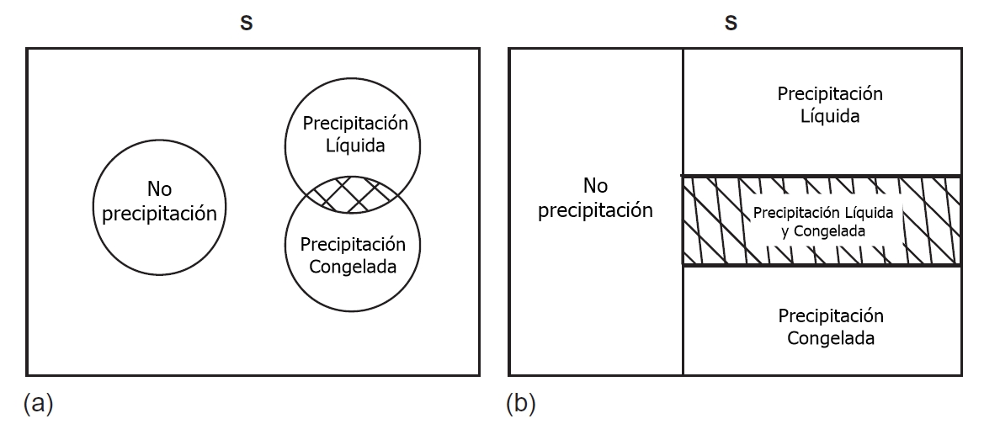

::: {.quote-block}
“Es imposible que lo improbable nunca ocurra.”\
— *Atribuida a Emil Julius Gumbel (1891–1966), estadístico conocido por su trabajo en la teoría de valores extremos*
:::

## La estadística en hidrología {#sec-prob-estadistica}

Los procesos hidrológicos obedecen leyes físicas de conservación de masa y energía, pero dependen de tantas condiciones que no se pueden predecir con exactitud. Nadie sabe cuánto lloverá en octubre del próximo año ni cuál será la mayor crecida de los próximos 50 años. Lo que sí se puede estimar es qué tan probable es cada valor, y eso basta para diseñar. La estadística y la probabilidad son, por eso, la forma de trabajar con la incertidumbre de la lluvia y del caudal.

En ingeniería civil, quien hace el estudio hidrológico define los eventos de diseño de una obra, igual que quien diseña la estructura define las cargas muertas y vivas. La estadística se usa en tres tipos de problema:

- **Diseño.** Capacidad de vertedores, puentes, alcantarillas y redes de drenaje urbano.
- **Gestión del recurso.** Agua disponible para abastecimiento, riego y generación hidroeléctrica.
- **Operación.** Pronóstico de crecidas y sequías para decidir a tiempo.

En todos los casos se hace lo mismo: se infieren las propiedades de una población a partir de una muestra. La población es el conjunto de todos los valores posibles de la variable, pasados y futuros. La muestra es el registro, casi siempre de unas pocas décadas. Con 25 años de caudales máximos anuales se estima, por ejemplo, el caudal que se excede en promedio una vez cada 100 años.

El estudio de un problema hidrológico sigue los pasos del análisis de sistemas (@fig-prob-sistemas): describir el problema, identificar los factores que importan, proponer un modelo, probarlo con datos y refinarlo hasta que represente bien el sistema.

```{r}
#| label: fig-prob-sistemas
#| fig-cap: "Pasos del análisis de sistemas. El recuadro punteado marca el ciclo de proponer, probar y refinar el modelo."
#| fig-alt: "Diagrama de flujo de izquierda a derecha con siete pasos; tres de ellos, de identificar factores a realizar experimentos, están dentro de un recuadro punteado con flechas de ida y vuelta"
#| echo: false
#| out-width: 95%

library(DiagrammeR)

grViz("
digraph sistemas {
  graph [layout = dot, rankdir = LR, bgcolor = 'white']
  node [shape = box, style = 'filled,rounded', color = '#1C6BA0', fillcolor = '#E3EEF6',
        fontname = 'Times-Roman', fontsize = 14]
  nodo1 [label = 'Describir\nel problema']
  nodo2 [label = 'Identificar\nlos factores']
  nodo3 [label = 'Proponer o\nrefinar el modelo']
  nodo4 [label = 'Probar con\ndatos']
  nodo5 [label = 'Usar el\nmodelo']
  nodo6 [label = 'Confirmar la\nsolución']
  nodo7 [label = 'Conclusiones y\nrecomendaciones']
  subgraph cluster0 {
    style = dashed; color = '#E07B39'; label = ''
    nodo2 -> nodo3 -> nodo4
    nodo4 -> nodo3
  }
  nodo1 -> nodo2
  nodo3 -> nodo5 -> nodo6 -> nodo7
}
", height = 230)
```

Hay dos clases de modelos para representar un proceso hidrológico:

- **Modelo determinístico.** Se basa en leyes físicas y da siempre la misma salida para la misma entrada. Las ecuaciones de Saint-Venant para el tránsito de una crecida son un ejemplo.
- **Modelo estocástico.** Considera que parte de la respuesta depende del azar y la describe con distribuciones de probabilidad. El modelo de Thomas y Fiering del capítulo anterior es de este tipo (@sec-registros-thomas-fiering).

Un proceso estocástico es una sucesión de variables aleatorias en el tiempo o en el espacio, como la lluvia diaria de una estación. Aunque cada aguacero responde a la física de la atmósfera, la variabilidad del tiempo y las diferencias de suelo, relieve y cobertura entre cuencas hacen que la respuesta cambie mucho de un evento a otro.

Todo diseño hidrológico se hace con incertidumbre, que tiene cuatro fuentes principales:

1. **Variabilidad natural.** La lluvia y el caudal cambian de un año a otro. Un registro de 10 años puede no incluir una crecida que sí puede ocurrir.
2. **Error de muestreo.** El registro es solo una parte de la población. Cuanto más corto, más incierta es la estimación de los eventos raros.
3. **Error de medición.** Fallas de los instrumentos y errores al leer, procesar o transcribir los datos (@sec-registros-calidad).
4. **No estacionariedad.** La estadística clásica supone que las propiedades de la población no cambian con el tiempo. La urbanización, la deforestación y el cambio climático alteran la respuesta de las cuencas, y entonces el registro histórico ya no representa bien el futuro.

## Experimentos, eventos y variables {#sec-prob-conceptos}

Un experimento determinístico da el mismo resultado cada vez que se repite en las mismas condiciones: el agua hierve a la misma temperatura a la misma presión. Un experimento aleatorio, en cambio, puede dar resultados distintos aunque se repita en condiciones que parecen iguales. En hidrología, medir el caudal máximo de cada año en una sección de un río es un experimento aleatorio: se sabe que habrá una crecida, pero no de qué tamaño.

El espacio muestral ($S$ o $\Omega$) es el conjunto de todos los resultados posibles de un experimento. Un evento es un subconjunto del espacio muestral, es decir, un grupo de resultados.

- **Evento simple o elemental.** No se puede descomponer en otros. Al lanzar un dado, "sale un seis" es un evento simple.
- **Evento compuesto.** Reúne dos o más eventos simples. "Sale un número par" ocurre con 2, 4 o 6. En hidrología casi todos los eventos de interés son compuestos: "el caudal máximo anual supera 500 m³/s" abarca todos los valores por encima de ese umbral.

Los diagramas de Venn representan el espacio muestral con un rectángulo y los eventos con regiones dentro de él. La @fig-prob1 muestra dos formas de dibujar los eventos "no hay precipitación", "precipitación líquida" y "precipitación congelada" en un día. Los dos últimos pueden ocurrir juntos (lluvia y granizo en la misma tormenta); el primero no puede ocurrir con ninguno de ellos.

```{r}
#| label: fig-prob1
#| fig-cap: "Dos diagramas de Venn equivalentes para la precipitación de un día. La zona rayada es la ocurrencia de precipitación líquida y congelada a la vez. Fuente: adaptado de @Wilks2019."
#| fig-alt: "Dos rectángulos con el espacio muestral S. A la izquierda, un círculo de no precipitación aislado y dos círculos que se traslapan para precipitación líquida y congelada. A la derecha, el mismo esquema dividido en franjas"
#| out-width: 90%
#| echo: false


```

Las variables con que se describe el resultado de un experimento pueden ser de dos tipos:

- **Cualitativas o categóricas.** No son números. Pueden ser nominales, sin orden entre categorías (tipo de cobertura: bosque, pasto, urbano), u ordinales, con orden (alerta verde, amarilla, naranja y roja).
- **Cuantitativas.** Son números. Pueden ser discretas, que se cuentan con enteros (días con lluvia en un mes), o continuas, que toman cualquier valor en un intervalo (lluvia diaria en milímetros).

Las cuantitativas se distinguen también por el significado del cero. En una escala de razón el cero es ausencia (0 mm de lluvia), y por eso 40 mm es el doble de 20 mm. En una escala de intervalo el cero es convencional: 30 °C no es el doble de calor que 15 °C. Las variables que se usan en diseño hidrológico (lluvia, caudal, volumen) son casi siempre continuas y de razón.

## Probabilidad {#sec-prob-probabilidad}

La probabilidad es un número entre 0 y 1 que mide qué tan posible es un evento. En hidrología se usa la interpretación frecuentista: si un experimento se repite $n$ veces y el evento $A$ ocurre $n_A$ veces, la probabilidad de $A$ es el límite de la frecuencia relativa cuando $n$ crece sin límite:

$$
P(A) = \lim_{n \to \infty} \frac{n_A}{n}
$$ {#eq-prob-frecuentista}

Con un registro finito, $n_A/n$ es una estimación de $P(A)$, y mejora a medida que el registro se alarga. La @fig-prob-frecuencia lo muestra con 25 años de lluvia mensual de una estación de montaña: la fracción de meses con más de 300 mm oscila al principio y se acerca despacio al valor de todo el registro, 0.46.

```{r}
#| label: fig-prob-frecuencia
#| fig-cap: "Frecuencia relativa de los meses con más de 300 mm de lluvia en una estación de montaña, calculada con los primeros n meses del registro de 1986–2010. Datos ilustrativos."
#| fig-alt: "Línea que empieza con saltos grandes entre 0 y 0.6 en los primeros meses y se estabiliza poco a poco cerca de 0.46, marcada con una línea horizontal punteada"
#| echo: false
#| out-width: 75%
#| fig-width: 7
#| fig-height: 3.8

library(tidyverse)

lluvia_mes <- read_csv("datos/lluvia_mensual_dos_estaciones.csv", show_col_types = FALSE)
frecuencia <- tibble(n = seq_len(nrow(lluvia_mes)),
                     fr = cumsum(lluvia_mes$base_mm > 300) / n)

ggplot(frecuencia, aes(n, fr)) +
  geom_hline(yintercept = last(frecuencia$fr), linetype = "dashed", color = "grey50") +
  geom_line(color = "#1C6BA0", linewidth = 0.7) +
  scale_y_continuous(limits = c(0, 1)) +
  labs(x = "Número de meses del registro (n)", y = "Frecuencia relativa") +
  theme_minimal(base_family = "serif", base_size = 12)
```

La convergencia es lenta: con cinco años de datos la estimación es 0.37 y con diez años, 0.38. Los primeros años del registro fueron menos lluviosos que los últimos, y unos pocos años no representan bien el conjunto. Si así ocurre con un evento que pasa casi un mes de cada dos, para uno que pasa una vez cada 100 años la frecuencia relativa de un registro de 25 años no sirve: casi nunca tiene más de uno o dos casos. Por eso los eventos raros se estiman con distribuciones de probabilidad ajustadas a la muestra, que se estudian en los capítulos siguientes.

Toda medida de probabilidad cumple tres axiomas, de los que se deducen las demás reglas:

1. **No negatividad.** La probabilidad de cualquier evento $E$ es mayor o igual que cero:

    $$
    P(E) \ge 0
    $$ {#eq-prob-axioma1}

2. **Normalización.** La probabilidad del espacio muestral es uno, porque algún resultado tiene que ocurrir:

    $$
    P(\Omega) = 1
    $$ {#eq-prob-axioma2}

3. **Aditividad.** Si los eventos $E_1, E_2, \ldots$ son mutuamente excluyentes (no pueden ocurrir juntos), la probabilidad de que ocurra alguno de ellos es la suma de sus probabilidades:

    $$
    P\left(\bigcup_{i} E_i \right) = \sum_{i} P(E_i)
    $$ {#eq-prob-axioma3}

## Reglas de la probabilidad {#sec-prob-reglas}

### Regla de la suma {#sec-prob-suma}

La regla de la suma da la probabilidad de que ocurra $A$, $B$ o ambos, es decir, la probabilidad de la unión $A \cup B$. Si los dos eventos pueden ocurrir juntos, se resta la probabilidad de la intersección para no contarla dos veces:

$$
P(A \cup B) = P(A) + P(B) - P(A \cap B)
$$ {#eq-prob-suma}

donde $P(A \cap B)$ es la probabilidad de que $A$ y $B$ ocurran a la vez. Una inundación en la desembocadura de un afluente, por ejemplo, puede deberse a una crecida del afluente ($A$), al remanso del río principal ($B$) o a las dos cosas.

Si los eventos son mutuamente excluyentes, $A \cap B = \varnothing$ y la regla se reduce al tercer axioma, $P(A \cup B) = P(A) + P(B)$. Es el caso de los intervalos de caudal que no se traslapan, como "entre 100 y 200 m³/s" y "entre 200 y 300 m³/s". La @fig-prob-venn muestra los dos casos.

```{r}
#| label: fig-prob-venn
#| fig-cap: "Eventos mutuamente excluyentes (izquierda) y eventos que pueden ocurrir juntos (derecha). La zona sombreada es la intersección."
#| fig-alt: "Dos rectángulos. En el de la izquierda, dos círculos A y B separados. En el de la derecha, dos círculos A y B que se traslapan, con la zona común sombreada"
#| echo: false
#| out-width: 75%
#| fig-width: 7
#| fig-height: 3

library(ggforce)

circulos <- tibble(
  caso = rep(c("Mutuamente excluyentes", "No mutuamente excluyentes"), each = 2),
  x0 = c(-1.25, 1.25, -0.7, 0.7), y0 = 0, r = 1, nombre = rep(c("A", "B"), 2)
)
lente <- bind_rows(
  tibble(t = seq(-acos(0.7), acos(0.7), length.out = 100),
         x = -0.7 + cos(t), y = sin(t)),
  tibble(t = seq(pi - acos(0.7), pi + acos(0.7), length.out = 100),
         x = 0.7 + cos(t), y = sin(t))
) %>% mutate(caso = "No mutuamente excluyentes")

marco <- tibble(caso = unique(circulos$caso))

ggplot() +
  geom_rect(data = marco, aes(xmin = -2.6, xmax = 2.6, ymin = -1.4, ymax = 1.4),
            fill = NA, color = "grey30") +
  geom_polygon(data = lente, aes(x, y), fill = "#E07B39", alpha = 0.45) +
  geom_circle(data = circulos, aes(x0 = x0, y0 = y0, r = r), color = "#1C6BA0", linewidth = 0.8) +
  geom_text(data = circulos, aes(x = x0 + if_else(nombre == "A", -0.35, 0.35), y = 0.45, label = nombre),
            family = "serif", size = 5) +
  facet_wrap(~ caso) +
  coord_equal() +
  theme_void(base_family = "serif", base_size = 12) +
  theme(strip.text = element_text(size = 12, margin = margin(b = 4)))
```

### Probabilidad condicional {#sec-prob-condicional}

::: {.pregunta}
¿Es igual de probable un mes de más de 300 mm en cualquier época del año?
:::

No lo es, y la probabilidad condicional sirve para medir cuánto cambia. La probabilidad de $A$ dado que ocurrió $B$ es la fracción de las veces en que ocurre $B$ en que también ocurre $A$:

$$
P(A \mid B) = \frac{P(A \cap B)}{P(B)}
$$ {#eq-prob-condicional}

Al despejar se obtiene la regla de la multiplicación, que da la probabilidad de que ocurran los dos eventos:

$$
P(A \cap B) = P(A \mid B)\, P(B)
$$ {#eq-prob-multiplicacion}

Dos eventos son independientes si saber que ocurrió uno no cambia la probabilidad del otro, es decir, si $P(A \mid B) = P(A)$. En ese caso la regla de la multiplicación se reduce a:

$$
P(A \cap B) = P(A)\, P(B)
$$ {#eq-prob-independencia}

Con la hipótesis de independencia se calcula, en el capítulo siguiente, la probabilidad de que una obra falle al menos una vez en su vida útil a partir de la probabilidad anual. Se cumple bien para los máximos anuales de caudal o de lluvia, que ocurren en años distintos, pero no para valores diarios o mensuales, por dos razones:

- **Persistencia o autocorrelación.** El caudal de hoy depende del de ayer, sobre todo en la recesión, cuando la cuenca se vacía despacio.
- **Estacionalidad y estado de la cuenca.** La lluvia de un mes depende de la época del año, y el caudal depende de la lluvia antecedente y del agua almacenada en el suelo y los acuíferos.

Tratar como independientes valores que no lo son subestima la incertidumbre, porque una serie con persistencia tiene menos información de la que aparenta su número de datos.

::: {.callout-note title="Ejemplo: lluvia mensual y época lluviosa"}

El archivo `datos/lluvia_mensual_dos_estaciones.csv` tiene la lluvia mensual de 1986 a 2010 de dos estaciones de montaña de Costa Rica (datos ilustrativos). Con la columna de la estación base, defina los eventos $A$: "el mes tiene más de 300 mm" y $B$: "el mes es de la época lluviosa (mayo a noviembre)". Calcule $P(A)$, $P(B)$, $P(A \cap B)$, $P(A \cup B)$ y $P(A \mid B)$, y diga si los eventos son independientes.

```{r}
#| echo: false

source("R/ver_datos.R")
ver_datos("datos/lluvia_mensual_dos_estaciones.csv",
          nombres = c("Año", "Mes", "Estación base (mm)", "Estación en estudio (mm)"))
```

**Solución:**

1. **Conteo.** De los 300 meses, 175 son de la época lluviosa. Al clasificar cada mes según los dos eventos se obtiene el @tbl-prob-conteo.

```{r}
#| label: tbl-prob-conteo
#| tbl-cap: "Número de meses de 1986–2010 según la lluvia y la época del año."
#| echo: false

library(kableExtra)
tibble(lluvia = c("Más de 300 mm (A)", "300 mm o menos", "Total"),
       lluviosa = c(127, 48, 175), seca = c(12, 113, 125), total = c(139, 161, 300)) %>%
  kbl(col.names = c("", "Época lluviosa (B)", "Época seca", "Total"), align = "lccc") %>%
  kable_styling(full_width = FALSE, bootstrap_options = c("hover", "condensed"))
```

2. **Probabilidades simples**, con la @eq-prob-frecuentista: $P(A) = 139/300 = 0.463$ y $P(B) = 175/300 = 0.583$.
3. **Intersección:** $P(A \cap B) = 127/300 = 0.423$.
4. **Unión** (@eq-prob-suma): $P(A \cup B) = 0.463 + 0.583 - 0.423 = 0.623$. Es lo mismo que contar los meses que cumplen al menos una condición: $(127 + 48 + 12)/300 = 187/300$.
5. **Condicional** (@eq-prob-condicional): $P(A \mid B) = 0.423/0.583 = 127/175 = 0.726$.
6. **Independencia.** Si los eventos fueran independientes, $P(A \cap B)$ sería $0.463 \times 0.583 = 0.270$. El valor observado, 0.423, es mucho mayor: los eventos no son independientes.

**Pseudocódigo**

1. Leer la serie mensual.
2. Marcar en cada mes si ocurre $A$ y si ocurre $B$.
3. Calcular las frecuencias relativas de $A$, $B$, $A \cap B$ y $A \cup B$.
4. Calcular $P(A \mid B)$ y compararla con $P(A)$.

```{r}
#| label: ej-prob-eventos

library(tidyverse)

# 1) Lluvia mensual de la estación base (mm)
lluvia <- read_csv("datos/lluvia_mensual_dos_estaciones.csv")

# 2) Eventos de cada mes
lluvia <- lluvia %>%
  mutate(A = base_mm > 300,       # más de 300 mm
         B = mes %in% 5:11)       # época lluviosa

# 3) Frecuencias relativas
p_a <- mean(lluvia$A)
p_b <- mean(lluvia$B)
p_ayb <- mean(lluvia$A & lluvia$B)
p_aob <- mean(lluvia$A | lluvia$B)

# 4) Probabilidad condicional y prueba de independencia
p_a_dado_b <- p_ayb / p_b
round(c(p_a = p_a, p_b = p_b, p_ayb = p_ayb, p_aob = p_aob,
        p_a_dado_b = p_a_dado_b, p_a_por_p_b = p_a * p_b), 3)

# Cuadro de conteos con table()
table(A = lluvia$A, B = lluvia$B)
```

Saber que el mes es de la época lluviosa sube la probabilidad de pasar de 300 mm de 0.46 a 0.73. En la época seca baja a $12/125 = 0.10$. Una probabilidad calculada con los doce meses juntos no sirve, por ejemplo, para planificar una obra que se construirá entre diciembre y abril: para eso se usa la probabilidad condicionada a la época.

:::

## Variables aleatorias y distribuciones {#sec-prob-variables}

Una variable aleatoria asigna un número a cada resultado de un experimento aleatorio. Se escribe con mayúscula ($X$), y un valor particular, con minúscula ($x$). Es discreta si toma valores aislados, como el número de crecidas que superan un umbral en 10 años, y continua si toma cualquier valor de un intervalo, como el caudal máximo anual o la lluvia anual.

### Función de distribución acumulada {#sec-prob-fda}

La función de distribución acumulada (FDA) de una variable $X$ da la probabilidad de que $X$ no supere un valor $x$:

$$
F(x) = P(X \le x)
$$ {#eq-prob-fda}

En hidrología, $F(x)$ es la probabilidad de no excedencia de $x$, y $1 - F(x)$ es la probabilidad de excedencia. Toda FDA cumple cuatro propiedades:

1. Está entre 0 y 1: $0 \le F(x) \le 1$.
2. Tiende a 0 cuando $x \to -\infty$ y a 1 cuando $x \to +\infty$.
3. Es no decreciente: si $x_1 < x_2$, entonces $F(x_1) \le F(x_2)$.
4. La probabilidad de un intervalo es la diferencia de la FDA en sus extremos: $P(a < X \le b) = F(b) - F(a)$.

Con una muestra de $n$ datos, la FDA se estima con la función de distribución empírica: la fracción de los datos que son menores o iguales que $x$. Esa estimación no da probabilidades fuera del rango observado. Más adelante, en el capítulo de modelos estadísticos, se ven las posiciones de graficación, que asignan a cada dato ordenado una probabilidad de excedencia para el análisis de frecuencia.

### Función de densidad de probabilidad {#sec-prob-fdp}

Para una variable continua, la función de densidad de probabilidad (FDP) es la derivada de la FDA:

$$
f(x) = \frac{dF(x)}{dx}
\qquad \Longleftrightarrow \qquad
F(x) = \int_{-\infty}^{x} f(u)\,du
$$ {#eq-prob-fdp}

La FDP no es una probabilidad, sino una probabilidad por unidad de $x$ (por ejemplo, por milímetro). La probabilidad es el área bajo la curva:

$$
P(a \le X \le b) = \int_{a}^{b} f(x)\,dx
$$ {#eq-prob-intervalo}

De ahí sale que, para una variable continua, la probabilidad de un valor exacto es cero, $P(X = x) = 0$, y que el área total bajo la FDP es uno. La @fig-prob-fda-fdp muestra las dos funciones para la lluvia anual de la estación del ejemplo anterior: la empírica, a partir de los 25 datos, y una distribución normal con la misma media y la misma desviación estándar.

```{r}
#| label: fig-prob-fda-fdp
#| fig-cap: "Lluvia anual de la estación base, 1986–2010. Izquierda: función de distribución empírica (escalones) y FDA normal con la misma media y desviación. Derecha: histograma en densidad y FDP normal; el área sombreada es la probabilidad de un año con 3000 mm o menos. Datos ilustrativos."
#| fig-alt: "A la izquierda, una escalera de 25 peldaños que sube de 0 a 1 entre 2500 y 4400 mm y una curva en forma de S que la sigue de cerca. A la derecha, un histograma con una campana superpuesta y el área bajo la campana a la izquierda de 3000 mm sombreada"
#| echo: false
#| out-width: 95%
#| fig-width: 9
#| fig-height: 3.8

library(patchwork)

anual <- lluvia_mes %>% group_by(anio) %>% summarise(p = sum(base_mm))
m_p <- mean(anual$p); s_p <- sd(anual$p)
curva <- tibble(x = seq(2000, 4800, length.out = 300),
                fda = pnorm(x, m_p, s_p), fdp = dnorm(x, m_p, s_p))

g1 <- ggplot(anual, aes(p)) +
  stat_ecdf(geom = "step", color = "#1C6BA0", linewidth = 0.7) +
  geom_line(data = curva, aes(x, fda), color = "#E07B39", linewidth = 0.8) +
  labs(x = "Lluvia anual (mm)", y = "F(x)") +
  theme_minimal(base_family = "serif", base_size = 12)

g2 <- ggplot(anual, aes(p)) +
  geom_histogram(aes(y = after_stat(density)), breaks = seq(2500, 4500, 250),
                 fill = "#1C6BA0", alpha = 0.35, color = "white") +
  geom_area(data = filter(curva, x <= 3000), aes(x, fdp), fill = "#E07B39", alpha = 0.5) +
  geom_line(data = curva, aes(x, fdp), color = "#E07B39", linewidth = 0.8) +
  scale_y_continuous(labels = function(v) v * 1e4) +
  labs(x = "Lluvia anual (mm)", y = expression(f(x)~~(10^{-4}~mm^{-1}))) +
  theme_minimal(base_family = "serif", base_size = 12)

g1 + g2
```

::: {.callout-note title="Ejemplo: probabilidad de no excedencia de la lluvia anual"}

Con la lluvia anual de la estación base de 1986 a 2010 (@tbl-prob-anual, suma de los doce meses de cada año), estime la probabilidad de que un año tenga 3000 mm o menos, entre 3000 y 3500 mm y más de 4000 mm. Use la función de distribución empírica y compare con una distribución normal de la misma media (3298.3 mm) y desviación estándar (487.5 mm).

```{r}
#| label: tbl-prob-anual
#| tbl-cap: "Lluvia anual (mm) de la estación base. Datos ilustrativos."
#| echo: false

matrix(c(anual$anio, round(anual$p, 1)), ncol = 2) %>%
  as_tibble(.name_repair = ~ c("anio", "p")) %>%
  mutate(col = rep(1:5, each = 5), fila = rep(1:5, 5)) %>%
  mutate(txt = sprintf("%d: %.1f", anio, p)) %>%
  select(fila, col, txt) %>%
  pivot_wider(names_from = col, values_from = txt) %>%
  select(-fila) %>%
  kbl(col.names = rep("Año: lluvia", 5), align = "c") %>%
  kable_styling(full_width = FALSE, bootstrap_options = c("hover", "condensed"))
```

**Solución:**

1. **Empírica.** Siete años tienen 3000 mm o menos, diez están entre 3000 y 3500 mm y tres superan 4000 mm. Las probabilidades son $7/25 = 0.28$, $10/25 = 0.40$ y $3/25 = 0.12$.
2. **Normal.** Se estandariza cada límite con $z = (x - \bar{x})/s$ y se busca $\Phi(z)$ en una tabla de la normal estándar:
    - $x = 3000$ mm: $z = (3000 - 3298.3)/487.5 = -0.61$, $F = \Phi(-0.61) = 0.270$.
    - $x = 3500$ mm: $z = 0.41$, $F = 0.660$; entonces $P(3000 < X \le 3500) = 0.660 - 0.270 = 0.390$.
    - $x = 4000$ mm: $z = 1.44$, $F = 0.925$; la probabilidad de excedencia es $1 - 0.925 = 0.075$.

**Pseudocódigo**

1. Calcular la lluvia anual de cada año.
2. Estimar las probabilidades con la fracción de años que cumplen cada condición.
3. Calcular las mismas probabilidades con la FDA normal de igual media y desviación.

```{r}
#| label: ej-prob-no-excedencia

library(tidyverse)

# 1) Lluvia anual (mm) de la estación base
anual <- read_csv("datos/lluvia_mensual_dos_estaciones.csv") %>%
  group_by(anio) %>%
  summarise(p = sum(base_mm))

# 2) Función de distribución empírica
F_emp <- ecdf(anual$p)
emp <- c(hasta_3000 = F_emp(3000),
         entre_3000_3500 = F_emp(3500) - F_emp(3000),
         sobre_4000 = 1 - F_emp(4000))

# 3) Distribución normal con la media y la desviación de la muestra
m_p <- mean(anual$p); s_p <- sd(anual$p)
nor <- c(hasta_3000 = pnorm(3000, m_p, s_p),
         entre_3000_3500 = pnorm(3500, m_p, s_p) - pnorm(3000, m_p, s_p),
         sobre_4000 = 1 - pnorm(4000, m_p, s_p))

round(rbind(empirica = emp, normal = nor), 3)
```

En el centro de la distribución las dos estimaciones casi coinciden (0.28 contra 0.27 y 0.40 contra 0.39). En la cola alta difieren: la empírica da 0.12 para más de 4000 mm y la normal 0.075. Con 25 datos, tres años sobre 4000 mm pueden ser casualidad o indicar que la cola real es más pesada que la de la normal; la asimetría positiva de la muestra (@sec-prob-forma) apunta a lo segundo. Escoger la distribución que mejor representa la cola es el tema de los capítulos de análisis de frecuencia.

:::

## Estadísticos descriptivos {#sec-prob-descriptivos}

Un registro de lluvia o de caudal se resume con unos pocos números que describen su centro, su dispersión y su forma. Estos estadísticos descriptivos se relacionan con los momentos de la distribución. Para una variable continua con FDP $f(x)$, el momento de orden $k$ respecto al origen y respecto a la media $\mu$ son:

$$
\mu'_k = \int_{-\infty}^{\infty} x^{k}\, f(x)\, dx
\qquad
\mu_k = \int_{-\infty}^{\infty} (x-\mu)^{k}\, f(x)\, dx
$$ {#eq-prob-momentos}

La media es el primer momento respecto al origen ($\mu = \mu'_1$). La varianza es el segundo momento respecto a la media ($\sigma^2 = \mu_2$), y el tercero y el cuarto describen la forma. Con una muestra, los momentos de la población se estiman con los datos.

### Tendencia central {#sec-prob-centro}

- **Media.** Es el centro de gravedad de los datos: $\bar{x} = \frac{1}{n}\sum_{i=1}^{n} x_i$.
- **Mediana** ($x_{0.50}$). Es el valor que deja la mitad de los datos ordenados por debajo y la mitad por encima. Con $n$ impar es el dato central; con $n$ par, el promedio de los dos centrales.
- **Moda.** Es el valor más frecuente, o en datos continuos, la clase más alta del histograma.

En una distribución simétrica las tres coinciden. En una con asimetría positiva, como la de los caudales máximos, la media queda a la derecha de la mediana, arrastrada por los valores grandes.

### Dispersión {#sec-prob-dispersion}

- **Varianza.** Es el promedio de los cuadrados de las desviaciones respecto a la media. Con una muestra se estima con

    $$
    s^2 = \frac{1}{n-1}\sum_{i=1}^{n} (x_i - \bar{x})^2
    $$ {#eq-prob-varianza}

    Se divide entre $n - 1$, y no entre $n$, para que el estimador no sea sesgado: la media muestral ya se ajustó a los mismos datos.
- **Desviación estándar.** Es $s = \sqrt{s^2}$, con las mismas unidades que la variable.
- **Rango.** Es la diferencia entre el valor máximo y el mínimo. Depende solo de dos datos y crece con el tamaño de la muestra.
- **Rango intercuartílico.** Es $RIC = x_{0.75} - x_{0.25}$, la amplitud del 50 % central de los datos. Los cuantiles $x_{0.25}$ y $x_{0.75}$ dejan por debajo la cuarta parte y las tres cuartas partes de los datos.

### Forma {#sec-prob-forma}

Para comparar series de estaciones o cuencas distintas se usan coeficientes sin dimensiones:

- **Coeficiente de variación.** $CV = s/\bar{x}$. La lluvia anual de una estación de montaña suele tener un $CV$ bajo; los caudales máximos anuales de un río pequeño, uno mucho mayor.
- **Coeficiente de asimetría.** Mide la falta de simetría a partir del tercer momento. Su estimador muestral, con la corrección por tamaño de muestra que usan @chow1988appliedhydrology, es

    $$
    C_s = \frac{n \sum_{i=1}^{n} (x_i - \bar{x})^3}{(n-1)(n-2)\, s^3}
    $$ {#eq-prob-asimetria}

    $C_s > 0$ indica una cola larga hacia los valores altos, como en las lluvias intensas y los caudales máximos; $C_s = 0$, una distribución simétrica como la normal; y $C_s < 0$, una cola hacia los valores bajos.
- **Curtosis.** Mide el peso de las colas a partir del cuarto momento:

    $$
    C_k = \frac{m_4}{m_2^{2}}, \qquad m_k = \frac{1}{n}\sum_{i=1}^{n} (x_i - \bar{x})^k
    $$ {#eq-prob-curtosis}

    La normal tiene $C_k = 3$. Una distribución con $C_k > 3$ (leptocúrtica) tiene más valores extremos que la normal; una con $C_k < 3$ (platicúrtica), menos. Algunos programas restan 3 y reportan el exceso de curtosis, así que conviene revisar cuál de los dos da la función que se usa.

La @fig-prob-forma muestra distribuciones con distinta asimetría y curtosis. Los estimadores de $C_s$ y $C_k$ usan potencias altas de las desviaciones, así que con registros cortos varían mucho de una muestra a otra.

```{r}
#| label: fig-prob-forma
#| fig-cap: "Izquierda: distribuciones con asimetría positiva, nula y negativa. Derecha: distribuciones simétricas con curtosis menor, igual y mayor que la de la normal, todas con varianza uno."
#| fig-alt: "Dos paneles con tres curvas cada uno. A la izquierda, una curva con cola a la derecha, una campana simétrica y una curva con cola a la izquierda. A la derecha, tres curvas centradas en cero: una achatada, una normal y una puntiaguda de colas largas"
#| echo: false
#| out-width: 95%
#| fig-width: 9
#| fig-height: 3.6

x_a <- seq(0, 1, length.out = 400)
asim <- bind_rows(
  tibble(x = x_a, f = dbeta(x_a, 2, 6), caso = "Positiva (Cs > 0)"),
  tibble(x = x_a, f = dbeta(x_a, 4, 4), caso = "Nula (Cs = 0)"),
  tibble(x = x_a, f = dbeta(x_a, 6, 2), caso = "Negativa (Cs < 0)")
) %>% mutate(caso = factor(caso, levels = unique(caso)))

x_k <- seq(-4, 4, length.out = 400)
curt <- bind_rows(
  tibble(x = x_k, f = dunif(x_k, -sqrt(3), sqrt(3)), caso = "Platicúrtica (Ck < 3)"),
  tibble(x = x_k, f = dnorm(x_k), caso = "Normal (Ck = 3)"),
  tibble(x = x_k, f = dt(x_k * sqrt(5 / 3), 5) * sqrt(5 / 3), caso = "Leptocúrtica (Ck > 3)")
) %>% mutate(caso = factor(caso, levels = unique(caso)))

paleta <- c("#1C6BA0", "grey40", "#E07B39")
g1 <- ggplot(asim, aes(x, f, color = caso)) +
  geom_line(linewidth = 0.8) +
  scale_color_manual(values = paleta, name = NULL) +
  labs(x = "x", y = "f(x)") +
  theme_minimal(base_family = "serif", base_size = 12) +
  theme(legend.position = "bottom", legend.direction = "vertical")
g2 <- ggplot(curt, aes(x, f, color = caso)) +
  geom_line(linewidth = 0.8) +
  scale_color_manual(values = paleta, name = NULL) +
  labs(x = "x", y = "f(x)") +
  theme_minimal(base_family = "serif", base_size = 12) +
  theme(legend.position = "bottom", legend.direction = "vertical")
g1 + g2
```

::: {.callout-note title="Ejemplo: estadísticos de la lluvia anual"}

Calcule la media, la mediana, la desviación estándar, el rango intercuartílico, el coeficiente de variación, el coeficiente de asimetría y la curtosis de la lluvia anual de la estación base (@tbl-prob-anual, $n = 25$).

**Solución:**

1. **Sumas.** $\sum x_i = 82\,457.4$ mm. Con $\bar{x} = 3298.3$ mm, las sumas de las desviaciones son $\sum (x_i - \bar{x})^2 = 5\,703\,021$ mm², $\sum (x_i - \bar{x})^3 = 1.906 \times 10^{9}$ mm³ y $\sum (x_i - \bar{x})^4 = 3.551 \times 10^{12}$ mm⁴.
2. **Centro.** Media: $82\,457.4/25 = 3298.3$ mm. Al ordenar los 25 valores, el decimotercero es la mediana: 3158.7 mm.
3. **Dispersión** (@eq-prob-varianza): $s^2 = 5\,703\,021/24 = 237\,626$ mm² y $s = 487.5$ mm. Con 25 datos, los cuartiles son el séptimo y el decimonoveno de la serie ordenada: $x_{0.25} = 2975.0$ mm y $x_{0.75} = 3519.6$ mm, así que $RIC = 544.6$ mm.
4. **Coeficiente de variación:** $CV = 487.5/3298.3 = 0.148$.
5. **Asimetría** (@eq-prob-asimetria): $C_s = 25 \times 1.906 \times 10^{9}/(24 \times 23 \times 487.5^3) = 0.745$.
6. **Curtosis** (@eq-prob-curtosis): $m_2 = 5\,703\,021/25 = 228\,121$ mm² y $m_4 = 3.551 \times 10^{12}/25 = 1.421 \times 10^{11}$ mm⁴, de modo que $C_k = 1.421 \times 10^{11}/228\,121^2 = 2.73$.

**Pseudocódigo**

1. Calcular la lluvia anual.
2. Calcular la media, la mediana, la desviación estándar y los cuartiles.
3. Calcular $CV$, $C_s$ y $C_k$ con las ecuaciones del texto.
4. Comparar con las funciones del paquete `moments`.

```{r}
#| label: ej-prob-estadisticos

library(tidyverse)

# 1) Lluvia anual (mm)
anual <- read_csv("datos/lluvia_mensual_dos_estaciones.csv") %>%
  group_by(anio) %>%
  summarise(p = sum(base_mm))
x <- anual$p
n <- length(x)

# 2) Centro y dispersión
media <- mean(x)
s <- sd(x)                                 # divide entre n - 1
cuartiles <- quantile(x, c(0.25, 0.50, 0.75))

# 3) Coeficientes de forma con las ecuaciones del texto
cv <- s / media
cs <- n * sum((x - media)^3) / ((n - 1) * (n - 2) * s^3)
m2 <- mean((x - media)^2)
m4 <- mean((x - media)^4)
ck <- m4 / m2^2

round(c(media = media, mediana = cuartiles[[2]], s = s,
        ric = cuartiles[[3]] - cuartiles[[1]], cv = cv, cs = cs, ck = ck), 3)
```

Las mismas medidas se obtienen con funciones de R y del paquete `moments`. Hay que tener en cuenta que `moments::skewness()` no aplica la corrección por tamaño de muestra de la @eq-prob-asimetria:

```{r}
#| label: ej-prob-estadisticos-paquetes

# install.packages("moments")   # una sola vez
summary(x)                          # mínimo, cuartiles, media y máximo
IQR(x)                              # rango intercuartílico
moments::skewness(x)                # asimetría sin corregir
moments::skewness(x) * sqrt(n * (n - 1)) / (n - 2)   # corregida, igual a cs
moments::kurtosis(x)                # curtosis (la normal da 3)
```

La lluvia anual de esta estación varía poco: la desviación estándar es el 15 % de la media. La asimetría es positiva (0.745), con años muy lluviosos que se alejan más de la media que los secos, y por eso la media queda unos 140 mm por encima de la mediana. La curtosis de 2.73 es cercana a la de la normal; con 25 datos, una diferencia así no basta para concluir nada sobre las colas.

:::

### Medidas resistentes {#sec-prob-resistentes}

Un estadístico resistente cambia poco si se modifica una pequeña parte de los datos, aunque el cambio sea grande. Un método robusto, en cambio, funciona razonablemente bien aunque los datos no cumplan las hipótesis con que se diseñó [@Wilks2019]. La media y la desviación estándar no son resistentes: un solo valor mal transcrito las cambia mucho. La mediana y el rango intercuartílico sí lo son. Por eso, al revisar un registro (@sec-registros-calidad), se comparan las dos clases de medidas: si difieren mucho, conviene buscar datos erróneos antes de seguir.

::: {.callout-note title="Ejemplo: efecto de un error de transcripción"}

Al digitar la serie de la @tbl-prob-anual, la lluvia de 2001 (2561.6 mm) se escribió como 25 616 mm, con la coma en el lugar equivocado. Calcule de nuevo la media, la mediana, la desviación estándar y el rango intercuartílico, y compárelos con los del ejemplo anterior.

**Solución:**

1. **Media.** La suma aumenta en $25\,616 - 2561.6 = 23\,054.4$ mm, así que la media pasa a $(82\,457.4 + 23\,054.4)/25 = 4220.5$ mm, 922 mm más que antes.
2. **Mediana.** El valor erróneo pasa del primer lugar de la serie ordenada al último. El dato central es ahora el decimocuarto de la serie original: 3166.6 mm, 8 mm más.
3. **Dispersión.** La desviación estándar pasa de 487.5 a 4481 mm. El rango intercuartílico casi no cambia: 543.0 mm en lugar de 544.6 mm.

**Pseudocódigo**

1. Copiar la serie anual y reemplazar el valor de 2001.
2. Calcular las cuatro medidas con las dos series.
3. Comparar.

```{r}
#| label: ej-prob-resistentes

library(tidyverse)

anual <- read_csv("datos/lluvia_mensual_dos_estaciones.csv") %>%
  group_by(anio) %>%
  summarise(p = sum(base_mm))

# 1) Serie con el error de transcripción en 2001
anual <- anual %>% mutate(p_error = if_else(anio == 2001, 25616, p))

# 2) y 3) Medidas de las dos series
resumen <- function(v) c(media = mean(v), mediana = median(v), s = sd(v), ric = IQR(v))
round(rbind(correcta = resumen(anual$p), con_error = resumen(anual$p_error)), 1)
```

Un solo dato erróneo subió la media en 28 % y multiplicó por nueve la desviación estándar, mientras que la mediana y el rango intercuartílico casi no cambiaron. Una diferencia así entre media y mediana es una señal de alerta que se ve sin graficar la serie.

:::

## Ejercicios propuestos {#sec-prob-ejercicios}

1. En una cuenca, la probabilidad de que en un año ocurra una crecida que inunde el puente $A$ es 0.10 y la de que se inunde el puente $B$ es 0.05. La probabilidad de que se inunden los dos en el mismo año es 0.03 (datos hipotéticos). Calcule la probabilidad de que se inunde al menos uno de los puentes y la de que se inunde $B$ dado que se inundó $A$. ¿Son independientes las inundaciones de los dos puentes?

    *Respuesta:* $P(A \cup B) = 0.10 + 0.05 - 0.03 = 0.12$; $P(B \mid A) = 0.03/0.10 = 0.30$. No son independientes, porque $P(A)\,P(B) = 0.005$ es mucho menor que 0.03: las dos inundaciones suelen deberse a la misma tormenta.

2. Con el archivo `datos/lluvia_mensual_dos_estaciones.csv`, defina para la estación base el evento $C$: "el mes tiene menos de 100 mm". Calcule $P(C)$, la probabilidad de $C$ en la época seca (diciembre a abril) y en la época lluviosa (mayo a noviembre). ¿Son mutuamente excluyentes, en este registro, $C$ y "el mes es de la época lluviosa"? ¿Lo son en la población?

    *Respuesta:* $P(C) = 57/300 = 0.190$; en la época seca, $57/125 = 0.456$; en la época lluviosa, $0/175 = 0$. En el registro los dos eventos son mutuamente excluyentes, porque ningún mes lluvioso tuvo menos de 100 mm. Eso no prueba que sea imposible: con más años podría aparecer un mayo o un noviembre muy seco. Una frecuencia relativa de cero dice que el evento es raro, no que no pueda ocurrir.

3. Calcule la media, la desviación estándar y el coeficiente de asimetría de la lluvia anual de la estación en estudio del mismo archivo, usando solo los años completos. Compárelos con los de la estación base.

    *Respuesta:* con los 21 años completos, la media es 6606.3 mm, la desviación estándar 699.6 mm ($CV = 0.106$) y el coeficiente de asimetría −0.25. La estación en estudio recibe el doble de lluvia que la base, con una variación relativa algo menor y una asimetría ligeramente negativa.
