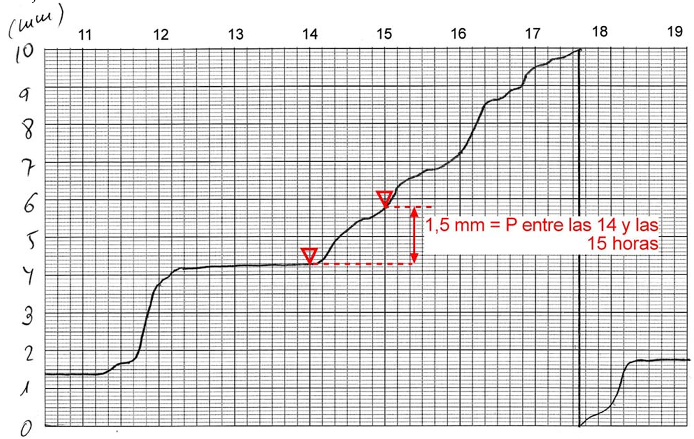
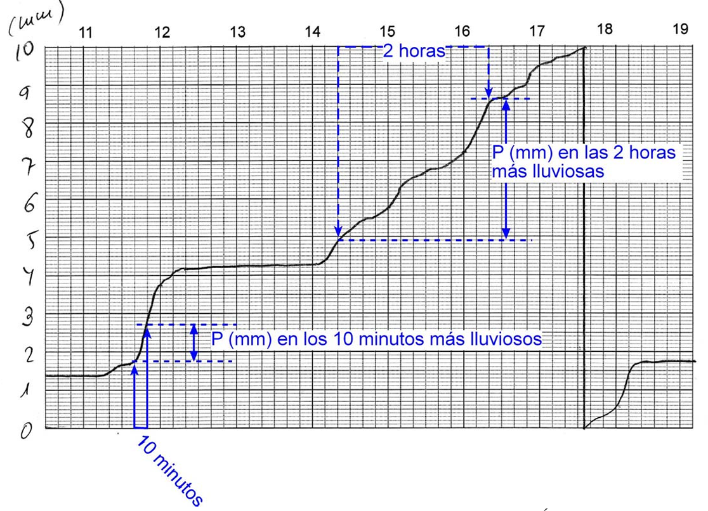
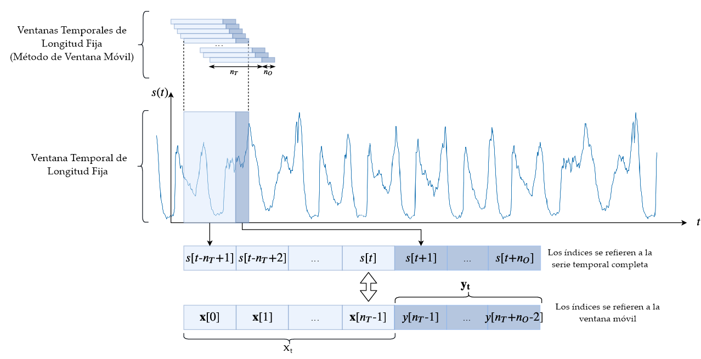
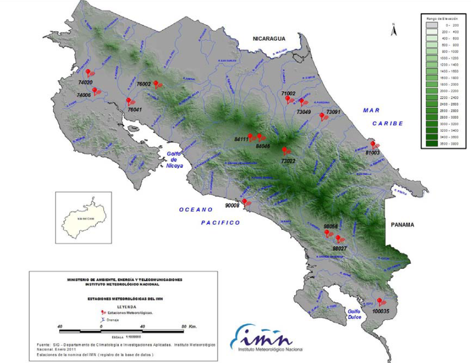
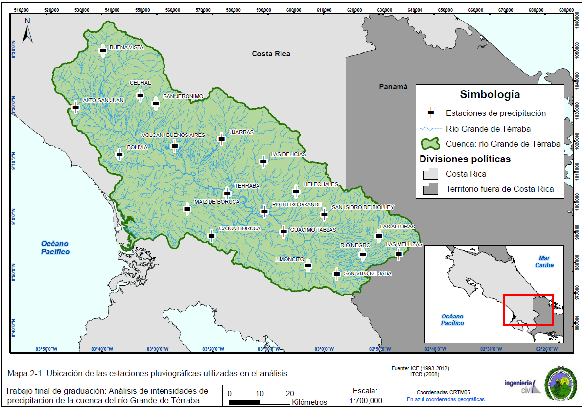

::: {.quote-block}
"Las lloviznas duran mucho, pero las tormentas repentinas son breves."\
— *William Shakespeare, Ricardo II (acto II, escena 1)*
:::

Las alcantarillas, los drenajes urbanos, los vertederos y los canales se diseñan para una lluvia que todavía no ha caído. Para dimensionarlos hace falta saber cuánta lluvia puede caer en un intervalo corto y con qué probabilidad. Esa información la resumen las curvas de intensidad, duración y frecuencia, o **curvas IDF**.

Una curva IDF dice, para un sitio dado, qué intensidad media de lluvia se iguala o se supera en promedio una vez cada $T$ años durante un intervalo de duración $d$. Para llegar a ellas hay que definir las tres variables, procesar los registros de pluviógrafo, analizar la frecuencia de los máximos y ajustar una ecuación. Con la curva lista, el último paso es convertirla en un hietograma de diseño. El capítulo cierra con la información IDF que existe para Costa Rica.

## Variables de la lluvia de diseño {#sec-idf-variables}

### Intensidad

La **intensidad** de la precipitación es la lámina de lluvia que cae por unidad de tiempo:

$$
i = \frac{h}{\Delta t}
$$ {#eq-idf-intensidad}

donde $i$ es la intensidad (mm/h), $h$ es la lámina de precipitación acumulada en el intervalo (mm) y $\Delta t$ es la duración del intervalo (h).

En diseño no interesa la intensidad media de toda la tormenta, sino la máxima que se registra dentro de un intervalo de cierta duración. Esa intensidad máxima es la que controla la escorrentía y la capacidad que necesita un drenaje. Cuanto más corto es el intervalo, mayor es la intensidad máxima, porque los núcleos más intensos de una tormenta convectiva duran pocos minutos.

### Duración

La **duración** $d$ es la longitud del intervalo sobre el que se calcula la lluvia acumulada. En un análisis IDF no es la duración total de la tormenta, sino una ventana fija que se desplaza a lo largo del registro. Se usan duraciones normalizadas para poder comparar estaciones y estudios. Un conjunto típico es

$$
d \in \{5,\ 10,\ 15,\ 30,\ 60,\ 120,\ 360,\ 720,\ 1440\}\ \text{min}.
$$

La duración que importa en un diseño depende del tiempo de respuesta de la cuenca. En cuencas pequeñas y en sistemas urbanos son críticas las duraciones de minutos. En cuencas grandes pesan más las de varias horas.

Una misma tormenta puede tener intensidades muy altas en intervalos de 5 o 10 minutos y una intensidad media mucho menor si se promedia sobre 3 horas. En las duraciones cortas domina el núcleo convectivo. En las largas entran también los periodos de lluvia estratiforme o intermitente, que bajan el promedio.

### Frecuencia y periodo de retorno

La **frecuencia** se expresa con el **periodo de retorno** $T$, que es el tiempo medio, en años, entre dos eventos que igualan o superan una magnitud dada. Se relaciona con la probabilidad anual de excedencia $p$ mediante

$$
p = \frac{1}{T}
$$ {#eq-idf-periodo-retorno}

Una tormenta con $T = 50$ años tiene una probabilidad de $1/50 = 0.02$, es decir de 2 %, de ser igualada o superada en un año cualquiera.

::: {.callout-warning title="Cuidado"}
El periodo de retorno no es un periodo. Un evento de 50 años no ocurre cada 50 años: puede repetirse en años seguidos o no aparecer en un siglo. Lo único que dice $T$ es la probabilidad anual de excedencia.
:::

### Relación entre las tres variables

Las curvas IDF juntan las tres variables en una sola relación, $i = f(d, T)$, con dos propiedades que se cumplen en cualquier clima:

- Para un mismo periodo de retorno, la intensidad disminuye al aumentar la duración.
- Para una misma duración, la intensidad aumenta con el periodo de retorno.

La relación no es lineal. En escala logarítmica, sin embargo, las curvas de distintos periodos de retorno quedan casi rectas y paralelas, lo que facilita interpolar entre ellas. La @fig-idf_ggplot_turbo muestra una familia de curvas IDF con parámetros ilustrativos.

```{r}
#| label: fig-idf_ggplot_turbo
#| fig-cap: "Familia de curvas IDF con parámetros ilustrativos ($k = 1800$, $m = 0.18$, $c = 10$ min, $n = 0.72$)."
#| fig-alt: "Siete curvas decrecientes de intensidad contra duración, una por periodo de retorno entre 2 y 200 años"

library(tidyverse)

# Parámetros ilustrativos de la ecuación i = k T^m / (d + c)^n
k <- 1800
m <- 0.18
c_idf <- 10   # se llama c_idf para no tapar la función c() de R
n <- 0.72

idf <- expand_grid(
  d_min = seq(5, 120, by = 5),
  t_ret = c(2, 5, 10, 25, 50, 100, 200)
) %>%
  mutate(i_mmh = k * t_ret^m / (d_min + c_idf)^n)

ggplot(idf, aes(d_min, i_mmh, color = factor(t_ret))) +
  geom_line(linewidth = 1.1) +
  scale_color_viridis_d(option = "turbo", end = 0.98) +
  scale_x_continuous(breaks = seq(0, 120, by = 15), limits = c(0, 120), expand = c(0, 0)) +
  scale_y_continuous(breaks = seq(0, 700, by = 50), limits = c(0, 700), expand = c(0, 0)) +
  labs(x = "Duración (min)", y = "Intensidad (mm/h)", color = "T (años)") +
  theme(panel.grid.minor = element_blank())
```

## Procesamiento de registros pluviográficos {#sec-idf-pluviograficos}

Las curvas IDF se construyen con registros de **pluviógrafo**, que miden la lluvia acumulada en función del tiempo. El registro resultante se llama **pluviograma**. Un pluviómetro convencional solo da el total diario, que no sirve para saber cuánta lluvia cayó en 10 o 30 minutos. Por eso las curvas IDF de una estación dependen de que tenga pluviógrafo y de cuántos años de registro tenga.

Este procesamiento es el paso más delicado del análisis. Un error en la lectura del registro se arrastra a todas las intensidades de diseño que salen de él.

### Lectura de bandas pluviográficas

Los pluviógrafos mecánicos registraban la lluvia acumulada como una curva sobre una banda de papel. Quien analizaba la banda buscaba los tramos de mayor pendiente, que corresponden a las mayores intensidades. Hoy esas bandas suelen estar digitalizadas, y las estaciones automáticas entregan directamente la serie de lluvia cada 1, 5 o 10 minutos. En cualquier caso, el punto de partida es una función de precipitación acumulada $P(t)$ con un paso de tiempo corto.

::: {.callout-note title="Ejemplo: hietograma y curva intensidad-duración a partir de una banda de pluviógrafo"}

**Planteamiento.** El ejemplo está adaptado de una práctica de hidrología superficial de la Universidad de Salamanca [@sanchez_banda_pluviografo]. A partir de la banda de pluviógrafo de la @fig-idf1, estime el hietograma con intervalos de 1 h y la curva intensidad-duración del evento.

**Pseudocódigo**

1. Leer en la banda la lluvia acumulada al final de cada hora.
2. Corregir los vaciados del sifón: después de cada descarga, sumar 10 mm a las lecturas.
3. Restar lecturas consecutivas para obtener la lluvia de cada hora.
4. Para cada duración, buscar en la banda el tramo con mayor lluvia acumulada.
5. Dividir esa lluvia entre la duración en horas para obtener la intensidad.

```{r}
#| label: fig-idf1
#| fig-cap: "Lectura de la lluvia acumulada al final de cada hora en la banda de pluviógrafo. Fuente: adaptado de @sanchez_banda_pluviografo."
#| fig-alt: "Banda de pluviógrafo con la curva de lluvia acumulada entre las 11 y las 19 horas"
#| echo: false


```

La lluvia de cada hora es la diferencia entre dos lecturas. Por ejemplo, entre las 14 h y las 15 h:

$$
P_{14\text{–}15} = 5.8\ \text{mm} - 4.3\ \text{mm} = 1.5\ \text{mm}
$$

Entre las 17 h y las 18 h el sifón vació el depósito al llegar a 10 mm. La lectura de las 18 h (0.6 mm) se corrige sumando esos 10 mm:

$$
P_{17\text{–}18} = (10 + 0.6)\ \text{mm} - 9.5\ \text{mm} = 1.1\ \text{mm}
$$

```{r}
#| label: fig-plot_idfbanda
#| fig-cap: "Hietograma horario de la tormenta registrada en la banda."
#| fig-alt: "Gráfico de barras con la lluvia de cada hora entre las 11 y las 19 horas"
#| code-fold: false

library(tidyverse)

# 1) Lecturas de lluvia acumulada en la banda (mm), al final de cada hora
lecturas <- tibble(
  hora    = 11:19,
  lectura = c(1.4, 3.8, 4.2, 4.3, 5.8, 7.2, 9.5, 0.6, 1.8)
)

# 2) Corrección por vaciado del sifón (capacidad de 10 mm) a partir de las 18 h
lecturas <- lecturas %>%
  mutate(acumulada = if_else(hora >= 18, lectura + 10, lectura))

# 3) Lluvia de cada hora (diferencia entre lecturas consecutivas)
hietograma <- lecturas %>%
  mutate(
    intervalo = paste0(lag(hora), "–", hora),
    p_mm = acumulada - lag(acumulada)
  ) %>%
  filter(!is.na(p_mm))

hietograma

ggplot(hietograma, aes(factor(intervalo, levels = intervalo), p_mm)) +
  geom_col(fill = "#1C6BA0", width = 0.75) +
  scale_y_continuous(breaks = seq(0, 2.5, by = 0.5), expand = c(0, 0.1)) +
  labs(x = "Intervalo horario (h)", y = "Precipitación (mm)") +
  theme(panel.grid.minor.x = element_blank())
```

Para la curva intensidad-duración se divide la banda en ventanas de 10, 20, 30, 60, 120 y 180 min. En cada caso se busca el tramo de mayor pendiente, que es el de mayor lluvia en esa duración (@fig-idf2).

```{r}
#| label: fig-idf2
#| fig-cap: "Lectura de la lluvia máxima en la banda para cada duración. Fuente: adaptado de @sanchez_banda_pluviografo."
#| fig-alt: "Banda de pluviógrafo con los tramos de mayor pendiente marcados para cada duración"
#| echo: false


```

La intensidad sale de la @eq-idf-intensidad con la duración en horas. Para 10 min:

$$
i = \frac{1.2\ \text{mm}}{(10/60)\ \text{h}} = 7.2\ \text{mm/h}
$$

y para 120 min:

$$
i = \frac{3.6\ \text{mm}}{2\ \text{h}} = 1.8\ \text{mm/h}
$$

```{r}
#| label: fig-plot_idfbanda2
#| fig-cap: "Curva intensidad-duración de la tormenta registrada en la banda."
#| fig-alt: "Curva decreciente de intensidad contra duración, de 7.2 mm/h a 10 min hasta 1.7 mm/h a 180 min"
#| code-fold: false

# 4) Lluvia máxima leída en la banda para cada duración (mm)
id_evento <- tibble(
  d_min = c(10, 20, 30, 60, 120, 180),
  p_max = c(1.2, 1.9, 2.2, 2.8, 3.6, 5.2)
) %>%
  # 5) Intensidad con la duración en horas
  mutate(i_mmh = p_max / (d_min / 60))

id_evento

ggplot(id_evento, aes(d_min, i_mmh)) +
  geom_line(linewidth = 1.1, color = "#1C6BA0") +
  geom_point(size = 3, shape = 18, color = "#0B2C8A") +
  scale_x_continuous(breaks = id_evento$d_min, limits = c(0, 180), expand = c(0, 2)) +
  scale_y_continuous(breaks = 0:8, limits = c(0, 8), expand = c(0, 0)) +
  labs(x = "Duración (min)", y = "Intensidad (mm/h)") +
  theme(panel.grid.minor = element_blank())
```

```{r}
#| label: tbl-valores_intensidad2
#| tbl-cap: "Lluvia máxima e intensidad máxima de la tormenta para cada duración."
#| echo: false

library(kableExtra)

id_evento %>%
  mutate(d_h = d_min / 60) %>%
  select(d_min, d_h, p_max, i_mmh) %>%
  kbl(
    format = "html",
    digits = c(0, 3, 1, 1),
    align = "c",
    col.names = c("Duración (min)", "Duración (h)", "P (mm)", "i (mm/h)")
  ) %>%
  kable_styling(full_width = FALSE, bootstrap_options = c("hover", "condensed", "striped")) %>%
  row_spec(0, bold = TRUE)
```

**Interpretación.** La intensidad cae de 7.2 mm/h en 10 min a 1.7 mm/h en 3 h. Esta tormenta fue larga y poco intensa: en tres horas acumuló 5.2 mm. La curva describe un solo evento. Una curva IDF se obtiene con los máximos de muchos años, como se explica en la siguiente sección.

:::

### Extracción de máximos con ventanas móviles

El paso central del procesamiento es extraer, para cada duración, la lluvia máxima de cada tormenta. Para eso se usa una **ventana móvil**: un intervalo de longitud $d$ que se desplaza a lo largo del registro y en cada posición acumula la lluvia que cae dentro de él (@fig-rollingwindow).

```{r}
#| label: fig-rollingwindow
#| fig-cap: "Planteamiento algebraico de la ventana móvil."
#| fig-alt: "Curva de lluvia acumulada con una ventana de duración d que se desplaza sobre el eje del tiempo"
#| echo: false


```

Si $P(t)$ es la precipitación acumulada, la lámina dentro de la ventana que empieza en $t$ es

$$
h_d(t) = P(t+d) - P(t)
$$ {#eq-idf-ventana}

El máximo de $h_d(t)$ en toda la tormenta es la lámina máxima para la duración $d$. El cálculo se repite para cada duración estándar, por lo común

$$
d \in \{5,\ 10,\ 15,\ 30,\ 45,\ 60,\ 90,\ 120,\ 180,\ 360,\ 720,\ 1440\}\ \text{min}.
$$

De cada año se toma el máximo de $h_d(t)$ para cada duración. Así se arma una **serie de máximos anuales** (AMS, por sus siglas en inglés) por duración, que es la base del análisis IDF clásico. La @fig-plot_idfbanda3 muestra la ventana de máxima lluvia para 10 y 45 min en una tormenta sintética registrada cada 5 min.

```{r}
#| label: fig-plot_idfbanda3
#| fig-cap: "Posición de la ventana de máxima lluvia para duraciones de 10 y 45 min en una tormenta sintética."
#| fig-alt: "Dos paneles con la curva de lluvia acumulada y una franja sombreada donde la ventana acumula más lluvia"

library(tidyverse)

# Tormenta sintética registrada cada 5 min (lluvia de cada intervalo, mm)
pluvio <- tibble(
  t = seq(0, 180, by = 5),
  p_inc = c(0, 0, 0.2, 0.4, 0.8, 1.5, 1.2, 0.6, 0.3,
            0.1, 0, 0, 0.4, 0.9, 1.3, 0.8, 0.4,
            0.2, 0, 0, 0.1, 0.2, 0, 0, 0, 0,
            0, 0, 0, 0, 0, 0, 0, 0, 0, 0, 0)
) %>%
  mutate(p_acum = cumsum(p_inc))

# Ventana móvil: h_d(t) = P(t + d) - P(t)
ventana_maxima <- function(d) {
  pasos <- d / 5
  pluvio %>%
    mutate(h_d = lead(p_acum, pasos) - p_acum) %>%
    slice_max(h_d, n = 1, with_ties = FALSE) %>%
    transmute(duracion = paste0("d = ", d, " min"), t_ini = t, t_fin = t + d, h_d)
}

ventanas <- map_dfr(c(10, 45), ventana_maxima)

pluvio_panel <- expand_grid(duracion = ventanas$duracion, pluvio)

ggplot(pluvio_panel, aes(t, p_acum)) +
  geom_rect(data = ventanas,
            aes(xmin = t_ini, xmax = t_fin, ymin = -Inf, ymax = Inf, fill = duracion),
            alpha = 0.2, inherit.aes = FALSE) +
  geom_line(linewidth = 1.1, color = "#1C6BA0") +
  facet_wrap(~ duracion, ncol = 1) +
  scale_fill_manual(values = c("#33a02c", "#6a3d9a"), guide = "none") +
  scale_x_continuous(breaks = seq(0, 180, by = 30), expand = c(0, 0)) +
  labs(x = "Tiempo (min)", y = "Precipitación acumulada (mm)") +
  theme(panel.grid.minor = element_blank(), strip.text = element_text(face = "bold"))
```

En esta tormenta, la ventana de 10 min con más lluvia va del minuto 20 al 30 y acumula 2.7 mm. La de 45 min va del minuto 0 al 45 y acumula 5.1 mm.

### Control de calidad

Antes del análisis estadístico se revisan las series extraídas: valores atípicos, saltos en el registro, errores del instrumento y coherencia entre duraciones. La lámina máxima de 60 min de un año no puede ser menor que la de 30 min del mismo año. Si lo es, hay un error de lectura o de procesamiento.

### Análisis de frecuencia por duración

Con las series de máximos listas, se relaciona cada intensidad con su periodo de retorno. Hay dos formas de seleccionar los extremos:

- **Serie de máximos anuales (AMS):** un valor por año. Es la más usada y funciona bien para periodos de retorno medios y altos.
- **Serie de duración parcial (PDS o POT):** todos los eventos que superan un umbral. Aprovecha mejor registros cortos, porque puede tomar varias tormentas de un mismo año.

Para asignar probabilidades empíricas, los datos se ordenan de mayor a menor y se usa una fórmula de posición de graficación. La de Weibull es la más común:

$$
P = \frac{m}{n+1}, \qquad T = \frac{n+1}{m}
$$ {#eq-idf-weibull}

donde $P$ es la probabilidad de excedencia, $m$ es el número de orden del dato (1 para el mayor) y $n$ es el número de datos.

Después se ajusta una distribución teórica a cada serie para estimar intensidades de periodos de retorno mayores que el registro. Las más usadas son Gumbel, log-Pearson tipo III y la distribución generalizada de valores extremos (GEV). La elección depende de la asimetría de los datos, de la longitud del registro y de lo que pida la norma aplicable. El ajuste se explica en el capítulo de distribuciones paramétricas.

Una forma práctica de estimar los cuantiles es el método de los factores de frecuencia de Chow [@chow1988appliedhydrology]:

$$
X_T = \bar{X} + K_T\,S
$$ {#eq-idf-factor-frecuencia}

donde $X_T$ es el valor de periodo de retorno $T$, $\bar{X}$ y $S$ son la media y la desviación estándar de la serie y $K_T$ es el factor de frecuencia, que depende de la distribución elegida y de $T$.

Al repetir el ajuste para cada duración se obtiene una malla de intensidades de diseño $i(d,T)$. Con ella se dibujan las curvas IDF o se ajusta una ecuación, como se explica a continuación.

## Ecuaciones de las curvas IDF {#sec-idf-ecuaciones}

Las curvas IDF son cuantiles de la lluvia máxima en ventanas de distinta duración. Cada punto de una curva corresponde a una probabilidad de excedencia $p = 1/T$. No son leyes físicas: son modelos empíricos que dependen de la longitud y la calidad del registro, de la resolución temporal del instrumento, del régimen de tormentas de la zona y del método estadístico usado. Quien las aplica debe conocer esas condiciones para saber cuándo una curva sirve y cuándo no.

### Ecuación general

La forma más usada en la práctica para representar a la vez el efecto de la duración y del periodo de retorno es

$$
i(d,T) = \frac{k\,T^{m}}{(d+c)^{n}}
$$ {#eq-idf-general}

donde $i$ es la intensidad media máxima (mm/h), $T$ es el periodo de retorno (años), $d$ es la duración (min) y $k$, $m$, $c$ y $n$ son parámetros de ajuste propios de cada estación.

Cada parámetro tiene una lectura física:

- $m > 0$ controla cuánto crece la intensidad con el periodo de retorno.
- $n > 0$ controla qué tan rápido cae la intensidad con la duración.
- $c \ge 0$ (min) desplaza la duración. Evita que la intensidad tienda a infinito cuando $d \to 0$ y absorbe efectos de la resolución del registro.
- $k$ fija la escala de intensidades del sitio.

La ecuación describe intensidades de diseño, es decir cuantiles extremos para cada par $(d, T)$. Por eso se calibra con los cuantiles obtenidos del análisis de frecuencia de cada duración, no con las intensidades observadas directamente.

::: {.callout-warning title="Cuidado"}
Los parámetros solo valen en las unidades en que se ajustaron. Si $d$ está en minutos, $c$ también. Una ecuación ajustada con $d$ en horas da resultados absurdos si se usa con $d$ en minutos.
:::

### Formas particulares

Hay varias ecuaciones históricas que son casos particulares de la @eq-idf-general. Todas se ajustan para un periodo de retorno fijo.

@koutsoyiannis1998idf muestran que todas estas formas son casos particulares de una estructura general con una función de $T$ en el numerador y una función de $d$ en el denominador.

1. **Talbot** (hiperbólica):
   $$
   i(d) = \frac{a}{d+b}
   $$
   con $a > 0$ y $b > 0$. Suele funcionar en duraciones cortas y medias.

2. **Potencial** (llamada a veces de Montana):
   $$
   i(d) = a\,d^{-b}
   $$
   con $a > 0$ y $b > 0$. En escala log-log es una recta, por lo que se ajusta bien en los rangos de duración donde la curva observada también lo es, por lo general duraciones medias y largas.

3. **Sherman** [@sherman1931frequency] (potencial con desplazamiento):
   $$
   i(d) = \frac{a}{(d+b)^{e}}
   $$
   que agrega un desplazamiento en la duración y amplía el rango en que el ajuste es bueno.

Estas formas se ajustan curva por curva, una para cada $T$. La @eq-idf-general incorpora $T$ explícitamente y reemplaza a toda la familia con una sola ecuación.

## Determinación de los parámetros {#sec-idf-parametros}

Los parámetros $k$, $m$, $n$ y $c$ se pueden estimar de dos maneras: en dos etapas o directamente.

### Ajuste en dos etapas

Es el método recomendado cuando interesa controlar e interpretar cada paso.

**Etapa 1. Intensidades de diseño por duración.** Para cada duración $d_j$ se arma la serie de máximos anuales de lámina en ventana móvil, se convierte a intensidad,

$$
i_{j,t} = \frac{h_{j,t}}{d_j},
$$

donde $h_{j,t}$ es la lámina máxima de duración $d_j$ en el año $t$, y se ajusta una distribución de extremos (GEV para AMS o Pareto generalizada para POT). De ese ajuste salen los cuantiles $i(d_j, T_\ell)$ para varios periodos de retorno.

**Etapa 2. Ajuste de la ecuación general.** Con la malla de cuantiles $i_{j\ell} \approx i(d_j, T_\ell)$ se ajusta la @eq-idf-general. Al tomar logaritmos queda

$$
\log i_{j\ell} = \log k + m\log T_\ell - n\log(d_j+c) + \eta_{j\ell}
$$ {#eq-idf-log}

donde $\eta_{j\ell}$ es el residuo. Para un valor fijo de $c$, la @eq-idf-log es una regresión lineal múltiple con $\beta_0 = \log k$, $\beta_1 = m$ y $\beta_2 = -n$. El problema es que $c$ está dentro del logaritmo. La salida práctica es probar una serie de valores de $c$, hacer la regresión para cada uno y quedarse con el que da el menor error. Así se ve cómo cambia el ajuste con $c$ y no se deja a un optimizador decidir sin mostrar si el parámetro está bien definido.

**Verificación.** Un $R^2$ alto en escala logarítmica no basta. Además hay que revisar:

- que $\hat m > 0$, $\hat n > 0$ y $\hat c \ge 0$;
- que, para cada $T$, la intensidad baje con $d$ y, para cada $d$, suba con $T$;
- que los residuos $\eta_{j\ell}$ no muestren tendencia con $d$ ni con $T$;
- el error relativo en cada punto de la malla,
  $$
  \text{ER}_{j\ell} = \frac{i_{j\ell} - \hat{i}(d_j, T_\ell)}{i_{j\ell}},
  $$
  resumido con su media absoluta y sus percentiles.

::: {.callout-note title="Ejemplo: ajuste de la ecuación IDF a una malla de intensidades"}

**Planteamiento.** Suponga que la etapa 1 dio la siguiente malla de intensidades de diseño (mm/h) para una estación. Los valores son sintéticos y se eligieron para cumplir las restricciones físicas: la intensidad baja con $d$ y sube con $T$.

| $d$ (min) | $T = 2$ | $T = 10$ | $T = 50$ | $T = 100$ |
|:---:|:---:|:---:|:---:|:---:|
| 10 | 140 | 185 | 245 | 275 |
| 30 | 85 | 112 | 150 | 170 |
| 60 | 60 | 80 | 110 | 125 |
| 120 | 42 | 56 | 78 | 90 |

: Malla de intensidades de diseño (mm/h) del ejemplo. {#tbl-idf-malla}

Estime $k$, $m$, $n$ y $c$ de la @eq-idf-general.

**Pseudocódigo**

1. Estimar $m$ con cocientes de intensidad a duración fija.
2. Suponer un valor de $c$ y estimar $n$ con cocientes de intensidad a periodo de retorno fijo.
3. Despejar $k$ de un punto de la malla y comprobarlo con otro.
4. Verificar con una regresión sobre toda la malla, probando varios valores de $c$.

**Paso 1. Estimación de $m$.** Con $d$ fijo, el denominador se cancela al dividir dos intensidades:

$$
\frac{i(d,T_2)}{i(d,T_1)} = \left(\frac{T_2}{T_1}\right)^m
\quad\Rightarrow\quad
m = \frac{\log\left[i(d,T_2)/i(d,T_1)\right]}{\log(T_2/T_1)}
$$

Con $d = 60$ min, $T_1 = 10$ y $T_2 = 100$:

$$
m = \frac{\log(125/80)}{\log(100/10)} = \frac{0.4463}{2.3026} \approx 0.194
$$

Con $d = 30$ min, $T_1 = 2$ y $T_2 = 50$:

$$
m = \frac{\log(150/85)}{\log(50/2)} = \frac{0.5686}{3.2189} \approx 0.177
$$

Se adopta el promedio, $\hat m \approx 0.186$.

**Paso 2. Estimación de $n$.** Con $T$ fijo se cancela $T^m$:

$$
n = \frac{\log\left[i(d_1,T)/i(d_2,T)\right]}{\log\left[(d_2+c)/(d_1+c)\right]}
$$

Aquí hace falta suponer $c$. Se prueba $c = 5$ min. Con $T = 10$, $d_1 = 30$ y $d_2 = 120$:

$$
n = \frac{\log(112/56)}{\log(125/35)} = \frac{0.6931}{1.2730} \approx 0.545
$$

Con $T = 50$, $d_1 = 10$ y $d_2 = 60$:

$$
n = \frac{\log(245/110)}{\log(65/15)} = \frac{0.8007}{1.4663} \approx 0.546
$$

Los dos valores coinciden. Se adoptan $\hat n \approx 0.546$ y $\hat c = 5$ min.

**Paso 3. Estimación de $k$.** Despejando de la @eq-idf-general:

$$
k = i(d,T)\,(d+c)^n\,T^{-m}
$$

Con $d = 60$ min, $T = 10$ años e $i = 80$ mm/h:

$$
\hat k = 80 \times 65^{0.546} \times 10^{-0.186} \approx 80 \times 9.76 \times 0.652 \approx 509
$$

Como control, con $d = 30$ min, $T = 50$ años e $i = 150$ mm/h:

$$
\hat k = 150 \times 35^{0.546} \times 50^{-0.186} \approx 150 \times 6.97 \times 0.483 \approx 505
$$

Los dos valores son parecidos y se adopta el promedio, $\hat k \approx 507$. La ecuación queda

$$
\hat{i}(d,T) = \frac{507\,T^{0.186}}{(d+5)^{0.546}}, \qquad d \text{ en min},\ i \text{ en mm/h}.
$$

```{r}
#| label: fig-idf_ggplot_mako
#| fig-cap: "Curvas IDF obtenidas con los parámetros estimados a mano ($k = 507$, $m = 0.186$, $n = 0.546$, $c = 5$ min)."
#| fig-alt: "Seis curvas decrecientes de intensidad contra duración para periodos de retorno de 2 a 100 años"
#| code-fold: false

library(tidyverse)

# Parámetros estimados en los pasos 1 a 3
k <- 507
m <- 0.186
n <- 0.546
c_idf <- 5

idf <- expand_grid(
  d_min = seq(5, 120, by = 5),
  t_ret = c(2, 5, 10, 25, 50, 100)
) %>%
  mutate(i_mmh = k * t_ret^m / (d_min + c_idf)^n)

ggplot(idf, aes(d_min, i_mmh, color = factor(t_ret))) +
  geom_line(linewidth = 1.2) +
  scale_color_viridis_d(option = "C", end = 0.95) +
  scale_x_continuous(breaks = seq(0, 120, by = 15), limits = c(0, 120), expand = c(0, 0)) +
  scale_y_continuous(breaks = seq(0, 350, by = 25), limits = c(0, 350), expand = c(0, 0)) +
  labs(x = "Duración (min)", y = "Intensidad (mm/h)", color = "T (años)") +
  theme(panel.grid.minor = element_blank())
```

**Paso 4. Verificación con regresión.** El cálculo a mano usa solo cuatro puntos de la malla. Con R se puede usar la malla completa: para cada valor de $c$ entre 0 y 30 min se ajusta la @eq-idf-log por mínimos cuadrados y se elige el $c$ con menor suma de cuadrados de los residuos.

```{r}
#| label: idf-ajuste-regresion
#| code-fold: false

library(tidyverse)

# Malla del Cuadro (mm/h)
malla <- expand_grid(d_min = c(10, 30, 60, 120), t_ret = c(2, 10, 50, 100)) %>%
  mutate(i_mmh = c(140, 185, 245, 275,
                   85, 112, 150, 170,
                   60,  80, 110, 125,
                   42,  56,  78,  90))

# Regresión lineal en logaritmos para un c fijo
ajuste_c <- function(c_idf) {
  lm(log(i_mmh) ~ log(t_ret) + log(d_min + c_idf), data = malla)
}

# Búsqueda de c: suma de cuadrados de los residuos para cada candidato
candidatos <- tibble(c_idf = seq(0, 30, by = 0.5)) %>%
  mutate(sse = map_dbl(c_idf, ~ sum(residuals(ajuste_c(.x))^2)))

c_opt <- candidatos$c_idf[which.min(candidatos$sse)]
coefs <- coef(ajuste_c(c_opt))

tibble(
  k = exp(coefs[1]),
  m = coefs[2],
  n = -coefs[3],
  c = c_opt
)
```

**Interpretación.**

- $\hat n \approx 0.55$ indica que la intensidad cae moderadamente con la duración.
- $\hat m \approx 0.19$ indica que, a duración fija, multiplicar $T$ por 10 multiplica la intensidad por $10^{0.19} \approx 1.55$.
- $\hat c = 5$ min es un ajuste para las duraciones cortas. Su valor debe validarse con el error en todo el rango de duraciones, dando más peso a las que importan en el proyecto.
- La regresión sobre toda la malla da $c = 2$ min, $k \approx 419$, $m \approx 0.184$ y $n \approx 0.501$. Los parámetros cambian bastante porque $c$, $k$ y $n$ se compensan entre sí, pero las intensidades que predicen las dos ecuaciones son parecidas. La regresión ajusta algo mejor: el mayor error relativo baja de 6 % (parámetros a mano, en $d = 10$ min y $T = 2$ años) a menos de 3 %. Por eso conviene comparar las intensidades que predice cada ecuación y no sus parámetros por separado.

:::

### Ajuste directo

En lugar de estimar primero los cuantiles por duración, se puede ajustar un modelo que relacione directamente los extremos con $d$ y $T$. Es más eficiente, pero mezcla en una sola etapa la incertidumbre del ajuste de extremos con la de la ecuación IDF. Si se usa, hay que informar con claridad el método de estimación y cómo se propaga la incertidumbre.

### Aspectos que afectan la calidad del ajuste

1. **Unidades.** Como se dijo, $c$ debe estar en las mismas unidades que $d$. Mezclar minutos y horas es el error más frecuente.
2. **Resolución del registro.** En duraciones cortas, la intensidad depende mucho del paso del registro (1 min frente a 5 min). Eso suele obligar a un $c$ positivo y produce cambios de pendiente en escala log-log.
3. **Dependencia entre duraciones.** Las intensidades de distintas duraciones salen del mismo registro y no son independientes. El ajuste debe verse como un ajuste de curvas de diseño, no como una regresión con errores independientes. En aplicaciones avanzadas se usan ponderaciones o modelos jerárquicos.
4. **Criterio de ajuste.** Si el diseño depende de periodos de retorno altos, conviene dar más peso a esos puntos. Una opción es minimizar
   $$
   \sum_{j,\ell} w_{j\ell}\left[\log i_{j\ell} - \log \hat{i}(d_j,T_\ell)\right]^2,
   \qquad
   w_{j\ell} \propto \frac{1}{\operatorname{Var}\left(\log i_{j\ell}\right)}.
   $$
   Si no se conocen las varianzas, se da más peso a las duraciones y los periodos de retorno que importan en el proyecto.

## Hietograma de diseño por el método del bloque alterno {#sec-idf-bloque-alterno}

Una curva IDF da la intensidad media para cada duración, pero no dice cómo se reparte la lluvia dentro de la tormenta. Los modelos de lluvia-escorrentía necesitan esa distribución en el tiempo, es decir un **hietograma de diseño**: una tormenta sintética cuya lluvia en cualquier subintervalo coincide con la que da la curva IDF para ese periodo de retorno.

El **método del bloque alterno** (MBA) es la forma más difundida de construirlo [@chow1988appliedhydrology]. Coloca el bloque de lluvia más intenso en el centro de la tormenta y los demás alternando a cada lado, de mayor a menor. Así, para cualquier duración $d$, la ventana de máxima lluvia dentro del hietograma contiene exactamente la lámina $P(d)$ de la curva IDF. El resultado es una tormenta con forma de triángulo, parecida a una tormenta convectiva, que hace coincidir la lluvia más intensa con la respuesta de la cuenca y por eso da caudales pico altos. Es un método conservador.

### Parámetros de diseño

- **Periodo de retorno $T$.** Depende de la importancia de la obra, de las consecuencias de una falla y de la norma vigente. Valores comunes son 10, 25, 50 y 100 años.
- **Duración total $T_d$.** Debe ser al menos igual al tiempo de concentración de la cuenca, para que toda el área aporte al caudal pico. Es común tomar una duración algo mayor. El tiempo de concentración se estudia en el capítulo de escorrentía.
- **Intervalo $\Delta t$.** Es el ancho de cada bloque. Debe ser lo bastante corto para describir la variación de la lluvia, sin llegar a valores que solo agreguen ruido. Se usan 5, 10 o 15 min.

### Cálculo

La tormenta se divide en $N = T_d / \Delta t$ bloques. Para cada duración acumulada $d_j = j\,\Delta t$, con $j = 1, \dots, N$, se lee la intensidad $i(d_j, T)$ de la curva IDF y se convierte en lámina acumulada:

$$
P(d_j) = i(d_j, T)\, \frac{d_j}{60}
$$ {#eq-idf-masa}

donde $P$ está en mm, $i$ en mm/h y $d_j$ en min. La serie $P(d_j)$ es la **curva de masa** de la tormenta. La lluvia de cada bloque es la diferencia entre valores sucesivos,

$$
\Delta P_j = P(d_j) - P(d_{j-1}), \qquad P(d_0) = 0.
$$

Como la curva IDF es decreciente, los $\Delta P_j$ salen ya ordenados de mayor a menor: el primero es el más grande.

Después se reordenan los bloques:

1. Se ordenan los $\Delta P_j$ de mayor a menor.
2. El mayor se coloca en el bloque central, el que contiene $T_d/2$.
3. El segundo se coloca inmediatamente a la derecha del central.
4. El tercero, inmediatamente a la izquierda.
5. Se sigue alternando derecha e izquierda hasta ubicar todos los bloques.

El resultado tiene la forma

$$
\ldots,\ \Delta P_5,\ \Delta P_3,\ \Delta P_1,\ \Delta P_2,\ \Delta P_4,\ \Delta P_6,\ \ldots
$$

donde $\Delta P_1$ es el bloque más grande, $\Delta P_2$ el segundo, y así sucesivamente.

### Limitaciones

El MBA es adecuado para obras menores de drenaje urbano, como alcantarillas, cunetas y tragantes, donde lo que importa es el caudal pico. Fuera de ese uso tiene limitaciones que conviene conocer:

- **No representa una tormenta real.** El orden de los bloques es artificial: no reproduce cómo se forma, madura y se disipa una tormenta. Su único propósito es maximizar la respuesta de la cuenca.
- **Combina extremos de tormentas distintas.** Cada punto de la curva IDF sale de una serie de máximos anuales propia: el máximo de 10 min de un año y el de 60 min pueden venir de tormentas diferentes. El MBA mete todos esos máximos, cada uno con periodo de retorno $T$, dentro de una sola tormenta. Esa tormenta es más rara que $T$ y su lámina total tiende a ser mayor que la de las tormentas observadas. Una alternativa son las distribuciones temporales de tormenta del NRCS (tipos I, IA, II y III), obtenidas de registros de Estados Unidos [@nrcs2019neh630cap4]. También tienen limitaciones y hay que revisar si representan las tormentas de la región antes de usarlas.
- **No sirve para cuencas grandes.** Se pensó para tormentas de menos de 24 h y cuencas pequeñas. En cuencas grandes pesan más el almacenamiento en los cauces, la variación espacial de la lluvia y la duración total del evento que la forma del hietograma en un punto. En esos casos conviene usar tormentas históricas representativas o modelación continua.
- **No tiene calibración regional.** Las curvas IDF son locales, pero la forma simétrica del hietograma es la misma en cualquier clima. En el trópico predominan tormentas convectivas cortas y asimétricas, con el pico al inicio, que el MBA no reproduce. Si hay registros de pluviógrafo, conviene comparar el hietograma con tormentas observadas de la zona.
- **Exagera el pico del hidrograma.** Como concentra toda la lluvia intensa en el centro y su lámina total es mayor que la de una tormenta real del mismo periodo de retorno, da hidrogramas con picos muy marcados y volúmenes altos, sobre todo en cuencas urbanas muy impermeables. Eso es aceptable en obras menores de drenaje, pero no en el diseño de estanques de retención o de obras de control de inundaciones, donde importan el volumen y la forma completa del hidrograma.

En resumen, el MBA sirve para prediseño y para obras menores en las que lo que interesa es el caudal pico. Quien lo usa debe tener presente que es una construcción matemática para maximizar la respuesta de la cuenca, no una tormenta real. En proyectos mayores, o cuando importan el volumen y la forma del hidrograma, se recomienda usar distribuciones temporales basadas en registros de la región.

::: {.callout-note title="Ejemplo: hietograma de diseño de 10 años para la estación IMN-Aranjuez"}

**Planteamiento.** El IMN publicó las curvas IDF de la estación automática 84-141 IMN-Aranjuez, en San José, con 16 años de registro y ajuste de Gumbel [@Rojas2011automaticas]. El @tbl-MBA1 reproduce sus intensidades. El boletín también da la ecuación ajustada

$$
i = \frac{174.33\, T^{0.104}}{d^{0.285}}
$$ {#eq-idf-aranjuez}

con $i$ en mm/h, $T$ en años y $d$ en min ($R^2 = 0.97$). Construya el hietograma de diseño para $T = 10$ años, con $\Delta t = 5$ min y una duración total $T_d = 30$ min, que es la mayor duración del boletín.

| Duración (min) | $T = 5$ | $T = 10$ | $T = 25$ | $T = 50$ | $T = 100$ | $T = 250$ | $T = 500$ |
|:---:|:---:|:---:|:---:|:---:|:---:|:---:|:---:|
| 5 | 124.05 | 135.60 | 150.20 | 161.02 | 171.77 | 185.92 | 196.60 |
| 10 | 110.13 | 121.47 | 135.81 | 146.44 | 156.99 | 170.89 | 181.38 |
| 15 | 95.45 | 104.21 | 115.28 | 123.49 | 131.64 | 142.37 | 150.48 |
| 30 | 73.14 | 80.93 | 90.78 | 98.08 | 105.32 | 114.87 | 122.07 |

: Intensidades máximas de precipitación (mm/h) de la estación 84-141 IMN-Aranjuez, por duración y periodo de retorno (años). Fuente: @Rojas2011automaticas. {#tbl-MBA1}

El boletín solo tiene duraciones de 5, 10, 15 y 30 min. Para los bloques de 20 y 25 min se usa la @eq-idf-aranjuez. No conviene usarla para duraciones mayores de 30 min, porque sería extrapolar fuera de los datos con que se ajustó.

**Pseudocódigo**

1. Calcular con la @eq-idf-aranjuez la intensidad de $T = 10$ años para duraciones de 5 a 30 min.
2. Calcular la lámina acumulada (curva de masa) con la @eq-idf-masa.
3. Calcular la lluvia de cada bloque como diferencia de la curva de masa.
4. Ordenar los bloques de mayor a menor.
5. Colocar el mayor en el bloque central y los siguientes alternando a la derecha y a la izquierda.
6. Graficar el hietograma.

**Pasos 1 a 3. Curva de masa y bloques.** Para $d = 5$ min:

$$
i = \frac{174.33 \times 10^{0.104}}{5^{0.285}} = 140.0\ \text{mm/h}, \qquad
P(5) = 140.0 \times \frac{5}{60} = 11.7\ \text{mm}
$$

Para $d = 10$ min, $i = 114.9$ mm/h y $P(10) = 19.2$ mm, de modo que el segundo bloque es $\Delta P_2 = 19.2 - 11.7 = 7.5$ mm. Se sigue igual hasta $d = 30$ min.

La ecuación da valores cercanos a los del cuadro: 140.0 contra 135.6 mm/h en 5 min y 84.0 contra 80.9 mm/h en 30 min. La diferencia, de 3 % a 5 %, es el error del ajuste.

**Pasos 4 y 5. Reordenamiento.** Hay $N = 30/5 = 6$ bloques. Como $N$ es par, el centro de la tormenta (minuto 15) queda entre los bloques 3 y 4. Aquí se usa la convención de poner el bloque mayor en el bloque 3, el que termina en el minuto 15. Las posiciones se llenan en el orden 3, 4, 2, 5, 1, 6.

```{r}
#| label: fig-hietograma_bloque_alterno
#| fig-cap: "Hietograma de diseño de 10 años para la estación IMN-Aranjuez, obtenido por el método del bloque alterno."
#| fig-alt: "Gráfico de barras con seis bloques de 5 minutos; el bloque mayor, de 11.7 mm, está entre los minutos 10 y 15"
#| code-fold: false

library(tidyverse)

t_ret <- 10   # años
dt <- 5       # min
td <- 30      # min

# 1) Intensidad con la ecuación IDF de la estación 84-141 (i en mm/h, d en min)
bloques <- tibble(d_min = seq(dt, td, by = dt)) %>%
  mutate(i_mmh = 174.33 * t_ret^0.104 / d_min^0.285,
  # 2) Curva de masa (mm)
         masa = i_mmh * d_min / 60,
  # 3) Lluvia de cada bloque (mm)
         dp = masa - lag(masa, default = 0))

# 4) y 5) Reordenamiento alterno alrededor del bloque central
n_bloques <- nrow(bloques)
j_central <- n_bloques / 2
desplazamientos <- c(0, rep(1:n_bloques, each = 2) * c(1, -1))[1:n_bloques]
posicion <- j_central + desplazamientos   # 3, 4, 2, 5, 1, 6

hietograma <- tibble(
  bloque = posicion,
  dp_alterno = sort(bloques$dp, decreasing = TRUE)
) %>%
  arrange(bloque) %>%
  mutate(t_fin = bloque * dt)

# Comprobación: el reordenamiento no cambia la lluvia total
sum(hietograma$dp_alterno)

# 6) Gráfico
ggplot(hietograma, aes(factor(t_fin), dp_alterno)) +
  geom_col(fill = "#1C6BA0", color = "#08306b", width = 0.85) +
  scale_y_continuous(breaks = seq(0, 12, by = 2), limits = c(0, 12), expand = c(0, 0)) +
  labs(x = "Tiempo (min)", y = "Precipitación (mm)") +
  theme(panel.grid.minor = element_blank())
```

```{r}
#| label: tbl-hietograma_MBA
#| tbl-cap: "Curva de masa, lluvia por bloque y lluvia reordenada por el método del bloque alterno para la estación IMN-Aranjuez ($T = 10$ años)."
#| echo: false

library(kableExtra)

bloques %>%
  mutate(dp_alterno = hietograma$dp_alterno) %>%
  kbl(
    format = "html",
    digits = c(0, 1, 1, 1, 1),
    align = "c",
    col.names = c("Tiempo (min)", "Intensidad (mm/h)", "Masa (mm)",
                  "Precipitación (mm)", "P<sub>alterna</sub> (mm)"),
    escape = FALSE
  ) %>%
  kable_styling(full_width = FALSE, bootstrap_options = c("hover", "condensed", "striped")) %>%
  row_spec(0, bold = TRUE)
```

**Interpretación.** La tormenta de diseño acumula 42 mm en 30 min, y 11.7 mm caen en los 5 min centrales. Cualquier ventana centrada en el pico contiene la lámina de la curva IDF para su duración: los 15 min centrales suman $11.7 + 7.5 + 6.4 = 25.6$ mm, igual a $P(15)$. Con una duración total de 30 min, este hietograma sirve para una cuenca urbana pequeña con un tiempo de concentración menor de media hora. Para cuencas más lentas haría falta una curva IDF con duraciones mayores.

:::

## Información IDF disponible en Costa Rica {#sec-idf-costa-rica}

En Costa Rica no hay un repositorio único con curvas IDF actualizadas para todas las estaciones. La información está repartida entre publicaciones del Instituto Meteorológico Nacional (IMN), trabajos académicos y proyectos de investigación.

### Publicaciones del IMN

- El **Atlas climatológico de Costa Rica** tiene mapas y estadísticas que sirven de complemento a los estudios de frecuencia de lluvia [@IMN_AtlasClimatologico_CostaRica].
- El boletín de **curvas IDF de estaciones meteorológicas mecánicas** [@Rojas2011mecanicas] presenta curvas de 15 estaciones en distintas zonas del país (@fig-IMN_mecanicas y @tbl-estaciones_mecanicas_imn).

```{r}
#| label: fig-IMN_mecanicas
#| fig-cap: "Ubicación de las estaciones mecánicas del boletín de curvas IDF del IMN. Fuente: @Rojas2011mecanicas."
#| fig-alt: "Mapa de Costa Rica con la ubicación de 15 estaciones meteorológicas mecánicas"
#| echo: false


```

| Número | Nombre |
|:---:|:---|
| 71-02 | La Mola |
| 73-22 | Pacayas |
| 73-49 | Mola 2 |
| 73-91 | Hacienda El Carmen |
| 74-06 | La Guinea |
| 74-20 | Llano Grande, Liberia |
| 76-02 | Tilarán |
| 76-41 | Ingenio Taboga |
| 81-03 | Limón |
| 84-46 | San Josecito, Heredia |
| 84-111 | Santa Lucía, Heredia |
| 90-09 | Damas |
| 98-27 | Pindeco |
| 98-56 | Volcán |
| 100-35 | Coto 47 |

: Estaciones mecánicas del boletín de curvas IDF del IMN [@Rojas2011mecanicas]. {#tbl-estaciones_mecanicas_imn}

- El boletín de **curvas IDF de estaciones meteorológicas automáticas** [@Rojas2011automaticas] presenta curvas de 27 estaciones. El boletín no incluye un mapa de ubicación.

| Estación | Nombre |
|:---:|:---|
| 69-633 | Comando Los Chiles |
| 69-661 | Ciudad Quesada |
| 69-679 | Upala |
| 69-681 | La Rebusca |
| 71-15 | Canta Gallo |
| 72-157 | Finca La Ceiba |
| 73-123 | ITCR, Cartago |
| 73-129 | Recope Ochomogo |
| 74-51 | Aeropuerto Liberia |
| 74-53 | Santa Cruz |
| 76-55 | Hacienda Mojica |
| 81-05 | Aeropuerto Limón |
| 84-139 | CIGEFI |
| 84-141 | IMN-Aranjuez |
| 84-145 | Esc. Centroamericana de Ganadería |
| 84-191 | RECOPE La Garita |
| 84-195 | Aeropuerto Pavas (Oeste) |
| 85-21 | Hito Cerere |
| 87-13 | Sixaola |
| 88-35 | Frailes |
| 88-41 | La Lucha |
| 98-75 | Las Brisas, San Vito |
| 98-87 | PINDECO |
| 98-91 | Chirripó |
| 98-95 | Altamira |
| 100-03 | Golfito |
| 100-631 | Coto 47 |

: Estaciones automáticas del boletín de curvas IDF del IMN [@Rojas2011automaticas]. {#tbl-estaciones_auto_imn}

Los análisis de Vahrson para estaciones pluviográficas de Limón, Liberia, Puntarenas, San Carlos y otras localidades [@Vahrson1992a; @Vahrson1992b] ya no se usan como referencia habitual en diseño. Son antiguos, tienen poca cobertura y se extrapolaban a provincias enteras, cuyas condiciones de lluvia no siempre representan.

### Trabajos académicos

- @Murillo1994 presenta curvas IDF de 10 estaciones en la cuenca del río Virilla (@tbl-estaciones_murillo).

| Número | Estación |
|:---:|:---|
| 84001 | San José |
| 84021 | A. J. Santamaría |
| 84034 | Embalse La Garita |
| 84046 | San Josecito |
| 84074 | Aeropuerto Pavas |
| 84075 | Coop. Café, Naranjo |
| 84096 | Sabana Norte |
| 84111 | Santa Lucía |
| 84115 | Sabanilla |
| 69505 | Vara Blanca |

: Estaciones con curvas IDF en la cuenca del río Virilla [@Murillo1994]. {#tbl-estaciones_murillo}

- @Garcia2015Terraba presenta curvas IDF de 20 estaciones pluviográficas del ICE en la cuenca del río Grande de Térraba (@fig-estaciones_efra y @tbl-estaciones_efra).

```{r}
#| label: fig-estaciones_efra
#| fig-cap: "Estaciones pluviográficas con curvas IDF en la cuenca del río Grande de Térraba. Fuente: @Garcia2015Terraba."
#| fig-alt: "Mapa de la cuenca del río Grande de Térraba con la ubicación de 20 estaciones pluviográficas"
#| echo: false


```

| Código | Nombre |
|:---:|:---|
| 98006 | Volcán Buenos Aires |
| 98007 | San Vito de Jaba |
| 98010 | Cedral |
| 98011 | Bolivia |
| 98012 | Potrero Grande |
| 98013 | Río Negro |
| 98018 | Ujarrás |
| 98031 | Buena Vista |
| 98032 | Alto San Juan |
| 98033 | San Jerónimo |
| 98034 | Guácimo Tablas |
| 98035 | Limoncito |
| 98036 | Maíz de Boruca |
| 98037 | Cajón Boruca |
| 98043 | Las Mellizas |
| 98044 | Las Alturas |
| 98051 | Helechales |
| 98057 | Térraba |
| 98066 | San Isidro de Biolley |
| 98068 | Las Delicias |

: Estaciones pluviográficas con curvas IDF en la cuenca del río Grande de Térraba [@Garcia2015Terraba]. {#tbl-estaciones_efra}

### Proyectos de investigación

Algunos proyectos han estudiado cómo podrían cambiar las curvas IDF de Costa Rica con el cambio climático. @mendez2024bias, por ejemplo, construyeron curvas IDF futuras para la estación del aeropuerto Juan Santamaría con nueve combinaciones de modelos globales y regionales del proyecto CORDEX para Centroamérica, y compararon cómo cambian las curvas según el método de corrección de sesgo.

### Herramientas de cálculo

Para construir curvas IDF a partir de registros pluviográficos se pueden usar, entre otras, estas herramientas:

- R [@RcoreTeam2024], que es la que se usa en este libro.
- Python [@PythonSoftwareFoundation2024].
- Hydrognomon [@Hydrognomon2023].
- HEC-HMS [@HECHMS2023], que además permite usar los hietogramas de diseño en modelos de lluvia-escorrentía.

En síntesis, en Costa Rica sí hay curvas IDF, pero dispersas y para un número limitado de estaciones. Para una cuenca sin curvas propias, el camino es reunir estas fuentes, revisar qué estaciones tienen registro pluviográfico suficiente y, cuando haga falta, construir las curvas con los métodos de este capítulo.
