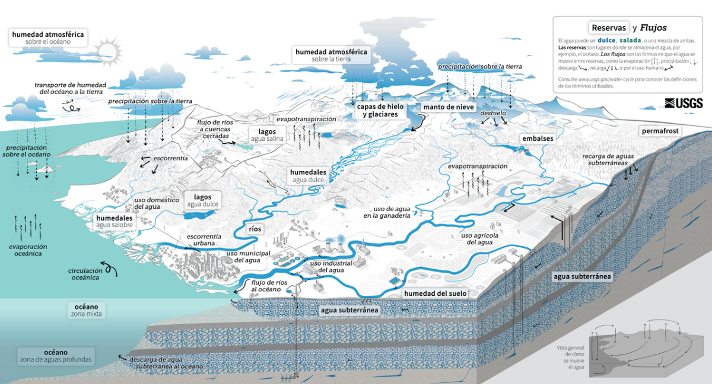
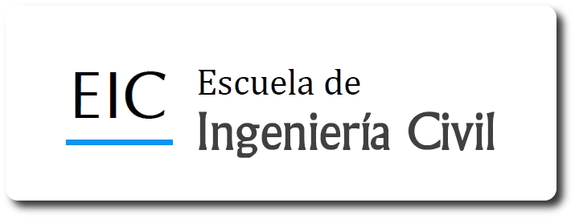

# Hidrología Aplicada a la Ingeniería Civil {.unnumbered .portada-titulo-oculto}

::: {.portada}

Escuela de Ingeniería Civil · Universidad de Costa Rica

Hidrología Aplicada a la Ingeniería Civil

Fundamentos, análisis estadístico y aplicaciones prácticas

Edwin Matarrita Segura

<figure class="portada-imagen">

<figcaption>Ilustración: Servicio Geológico de los Estados Unidos (USGS).</figcaption>
</figure>

Cómo citar

Matarrita Segura, E. (2026). <i>Hidrología aplicada a la ingeniería civil: fundamentos, análisis estadístico y aplicaciones prácticas</i>. Escuela de Ingeniería Civil, Universidad de Costa Rica.

Licencia

 Texto bajo licencia <a href="https://creativecommons.org/licenses/by-nc-sa/4.0/deed.es">Creative Commons Atribución-NoComercial-CompartirIgual 4.0</a>. El código R está bajo licencia <a href="https://github.com/ems270900/libro_hidrologia/blob/master/LICENSE-CODE">MIT</a> y puede copiarse y reutilizarse libremente.

:::
